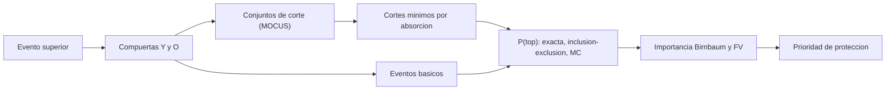

# B83-C24 — Árboles de fallos (FTA) y análisis de causas

<!-- nav:top -->
[🏠 Programa](../../../../README.md) · [📚 Bloque B83](../../../tronco-comun/B83-ingenieria-de-sistemas-y-diseno-de-misiones.md) · [← Anterior: B83-C23 — Redundancia y tolerancia a fallos de misión](../B83-C23-redundancia-y-tolerancia-a-fallos-de-mision/CLASE.md) · [Siguiente: B84-C01 — Entorno mecánico de lanzamiento →](../../../tronco-comun/B84-estructuras-materiales-y-fabricacion-espacial.md#b84-c01)
<!-- /nav -->

## 1. Ubicación, nivel y alcance

Clase 24 del bloque B83 (clase de la ampliación `0.2.0`). Nivel N3. Un **árbol de fallos** (FTA) parte de un evento no deseado (el *evento superior*) y lo descompone, con compuertas Y/O, en combinaciones de eventos básicos; permite hallar las combinaciones mínimas que lo causan y calcular su probabilidad. Es un análisis **deductivo** (de efecto a causas), complementario del FMEA de C22, que es inductivo. Aquí construyes un árbol **sintético** de «pérdida de control de actitud» de ESTRELLA-S con un evento repetido, obtienes los conjuntos mínimos de corte y calculas la probabilidad por tres vías. El manual de NASA (S4) refiere el análisis de escenarios, verosimilitudes y consecuencias; no se consultó ningún texto específico de FTA.

## 2. Por qué esta clase existe

Un fallo combinado como «dos sensores fallan a la vez» no aparece en una lista de modos individuales. La decisión central: **¿qué combinaciones de fallos causan el evento no deseado, cuál es su probabilidad y qué evento básico conviene proteger primero?**

## 3. Lo que podrás hacer al terminar

1. Construir un árbol con compuertas Y/O y un evento repetido.
2. Obtener los conjuntos de corte por expansión y reducirlos a mínimos por absorción.
3. Calcular la probabilidad del evento superior por enumeración exacta, por inclusión–exclusión y por Monte Carlo.
4. Comparar la aproximación de evento raro y la cota de cortes mínimos con el valor exacto.
5. Calcular la importancia de Birnbaum y de Fussell–Vesely y priorizar.
6. Rotular lo sintético y los supuestos (eventos independientes, probabilidades fijas).

La evidencia es la **árbol de fallos con cortes mínimos e importancia** del ejercicio 12 (sección 20).

## 4. Con qué llegas y cómo comprobarlo

1. ¿Qué es una compuerta Y?
2. ¿Qué es una compuerta O?
3. ¿Qué es un conjunto de corte?
4. ¿Qué es la absorción?
5. ¿Qué es un evento repetido?

<details>
<summary>Ver respuestas</summary>

1. El evento ocurre si ocurren todas sus entradas: producto de probabilidades. 2. El evento ocurre si ocurre alguna entrada. 3. Una combinación de eventos básicos cuya ocurrencia causa el evento superior. 4. Eliminar un conjunto de corte que contiene a otro más pequeño: `A + A·B = A`. 5. Un evento básico que aparece en más de una rama del árbol.
</details>

Con cuatro o cinco aciertos, sigue; si no, repasa los prerrequisitos.

## 5. Un caso de contexto y casos de referencia

El árbol sintético tiene 7 eventos básicos y 4 compuertas de nivel intermedio. La expansión da 5 conjuntos de corte y la absorción deja 4: dos de un solo evento (B7 y B5, puntos únicos de fallo) y dos pares (B1·B2 y B3·B4). La probabilidad del evento superior es 0,016132 por enumeración exacta de 128 estados, 0,016132 por inclusión–exclusión y 0,015777 por Monte Carlo; el evento raro da 0,016200 (error 0,42 %). El mayor contribuyente es **B5** (FV 0,616).

## 6. Vocabulario

Un **árbol de fallos** descompone un evento superior con compuertas Y y O hasta **eventos básicos**. Un **conjunto de corte** es una combinación que causa el evento superior; es **mínimo** si ningún subconjunto propio lo causa. **MOCUS** expande el árbol a conjuntos de corte. La **aproximación de evento raro** suma las probabilidades de los cortes; la **cota de cortes mínimos** es `1 − Π(1 − P(cᵢ))`. **Birnbaum** mide `P(top | i falla) − P(top | i no falla)`. **Fussell–Vesely** mide la fracción del riesgo que se elimina si `i` nunca falla.

## 7. Modelo mental: del evento superior a las prioridades



*Descripción textual:* el evento superior se descompone con compuertas en eventos básicos; la expansión da los conjuntos de corte, reducidos por absorción a mínimos; con ellos y las probabilidades se calcula `P(top)` por tres vías y la importancia indica qué proteger primero.

Analogía: un detective que parte del suceso y pregunta «¿qué combinaciones de causas lo habrían producido?». Límite: el detective trabaja con hechos; el árbol trabaja con probabilidades estimadas, y una estimación mala da un árbol engañoso.

## 8. La explicación, paso a paso

### 8.1 Estructura y cortes

`TOP = (B1·B2 + B7) + B3·B4 + (B5 + B6·B7)`. Al expandir aparecen 5 conjuntos: `{B1,B2}`, `{B7}`, `{B3,B4}`, `{B5}` y `{B6,B7}`. El último contiene a `{B7}`, así que se absorbe: quedan 4 mínimos, 2 de un solo evento. Los puntos únicos de fallo (B5, error de software, y B7, alimentación) dominan la probabilidad porque no tienen redundancia.

### 8.2 Probabilidad por tres vías

Con `P(B1…B7) = 0,02; 0,03; 0,06; 0,01; 0,01; 0,02; 0,005`, los cortes valen `10⁻²` (B5), `5×10⁻³` (B7), `6×10⁻⁴` (B1·B2) y `6×10⁻⁴` (B3·B4). La enumeración exacta de los 128 estados da 0,016132; la inclusión–exclusión, 0,016132; la aproximación de evento raro, 0,016200 (un 0,42 % de más); la cota de cortes mínimos, 0,016132 (aquí coincide porque los cortes mínimos no comparten eventos); Monte Carlo, 0,015777.

### 8.3 Importancia

B5 tiene FV 0,616: eliminarlo quita el 62 % del riesgo; B7, 0,306; B1, B2, B3 y B4, 0,037 cada uno. B6 tiene importancia 0 porque está absorbido: protegerlo no baja `P(top)`. Birnbaum separa la influencia estructural de la probabilidad: B7 y B5 tienen `B ≈ 0,99` (si fallan, el evento ocurre casi seguro).

## 9. Magnitudes, símbolos y unidades

| Símbolo | Qué es | Unidad | Valor / nota |
|---|---|---|---|
| `P(top)` | probabilidad del evento superior | — | 0,016132 |
| `n_cortes` | conjuntos mínimos de corte | — | 4 |
| `P_rara` | aproximación de evento raro | — | 0,016200 |
| `FV` | importancia de Fussell–Vesely | — | B5: 0,616 |
| `B` | importancia de Birnbaum | — | B5 y B7 ≈ 0,99 |
| `n_estados` | estados enumerados | — | 128 |

## 10. Convenciones y referencias

Sin constantes físicas ni sistema de referencia. Estructura del árbol y probabilidades **sintéticas** y eventos independientes. La probabilidad es de toda la misión. Monte Carlo: 400 000 muestras, semilla 83024. Tolerancias: exacta e inclusión–exclusión a `10⁻¹²`; Monte Carlo a `1,2×10⁻³` (cuatro desviaciones). Las técnicas de FTA (ECSS-Q-ST-40-12C, IEC 61025, NASA Fault Tree Handbook) **no se consultaron**.

## 11. De dónde sale lo que afirmamos

| ID | Fuente | Localizador | Respalda | Estado |
|---|---|---|---|---|
| S4 | NASA, *Systems Engineering Handbook*, 6.4 Technical Risk Management — https://www.nasa.gov/reference/6-4-technical-risk-management/ (consultada 2026-11-10) | sección 6.4, conceptos clave | el riesgo se describe con escenarios, verosimilitudes y consecuencias; los equipos analizan la fuente, consecuencia y verosimilitud de los riesgos | Consultada |
| ECSS | ECSS-E-ST-10C, ECSS-M-ST-40C, ECSS-Q-ST-30-02C, ECSS-Q-ST-40-12C y demás estándares (ecss.nl) | — | — | No consultada: la página de estándares no mostró los documentos |
| — | ISO/IEC/IEEE 15288, INCOSE, SysML, MIL-STD-1629, IEC 60812 e IEC 61025 | — | — | No consultada |
| — | Relaciones matemáticas estándar usadas en el laboratorio (AHP, rutas críticas, ley de Stefan, confiabilidad exponencial, cortes mínimos, ecuación del cohete) | — | — | No consultada en una fuente concreta: las verifica el laboratorio por una segunda vía |

Límites: no se consultó ningún texto de FTA; los métodos (MOCUS, absorción, importancias) son estándar y los verifica el laboratorio por tres vías; el manual S4 no menciona el FTA en la parte leída.

## 12. Cómo ver el árbol y sus cortes

| Magnitud | Valor |
|---|---|
| Cortes antes / después de absorber | 5 / 4 |
| Cortes de un solo evento | 2 (B5, B7) |
| P(top) exacta | 0,016132 |
| Evento raro / cota | 0,016200 / 0,016132 |
| Monte Carlo | 0,015777 |
| Mayor FV | B5 (0,616) |

Descripción larga: los dos puntos únicos de fallo explican más del 90 % del riesgo; los pares redundantes aportan poco; duplicar el software o la alimentación vale más que duplicar un sensor.

## 13. Ejemplo trabajado: probabilidad con dos cortes

**Paso 1 · Cortes.** `{B5}` con `0,01` y `{B7}` con `0,005`.

**Paso 2 · Unión.** `P = 0,01 + 0,005 − 0,01×0,005 = 0,01495`.

**Paso 3 · Con los pares.** Los pares aportan unos `1,2×10⁻³` más: total `≈ 0,016132`.

**Paso 4 · Comprobación.** La enumeración exacta de 128 estados da el mismo valor.

## 14. Distintas formas de abordar el problema

**Cortes mínimos e inclusión–exclusión** (esta clase). **Enumeración exacta** (segunda vía, solo viable con pocos eventos). **Monte Carlo** (tercera vía). **Diagramas de decisión binarios** (BDD) escalan a árboles grandes (no usados). Un FMEA (C22) alimenta los eventos básicos.

## 15. Práctica guiada

**Ejercicio 1 · con los pasos indicados.** Calcula la probabilidad de un corte `{B1,B2}` con `0,02` y `0,03`. *Pasos:* multiplica.

<details><summary>Solución comentada</summary>

`6×10⁻⁴`.
</details>

**Ejercicio 2 · con una pista.** ¿Por qué `{B6,B7}` no es un corte mínimo?

<details><summary>Solución comentada</summary>

Porque contiene a `{B7}`, que ya causa el evento por sí solo.
</details>

**Ejercicio 3 · casi autónomo.** Calcula `P(A ∪ B)` con `P(A) = 0,01`, `P(B) = 0,005` independientes.

<details><summary>Solución comentada</summary>

`0,01 + 0,005 − 0,00005 = 0,01495`.
</details>

## 16. Práctica autónoma, transferencia e integrador

**Ejercicio 4 · autónomo.** ¿Cuál es el error relativo de la aproximación de evento raro en este árbol?

<details><summary>Solución comentada</summary>

0,42 %.
</details>

**Ejercicio 5 · autónomo.** Si B5 baja de 0,01 a 0,001, ¿cuál es la nueva suma de cortes (evento raro)?

<details><summary>Solución comentada</summary>

`0,001 + 0,005 + 0,0006 + 0,0006 = 0,0072`.
</details>

**Ejercicio 6 · autónomo.** ¿Qué indica FV = 0 para B6?

<details><summary>Solución comentada</summary>

Que su protección no reduce `P(top)`, porque está absorbido por B7.
</details>

**Ejercicio 7 · autónomo.** Explica por qué el árbol y el FMEA se complementan.

<details><summary>Solución comentada</summary>

El FMEA va de componente a efecto; el árbol va del evento a combinaciones de causas.
</details>

**Ejercicio 8 · autónomo.** ¿Por qué el evento repetido B7 exige cuidado?

<details><summary>Solución comentada</summary>

Porque su ocurrencia afecta a dos ramas; tratarlo como independiente en cada rama daría una probabilidad errónea.
</details>

**Ejercicio 9 · transferencia.** **Transferencia.** Un colega usa 0,016132 como la probabilidad de perder el control de un satélite real. ¿Es válido?

<details><summary>Solución comentada</summary>

No: el árbol y las probabilidades son sintéticos.
</details>

**Ejercicio 10 · transferencia.** **Transferencia.** ¿Qué rediseño bajaría más `P(top)`?

<details><summary>Solución comentada</summary>

Duplicar o aislar B5 (software) y B7 (alimentación), que son puntos únicos de fallo; usa C23 para decidir el esquema.
</details>

**Ejercicio 11 · transferencia.** **Transferencia.** ¿Qué pasa con el árbol si B1 y B2 comparten el mismo defecto de diseño?

<details><summary>Solución comentada</summary>

Aparece una causa común que los une en un corte de un solo evento; hay que modelarla con un evento nuevo.
</details>

**Ejercicio 12 · integrador.** **Integrador.** Elabora tu *árbol de fallos con cortes mínimos e importancia*: estructura, cortes, probabilidad por tres vías, importancia y acciones, con lista de qué es sintético y no consultado.

<details><summary>Solución comentada</summary>

Secciones 8.1–8.3, el ejemplo 13 y la salida del laboratorio.
</details>

## 17. Laboratorio: árbol de fallos, cortes mínimos e importancia

El script [arbol_de_fallos.py](arbol_de_fallos.py) expande el árbol a conjuntos de corte, los reduce por absorción, calcula `P(top)` por enumeración exacta, por inclusión–exclusión y por Monte Carlo, y la importancia de cada evento (**comprueba** que exacta e inclusión–exclusión coinciden a `10⁻¹²`, que Monte Carlo queda a menos de `1,2×10⁻³` y que las dos aproximaciones son cotas superiores). Usa la biblioteca común [sistemas_comun.py](../sistemas_comun.py) del bloque.

**Datos:** todos **sintéticos** (estructura y probabilidades); sin constantes físicas; textos de FTA **no consultados**. **Predice antes de ejecutar:** ¿qué evento básico tiene la mayor importancia y cuántos cortes mínimos hay? (B5; cuatro.) **Ejecución del 2026-11-10 (Python 3.12.9 | numpy 2.4.4):**

```text
Python 3.12.9 | numpy 2.4.4
Datos SINTETICOS: 7 eventos basicos; TOP = (B1 Y B2) O B7 O (B3 Y B4) O B5 O (B6 Y B7)
Conjuntos de corte antes de la absorcion: 5 ; minimos: 4 (2 de un solo evento)
  {B7}  P = 5.000e-03
  {B5}  P = 1.000e-02
  {B3, B4}  P = 6.000e-04
  {B1, B2}  P = 6.000e-04
P(TOP) exacta por enumeracion de 128 estados = 0.01613171
P(TOP) por inclusion-exclusion de cortes = 0.01613171 ; diferencia 2.4e-17
Aproximacion de evento raro = 0.01620000 (error 0.423 %) ; cota de cortes minimos = 0.01613171
Monte Carlo (400000, semilla 83024) = 0.015777 ; diferencia con la exacta 3.5e-04
Importancia: B1 FV 0.037 B 0.0295, B2 FV 0.037 B 0.0197, B3 FV 0.037 B 0.0098, B4 FV 0.037 B 0.0591, B5 FV 0.616 B 0.9938, B6 FV 0.000 B 0.0000, B7 FV 0.306 B 0.9888
Mayor contribuyente (Fussell-Vesely): B5 (0.616)
Pruebas superadas.
```

```bash
python programa/clases/B83/B83-C24-arboles-de-fallos-fta-y-analisis-de-causas/arbol_de_fallos.py
```

**Límites:** siete eventos independientes; probabilidades fijas sin tiempo; sin compuertas de secuencia ni de prioridad; sin causas comunes; enumeración exacta solo viable con pocos eventos.

## 18. Errores frecuentes y cómo corregirlos

**No absorber los cortes.** Elimina los conjuntos que contienen a otro menor

**Tratar un evento repetido como independiente.** Usa cortes o enumeración sobre los eventos básicos

**Confundir FMEA con FTA.** El FMEA es inductivo; el FTA, deductivo

## 19. Cómo sabrás que vas bien

Tras 8.1: ¿qué cortes esperabas? Tras 8.3: ¿qué evento protegerías primero? Si dudas, repasa el ejemplo 13.

## 20. Qué entregas y cómo se evalúa

El producto es tu **árbol de fallos con cortes mínimos e importancia** (ejercicio 12).

| Criterio | Inicial | En desarrollo | Logrado | Destacado |
|---|---|---|---|---|
| Conceptos | Los confunde | Parciales | Explica el método y su dominio | Explica los límites y las alternativas |
| Cálculo | Sin unidades | Con errores | Resultados con unidades y comprobados | Resuelve casos nuevos |
| Numérico | Sin comprobar | Un caso | Verifica por una segunda vía en varios casos | Interpreta las diferencias y los fallos |
| Fuentes | Sin fuente | Sin fecha | Fuentes con fecha y estado | Declara lo sintético y lo no consultado |
| Límites | No los nombra | Uno | Tres | Discute qué falta del modelo |

**Condiciones críticas (no se compensan con promedio):** rotular los datos como sintéticos; verificar el resultado por una segunda vía; citar solo lo consultado.

## 21. Ética, seguridad y límites

Clase educativa: los modelos son simplificados y los datos son sintéticos; ningún resultado describe una misión real, certifica una seguridad ni sustituye a los estándares vigentes y a la revisión de especialistas.  Accesibilidad: tablas equivalentes a las gráficas, fórmulas en texto, ejercicios sin conexión.

## 22. Para cerrar y seguir

El árbol sintético de ESTRELLA-S da `P(top) =` 0,016132 con 4 cortes mínimos; los puntos únicos de fallo B5 y B7 dominan. Con esto se cierra el bloque: de la necesidad de misión al diseño preliminar y a su análisis de seguridad y confiabilidad. Siguen los bloques de estructuras y de gestión térmica (B84, B85).

**Glosario español–inglés.** árbol de fallos · *fault tree*; evento superior · *top event*; conjunto mínimo de corte · *minimal cut set*; evento raro · *rare event*; importancia de Fussell–Vesely · *Fussell–Vesely importance*.

**Continuidad.** El bloque B83 termina aquí; [B84](../../../tronco-comun/B84-estructuras-materiales-y-fabricacion-espacial.md) continúa con las estructuras, los materiales y la fabricación espacial.

**Referencias:** ver sección 11.

<!-- nav:bottom -->
---

[← Anterior: B83-C23 — Redundancia y tolerancia a fallos de misión](../B83-C23-redundancia-y-tolerancia-a-fallos-de-mision/CLASE.md) · [📚 Bloque B83](../../../tronco-comun/B83-ingenieria-de-sistemas-y-diseno-de-misiones.md) · [Siguiente: B84-C01 — Entorno mecánico de lanzamiento →](../../../tronco-comun/B84-estructuras-materiales-y-fabricacion-espacial.md#b84-c01)
<!-- /nav -->
