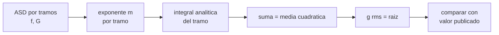

# B84-C01 — Entorno mecánico de lanzamiento

<!-- nav:top -->
[🏠 Programa](../../../../README.md) · [📚 Bloque B84](../../../tronco-comun/B84-estructuras-materiales-y-fabricacion-espacial.md) · [← Anterior: B83-C24 — Árboles de fallos (FTA) y análisis de causas](../../../tronco-comun/B83-ingenieria-de-sistemas-y-diseno-de-misiones.md#b83-c24) · [Siguiente: B84-C02 — Propiedades de aleaciones →](../B84-C02-propiedades-de-aleaciones/CLASE.md)
<!-- /nav -->

## 1. Ubicación, nivel y alcance

Clase 1 del bloque B84. Nivel N3. Un lanzamiento sacude el satélite con vibración aleatoria, acústica, choques y cargas cuasiestáticas. Aquí te quedas con la vibración aleatoria: cómo se especifica con una densidad espectral de aceleración (ASD) y cómo se convierte en un valor eficaz (`g` rms) que puedes contrastar con los niveles del estándar GEVS de la NASA/GSFC. Es la puerta de entrada del bloque; las clases C10, C11 y C32 profundizan en modos, resonancia y señales aleatorias. Los pesos de los componentes de ejemplo son ilustrativos.

## 2. Por qué esta clase existe

Un satélite no falla en órbita por el empuje del motor sino por la sacudida de la subida; esa sacudida se especifica con un espectro, no con un número. Un espectro con 0,16 g²/Hz de meseta no dice nada hasta que se integra. La decisión central: **¿qué aceleración eficaz representa un espectro de ensayo y cómo cambia al variar la masa del componente?**

## 3. Lo que podrás hacer al terminar

1. Distinguir las componentes del entorno mecánico de un lanzamiento (cuasiestática, sinusoidal, aleatoria, acústica, choque).
2. Leer un perfil de ASD y sus pendientes en dB por octava.
3. Integrar analíticamente una ASD lineal a tramos en escala log-log.
4. Obtener el valor `g` rms y compararlo con el publicado en el GEVS.
5. Aplicar la reducción de meseta por masa de la Tabla 2.4-3.
6. Separar lo consultado (niveles del GEVS) de lo ilustrativo (masas de ejemplo).

La evidencia es la **tabla de niveles de vibración aleatoria con su `g` rms** del ejercicio 12 (sección 20).

## 4. Con qué llegas y cómo comprobarlo

1. ¿Qué es el valor eficaz (rms) de una señal?
2. ¿Qué significa una octava?
3. ¿Qué es una densidad espectral?
4. ¿Cuántos dB son un factor 4 en potencia?
5. ¿Qué es un dato ilustrativo?

<details>
<summary>Ver respuestas</summary>

1. La raíz cuadrada del promedio del cuadrado de la señal. 2. Una duplicación de la frecuencia. 3. La potencia (aquí aceleración al cuadrado) por unidad de frecuencia, en g²/Hz. 4. Unos 6 dB. 5. Un valor inventado para el ejemplo, no medido ni consultado.
</details>

Con cuatro o cinco aciertos, sigue; si no, repasa los prerrequisitos.

## 5. Un caso de contexto y casos de referencia

Un componente de 22,7 kg o menos, para un lanzador no tripulado, se ensaya a nivel de calificación con la ASD de la Tabla 2.4-3 del GEVS: `0,026 g²/Hz` en 20 Hz, subida de +6 dB/oct hasta 50 Hz, meseta de `0,16 g²/Hz` de 50 a 800 Hz y bajada de −6 dB/oct hasta `0,026 g²/Hz` en 2000 Hz. El GEVS publica un total de `14,1 g rms`; el laboratorio lo recalcula y obtiene `14,136`. **Ejemplo conductor.** Los niveles son valores consultados del estándar; las masas de 35 y 59 kg son ilustrativas.

## 6. Vocabulario

La **ASD** (*acceleration spectral density*) es `G(f)` en g²/Hz. El **valor eficaz** es `g_rms = √(∫ G(f) df)`. Una pendiente de `N` dB/oct equivale a `G ∝ f^m` con `m = N/3,01`: +6 dB/oct es `f²`, +3 dB/oct es `f`. **Calificación** es el ensayo a nivel superior al de vuelo; **aceptación** el de la unidad de vuelo; **mano de obra mínima** (*workmanship*) el nivel mínimo para detectar defectos de fabricación.

## 7. Modelo mental: una gráfica de potencia por colores de ruido



*Descripción textual:* el perfil de ASD se parte en tramos, en cada tramo se halla el exponente de `f`, se integra y se suma el área; la raíz del área es el `g` rms que se compara con el valor del estándar.

Analogía: el espectro es como la lista de cuánto ruido hay en cada nota de un piano; el valor eficaz es el volumen total que oyes al sumar todas. Límite: la ASD describe una señal gaussiana estacionaria; un choque o un transitorio no se resume con ella.

## 8. La explicación, paso a paso

### 8.1 Qué entorno es y qué parte es esta clase

El lanzamiento combina cargas cuasiestáticas (aceleración sostenida), transitorios de baja frecuencia, vibración sinusoidal, vibración aleatoria transmitida por la estructura, ruido acústico y choques de separación. El GEVS indica que los niveles de ensayo de componentes se toman de tablas genéricas cuando no hay un entorno propio. Esta clase usa solo la vibración aleatoria.

### 8.2 Integrar una ASD a tramos

En un tramo entre `(f₁, G₁)` y `(f₂, G₂)` el exponente es `m = ln(G₂/G₁)/ln(f₂/f₁)` y el área es `G₁/f₁^m · (f₂^(m+1) − f₁^(m+1))/(m+1)` (con `m = −1` el área es `G₁ f₁ ln(f₂/f₁)`). Para la Tabla 2.4-3 los exponentes salen `1,98; 0; −1,98` (los extremos publicados están redondeados a 0,026 y no a 0,0256). Meseta: `0,16 × (800 − 50) = 120 g²`. Subida (`m = 1,98`): `0,16 × 50/2,98 × (1 − (20/50)^2,98) = 2,51`. Bajada (`m = −1,98`): `0,16 × 800/(−0,98) × ((2000/800)^(−0,98) − 1) = 77,4`. Suma ≈ 199,9 g² y `√199,9 = 14,14`.

### 8.3 Tres perfiles

| Perfil | `g` rms calculado | `g` rms publicado |
|---|---|---|
| Calificación (Tabla 2.4-3) | 14,136 | 14,1 |
| Aceptación (Tabla 2.4-3) | 9,995 | 10,0 |
| Mano de obra mínima (Tabla 2.4-4) | 6,784 | 6,8 |

La aceptación es la mitad de la ASD (−3 dB) y su `g` rms es `14,14/√2 ≈ 10,0`. La Tabla 2.4-4 usa +3 dB/oct y −3 dB/oct y una meseta de `0,04 g²/Hz` de 80 a 500 Hz.

### 8.4 Reducción por masa

Para componentes de más de 22,7 kg la meseta baja con `0,16 × 22,7/W`. Con `W = 35 kg` la meseta es `0,1038 g²/Hz` (reducción de 1,88 dB) y el valor eficaz cae a `11,38 g rms`; con 59 kg, a `8,77 g rms`. Los pesos son ilustrativos. La razón: un equipo pesado carga más la mesa y recibe menos aceleración.

### 8.5 Lo que NO te dice un `g` rms

Un `g` rms no es una carga de diseño: la respuesta depende de los modos de la estructura (C10, C11, C32). `3σ` de `14,14 g` es `42,4 g`, un pico de mesa y no una carga límite.

## 9. Magnitudes, símbolos y unidades

| Símbolo | Qué es | Unidad | Valor / nota |
|---|---|---|---|
| `f` | frecuencia | Hz | 20–2000 |
| `G(f)` | ASD de aceleración | g²/Hz | 0,16 de meseta (calificación) |
| `m` | exponente de `f` en el tramo | — | 1,98; 0; −1,98 |
| `g_rms` | valor eficaz | g | 14,14; 9,995; 6,784 |
| `W` | masa del componente | kg | ilustrativo: 35; 59 |
| `gₙ` | gravedad estándar | m/s² | 9,806 65 (NIST) |

## 10. Convenciones y referencias

Frecuencias en Hz, ASD en g²/Hz y `g` rms en múltiplos de `gₙ = 9,806 65 m/s²`. Escala log-log lineal por tramos. Los niveles son los de las Tablas 2.4-3 y 2.4-4 del GEVS (Versión B). Tolerancia del laboratorio: diferencia con el valor publicado menor de 0,05 `g` rms.

## 11. De dónde sale lo que afirmamos

| ID | Fuente | Localizador | Respalda | Estado |
|---|---|---|---|---|
| S1 | NASA/GSFC, GSFC-STD-7000 (GEVS) Versión B, Cambio 0, 2021-04-28 — https://standards.nasa.gov/standard/gsfc/gsfc-std-7000 (PDF descargado y leído con PyMuPDF el 2026-11-10) | Tablas 2.4-3 y 2.4-4 (páginas 70 y 71 del PDF) | niveles de ASD, pendientes, valores totales de 14,1, 10,0 y 6,8 g rms y regla de reducción por masa | Consultada |
| S2 | NIST, CODATA, aceleración estándar de la gravedad — https://physics.nist.gov/cgi-bin/cuu/Value?gn (consultada 2026-11-10) | valor de `gₙ` | `gₙ` = 9,806 65 m/s² (exacto por definición) | Consultada |
| — | Perfil real de un lanzador concreto (manual de usuario del lanzador) | — | no se consultó ningún manual de lanzador; los niveles del GEVS son genéricos | No consultada en una fuente concreta |

Límites: solo se leyeron las tablas citadas del GEVS; no se consultó ningún entorno de un lanzador específico; las masas de 35 y 59 kg son ilustrativas.

## 12. Cómo ver un perfil de vibración

| Magnitud | Valor |
|---|---|
| Meseta de calificación | 0,16 g²/Hz |
| `g` rms calificación | 14,136 |
| `g` rms aceptación | 9,995 |
| `g` rms mano de obra | 6,784 |
| Meseta con 35 kg | 0,1038 g²/Hz |

Descripción larga: el perfil sube con `f²` hasta 50 Hz, se mantiene hasta 800 Hz y baja con `f⁻²`; casi toda el área está en la meseta.

## 13. Ejemplo trabajado: el valor eficaz del perfil de aceptación

**Paso 1 · Meseta.** `0,08 g²/Hz × 750 Hz = 60 g²`.

**Paso 2 · Rampas.** La subida aporta `1,25 g²` y la bajada (`m = −1,98`) `0,08 × 800/(−0,98) × ((2000/800)^(−0,98) − 1) = 38,7 g²`.

**Paso 3 · Total.** `60 + 1,25 + 38,7 = 99,9 g²`; el valor eficaz es `√99,9 = 9,995 g`, el 10,0 publicado.

## 14. Distintas formas de describir un entorno de vibración

**Por espectro:** `G(f)`. **Por valor global:** `g_rms`. **Por pico:** `3 g_rms`. **Por nivel relativo:** dB sobre aceptación. **Por masa:** meseta reducida.

## 15. Práctica guiada

**Ejercicio 1 · con los pasos indicados** Calcula el exponente de `f` entre 800 y 2000 Hz con `G` de 0,16 a 0,026 g²/Hz. *Pasos:* `ln(0,026/0,16)/ln(2000/800)`.

<details><summary>Solución comentada</summary>

`ln(0,1625)/ln(2,5) = −1,98`: unos −6 dB/oct.
</details>

**Ejercicio 2 · con los pasos indicados** ¿Cuánto vale la meseta de calificación para 35 kg? *Pista:* `0,16 × 22,7/W`.

<details><summary>Solución comentada</summary>

`0,1038 g²/Hz`; reducción `10 log(35/22,7) = 1,88 dB`.
</details>

**Ejercicio 3 · con los pasos indicados** ¿Por qué el `g` rms de aceptación es el de calificación dividido por `√2`? *Casi autónomo.*

<details><summary>Solución comentada</summary>

Porque la ASD aceptación es la mitad (−3 dB) y el rms es la raíz del área.
</details>

## 16. Práctica autónoma, transferencia e integrador

**Ejercicio 4 · autónomo** Valor eficaz de una meseta de `0,04 g²/Hz` entre 20 y 2000 Hz.

<details><summary>Solución comentada</summary>

`√(0,04 × 1980) = 8,90 g`.
</details>

**Ejercicio 5 · autónomo** Reducción en dB para un componente de 59 kg.

<details><summary>Solución comentada</summary>

`10 log(59/22,7) = 4,15 dB`.
</details>

**Ejercicio 6 · autónomo** Pico `3σ` del perfil de calificación.

<details><summary>Solución comentada</summary>

`3 × 14,14 = 42,4 g`.
</details>

**Ejercicio 7 · autónomo** Cociente de las ASD de calificación y aceptación en dB.

<details><summary>Solución comentada</summary>

`10 log 2 = 3,01 dB`.
</details>

**Ejercicio 8 · autónomo** ¿Qué `m` corresponde a +3 dB/oct?

<details><summary>Solución comentada</summary>

`m = 3/3,01 ≈ 1`: `G ∝ f`.
</details>

**Ejercicio 9 · transferencia. **Transferencia.**** Un proveedor da solo `14 g rms` sin espectro. ¿Basta?

<details><summary>Solución comentada</summary>

No: perfiles muy distintos dan el mismo `g` rms; el espectro decide qué modos se excitan.
</details>

**Ejercicio 10 · transferencia. **Transferencia.**** Un equipo de 100 kg usa la meseta de 22,7 kg. ¿Qué error comete?

<details><summary>Solución comentada</summary>

Ensayo excesivo en 6,4 dB sobre el nivel reducido: sobrediseño y riesgo de daño.
</details>

**Ejercicio 11 · transferencia. **Transferencia.**** ¿Puede un perfil de la Tabla 2.4-3 sustituir el entorno del lanzador elegido?

<details><summary>Solución comentada</summary>

No: es genérico; sirve de punto de partida y mínimo.
</details>

**Ejercicio 12 · integrador. **Integrador.**** Elabora tu *tabla de niveles de vibración aleatoria con su `g` rms*: los tres perfiles, el valor calculado y el publicado, la reducción por masa y qué es consultado e ilustrativo.

<details><summary>Solución comentada</summary>

Secciones 8.2–8.4 y la salida del laboratorio.
</details>

## 17. Laboratorio: niveles del GEVS y su valor eficaz

El script [lanzamiento.py](lanzamiento.py) integra los perfiles de la Tabla 2.4-3 y 2.4-4 y la reducción por masa (**comprueba** coincidencia con 14,1, 10,0 y 6,8 g rms dentro de 0,05 y exponentes de 1,98).

**Datos:** niveles del GEVS (consultados); masas ilustrativas. **Predice antes de ejecutar:** ¿qué `g` rms dará el perfil de mano de obra mínima? (≈ 6,8). **Ejecución del 2026-11-10 (Python 3.12.9):**

```text
Python 3.12.9 (biblioteca estandar)
Perfil                                  g rms calc   g rms publicado   dif
Calificacion (Tabla 2.4-3)                14.136            14.1     0.036
Aceptacion (Tabla 2.4-3)                   9.995            10.0    -0.005
Mano de obra minima (Tabla 2.4-4)          6.784             6.8    -0.016
Exponentes de f (ASD ~ f^m) Cal: 1.98, 0.00, -1.98
Exponentes de f (ASD ~ f^m) Mano: 1.00, 0.00, -1.00
Reduccion de la meseta de calificacion con la masa (masas ILUSTRATIVAS):
  W =  22.7 kg  meseta = 0.1600 g2/Hz  dB de reduccion =  0.00  g rms = 14.14
  W =  35.0 kg  meseta = 0.1038 g2/Hz  dB de reduccion =  1.88  g rms = 11.38
  W =  59.0 kg  meseta = 0.0616 g2/Hz  dB de reduccion =  4.15  g rms = 8.77
Fuerza 3-sigma sobre 35 kg con 14.14 g rms (cota de mesa, no carga de diseno): 14555 N
Pruebas superadas.
```

```bash
python programa/clases/B84/B84-C01-entorno-mecanico-de-lanzamiento/lanzamiento.py
```

**Límites:** la ASD describe una vibración gaussiana estacionaria; no es una carga de diseño ni representa a un lanzador concreto.

## 18. Errores frecuentes y cómo corregirlos

**Tomar el `g` rms como carga de diseño.** Se corrige con 8.5.

**Sumar `g` rms de varios perfiles linealmente.** Se suman las áreas (potencias), no los `g`.

**Confundir dB/oct con dB/década.** Se corrige con el vocabulario.

**Usar la meseta de 22,7 kg para un equipo pesado.** Se corrige con 8.4.

## 19. Cómo sabrás que vas bien

Tras la sección 8: ¿qué `g` rms esperabas para la aceptación y cuál obtuviste? Si dudas, repasa el ejemplo 13. Tras el laboratorio: ¿qué comprueba? (ver la sección 17).

## 20. Qué entregas y cómo se evalúa

El producto es tu **tabla de niveles de vibración aleatoria con su `g` rms** (ejercicio 12).

| Criterio | Inicial | En desarrollo | Logrado | Destacado |
|---|---|---|---|---|
| Conceptos | Los confunde | Parciales | Integra una ASD y la compara con el estándar | Explica los límites |
| Cálculo | Sin unidades | Con errores | Tablas completas con unidades | Calcula casos nuevos |
| Numérico | Sin comprobar | Un caso | Contraste con una segunda vía | Interpreta las diferencias |
| Fuentes | Sin fuente | Sin fecha | Fuentes con fecha y estado | Declara lo ilustrativo y lo no consultado |
| Límites | No los nombra | Uno | Tres | Discute qué falta del modelo |

**Condiciones críticas (no se compensan con promedio):** rotular los datos ilustrativos y sintéticos como tales; no presentar un cálculo como ensayo ni como dato de vuelo; citar solo lo consultado.

## 21. Ética, seguridad y límites

Clase educativa: los modelos son simplificados y sus datos son sintéticos, ilustrativos o valores de estándar rotulados; **no es una base de diseño de hardware de vuelo** y ningún resultado sustituye a datos de material cualificados, a los documentos vigentes de la agencia o del lanzador ni a la revisión por personal competente. Accesibilidad: tablas equivalentes a las gráficas, fórmulas en texto, ejercicios sin conexión.

## 22. Para cerrar y seguir

Un espectro de 0,16 g²/Hz de meseta equivale a `14,14 g rms` y la masa lo reduce. Queda una pregunta: ¿de qué material está hecha la estructura que recibe esa sacudida?

**Glosario español–inglés.** densidad espectral de aceleración · *acceleration spectral density (ASD)*; valor eficaz · *root mean square*; calificación · *qualification*; aceptación · *acceptance*; mano de obra · *workmanship*.

**Continuidad.** [B84-C02](../B84-C02-propiedades-de-aleaciones/CLASE.md) estudia las propiedades de las aleaciones.

**Referencias:** ver sección 11.

<!-- nav:bottom -->
---

[← Anterior: B83-C24 — Árboles de fallos (FTA) y análisis de causas](../../../tronco-comun/B83-ingenieria-de-sistemas-y-diseno-de-misiones.md#b83-c24) · [📚 Bloque B84](../../../tronco-comun/B84-estructuras-materiales-y-fabricacion-espacial.md) · [Siguiente: B84-C02 — Propiedades de aleaciones →](../B84-C02-propiedades-de-aleaciones/CLASE.md)
<!-- /nav -->
