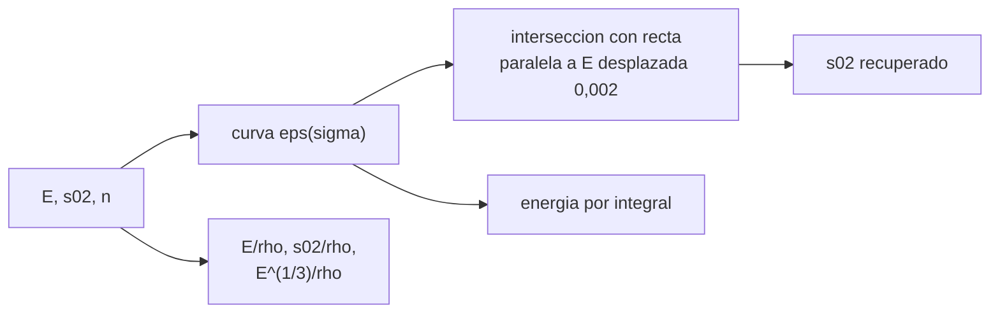

# B84-C02 — Propiedades de aleaciones

<!-- nav:top -->
[🏠 Programa](../../../../README.md) · [📚 Bloque B84](../../../tronco-comun/B84-estructuras-materiales-y-fabricacion-espacial.md) · [← Anterior: B84-C01 — Entorno mecánico de lanzamiento](../B84-C01-entorno-mecanico-de-lanzamiento/CLASE.md) · [Siguiente: B84-C03 — Materiales compuestos →](../B84-C03-materiales-compuestos/CLASE.md)
<!-- /nav -->

## 1. Ubicación, nivel y alcance

Clase 2 del bloque B84. Nivel N3. Las aleaciones de aluminio, titanio, níquel y acero son la base de las estructuras espaciales. Aquí lees una curva tensión–deformación con el modelo de Ramberg–Osgood, obtienes el límite elástico al 0,2 % y calculas índices específicos de rigidez y resistencia. Preparas C05 (selección) y C22 (elasticidad). Los datos de las cuatro aleaciones son valores típicos **ilustrativos**, no valores de diseño.

## 2. Por qué esta clase existe

Dos aleaciones con la misma rigidez específica pueden diferir en 7 veces su resistencia específica (Ti frente a acero 304); elegir por una sola propiedad lleva a un mal diseño. La decisión central: **¿qué aleación es mejor según el índice que importa a la pieza, y qué significa el límite elástico al 0,2 %?**

## 3. Lo que podrás hacer al terminar

1. Describir el comportamiento elástico y plástico de una aleación.
2. Evaluar la curva de Ramberg–Osgood `ε = σ/E + 0,002 (σ/σ₀,₂)ⁿ`.
3. Hallar el límite elástico al 0,2 % por intersección numérica con la recta paralela.
4. Calcular rigidez específica, resistencia específica y energía de resiliencia.
5. Comparar cuatro aleaciones con tres índices distintos.
6. Separar valores típicos ilustrativos de valores de diseño certificados.

La evidencia es la **ficha de propiedades de cuatro aleaciones** del ejercicio 12 (sección 20).

## 4. Con qué llegas y cómo comprobarlo

1. ¿Qué es el módulo de Young?
2. ¿Qué es una deformación unitaria?
3. ¿Qué es la densidad y su unidad?
4. ¿Qué es un límite elástico?
5. ¿Qué es un dato ilustrativo?

<details>
<summary>Ver respuestas</summary>

1. La pendiente tensión/deformación en el tramo elástico, en Pa. 2. El cambio de longitud dividido por la longitud inicial; adimensional. 3. Masa por volumen, en kg/m³. 4. La tensión a la que empieza la deformación permanente. 5. Un valor típico o inventado, no consultado ni medido.
</details>

Con cuatro o cinco aciertos, sigue; si no, repasa los prerrequisitos.

## 5. Un caso de contexto y casos de referencia

Se comparan Al 6061-T6, Ti-6Al-4V, Inconel 718 y acero 304 recocido con `E`, `ρ`, `σ₀,₂` y `n` típicos. El Ti-6Al-4V tiene `σ₀,₂/ρ = 198,6 kN·m/kg` frente a `101,9` del aluminio, pero el aluminio gana en el índice de panel rígido `E^(1/3)/ρ` con `1,519`. **Ejemplo conductor.** Todo es **ilustrativo**: valores típicos redondeados, no certificados.

## 6. Vocabulario

El **límite elástico al 0,2 %** `σ₀,₂` es la tensión a la que la deformación plástica residual sería 0,002. **Ramberg–Osgood** describe toda la curva con `E`, `σ₀,₂` y el exponente de endurecimiento `n`. La **rigidez específica** es `E/ρ`; la **resistencia específica**, `σ₀,₂/ρ`; la **resiliencia**, `σ₀,₂²/(2E)`.

## 7. Modelo mental: una goma elástica que se alarga y ya no vuelve



*Descripción textual:* los tres parámetros generan la curva; se halla el límite al 0,2 % por intersección y se calculan los índices específicos y la energía.

Analogía: la goma que se estira y vuelve hasta cierto punto y luego queda alargada. Límite: el modelo de Ramberg–Osgood ajusta una curva monótona y no describe el ciclo, la fatiga ni la temperatura.

## 8. La explicación, paso a paso

### 8.1 La curva

`ε = σ/E + 0,002 (σ/σ₀,₂)ⁿ`. Con `σ = σ₀,₂` la parte plástica es exactamente `0,002`. Para Al 6061-T6 (`E = 69 GPa`, `σ₀,₂ = 275 MPa`, `n = 20`) la deformación total en `σ₀,₂` es `275/69000 + 0,002 = 0,5986 %`. El laboratorio halla `σ₀,₂` por bisección (error 0) como control del código; no valida el material.

### 8.2 Índices específicos

| Aleación | `E/ρ` (MN·m/kg) | `σ₀,₂/ρ` (kN·m/kg) | `E^(1/3)/ρ` (GPa^(1/3) por Mg/m³) |
|---|---|---|---|
| Al 6061-T6 | 25,56 | 101,9 | 1,519 |
| Ti-6Al-4V | 25,73 | 198,6 | 1,095 |
| Inconel 718 | 24,42 | 125,8 | 0,714 |
| Acero 304 | 24,12 | 26,9 | 0,722 |

La rigidez específica `E/ρ` es casi igual en las cuatro (≈ 24–26 MN·m/kg): ninguna aleación es más rígida por kilo. Cambia la resistencia específica (Ti gana) y el índice de panel (Al gana).

### 8.3 Resiliencia y energía

La energía elástica almacenada hasta `σ₀,₂` es `σ₀,₂²/(2E)`: `548 kJ/m³` en el aluminio y `3396 kJ/m³` en el Ti. Con la parte plástica incluida la energía complementaria es `574,198 kJ/m³` en el aluminio; el trapecio y la fórmula cerrada coinciden.

### 8.4 Cuándo manda cada índice

Un tirante (tracción) se elige por `σ₀,₂/ρ`; un panel rígido a flexión, por `E^(1/3)/ρ`; una columna delgada, por `E^(1/2)/ρ`. Por eso no hay una «mejor aleación» sin decir la función.

## 9. Magnitudes, símbolos y unidades

| Símbolo | Qué es | Unidad | Valor / nota |
|---|---|---|---|
| `E` | módulo de Young | Pa | 69 GPa (Al, ilustrativo) |
| `ρ` | densidad | kg/m³ | 2700 (Al) |
| `σ₀,₂` | límite elástico al 0,2 % | Pa | 275 MPa (Al) |
| `n` | exponente de Ramberg–Osgood | — | 20 (Al) |
| `E/ρ` | rigidez específica | MN·m/kg | 25,56 (Al) |
| `σ₀,₂/ρ` | resistencia específica | kN·m/kg | 101,9 (Al) |

## 10. Convenciones y referencias

SI. Valores típicos redondeados, ilustrativos y a temperatura ambiente. No sustituyen a valores de diseño de una base de datos cualificada de materiales. Curva monótona en tracción uniaxial.

## 11. De dónde sale lo que afirmamos

| ID | Fuente | Localizador | Respalda | Estado |
|---|---|---|---|---|
| — | Propiedades típicas de Al 6061-T6, Ti-6Al-4V, Inconel 718 y acero 304; ley de Ramberg–Osgood | — | los valores de `E`, `ρ`, `σ₀,₂` y `n` y la forma de la curva | No consultada en una fuente concreta |

Límites: los valores de las aleaciones son típicos e ilustrativos y no se consultaron en una fuente concreta; no son valores de diseño ni de vuelo.

## 12. Cómo ver la comparación de aleaciones

| Magnitud | Valor |
|---|---|
| `σ₀,₂/ρ` Ti-6Al-4V | 198,6 kN·m/kg |
| `σ₀,₂/ρ` Al 6061-T6 | 101,9 kN·m/kg |
| `E^(1/3)/ρ` Al | 1,519 |
| `E/ρ` Ti | 25,73 MN·m/kg |
| Resiliencia Ti | 3396 kJ/m³ |

Descripción larga: la rigidez específica es casi igual en las cuatro aleaciones; la resistencia específica del titanio es casi el doble que la del aluminio.

## 13. Ejemplo trabajado: la deformación total del Ti-6Al-4V en su límite

**Paso 1 · Parte elástica.** `880e6/114e9 = 0,772 %`.

**Paso 2 · Parte plástica.** `0,002 × (1)²⁵ = 0,2 %`.

**Paso 3 · Total.** `0,9719 %`, igual que el laboratorio.

## 14. Distintas formas de describir una aleación

**Por curva:** `σ(ε)`. **Por parámetros:** `E`, `σ₀,₂`, `n`. **Por índices:** `E/ρ`, `σ₀,₂/ρ`. **Por energía:** resiliencia.

## 15. Práctica guiada

**Ejercicio 1 · con los pasos indicados** Calcula `E/ρ` del acero 304 (`193 GPa`, `8000 kg/m³`). *Pasos:* divide y expresa en MN·m/kg.

<details><summary>Solución comentada</summary>

`193e9/8000 = 24,1 MN·m/kg`.
</details>

**Ejercicio 2 · con los pasos indicados** ¿Cuál es la deformación plástica a `σ = σ₀,₂`? *Pista:* mira el segundo término.

<details><summary>Solución comentada</summary>

`0,002` por definición.
</details>

**Ejercicio 3 · con los pasos indicados** ¿Por qué el titanio y el aluminio casi empatan en `E/ρ`? *Casi autónomo.*

<details><summary>Solución comentada</summary>

Porque `E` del titanio es 1,65 veces el del aluminio y su `ρ` es 1,64 veces mayor.
</details>

## 16. Práctica autónoma, transferencia e integrador

**Ejercicio 4 · autónomo** Resiliencia del Inconel 718.

<details><summary>Solución comentada</summary>

`(1030e6)²/(2 × 200e9) = 2652 kJ/m³`.
</details>

**Ejercicio 5 · autónomo** `σ₀,₂/ρ` del aluminio.

<details><summary>Solución comentada</summary>

`275e6/2700 = 101,9 kN·m/kg`.
</details>

**Ejercicio 6 · autónomo** Deformación elástica del acero en `σ₀,₂`.

<details><summary>Solución comentada</summary>

`215e6/193e9 = 0,111 %`.
</details>

**Ejercicio 7 · autónomo** Si `n` sube de 7 a 20, ¿qué le pasa al codo de la curva?

<details><summary>Solución comentada</summary>

Se hace más brusco: el material se comporta casi elastoplástico perfecto.
</details>

**Ejercicio 8 · autónomo** Índice de columna `E^(1/2)/ρ` del aluminio frente al titanio.

<details><summary>Solución comentada</summary>

Al: `8,31/2,7 = 3,08`; Ti: `10,68/4,43 = 2,41`.
</details>

**Ejercicio 9 · transferencia. **Transferencia.**** Un diseñador elige titanio por `E/ρ`. ¿Es válida la razón?

<details><summary>Solución comentada</summary>

No: casi empata con el aluminio; la ventaja del titanio es la resistencia específica.
</details>

**Ejercicio 10 · transferencia. **Transferencia.**** Un catálogo da `σ₀,₂` como «típico». ¿Puede usarse como valor de diseño?

<details><summary>Solución comentada</summary>

No: se necesita un valor mínimo garantizado (valor A o B) de una base cualificada.
</details>

**Ejercicio 11 · transferencia. **Transferencia.**** ¿Qué hay que añadir a la curva para estudiar fatiga?

<details><summary>Solución comentada</summary>

Ciclos, tensión media y la curva S–N, que Ramberg–Osgood no da (C08).
</details>

**Ejercicio 12 · integrador. **Integrador.**** Elabora tu *ficha de propiedades de cuatro aleaciones*: tabla de `E/ρ`, `σ₀,₂/ρ`, `E^(1/3)/ρ` y resiliencia, el control de `σ₀,₂` y qué es ilustrativo.

<details><summary>Solución comentada</summary>

Secciones 8.1–8.4 y la salida del laboratorio.
</details>

## 17. Laboratorio: curva de Ramberg–Osgood e índices de cuatro aleaciones

El script [aleaciones.py](aleaciones.py) evalúa la curva, halla `σ₀,₂` por bisección, calcula los índices y compara la energía por trapecio con la fórmula cerrada (**comprueba** `σ₀,₂` recuperado con error < 1e-9 y energía numérica frente a analítica < 1e-6).

**Datos:** propiedades típicas **ilustrativas**, no consultadas. **Predice antes de ejecutar:** ¿qué aleación gana en `E^(1/3)/ρ`? (el aluminio.) **Ejecución del 2026-11-10 (Python 3.12.9):**

```text
Python 3.12.9 (biblioteca estandar)
Aleaciones con datos ILUSTRATIVOS (valores tipicos, no consultados)
aleacion         E/rho   s02/rho    E^1/3/rho  resil. [kJ/m3]   (E/rho en MN m/kg; s02/rho en kN m/kg; E^1/3/rho en GPa^1/3 por Mg/m3)
Al 6061-T6       25.56     101.9        1.519           548.0
Ti-6Al-4V        25.73     198.6        1.095          3396.5
Inconel 718      24.42     125.8        0.714          2652.2
Acero 304        24.12      26.9        0.722           119.8
Limite elastico al 0,2 % (biseccion) frente al dato de entrada:
  Al 6061-T6   sigma =  275.000 MPa  eps total = 0.5986 %  error relativo = 0.0e+00
  Ti-6Al-4V    sigma =  880.000 MPa  eps total = 0.9719 %  error relativo = 0.0e+00
  Inconel 718  sigma = 1030.000 MPa  eps total = 0.7150 %  error relativo = 0.0e+00
  Acero 304    sigma =  215.000 MPa  eps total = 0.3114 %  error relativo = 0.0e+00
Energia complementaria hasta sigma_0.2 (trapecio frente a formula cerrada):
  Al 6061-T6   numerica =   574.198 kJ/m3  analitica =   574.198 kJ/m3
  Ti-6Al-4V    numerica =  3464.184 kJ/m3  analitica =  3464.184 kJ/m3
  Inconel 718  numerica =  2781.000 kJ/m3  analitica =  2781.000 kJ/m3
  Acero 304    numerica =   173.504 kJ/m3  analitica =   173.504 kJ/m3
Mejor por rigidez especifica E/rho: Ti-6Al-4V
Mejor por resistencia especifica s02/rho: Ti-6Al-4V
Mejor por panel rigido E^(1/3)/rho: Al 6061-T6
Pruebas superadas.
```

```bash
python programa/clases/B84/B84-C02-propiedades-de-aleaciones/aleaciones.py
```

**Límites:** curva monótona uniaxial; valores típicos y no de diseño; la bisección valida el código, no el material.

## 18. Errores frecuentes y cómo corregirlos

**Usar valores típicos como de diseño.** Se corrige con la sección 10.

**Elegir por una sola propiedad.** Se corrige con 8.4.

**Creer que el titanio es más rígido por kilo.** Se corrige con 8.2.

**Olvidar que `σ₀,₂` es una convención.** Se corrige con el vocabulario.

## 19. Cómo sabrás que vas bien

Tras la sección 8: ¿qué aleación esperabas para un tirante y cuál para un panel? Si dudas, repasa 8.4. Tras el laboratorio: ¿qué comprueba? (ver la sección 17).

## 20. Qué entregas y cómo se evalúa

El producto es tu **ficha de propiedades de cuatro aleaciones** (ejercicio 12).

| Criterio | Inicial | En desarrollo | Logrado | Destacado |
|---|---|---|---|---|
| Conceptos | Los confunde | Parciales | Calcula índices y los asocia a la función | Explica los límites |
| Cálculo | Sin unidades | Con errores | Tablas completas con unidades | Calcula casos nuevos |
| Numérico | Sin comprobar | Un caso | Contraste con una segunda vía | Interpreta las diferencias |
| Fuentes | Sin fuente | Sin fecha | Fuentes con fecha y estado | Declara lo ilustrativo y lo no consultado |
| Límites | No los nombra | Uno | Tres | Discute qué falta del modelo |

**Condiciones críticas (no se compensan con promedio):** rotular los datos ilustrativos y sintéticos como tales; no presentar un cálculo como ensayo ni como dato de vuelo; citar solo lo consultado.

## 21. Ética, seguridad y límites

Clase educativa: los modelos son simplificados y sus datos son sintéticos, ilustrativos o valores de estándar rotulados; **no es una base de diseño de hardware de vuelo** y ningún resultado sustituye a datos de material cualificados, a los documentos vigentes de la agencia o del lanzador ni a la revisión por personal competente. Accesibilidad: tablas equivalentes a las gráficas, fórmulas en texto, ejercicios sin conexión.

## 22. Para cerrar y seguir

Cuatro aleaciones casi empatan en rigidez específica y difieren en resistencia: el Ti-6Al-4V da `198,6 kN·m/kg`. Queda una pregunta: ¿qué se gana con fibras en lugar de metal?

**Glosario español–inglés.** límite elástico · *yield strength*; rigidez específica · *specific stiffness*; endurecimiento · *hardening*; resiliencia · *resilience*; aleación · *alloy*.

**Continuidad.** [B84-C03](../B84-C03-materiales-compuestos/CLASE.md) estudia los materiales compuestos.

**Referencias:** ver sección 11.

<!-- nav:bottom -->
---

[← Anterior: B84-C01 — Entorno mecánico de lanzamiento](../B84-C01-entorno-mecanico-de-lanzamiento/CLASE.md) · [📚 Bloque B84](../../../tronco-comun/B84-estructuras-materiales-y-fabricacion-espacial.md) · [Siguiente: B84-C03 — Materiales compuestos →](../B84-C03-materiales-compuestos/CLASE.md)
<!-- /nav -->
