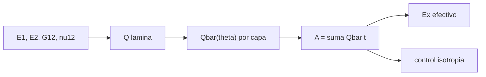

# B84-C03 — Materiales compuestos

<!-- nav:top -->
[🏠 Programa](../../../../README.md) · [📚 Bloque B84](../../../tronco-comun/B84-estructuras-materiales-y-fabricacion-espacial.md) · [← Anterior: B84-C02 — Propiedades de aleaciones](../B84-C02-propiedades-de-aleaciones/CLASE.md) · [Siguiente: B84-C04 — Cerámicos y polímeros espaciales →](../B84-C04-ceramicos-y-polimeros-espaciales/CLASE.md)
<!-- /nav -->

## 1. Ubicación, nivel y alcance

Clase 3 del bloque B84. Nivel N3. Un laminado de fibra de carbono es rígido en la dirección de la fibra y blando en la transversal; el apilado decide cuál. Aquí aplicas la teoría clásica de laminados (CLT) para obtener la matriz de rigidez de membrana `A` y el módulo efectivo de un unidireccional, un cruzado y un cuasi-isótropo. La lámina es **ilustrativa**; no se calcula resistencia ni falla.

## 2. Por qué esta clase existe

Un panel de fibra con las capas mal orientadas puede ser 14 veces más blando en una dirección que en otra sin que el material cambie. La decisión central: **¿cómo cambia la rigidez efectiva de un laminado según el ángulo de sus capas?**

## 3. Lo que podrás hacer al terminar

1. Calcular la matriz de rigidez reducida `Q` de una lámina ortótropa.
2. Rotarla a un ángulo con `Q̄`.
3. Sumar capas en la matriz `A = Σ Q̄ t`.
4. Obtener el módulo efectivo en `x` invirtiendo `A`.
5. Verificar la cuasi-isotropía con `A₁₁ = A₂₂` y `A₆₆ = (A₁₁ − A₁₂)/2`.
6. Separar lo ilustrativo de lo consultado.

La evidencia es la **ficha de rigidez de tres apilados** del ejercicio 12 (sección 20).

## 4. Con qué llegas y cómo comprobarlo

1. ¿Qué es un material ortótropo?
2. ¿Qué es el coeficiente de Poisson?
3. ¿Qué es una matriz simétrica?
4. ¿Qué es una regla de mezclas?
5. ¿Qué es un dato ilustrativo?

<details>
<summary>Ver respuestas</summary>

1. Uno cuyas propiedades dependen de la dirección según tres planos de simetría. 2. El cociente entre la contracción transversal y la elongación longitudinal. 3. Una igual a su traspuesta. 4. El promedio ponderado por fracción en volumen de una propiedad de dos fases. 5. Un valor típico no consultado.
</details>

Con cuatro o cinco aciertos, sigue; si no, repasa los prerrequisitos.

## 5. Un caso de contexto y casos de referencia

Una lámina unidireccional ilustrativa (`E₁ = 140 GPa`, `E₂ = 10 GPa`, `G₁₂ = 5 GPa`, `ν₁₂ = 0,30`, `t = 0,125 mm`) se apila de tres maneras con 8 capas. El módulo efectivo en `x` es `140,00 GPa` para el unidireccional, `75,36 GPa` para el cruzado y `54,07 GPa` para el cuasi-isótropo `[0/45/−45/90]s`. **Ejemplo conductor.** Todo es ilustrativo.

## 6. Vocabulario

La **lámina** tiene ejes del material 1 (fibra) y 2. La **matriz de rigidez reducida** `Q` relaciona tensión y deformación en el plano. `Q̄` es `Q` rotada al ángulo `θ`. La **matriz `A`** es la rigidez de membrana del laminado (N/m). Un laminado **cuasi-isótropo** tiene `A` isótropa en el plano.

## 7. Modelo mental: un tejido con hilos en varias direcciones



*Descripción textual:* de las propiedades de la lámina se construye `Q`, se rota por capa, se suman las capas en `A` y se obtienen el módulo efectivo y el control de isotropía.

Analogía: una tela con hilos solo en una dirección se estira mucho al cruzarla; con hilos en varias direcciones se estira lo mismo en todas, pero menos. Límite: la CLT supone láminas perfectas y deformación plana, sin delaminación ni bordes libres.

## 8. La explicación, paso a paso

### 8.1 La lámina

`Q₁₁ = E₁/(1 − ν₁₂ν₂₁)`, `Q₂₂ = E₂/(1 − ν₁₂ν₂₁)`, `Q₁₂ = ν₁₂E₂/(1 − ν₁₂ν₂₁)`, `Q₆₆ = G₁₂`, con `ν₂₁ = ν₁₂E₂/E₁ = 0,0214`.

### 8.2 Apilados

| Apilado | `A₁₁` (MN/m) | `A₂₂` (MN/m) | `A₁₂` | `A₆₆` | `Eₓ` (GPa) |
|---|---|---|---|---|---|
| UD `[0]₈` | 140,906 | 10,065 | 3,019 | 5,000 | 140,00 |
| Cruzado `[0/90]₂s` | 75,485 | 75,485 | 3,019 | 5,000 | 75,36 |
| Cuasi-iso `[0/45/−45/90]s` | 59,869 | 59,869 | 18,636 | 20,617 | 54,07 |

El cuasi-isótropo pierde 61 % del módulo longitudinal del UD y gana igualdad en todas las direcciones.

### 8.3 Control de isotropía

En el cuasi-isótropo `|A₁₁ − A₂₂|/A₁₁ = 0` y `|A₆₆ − (A₁₁ − A₁₂)/2|/A₆₆ = 3,6 × 10⁻¹⁶`, y `E = 54,07 GPa`, `ν = 0,311` dan `G = 20,62 GPa`, igual a `A₆₆/h`.

### 8.4 Regla de mezclas

Con `V_f = 0,60`, `E_f = 230 GPa` y `E_m = 3,5 GPa` (ilustrativos), `E₁ = 139,4 GPa`, cerca de los 140 GPa de la lámina. La rigidez específica del UD es `90,3 MN·m/kg` y la del cuasi-isótropo `34,9`, frente a `25,6` del aluminio (C02).

## 9. Magnitudes, símbolos y unidades

| Símbolo | Qué es | Unidad | Valor / nota |
|---|---|---|---|
| `Q` | rigidez reducida de lámina | Pa | `Q₁₁ = 140,9 GPa` |
| `Q̄(θ)` | `Q` rotada | Pa | — |
| `A` | rigidez de membrana | N/m | 59,87 MN/m (cuasi-iso) |
| `t` | espesor de lámina | m | 0,125 mm |
| `Eₓ` | módulo efectivo en `x` | GPa | 54,07 (cuasi-iso) |
| `V_f` | fracción de fibra | — | 0,60 (ilustrativo) |

## 10. Convenciones y referencias

SI. Ejes 1–2 de la lámina, `x` del laminado alineado con las capas a 0°. Deformación plana de membrana, sin acoplamiento de flexión (apilados simétricos, `B = 0`). Propiedades ilustrativas.

## 11. De dónde sale lo que afirmamos

| ID | Fuente | Localizador | Respalda | Estado |
|---|---|---|---|---|
| — | Propiedades típicas de una lámina CFRP; teoría clásica de laminados | — | `E₁`, `E₂`, `G₁₂`, `ν₁₂`, `t` y las fórmulas de `Q̄` | No consultada en una fuente concreta |

Límites: la lámina es ilustrativa y las fórmulas son estándar y no se consultaron en una fuente concreta; no se calcula resistencia ni falla de laminados reales.

## 12. Cómo ver la rigidez de un laminado

| Magnitud | Valor |
|---|---|
| `Eₓ` UD | 140,00 GPa |
| `Eₓ` cruzado | 75,36 GPa |
| `Eₓ` cuasi-iso | 54,07 GPa |
| Control isotropía | 3,6 × 10⁻¹⁶ |
| Rigidez específica UD | 90,3 MN·m/kg |

Descripción larga: el módulo en `x` baja de 140 a 54 GPa al repartir las fibras en cuatro direcciones.

## 13. Ejemplo trabajado: el módulo de un cuasi-isótropo

**Paso 1 · Capas.** Ocho capas de `0,125 mm`: `h = 1,0 mm`.

**Paso 2 · A.** `A₁₁ = 59,869 MN/m`, `A₁₂ = 18,636`, `A₂₂ = 59,869`.

**Paso 3 · Módulo.** `Eₓ = (A₁₁ − A₁₂²/A₂₂)/h = (59,869 − 5,800)/0,001 = 54,07 GPa`.

## 14. Distintas formas de describir un laminado

**Por apilado:** secuencia de ángulos. **Por `A`:** rigidez de membrana. **Por `Eₓ`, `ν`, `G`:** constantes efectivas. **Por rigidez específica:** `E/ρ`.

## 15. Práctica guiada

**Ejercicio 1 · con los pasos indicados** Calcula `ν₂₁` de la lámina. *Pasos:* `ν₁₂E₂/E₁`.

<details><summary>Solución comentada</summary>

`0,3 × 10/140 = 0,0214`.
</details>

**Ejercicio 2 · con los pasos indicados** ¿Cuántas capas y qué espesor tiene un `[0/45/−45/90]s`? *Pista:* la `s` duplica.

<details><summary>Solución comentada</summary>

8 capas; `1,0 mm`.
</details>

**Ejercicio 3 · con los pasos indicados** ¿Por qué `A₁₁ = A₂₂` en el cuasi-isótropo? *Casi autónomo.*

<details><summary>Solución comentada</summary>

Hay la misma cantidad de fibra a 0° y 90°, y 45° y −45° se compensan.
</details>

## 16. Práctica autónoma, transferencia e integrador

**Ejercicio 4 · autónomo** Módulo de un laminado `[0/90]s` de 4 capas.

<details><summary>Solución comentada</summary>

`≈ 75,4 GPa` como el cruzado (mismo reparto).
</details>

**Ejercicio 5 · autónomo** Rigidez específica del cuasi-iso con `ρ = 1550`.

<details><summary>Solución comentada</summary>

`54,07e9/1550 = 34,9 MN·m/kg`.
</details>

**Ejercicio 6 · autónomo** `G` efectivo del cuasi-iso con `E = 54,07` y `ν = 0,311`.

<details><summary>Solución comentada</summary>

`54,07/(2 × 1,311) = 20,62 GPa`.
</details>

**Ejercicio 7 · autónomo** Regla de mezclas con `V_f = 0,5`, `E_f = 230`, `E_m = 3,5`.

<details><summary>Solución comentada</summary>

`0,5 × 230 + 0,5 × 3,5 = 116,75 GPa`.
</details>

**Ejercicio 8 · autónomo** ¿Qué `Eₓ` tendría un `[90]₈`?

<details><summary>Solución comentada</summary>

`E₂ ≈ 10 GPa`.
</details>

**Ejercicio 9 · transferencia. **Transferencia.**** Un panel `[0]₈` se carga a 45°. ¿Es buena idea?

<details><summary>Solución comentada</summary>

No: a 45° el módulo cae mucho; hace falta un apilado multiaxial.
</details>

**Ejercicio 10 · transferencia. **Transferencia.**** Un proveedor da el módulo de la lámina. ¿Puedes usarlo para el panel?

<details><summary>Solución comentada</summary>

No: el módulo del panel depende del apilado y del espesor.
</details>

**Ejercicio 11 · transferencia. **Transferencia.**** ¿Qué falta para predecir la rotura del laminado?

<details><summary>Solución comentada</summary>

Criterios de falla por lámina, resistencias, bordes y adhesivo; no están en la CLT de rigidez.
</details>

**Ejercicio 12 · integrador. **Integrador.**** Elabora tu *ficha de rigidez de tres apilados*: `A`, `Eₓ` y rigidez específica de UD, cruzado y cuasi-isótropo, control de isotropía y qué es ilustrativo.

<details><summary>Solución comentada</summary>

Secciones 8.1–8.4 y la salida del laboratorio.
</details>

## 17. Laboratorio: teoría clásica de laminados con tres apilados

El script [compuestos.py](compuestos.py) calcula `Q̄`, `A` y `Eₓ` de tres apilados y comprueba la cuasi-isotropía (**comprueba** `A₁₁ = A₂₂` y `A₆₆ = (A₁₁ − A₁₂)/2` con error < 1e-9 y `Eₓ(UD) = E₁`).

**Datos:** lámina CFRP **ilustrativa**. **Predice antes de ejecutar:** ¿qué módulo tendrá el cuasi-iso, más o menos que el cruzado? (menos: 54,07 frente a 75,36 GPa.) **Ejecución del 2026-11-10 (Python 3.12.9):**

```text
Python 3.12.9 (biblioteca estandar)
Lamina UD ILUSTRATIVA: E1 = 140 GPa, E2 = 10 GPa, G12 = 5 GPa, nu12 = 0,30, t = 0,125 mm
apilado                     A11 [MN/m]  A22 [MN/m]  A12 [MN/m]  A66 [MN/m]  Ex [GPa]
UD [0]8                       140.9058     10.0647      3.0194      5.0000    140.00
Cruzado [0/90]2s               75.4853     75.4853      3.0194      5.0000     75.36
Cuasi-iso [0/45/-45/90]s       59.8688     59.8688     18.6359     20.6165     54.07
Cuasi-isotropia: |A11-A22|/A11 = 0.0e+00 ; |A66-(A11-A12)/2|/A66 = 3.6e-16
Cuasi-iso: E efectivo = 54.07 GPa, nu efectivo = 0.311, G = E/(2(1+nu)) = 20.62 GPa, A66 h^-1 = 20.62 GPa
Regla de mezclas E1 = Vf Ef + (1-Vf) Em = 139.4 GPa (Vf, Ef, Em ILUSTRATIVOS; la lamina usa 140 GPa)
Rigidez especifica UD = 90.3 MN m/kg ; cuasi-iso = 34.9 MN m/kg
Pruebas superadas.
```

```bash
python programa/clases/B84/B84-C03-materiales-compuestos/compuestos.py
```

**Límites:** solo rigidez de membrana de apilados simétricos; sin resistencia, humedad ni temperatura.

## 18. Errores frecuentes y cómo corregirlos

**Usar `E₁` de la lámina para el panel.** Se corrige con 8.2.

**Suponer que isótropo es más rígido.** Se corrige con 8.2.

**Olvidar `ν₂₁`.** Se corrige con 8.1.

**Presentar la lámina ilustrativa como material de vuelo.** Se corrige con la sección 10.

## 19. Cómo sabrás que vas bien

Tras la sección 8: ¿qué módulo esperabas para el cruzado y cuál obtuviste? Si dudas, repasa el ejemplo 13. Tras el laboratorio: ¿qué comprueba? (ver la sección 17).

## 20. Qué entregas y cómo se evalúa

El producto es tu **ficha de rigidez de tres apilados** (ejercicio 12).

| Criterio | Inicial | En desarrollo | Logrado | Destacado |
|---|---|---|---|---|
| Conceptos | Los confunde | Parciales | Calcula `A` y el módulo efectivo | Explica los límites |
| Cálculo | Sin unidades | Con errores | Tablas completas con unidades | Calcula casos nuevos |
| Numérico | Sin comprobar | Un caso | Contraste con una segunda vía | Interpreta las diferencias |
| Fuentes | Sin fuente | Sin fecha | Fuentes con fecha y estado | Declara lo ilustrativo y lo no consultado |
| Límites | No los nombra | Uno | Tres | Discute qué falta del modelo |

**Condiciones críticas (no se compensan con promedio):** rotular los datos ilustrativos y sintéticos como tales; no presentar un cálculo como ensayo ni como dato de vuelo; citar solo lo consultado.

## 21. Ética, seguridad y límites

Clase educativa: los modelos son simplificados y sus datos son sintéticos, ilustrativos o valores de estándar rotulados; **no es una base de diseño de hardware de vuelo** y ningún resultado sustituye a datos de material cualificados, a los documentos vigentes de la agencia o del lanzador ni a la revisión por personal competente. Accesibilidad: tablas equivalentes a las gráficas, fórmulas en texto, ejercicios sin conexión.

## 22. Para cerrar y seguir

Con las mismas ocho capas el módulo en `x` va de `140` a `54 GPa` según el apilado. Queda una pregunta: ¿cómo se comportan los materiales frágiles como las cerámicas?

**Glosario español–inglés.** lámina · *ply*; laminado · *laminate*; apilado · *stacking sequence*; cuasi-isótropo · *quasi-isotropic*; matriz de rigidez de membrana · *extensional stiffness matrix*.

**Continuidad.** [B84-C04](../B84-C04-ceramicos-y-polimeros-espaciales/CLASE.md) estudia cerámicos y polímeros.

**Referencias:** ver sección 11.

<!-- nav:bottom -->
---

[← Anterior: B84-C02 — Propiedades de aleaciones](../B84-C02-propiedades-de-aleaciones/CLASE.md) · [📚 Bloque B84](../../../tronco-comun/B84-estructuras-materiales-y-fabricacion-espacial.md) · [Siguiente: B84-C04 — Cerámicos y polímeros espaciales →](../B84-C04-ceramicos-y-polimeros-espaciales/CLASE.md)
<!-- /nav -->
