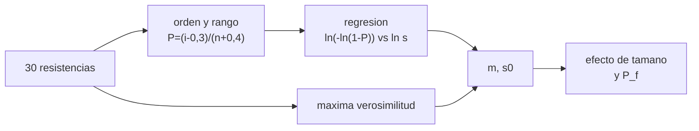

# B84-C04 — Cerámicos y polímeros espaciales

<!-- nav:top -->
[🏠 Programa](../../../../README.md) · [📚 Bloque B84](../../../tronco-comun/B84-estructuras-materiales-y-fabricacion-espacial.md) · [← Anterior: B84-C03 — Materiales compuestos](../B84-C03-materiales-compuestos/CLASE.md) · [Siguiente: B84-C05 — Selección de materiales →](../B84-C05-seleccion-de-materiales/CLASE.md)
<!-- /nav -->

## 1. Ubicación, nivel y alcance

Clase 4 del bloque B84. Nivel N3. Las cerámicas (espejos, aislantes, protecciones) son rígidas, ligeras y frágiles: no se deforman, se rompen, y su resistencia es una distribución estadística. Aquí ajustas un módulo de Weibull a 30 resistencias **sintéticas**, calculas el efecto de tamaño y un parámetro de choque térmico para una alúmina **ilustrativa**. Los polímeros espaciales se tratan por sus rasgos (transición vítrea, desgasificación en C07 y recubrimientos en C34).

## 2. Por qué esta clase existe

Un metal avisa antes de romper; una cerámica no. Diseñar con la resistencia media de una probeta pequeña sobreestima la de una pieza grande en 40 %. La decisión central: **¿qué resistencia puede usarse en una pieza cerámica grande a partir de ensayos de probetas pequeñas?**

## 3. Lo que podrás hacer al terminar

1. Describir la fractura frágil y por qué la resistencia es estadística.
2. Ajustar `m` y `σ₀` por rangos medianos y por máxima verosimilitud.
3. Aplicar el efecto de tamaño `V σᵐ = const`.
4. Calcular una resistencia con probabilidad de falla dada.
5. Estimar la diferencia de temperatura crítica de choque térmico.
6. Separar lo sintético de lo consultado.

La evidencia es la **ficha estadística de resistencia cerámica** del ejercicio 12 (sección 20).

## 4. Con qué llegas y cómo comprobarlo

1. ¿Qué es una distribución de probabilidad acumulada?
2. ¿Qué es una regresión lineal?
3. ¿Qué es un logaritmo natural?
4. ¿Qué es la dilatación térmica?
5. ¿Qué es un dato sintético?

<details>
<summary>Ver respuestas</summary>

1. La probabilidad de que la variable sea menor o igual a un valor. 2. El ajuste de una recta por mínimos cuadrados. 3. El inverso de la exponencial. 4. El cambio de longitud por grado, `α` en 1/K. 5. Un dato generado, no medido.
</details>

Con cuatro o cinco aciertos, sigue; si no, repasa los prerrequisitos.

## 5. Un caso de contexto y casos de referencia

Treinta resistencias sintéticas (semilla 84004) de una cerámica con `m = 10` y `σ₀ = 400 MPa` por cm³ dan `m = 13,40` por rangos y `13,77` por máxima verosimilitud: con 30 datos `m` queda lejos del verdadero. La resistencia mediana cae de `393 MPa` (1 cm³) a `238 MPa` (1000 cm³). **Ejemplo conductor.** Todo es sintético o ilustrativo.

## 6. Vocabulario

La **distribución de Weibull** da `P_f = 1 − exp(−(V/V₀)(σ/σ₀)ᵐ)`; `m` es el **módulo de Weibull** (menor `m` = más dispersión) y `σ₀` la **resistencia característica**. El **efecto de tamaño** dice que más volumen implica más defectos. El **choque térmico** crítico es `ΔT = σ_f(1 − ν)/(Eα)`.

## 7. Modelo mental: una cadena con eslabones débiles



*Descripción textual:* las resistencias ordenadas dan `m` y `σ₀` por dos vías; con ellos se calculan el efecto de tamaño y la resistencia para una `P_f`.

Analogía: una cadena se rompe por su eslabón más débil: cuanto más larga, más probable un eslabón débil. Límite: Weibull supone defectos independientes y un solo mecanismo de falla.

## 8. La explicación, paso a paso

### 8.1 Ajuste

La recta `ln(−ln(1 − P)) = m ln σ − m ln σ₀` da `m` como pendiente. Con rangos de Bernard `P = (i − 0,3)/(n + 0,4)` resulta `m = 13,40`, `σ₀ = 403,9 MPa`. La máxima verosimilitud (Newton sobre la ecuación de `m`) da `13,77` y `403,8 MPa`. Con `n = 30` la incertidumbre de `m` es de unos 15–20 %, y el dato sintético queda a 2–3 errores del verdadero: por eso la resistencia de diseño exige muchos ensayos.

### 8.2 Efecto de tamaño

Para igual `P_f`, `V₁σ₁ᵐ = V₂σ₂ᵐ`: `300 MPa` en 1 cm³ equivalen a `214,7 MPa` en 100 cm³ (diferencia de `P_f` de 1,1 × 10⁻¹⁶).

| Volumen (cm³) | Resistencia mediana (MPa) | Respecto de la referencia |
|---|---|---|
| 1 | 393,2 | 1,000 |
| 10 | 332,7 | 0,846 |
| 100 | 281,4 | 0,716 |
| 1000 | 238,1 | 0,605 |

### 8.3 Diseño con `P_f` baja

Con `P_f = 10⁻³` en 1 cm³ la resistencia es `244,5 MPa`, 62 % de la mediana.

### 8.4 Choque térmico

Para la alúmina ilustrativa (`E = 370 GPa`, `ν = 0,22`, `α = 8 × 10⁻⁶ K⁻¹`, `σ_f = 400 MPa`): `ΔT = 105,4 K` y `R′ = kΔT = 3162 W/m` con `k = 30 W/(m·K)`.

## 9. Magnitudes, símbolos y unidades

| Símbolo | Qué es | Unidad | Valor / nota |
|---|---|---|---|
| `m` | módulo de Weibull | — | 13,77 (ajustado) |
| `σ₀` | resistencia característica | MPa | 403,8 |
| `V/V₀` | volumen relativo | — | 1–1000 |
| `P_f` | probabilidad de falla | — | 10⁻³ |
| `ΔT` | choque térmico crítico | K | 105,4 |
| `E`, `ν`, `α` | propiedades de la alúmina | GPa, —, 1/K | 370; 0,22; 8e-6 (ilustrativos) |

## 10. Convenciones y referencias

SI y MPa. Los datos de resistencia son sintéticos con semilla 84004; la alúmina es ilustrativa, no consultada. `V₀ = 1 cm³`. Tolerancia: error de `m` menor del 50 % (n = 30).

## 11. De dónde sale lo que afirmamos

| ID | Fuente | Localizador | Respalda | Estado |
|---|---|---|---|---|
| — | Propiedades de la alúmina; teoría de Weibull y del choque térmico | — | los valores de `E`, `ν`, `α`, `k` y las fórmulas | No consultada en una fuente concreta |

Límites: datos sintéticos y propiedades ilustrativas, no consultadas; no se describe ninguna cerámica de vuelo.

## 12. Cómo ver el efecto de tamaño

| Magnitud | Valor |
|---|---|
| `m` por rangos | 13,40 |
| `m` por máxima verosimilitud | 13,77 |
| Resistencia a 1000 cm³ | 238,1 MPa |
| `P_f = 10⁻³` | 244,5 MPa |
| `ΔT` crítico | 105,4 K |

Descripción larga: la resistencia mediana baja 40 % entre 1 y 1000 cm³; la de diseño con `P_f = 10⁻³` es 62 % de la mediana.

## 13. Ejemplo trabajado: la resistencia de una pieza de 100 cm³

**Paso 1 · Ley de escala.** `σ₂ = σ₁ (V₁/V₂)^(1/m)`.

**Paso 2 · Números.** `300 × (1/100)^(1/13,77) = 300 × 0,7157 = 214,7 MPa`.

## 14. Distintas formas de describir la resistencia de una cerámica

**Por distribución:** `P_f(σ)`. **Por parámetros:** `m`, `σ₀`. **Por volumen:** `σ(V)`. **Por riesgo:** `σ` con `P_f` dada. **Por choque térmico:** `ΔT`.

## 15. Práctica guiada

**Ejercicio 1 · con los pasos indicados** Calcula `σ` con `P_f = 0,5` y `V = V₀`, `m = 13,77`, `σ₀ = 403,8`. *Pasos:* `σ₀ (ln 2)^(1/m)`.

<details><summary>Solución comentada</summary>

`403,8 × 0,6931^(1/13,77) = 403,8 × 0,9737 = 393,2 MPa`, igual que el laboratorio.
</details>

**Ejercicio 2 · con los pasos indicados** ¿Qué pasa con la resistencia si el volumen se multiplica por 10? *Pista:* `10^(−1/m)`.

<details><summary>Solución comentada</summary>

Se divide por `1,18`: `0,846`.
</details>

**Ejercicio 3 · con los pasos indicados** ¿Qué mide `m` alto? *Casi autónomo.*

<details><summary>Solución comentada</summary>

Poca dispersión: las resistencias se agrupan.
</details>

## 16. Práctica autónoma, transferencia e integrador

**Ejercicio 4 · autónomo** Resistencia en 10 cm³ si en 1 cm³ es `393,2` con `m = 13,77`.

<details><summary>Solución comentada</summary>

`332,7 MPa`.
</details>

**Ejercicio 5 · autónomo** `ΔT` con `σ_f = 300 MPa`.

<details><summary>Solución comentada</summary>

`300e6 × 0,78/(370e9 × 8e-6) = 79,1 K`.
</details>

**Ejercicio 6 · autónomo** `P_f` a 300 MPa en 1 cm³ con `σ₀ = 403,8` y `m = 13,77`.

<details><summary>Solución comentada</summary>

`1 − exp(−(0,743)^13,77) = 1,7 %`.
</details>

**Ejercicio 7 · autónomo** ¿Qué cambia si `m` baja a 5?

<details><summary>Solución comentada</summary>

La dispersión crece y la resistencia de diseño cae mucho.
</details>

**Ejercicio 8 · autónomo** ¿Qué `V` iguala 300 MPa a 214,7 MPa?

<details><summary>Solución comentada</summary>

`V = 100 V₀`.
</details>

**Ejercicio 9 · transferencia. **Transferencia.**** Un proveedor da la resistencia media de probetas de 1 cm³. ¿Basta para un espejo de 10 000 cm³?

<details><summary>Solución comentada</summary>

No: hay que escalar con `m` y fijar una `P_f`.
</details>

**Ejercicio 10 · transferencia. **Transferencia.**** Con 5 ensayos, ¿qué confianza hay en `m`?

<details><summary>Solución comentada</summary>

Baja: la incertidumbre crece como `1/√n`.
</details>

**Ejercicio 11 · transferencia. **Transferencia.**** ¿Por qué una cerámica resiste el calor pero no un choque térmico?

<details><summary>Solución comentada</summary>

Resiste la temperatura, no el gradiente; el límite es `ΔT` por `E α`.
</details>

**Ejercicio 12 · integrador. **Integrador.**** Elabora tu *ficha estadística de resistencia cerámica*: ajuste de `m` y `σ₀`, tabla de efecto de tamaño, resistencia con `P_f` dada y `ΔT`, rotulando lo sintético.

<details><summary>Solución comentada</summary>

Secciones 8.1–8.4 y la salida del laboratorio.
</details>

## 17. Laboratorio: Weibull y choque térmico de una cerámica

El script [ceramicos.py](ceramicos.py) genera 30 resistencias sintéticas, ajusta `m` y `σ₀` por dos vías y calcula el efecto de tamaño y `ΔT` (**comprueba** misma `P_f` con la ley de escala (< 1e-12) y `m` dentro del 50 % del verdadero).

**Datos:** resistencias **sintéticas** (semilla 84004) y alúmina **ilustrativa**. **Predice antes de ejecutar:** ¿el `m` ajustado será menor o mayor que el verdadero (10)? (mayor: 13,4–13,8.) **Ejecución del 2026-11-10 (Python 3.12.9):**

```text
Python 3.12.9 (biblioteca estandar)
30 resistencias SINTETICAS (semilla 84004): min = 315.7 MPa, mediana = 391.4 MPa, max = 447.0 MPa
Verdadero (sintetico):        m = 10.00   sigma0 = 400.0 MPa
Rangos medianos + regresion:  m = 13.40   sigma0 = 403.9 MPa
Maxima verosimilitud:         m = 13.77   sigma0 = 403.8 MPa
Efecto de tamano con el ajuste de maxima verosimilitud (V0 = 1 cm3):
  Resistencia mediana de la probeta de referencia = 393.2 MPa
  V =     1.0 cm3: resistencia mediana =   393.2 MPa (1.000 de la de referencia)
  V =    10.0 cm3: resistencia mediana =   332.7 MPa (0.846 de la de referencia)
  V =   100.0 cm3: resistencia mediana =   281.4 MPa (0.716 de la de referencia)
  V =  1000.0 cm3: resistencia mediana =   238.1 MPa (0.605 de la de referencia)
Misma P_f a 300 MPa en 1 cm3 y a 214.7 MPa en 100 cm3: diferencia = 1.1e-16
Resistencia con P_f = 1e-3 en 1 cm3: 244.5 MPa
Choque termico ILUSTRATIVO (alumina tipica): Delta T critico = 105.4 K ; R' = k dT = 3162 W/m
Pruebas superadas.
```

```bash
python programa/clases/B84/B84-C04-ceramicos-y-polimeros-espaciales/ceramicos.py
```

**Límites:** 30 datos dan un `m` incierto; Weibull de dos parámetros, un solo mecanismo y sin carga cíclica.

## 18. Errores frecuentes y cómo corregirlos

**Usar la resistencia media de probetas pequeñas.** Se corrige con 8.2.

**Creer que `m` ajustado es exacto.** Se corrige con 8.1.

**Olvidar la `P_f`.** Se corrige con 8.3.

**Confundir resistir temperatura y resistir choque.** Se corrige con 8.4.

## 19. Cómo sabrás que vas bien

Tras la sección 8: ¿qué resistencia esperabas a 100 cm³ y cuál obtuviste? Si dudas, repasa el ejemplo 13. Tras el laboratorio: ¿qué comprueba? (ver la sección 17).

## 20. Qué entregas y cómo se evalúa

El producto es tu **ficha estadística de resistencia cerámica** (ejercicio 12).

| Criterio | Inicial | En desarrollo | Logrado | Destacado |
|---|---|---|---|---|
| Conceptos | Los confunde | Parciales | Ajusta Weibull y escala por volumen | Explica los límites |
| Cálculo | Sin unidades | Con errores | Tablas completas con unidades | Calcula casos nuevos |
| Numérico | Sin comprobar | Un caso | Contraste con una segunda vía | Interpreta las diferencias |
| Fuentes | Sin fuente | Sin fecha | Fuentes con fecha y estado | Declara lo ilustrativo y lo no consultado |
| Límites | No los nombra | Uno | Tres | Discute qué falta del modelo |

**Condiciones críticas (no se compensan con promedio):** rotular los datos ilustrativos y sintéticos como tales; no presentar un cálculo como ensayo ni como dato de vuelo; citar solo lo consultado.

## 21. Ética, seguridad y límites

Clase educativa: los modelos son simplificados y sus datos son sintéticos, ilustrativos o valores de estándar rotulados; **no es una base de diseño de hardware de vuelo** y ningún resultado sustituye a datos de material cualificados, a los documentos vigentes de la agencia o del lanzador ni a la revisión por personal competente. Accesibilidad: tablas equivalentes a las gráficas, fórmulas en texto, ejercicios sin conexión.

## 22. Para cerrar y seguir

Una cerámica sintética pasa de `393` a `238 MPa` al crecer mil veces. Queda una pregunta: ¿cómo se elige entre todos los materiales?

**Glosario español–inglés.** módulo de Weibull · *Weibull modulus*; efecto de tamaño · *size effect*; choque térmico · *thermal shock*; fractura frágil · *brittle fracture*; cerámica · *ceramic*.

**Continuidad.** [B84-C05](../B84-C05-seleccion-de-materiales/CLASE.md) estudia la selección de materiales.

**Referencias:** ver sección 11.

<!-- nav:bottom -->
---

[← Anterior: B84-C03 — Materiales compuestos](../B84-C03-materiales-compuestos/CLASE.md) · [📚 Bloque B84](../../../tronco-comun/B84-estructuras-materiales-y-fabricacion-espacial.md) · [Siguiente: B84-C05 — Selección de materiales →](../B84-C05-seleccion-de-materiales/CLASE.md)
<!-- /nav -->
