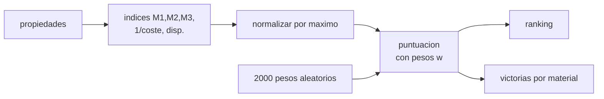

# B84-C05 — Selección de materiales

<!-- nav:top -->
[🏠 Programa](../../../../README.md) · [📚 Bloque B84](../../../tronco-comun/B84-estructuras-materiales-y-fabricacion-espacial.md) · [← Anterior: B84-C04 — Cerámicos y polímeros espaciales](../B84-C04-ceramicos-y-polimeros-espaciales/CLASE.md) · [Siguiente: B84-C06 — Comportamiento bajo vacío →](../B84-C06-comportamiento-bajo-vacio/CLASE.md)
<!-- /nav -->

## 1. Ubicación, nivel y alcance

Clase 5 del bloque B84. Nivel N3. Elegir un material es una decisión con varios criterios que compiten. Aquí usas índices de mérito de Ashby y una matriz de decisión ponderada para ordenar cuatro materiales **ilustrativos** (Al 6061-T6, Ti-6Al-4V, Mg AZ31, CFRP cuasi-isótropo) y mides con un muestreo de pesos cuánto depende el ganador de las prioridades. La compatibilidad química (C21), el vacío (C06) y la desgasificación (C07) son criterios adicionales.

## 2. Por qué esta clase existe

Un ganador que cambia con pequeñas variaciones de pesos no es una decisión: es una opinión. La sensibilidad dice si la elección es robusta. La decisión central: **¿qué material elegir y con cuánta robustez frente a los pesos de los criterios?**

## 3. Lo que podrás hacer al terminar

1. Derivar índices de mérito para panel, tirante y columna.
2. Normalizar criterios y ponderarlos en una matriz de decisión.
3. Ordenar materiales según una puntuación.
4. Muestrear pesos aleatorios con semilla fija y contar victorias.
5. Interpretar la robustez de un ganador.
6. Rotular lo ilustrativo y lo no consultado.

La evidencia es la **matriz de selección con análisis de sensibilidad** del ejercicio 12 (sección 20).

## 4. Con qué llegas y cómo comprobarlo

1. ¿Qué es un índice de mérito?
2. ¿Qué es normalizar?
3. ¿Qué es una semilla fija?
4. ¿Qué es el coste relativo?
5. ¿Qué es un dato ilustrativo?

<details>
<summary>Ver respuestas</summary>

1. Una combinación de propiedades que mide el desempeño para una función dada. 2. Dividir por el máximo para que todos los criterios queden en [0,1]. 3. Un valor inicial del generador que hace repetible la simulación. 4. El coste dividido por el de un material de referencia. 5. Un valor no consultado.
</details>

Con cuatro o cinco aciertos, sigue; si no, repasa los prerrequisitos.

## 5. Un caso de contexto y casos de referencia

Con pesos rigidez 0,35, resistencia 0,35, coste 0,15 y disponibilidad 0,15, el CFRP cuasi-isótropo puntúa `0,7883`, el Al 6061 `0,6285`, el Mg `0,5837` y el Ti `0,4851`. En 2000 pesos aleatorios el CFRP gana solo el `39,1 %` de las veces y el Al el `60,9 %`. **Ejemplo conductor.** Los materiales, costes y disponibilidades son ilustrativos.

## 6. Vocabulario

El **índice de panel** es `E^(1/3)/ρ`; el de **tirante**, `σ_y/ρ`; el de **columna**, `E^(1/2)/ρ`. La **matriz de decisión** puntúa `Σ wᵢ xᵢ/max(xᵢ)`. Los **pesos** `wᵢ` suman 1 y reflejan prioridades. La **sensibilidad** mide cuánto cambia el ganador al variar los pesos.

## 7. Modelo mental: un jurado con criterios y votos



*Descripción textual:* las propiedades dan índices que se normalizan y ponderan; el ranking se repite con 2000 conjuntos de pesos para contar victorias.

Analogía: un concurso con jurado: cambiar el peso de cada juez cambia el ganador. Límite: normalizar por el máximo hace que un criterio con un valor extremo domine; el método no sustituye al juicio de ingeniería.

## 8. La explicación, paso a paso

### 8.1 Índices

| Material | `M₁ = E^(1/3)/ρ` | `M₂ = σ_y/ρ` | `M₃ = E^(1/2)/ρ` | `1/coste` | Disp. |
|---|---|---|---|---|---|
| Al 6061-T6 | 1,519 | 101,9 | 3,077 | 1,000 | 9 |
| Ti-6Al-4V | 1,095 | 198,6 | 2,410 | 0,083 | 6 |
| Mg AZ31 | 1,998 | 112,4 | 3,769 | 0,500 | 6 |
| CFRP cuasi-iso | 2,439 | 322,6 | 4,741 | 0,033 | 5 |

El CFRP gana los tres índices físicos y pierde en coste y disponibilidad.

### 8.2 Matriz ponderada

Con `w = (0,35; 0,35; 0,15; 0,15)` sobre `M₁`, `M₂`, `1/coste` y disponibilidad: CFRP `0,7883`, Al `0,6285`, Mg `0,5837`, Ti `0,4851`.

### 8.3 Sensibilidad

Con 2000 pesos de una Dirichlet(1,1,1,1) (semilla 84005) ganan el Al 1217 veces (60,9 %) y el CFRP 783 (39,1 %); Ti y Mg, ninguna. El ganador con los pesos base solo gana 39 % de las veces: la elección **no es robusta** y depende de cuánto pese el coste.

### 8.4 Qué falta

Un criterio ausente (compatibilidad galvánica, desgasificación, procesos, herencia de vuelo) puede descartar un material de la tabla.

## 9. Magnitudes, símbolos y unidades

| Símbolo | Qué es | Unidad | Valor / nota |
|---|---|---|---|
| `M₁` | índice de panel | GPa^(1/3) por Mg/m³ | 1,519 (Al) |
| `M₂` | índice de tirante | kN·m/kg | 101,9 (Al) |
| `M₃` | índice de columna | GPa^(1/2) por Mg/m³ | 3,077 (Al) |
| `wᵢ` | peso del criterio | — | 0,35; 0,35; 0,15; 0,15 |
| `S` | puntuación | — | 0,7883 (CFRP) |
| `N` | pesos muestreados | — | 2000 |

## 10. Convenciones y referencias

Materiales con valores típicos ilustrativos (no consultados). Criterios normalizados por el máximo; semilla 84005; pesos Dirichlet(1,1,1,1). No hay ponderación objetiva: los pesos son una decisión del equipo.

## 11. De dónde sale lo que afirmamos

| ID | Fuente | Localizador | Respalda | Estado |
|---|---|---|---|---|
| — | Propiedades, costes relativos y disponibilidad de los cuatro materiales; método de Ashby | — | todos los valores de la tabla y las fórmulas de los índices | No consultada en una fuente concreta |

Límites: todos los datos son ilustrativos y no se consultaron; no es una recomendación de material.

## 12. Cómo ver el ranking y su robustez

| Magnitud | Valor |
|---|---|
| Puntuación CFRP | 0,7883 |
| Puntuación Al | 0,6285 |
| Victorias del Al en 2000 pesos | 1217 |
| Victorias del CFRP | 783 |
| Victorias de Ti y Mg | 0 |

Descripción larga: el CFRP gana con los pesos base pero solo en 39 % de los muestreos; el Al gana en 61 %.

## 13. Ejemplo trabajado: la puntuación del aluminio

**Paso 1 · Normalización.** `M₁/máx = 1,519/2,439 = 0,623`; `M₂/máx = 101,9/322,6 = 0,316`; `1/coste` y disp.: `1,0` y `1,0`.

**Paso 2 · Ponderación.** `0,35 × 0,623 + 0,35 × 0,316 + 0,15 × 1 + 0,15 × 1 = 0,6285`.

## 14. Distintas formas de describir una decisión de material

**Por índice:** `M₁`–`M₃`. **Por puntuación:** `S`. **Por ranking:** orden. **Por robustez:** porcentaje de victorias.

## 15. Práctica guiada

**Ejercicio 1 · con los pasos indicados** Calcula `M₂` del Mg AZ31 (`200 MPa`, `1780 kg/m³`). *Pasos:* `200/1,78`.

<details><summary>Solución comentada</summary>

`112,4 kN·m/kg`.
</details>

**Ejercicio 2 · con los pasos indicados** ¿Qué puntuación tiene un material que es el mejor en todo? *Pista:* cada término es 1.

<details><summary>Solución comentada</summary>

`Σ wᵢ = 1`.
</details>

**Ejercicio 3 · con los pasos indicados** ¿Por qué gana el Ti en ningún muestreo? *Casi autónomo.*

<details><summary>Solución comentada</summary>

Es peor que el CFRP en rigidez y resistencia y peor que el Al en coste y disponibilidad: ninguna combinación de pesos lo favorece.
</details>

## 16. Práctica autónoma, transferencia e integrador

**Ejercicio 4 · autónomo** Puntuación del Mg con los pesos base.

<details><summary>Solución comentada</summary>

`0,5837` (laboratorio).
</details>

**Ejercicio 5 · autónomo** Efecto de poner `w` coste 0,5 y los demás 0,5/3.

<details><summary>Solución comentada</summary>

Sube el Al y baja el CFRP: el ganador cambia.
</details>

**Ejercicio 6 · autónomo** `M₃` del CFRP (`54 GPa`, `1550`).

<details><summary>Solución comentada</summary>

`7,35/1,55 = 4,741`.
</details>

**Ejercicio 7 · autónomo** ¿Qué pasa si se duplica el coste del CFRP?

<details><summary>Solución comentada</summary>

`1/coste` cae a 0,0167 y su puntuación baja.
</details>

**Ejercicio 8 · autónomo** ¿Cuántos muestreos gana el Al si gana el 60,9 % de 2000?

<details><summary>Solución comentada</summary>

`1217`.
</details>

**Ejercicio 9 · transferencia. **Transferencia.**** El equipo elige CFRP porque ganó la matriz. ¿Es suficiente?

<details><summary>Solución comentada</summary>

No: gana en el 39 % de los pesos; hay que justificar las prioridades.
</details>

**Ejercicio 10 · transferencia. **Transferencia.**** Se añade un criterio de desgasificación que el Mg incumple. ¿Qué hace?

<details><summary>Solución comentada</summary>

Elimina el Mg antes de ponderar (filtro duro).
</details>

**Ejercicio 11 · transferencia. **Transferencia.**** ¿Es objetiva una matriz ponderada?

<details><summary>Solución comentada</summary>

No: los pesos son juicios; la sensibilidad lo hace explícito.
</details>

**Ejercicio 12 · integrador. **Integrador.**** Elabora tu *matriz de selección con análisis de sensibilidad*: índices, puntuaciones, victorias por material y filtros duros que añadirías.

<details><summary>Solución comentada</summary>

Secciones 8.1–8.4 y la salida del laboratorio.
</details>

## 17. Laboratorio: índices de Ashby y matriz con sensibilidad

El script [seleccion.py](seleccion.py) calcula los índices, puntúa con pesos base y muestrea 2000 pesos (**comprueba** pesos que suman 1 y 2000 victorias repartidas).

**Datos:** materiales **ilustrativos**; pesos aleatorios con semilla 84005. **Predice antes de ejecutar:** ¿ganará el CFRP en todos los muestreos? (no: 39,1 %.) **Ejecución del 2026-11-10 (Python 3.12.9):**

```text
Python 3.12.9 (biblioteca estandar)
Indices con datos ILUSTRATIVOS (no consultados):
material          M1 E^1/3/rho  M2 sy/rho  M3 E^1/2/rho  1/coste  disp.
Al 6061-T6               1.519      101.9         3.077    1.000    9.0
Ti-6Al-4V                1.095      198.6         2.410    0.083    6.0
Mg AZ31                  1.998      112.4         3.769    0.500    6.0
CFRP cuasi-iso           2.439      322.6         4.741    0.033    5.0
Mejor por panel rigido M1: CFRP cuasi-iso
Mejor por tirante M2: CFRP cuasi-iso
Mejor por columna M3: CFRP cuasi-iso
Puntuacion con pesos [rigidez 0,35; resistencia 0,35; coste 0,15; disponibilidad 0,15]:
  CFRP cuasi-iso   0.7883
  Al 6061-T6       0.6285
  Mg AZ31          0.5837
  Ti-6Al-4V        0.4851
Sensibilidad: victorias en 2000 pesos aleatorios (Dirichlet, semilla 84005):
  Al 6061-T6        1217 (60.9 %)
  CFRP cuasi-iso     783 (39.1 %)
  Ti-6Al-4V            0 (0.0 %)
  Mg AZ31              0 (0.0 %)
Ganador con los pesos base: CFRP cuasi-iso; gana en 39.1 % de los pesos aleatorios
Pruebas superadas.
```

```bash
python programa/clases/B84/B84-C05-seleccion-de-materiales/seleccion.py
```

**Límites:** datos no consultados; los filtros duros (compatibilidad, desgasificación, herencia) no están en la matriz.

## 18. Errores frecuentes y cómo corregirlos

**Ordenar por una sola propiedad.** Se corrige con 8.1.

**Tomar el ganador de un solo conjunto de pesos.** Se corrige con 8.3.

**Dejar fuera filtros duros.** Se corrige con 8.4.

**Presentar datos ilustrativos como de diseño.** Se corrige con la sección 10.

## 19. Cómo sabrás que vas bien

Tras la sección 8: ¿qué ganador esperabas y qué porcentaje de robustez obtuviste? Si dudas, repasa 8.3. Tras el laboratorio: ¿qué comprueba? (ver la sección 17).

## 20. Qué entregas y cómo se evalúa

El producto es tu **matriz de selección con análisis de sensibilidad** (ejercicio 12).

| Criterio | Inicial | En desarrollo | Logrado | Destacado |
|---|---|---|---|---|
| Conceptos | Los confunde | Parciales | Calcula índices, puntúa y mide sensibilidad | Explica los límites |
| Cálculo | Sin unidades | Con errores | Tablas completas con unidades | Calcula casos nuevos |
| Numérico | Sin comprobar | Un caso | Contraste con una segunda vía | Interpreta las diferencias |
| Fuentes | Sin fuente | Sin fecha | Fuentes con fecha y estado | Declara lo ilustrativo y lo no consultado |
| Límites | No los nombra | Uno | Tres | Discute qué falta del modelo |

**Condiciones críticas (no se compensan con promedio):** rotular los datos ilustrativos y sintéticos como tales; no presentar un cálculo como ensayo ni como dato de vuelo; citar solo lo consultado.

## 21. Ética, seguridad y límites

Clase educativa: los modelos son simplificados y sus datos son sintéticos, ilustrativos o valores de estándar rotulados; **no es una base de diseño de hardware de vuelo** y ningún resultado sustituye a datos de material cualificados, a los documentos vigentes de la agencia o del lanzador ni a la revisión por personal competente. Accesibilidad: tablas equivalentes a las gráficas, fórmulas en texto, ejercicios sin conexión.

## 22. Para cerrar y seguir

El CFRP puntúa `0,7883` pero gana solo `39,1 %` de los muestreos. Queda una pregunta: ¿qué le pasa a un material en el vacío del espacio?

**Glosario español–inglés.** índice de mérito · *merit index*; matriz de decisión · *decision matrix*; sensibilidad · *sensitivity*; ponderación · *weighting*; selección de materiales · *materials selection*.

**Continuidad.** [B84-C06](../B84-C06-comportamiento-bajo-vacio/CLASE.md) estudia el comportamiento de los materiales bajo vacío.

**Referencias:** ver sección 11.

<!-- nav:bottom -->
---

[← Anterior: B84-C04 — Cerámicos y polímeros espaciales](../B84-C04-ceramicos-y-polimeros-espaciales/CLASE.md) · [📚 Bloque B84](../../../tronco-comun/B84-estructuras-materiales-y-fabricacion-espacial.md) · [Siguiente: B84-C06 — Comportamiento bajo vacío →](../B84-C06-comportamiento-bajo-vacio/CLASE.md)
<!-- /nav -->
