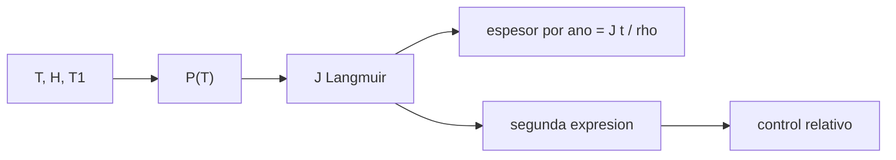

# B84-C06 — Comportamiento bajo vacío

<!-- nav:top -->
[🏠 Programa](../../../../README.md) · [📚 Bloque B84](../../../tronco-comun/B84-estructuras-materiales-y-fabricacion-espacial.md) · [← Anterior: B84-C05 — Selección de materiales](../B84-C05-seleccion-de-materiales/CLASE.md) · [Siguiente: B84-C07 — Desgasificación de materiales →](../B84-C07-desgasificacion-de-materiales/CLASE.md)
<!-- /nav -->

## 1. Ubicación, nivel y alcance

Clase 6 del bloque B84. Nivel N3. En el vacío los átomos de una superficie que se evaporan no regresan. Aquí calculas con la ley de Langmuir cuánto espesor pierde un metal por sublimación al año a 300, 400 y 500 K, y el camino libre medio de las moléculas de gas a distintas presiones. Los datos de presión de vapor son **ilustrativos** (órdenes de magnitud, no consultados). La desgasificación de polímeros y adhesivos se trata en C07.

## 2. Por qué esta clase existe

Un recubrimiento de cadmio o de zinc que es inocuo en tierra puede desaparecer y contaminar ópticas en el vacío; un cálculo de un minuto lo descarta. La decisión central: **¿qué metales sobreviven sin protección al vacío a la temperatura de trabajo y cuáles se subliman?**

## 3. Lo que podrás hacer al terminar

1. Describir el régimen de flujo molecular y calcular el camino libre medio.
2. Calcular la presión de vapor con Clausius–Clapeyron.
3. Aplicar la ley de Langmuir para el flujo de masa de sublimación.
4. Convertir el flujo en pérdida de espesor al año.
5. Verificar con una segunda expresión del flujo.
6. Rotular lo ilustrativo y lo no consultado.

La evidencia es la **tabla de pérdida de espesor por sublimación** del ejercicio 12 (sección 20).

## 4. Con qué llegas y cómo comprobarlo

1. ¿Qué es la presión de vapor?
2. ¿Qué es una entalpía de sublimación?
3. ¿Qué es el camino libre medio?
4. ¿Qué es una constante exacta del SI?
5. ¿Qué es una cota superior?

<details>
<summary>Ver respuestas</summary>

1. La presión de equilibrio entre un sólido o líquido y su vapor a una temperatura. 2. La energía para pasar un mol de sólido a vapor. 3. La distancia media entre colisiones de una molécula. 4. Un valor fijado por definición, sin incertidumbre. 5. Un valor que el resultado real no supera.
</details>

Con cuatro o cinco aciertos, sigue; si no, repasa los prerrequisitos.

## 5. Un caso de contexto y casos de referencia

Con coeficiente de acomodación 1, el cadmio pierde `1,95 µm/año` a 300 K y `1,27 × 10⁵ µm/año` a 400 K; el zinc `7,9 × 10⁻⁴ µm/año` a 300 K; el aluminio y el titanio, valores inconmensurables (`5 × 10⁻³⁶` µm/año). **Ejemplo conductor.** Las presiones de vapor son ilustrativas.

## 6. Vocabulario

La **ley de Langmuir** da el flujo de masa `J = α P √(M/(2πRT))`, con `α = 1` como cota superior. **Clausius–Clapeyron**: `P(T) = 1 Pa · exp(−H/R (1/T − 1/T₁))`. El **camino libre medio** es `λ = k_B T/(√2 π d² P)`. **Flujo molecular** es el régimen donde `λ` supera las dimensiones del sistema.

## 7. Modelo mental: agua evaporándose de un vaso sin tapa en una habitación vacía



*Descripción textual:* la temperatura da la presión de vapor, que da el flujo de Langmuir y la pérdida de espesor; una segunda expresión comprueba el flujo.

Analogía: un vaso destapado se seca porque el vapor se va; en el vacío no hay aire que lo devuelva. Límite: con acomodación menor que 1 la pérdida real es menor; la cifra es una cota superior.

## 8. La explicación, paso a paso

### 8.1 Régimen de vacío

A 300 K, el nitrógeno tiene `λ = 6,8 × 10⁻⁸ m` a 10⁵ Pa, `0,68 m` a 10⁻² Pa, `681 m` a 10⁻⁵ Pa y `6,8 × 10⁵ m` a 10⁻⁸ Pa. En órbita las moléculas viajan en línea recta hasta chocar con una pared: flujo molecular.

### 8.2 Sublimación al año

| Metal | 300 K | 400 K | 500 K |
|---|---|---|---|
| Cd | 1,95 µm | 1,27 × 10⁵ µm | 9,5 × 10⁷ µm |
| Zn | 7,9 × 10⁻⁴ µm | 310 µm | 6,9 × 10⁵ µm |
| Mg | 3,6 × 10⁻⁶ µm | 7,8 µm | 4,8 × 10⁴ µm |
| Al | 5 × 10⁻³⁶ µm | 7 × 10⁻²² µm | 2 × 10⁻¹³ µm |
| Ti | 4 × 10⁻⁶¹ µm | 1 × 10⁻⁴⁰ µm | 2 × 10⁻²⁸ µm |

La pérdida crece exponencialmente con `T`: de 300 a 400 K, el cadmio pierde 65 000 veces más.

### 8.3 Verificación

El flujo `P√(M/(2πRT))` coincide con `m P/√(2π m k_B T)` (con `m = M/N_A`) con diferencia relativa `3 × 10⁻¹⁶`: valida el código y las constantes, no los datos de presión de vapor.

### 8.4 Regla ilustrativa

Con el criterio de menos de 1 µm en 10 años a 300 K, el cadmio no es apto sin protección (`19,5 µm` en 10 años) y zinc, magnesio, aluminio y titanio sí. Los materiales reales se cribarán con ensayos (C07).

## 9. Magnitudes, símbolos y unidades

| Símbolo | Qué es | Unidad | Valor / nota |
|---|---|---|---|
| `P` | presión de vapor | Pa | 2,0 × 10⁻⁷ (Cd, 300 K) |
| `H` | entalpía de sublimación | J/mol | 112 000 (Cd) |
| `J` | flujo de masa | kg/(m²·s) | — |
| `λ` | camino libre medio | m | 0,68 a 10⁻² Pa |
| `k_B`, `N_A` | constantes exactas del SI | J/K, 1/mol | 1,380649e-23; 6,02214076e23 |
| `R` | constante de los gases | J/(mol·K) | `k_B N_A` |

## 10. Convenciones y referencias

SI. `α = 1` (cota superior); sin recondensación; `d(N₂) = 3,7 × 10⁻¹⁰ m` ilustrativo. Constantes exactas del SI 2019 (no consultadas en esta sesión). Tolerancia: 10⁻¹² relativa entre expresiones.

## 11. De dónde sale lo que afirmamos

| ID | Fuente | Localizador | Respalda | Estado |
|---|---|---|---|---|
| — | Presiones de vapor, entalpías, masas molares y densidades de Cd, Zn, Mg, Al y Ti; ley de Langmuir | — | todos los datos de los metales y la ley | No consultada en una fuente concreta |

Límites: las presiones de vapor son órdenes de magnitud ilustrativos y no se consultaron; los resultados son cotas superiores y no sirven para calificar un recubrimiento.

## 12. Cómo ver la sublimación

| Magnitud | Valor |
|---|---|
| Cd a 300 K | 1,95 µm/año |
| Cd a 400 K | 1,27 × 10⁵ µm/año |
| Zn a 300 K | 7,9 × 10⁻⁴ µm/año |
| `λ` a 10⁻⁵ Pa | 681 m |
| Diferencia de expresiones | 3 × 10⁻¹⁶ |

Descripción larga: la sublimación sube muchos órdenes de magnitud con la temperatura y depende del metal.

## 13. Ejemplo trabajado: el cadmio a 300 K

**Paso 1 · Presión.** `P = exp(−112000/R (1/300 − 1/457)) = 2,0 × 10⁻⁷ Pa`.

**Paso 2 · Flujo.** `J = 2,0 × 10⁻⁷ √(0,1124/(2π × 8,314 × 300)) = 5,4 × 10⁻¹⁰ kg/(m²·s)`.

**Paso 3 · Espesor.** `J × 3,156 × 10⁷ s/8650 = 1,95 µm/año`.

## 14. Distintas formas de describir la pérdida en vacío

**Por presión de vapor:** `P(T)`. **Por flujo:** `J`. **Por espesor:** µm/año. **Por régimen:** `λ` frente al tamaño.

## 15. Práctica guiada

**Ejercicio 1 · con los pasos indicados** Calcula `R` con `k_B N_A`. *Pasos:* multiplica.

<details><summary>Solución comentada</summary>

`8,314 J/(mol·K)`.
</details>

**Ejercicio 2 · con los pasos indicados** ¿Cuál es `λ` a 10⁻⁵ Pa? *Pista:* `λ ∝ 1/P`; parte de 0,68 m a 10⁻² Pa.

<details><summary>Solución comentada</summary>

Al bajar `P` mil veces, `λ` sube mil veces: `681 m`.
</details>

**Ejercicio 3 · con los pasos indicados** ¿Por qué la sublimación es una cota superior? *Casi autónomo.*

<details><summary>Solución comentada</summary>

Porque `α = 1` supone que todo átomo que sale no regresa; en la práctica parte vuelve.
</details>

## 16. Práctica autónoma, transferencia e integrador

**Ejercicio 4 · autónomo** Espesor del Zn en 10 años a 300 K.

<details><summary>Solución comentada</summary>

`7,9 × 10⁻³ µm`.
</details>

**Ejercicio 5 · autónomo** Factor de crecimiento del Cd de 300 a 400 K.

<details><summary>Solución comentada</summary>

`1,27e5/1,95 = 6,5 × 10⁴`.
</details>

**Ejercicio 6 · autónomo** `P` del Cd a 457 K.

<details><summary>Solución comentada</summary>

`1 Pa` (la referencia).
</details>

**Ejercicio 7 · autónomo** ¿Qué `α` da 1 µm/año de Cd a 300 K?

<details><summary>Solución comentada</summary>

`α = 1/1,95 = 0,51`.
</details>

**Ejercicio 8 · autónomo** ¿Con qué presión `λ` iguala 1 m?

<details><summary>Solución comentada</summary>

Aproximadamente `6,8 × 10⁻³ Pa`.
</details>

**Ejercicio 9 · transferencia. **Transferencia.**** Una pieza cadmiada va a un satélite con óptica sensible. ¿Qué haces?

<details><summary>Solución comentada</summary>

Sustituyes el recubrimiento: la sublimación contamina y degrada la pieza.
</details>

**Ejercicio 10 · transferencia. **Transferencia.**** Un proveedor dice que su recubrimiento es estable a 400 K. ¿Cómo lo compruebas?

<details><summary>Solución comentada</summary>

Con un ensayo de masa en vacío (C07) y un cálculo como éste.
</details>

**Ejercicio 11 · transferencia. **Transferencia.**** ¿Sirve esta tabla para un polímero?

<details><summary>Solución comentada</summary>

No: los polímeros pierden volátiles por difusión, no por sublimación (C07).
</details>

**Ejercicio 12 · integrador. **Integrador.**** Elabora tu *tabla de pérdida de espesor por sublimación*: valores a tres temperaturas, regla de clasificación, comprobación del flujo y qué es ilustrativo.

<details><summary>Solución comentada</summary>

Secciones 8.1–8.4 y la salida del laboratorio.
</details>

## 17. Laboratorio: sublimación de Langmuir y camino libre medio

El script [vacio.py](vacio.py) calcula `P(T)`, el flujo, la pérdida de espesor y el camino libre medio (**comprueba** coincidencia de las dos expresiones del flujo (< 1e-12) y órdenes de magnitud del Cd y el Al).

**Datos:** presiones de vapor **ilustrativas**; constantes exactas del SI. **Predice antes de ejecutar:** ¿cuántas veces más pierde el Cd a 400 K que a 300 K? (≈ 65 000.) **Ejecución del 2026-11-10 (Python 3.12.9):**

```text
Python 3.12.9 (biblioteca estandar)
Perdida de espesor por sublimacion al ano [micrometros] (datos ILUSTRATIVOS, cota superior):
metal        T=300 K       T=400 K       T=500 K
Cd         1.952e+00     1.268e+05     9.547e+07
Zn         7.867e-04     3.104e+02     6.898e+05
Mg         3.602e-06     7.811e+00     4.824e+04
Al         5.429e-36     7.284e-22     2.128e-13
Ti         4.097e-61     1.019e-40     1.716e-28
Diferencia relativa maxima entre las dos expresiones del flujo = 3.2e-16
Presion de vapor a 300 K [Pa]: Cd 2.00e-07, Zn 8.71e-11, Mg 1.60e-13, Al 3.54e-43, Ti 3.34e-68
Camino libre medio de N2 a 300 K:
  P =    1e+05 Pa  lambda =  6.810e-08 m
  P =    1e-02 Pa  lambda =  6.810e-01 m
  P =    1e-05 Pa  lambda =  6.810e+02 m
  P =    1e-08 Pa  lambda =  6.810e+05 m
Clasificacion ILUSTRATIVA (perdida < 1 um en 10 anos a 300 K):
  Cd: 1.95e+01 um en 10 anos -> NO apto sin proteccion
  Zn: 7.87e-03 um en 10 anos -> apto sin proteccion
  Mg: 3.60e-05 um en 10 anos -> apto sin proteccion
  Al: 5.43e-35 um en 10 anos -> apto sin proteccion
  Ti: 4.10e-60 um en 10 anos -> apto sin proteccion
Pruebas superadas.
```

```bash
python programa/clases/B84/B84-C06-comportamiento-bajo-vacio/vacio.py
```

**Límites:** cota superior; datos de vapor no consultados; sin recondensación ni oxidación.

## 18. Errores frecuentes y cómo corregirlos

**Tomar la cota superior por valor real.** Se corrige con 8.3.

**Olvidar la dependencia exponencial en `T`.** Se corrige con 8.2.

**Confundir sublimación con desgasificación.** Se corrige con el alcance.

**Usar presiones de vapor ilustrativas como datos.** Se corrige con la sección 10.

## 19. Cómo sabrás que vas bien

Tras la sección 8: ¿cuántas veces esperabas el aumento del Cd entre 300 y 400 K? Si dudas, repasa el ejemplo 13. Tras el laboratorio: ¿qué comprueba? (ver la sección 17).

## 20. Qué entregas y cómo se evalúa

El producto es tu **tabla de pérdida de espesor por sublimación** (ejercicio 12).

| Criterio | Inicial | En desarrollo | Logrado | Destacado |
|---|---|---|---|---|
| Conceptos | Los confunde | Parciales | Calcula sublimación y la interpreta como cota | Explica los límites |
| Cálculo | Sin unidades | Con errores | Tablas completas con unidades | Calcula casos nuevos |
| Numérico | Sin comprobar | Un caso | Contraste con una segunda vía | Interpreta las diferencias |
| Fuentes | Sin fuente | Sin fecha | Fuentes con fecha y estado | Declara lo ilustrativo y lo no consultado |
| Límites | No los nombra | Uno | Tres | Discute qué falta del modelo |

**Condiciones críticas (no se compensan con promedio):** rotular los datos ilustrativos y sintéticos como tales; no presentar un cálculo como ensayo ni como dato de vuelo; citar solo lo consultado.

## 21. Ética, seguridad y límites

Clase educativa: los modelos son simplificados y sus datos son sintéticos, ilustrativos o valores de estándar rotulados; **no es una base de diseño de hardware de vuelo** y ningún resultado sustituye a datos de material cualificados, a los documentos vigentes de la agencia o del lanzador ni a la revisión por personal competente. Accesibilidad: tablas equivalentes a las gráficas, fórmulas en texto, ejercicios sin conexión.

## 22. Para cerrar y seguir

El cadmio pierde `1,95 µm/año` a 300 K y `1,27 × 10⁵` a 400 K. Queda una pregunta: ¿qué pasa con los materiales que no se subliman pero sueltan gases?

**Glosario español–inglés.** presión de vapor · *vapor pressure*; sublimación · *sublimation*; camino libre medio · *mean free path*; flujo molecular · *free-molecular flow*; vacío · *vacuum*.

**Continuidad.** [B84-C07](../B84-C07-desgasificacion-de-materiales/CLASE.md) estudia la desgasificación de materiales.

**Referencias:** ver sección 11.

<!-- nav:bottom -->
---

[← Anterior: B84-C05 — Selección de materiales](../B84-C05-seleccion-de-materiales/CLASE.md) · [📚 Bloque B84](../../../tronco-comun/B84-estructuras-materiales-y-fabricacion-espacial.md) · [Siguiente: B84-C07 — Desgasificación de materiales →](../B84-C07-desgasificacion-de-materiales/CLASE.md)
<!-- /nav -->
