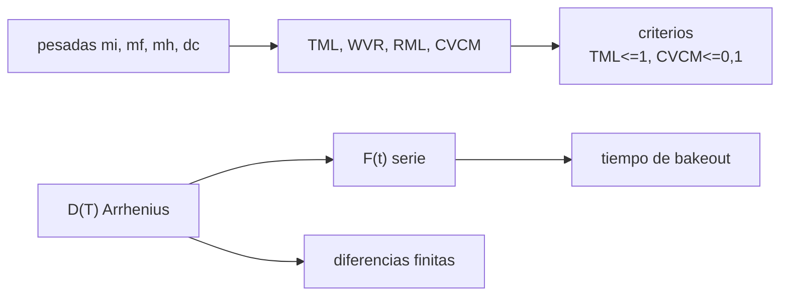

# B84-C07 — Desgasificación de materiales

<!-- nav:top -->
[🏠 Programa](../../../../README.md) · [📚 Bloque B84](../../../tronco-comun/B84-estructuras-materiales-y-fabricacion-espacial.md) · [← Anterior: B84-C06 — Comportamiento bajo vacío](../B84-C06-comportamiento-bajo-vacio/CLASE.md) · [Siguiente: B84-C08 — Fatiga y fractura →](../../../tronco-comun/B84-estructuras-materiales-y-fabricacion-espacial.md#b84-c08)
<!-- /nav -->

## 1. Ubicación, nivel y alcance

Clase 7 del bloque B84. Nivel N3. Los polímeros, adhesivos y lubricantes sueltan volátiles en el vacío que se condensan en ópticas y sensores. Aquí calculas TML, WVR, RML y CVCM a partir de pesadas **sintéticas** de un ensayo tipo ASTM E595 y modelas con difusión cuánto tarda en salir un volátil de una lámina. El GEVS exige este cribado como mínimo; los límites numéricos de E595 **no se consultaron** y se usan como criterios ilustrativos.

## 2. Por qué esta clase existe

Una película de 10 nm sobre un espejo de telescopio o un sensor estelar degrada la misión; el cribado de desgasificación se hace antes de elegir el adhesivo. La decisión central: **¿pasa un material el cribado de desgasificación y cuántos días de bakeout necesita para limpiarlo?**

## 3. Lo que podrás hacer al terminar

1. Definir TML, WVR, RML y CVCM desde pesadas.
2. Aplicar criterios de aceptación a cuatro materiales sintéticos.
3. Modelar la difusión desde una lámina con una serie y con diferencias finitas.
4. Calcular el efecto de la temperatura con Arrhenius.
5. Estimar el tiempo de bakeout para retirar el 99 %.
6. Rotular lo consultado, lo ilustrativo y lo sintético.

La evidencia es la **informe de cribado de desgasificación de un material** del ejercicio 12 (sección 20).

## 4. Con qué llegas y cómo comprobarlo

1. ¿Qué es el porcentaje de pérdida de masa?
2. ¿Qué es la difusión?
3. ¿Qué es la ley de Arrhenius?
4. ¿Qué es un colector?
5. ¿Qué es un dato sintético?

<details>
<summary>Ver respuestas</summary>

1. `(m_i − m_f)/m_i × 100`. 2. El transporte de una sustancia por gradiente de concentración. 3. La dependencia exponencial de la velocidad con `1/T`. 4. Una placa fría que recoge los volátiles condensables. 5. Un dato inventado para el ejemplo.
</details>

Con cuatro o cinco aciertos, sigue; si no, repasa los prerrequisitos.

## 5. Un caso de contexto y casos de referencia

Cuatro materiales con pesadas sintéticas: el epoxi A tiene `TML = 0,580 %` y `CVCM = 0,040 %` y pasa; la silicona B tiene `TML = 0,920 %` pero `CVCM = 0,190 %` y no pasa; la cinta D tiene `TML = 2,100 %` y `CVCM = 0,360 %`. Una lámina de 2 mm pierde el `60,4 %` de su volátil en 24 h a 125 °C y tarda `6,1 días` en perder el 99 %; a 20 °C tardaría `4047 días`. **Ejemplo conductor.** Pesadas y parámetros de difusión son sintéticos o ilustrativos.

## 6. Vocabulario

**TML** (*total mass loss*) es la pérdida total de masa; **WVR**, el vapor de agua recuperado; **RML** `= TML − WVR`; **CVCM** (*collected volatile condensable material*) es la masa condensada en el colector, en % de la masa inicial. El **bakeout** es un horneado en vacío para sacar los volátiles.

## 7. Modelo mental: una esponja que se seca



*Descripción textual:* las pesadas dan los porcentajes que se comparan con los criterios; la difusión con `D(T)` da la fracción remanente y el tiempo de bakeout, comprobada con diferencias finitas.

Analogía: una esponja mojada se seca primero rápido y luego lento; calentarla acelera el secado. Límite: aquí el volátil es uno solo y `D` es constante; un material real tiene varias especies y reacciones.

## 8. La explicación, paso a paso

### 8.1 Magnitudes del ensayo

Con `m_i = 500 mg`: `TML = (m_i − m_f)/m_i`, `WVR = (m_h − m_f)/m_i`, `RML = TML − WVR`, `CVCM = Δm_colector/m_i`.

| Muestra (sintética) | TML % | WVR % | RML % | CVCM % | Veredicto ilustrativo |
|---|---|---|---|---|---|
| Epoxi A | 0,580 | 0,230 | 0,350 | 0,040 | pasa |
| Silicona B | 0,920 | 0,050 | 0,870 | 0,190 | no pasa (CVCM) |
| Adhesivo C | 0,220 | 0,100 | 0,120 | 0,030 | pasa |
| Cinta D | 2,100 | 0,700 | 1,400 | 0,360 | no pasa |

La silicona B pasa en `TML` y falla en `CVCM`: por eso se exigen ambos criterios.

### 8.2 Difusión

`F(t) = Σ 8/((2k+1)²π²) exp(−(2k+1)²π² D t/(4L²))` para una lámina de espesor `L` con una cara abierta. `D(T) = D₀ exp(−E_a/(RT))` con `D₀ = 10⁻³ m²/s` y `E_a = 60 kJ/mol`.

| `T` (°C) | `D` (m²/s) | `τ = L²/D` (h) | `F(24 h)` | `t(99 %)` (días) |
|---|---|---|---|---|
| 20 | 2,04 × 10⁻¹⁴ | 54 520 | 0,9763 | 4047 |
| 60 | 3,92 × 10⁻¹³ | 2838 | 0,8962 | 210,6 |
| 125 | 1,34 × 10⁻¹¹ | 82,6 | 0,3961 | 6,13 |

### 8.3 Verificación

Frente a diferencias finitas, la serie difiere `3,5 × 10⁻⁴` como máximo en `F` (Fo = 0,05 a 1). Valida la matemática, no los parámetros.

### 8.4 Qué hacer con el resultado

Un material que falla se sustituye o se hornea. La temperatura acorta el tiempo exponencialmente: de 20 a 125 °C, de 4047 a 6 días.

## 9. Magnitudes, símbolos y unidades

| Símbolo | Qué es | Unidad | Valor / nota |
|---|---|---|---|
| `TML` | pérdida total de masa | % | 0,580 (epoxi A) |
| `CVCM` | condensables recogidos | % | 0,040 |
| `WVR`, `RML` | vapor de agua y masa perdida recuperable | % | 0,230; 0,350 |
| `D` | difusividad | m²/s | 1,34 × 10⁻¹¹ (125 °C) |
| `E_a` | energía de activación | J/mol | 60 000 (ilustrativo) |
| `L` | espesor | m | 0,002 |

## 10. Convenciones y referencias

SI y %. Pesadas en mg sintéticas. Criterios ilustrativos: TML ≤ 1,0 % y CVCM ≤ 0,10 % (no consultados). Lámina con una cara abierta. `R = 8,314462618 J/(mol·K)` (no consultada en esta sesión).

## 11. De dónde sale lo que afirmamos

| ID | Fuente | Localizador | Respalda | Estado |
|---|---|---|---|---|
| S1 | NASA/GSFC, GSFC-STD-7000 (GEVS) Versión B, Cambio 0, 2021-04-28 — https://standards.nasa.gov/standard/gsfc/gsfc-std-7000 (PDF descargado y leído con PyMuPDF el 2026-11-10) | menciones de ASTM E595 en la sección de contaminación (alrededor de la página 299 del PDF) | la exigencia de imponer ASTM E595, JSC 0700 Vol. XIV y NASA RP 1124 como cribado mínimo de estabilidad al vacío, y que son insuficientes para instrumentos exigentes | Consultada |
| S2 | NASA/GSFC, Outgassing Database — https://etd.gsfc.nasa.gov/capabilities/outgassing-database/ (consultada 2026-11-10; redirigida desde outgassing.nasa.gov) | página principal | TML, WVR y CVCM como campos de la base y que los ensayos siguen ASTM E595 | Consultada (la página no da los límites numéricos de ASTM E595) |
| — | ASTM E595 (límites numéricos y condiciones de ensayo) y los parámetros de difusión | — | los criterios de 1,0 % y 0,10 % y las condiciones de 125 °C y 24 h, que aquí son ilustrativos | No consultada en una fuente concreta |

Límites: no se consultó el texto de ASTM E595 ni su base de datos de valores; las pesadas son sintéticas y la difusión usa `D₀` y `E_a` ilustrativos.

## 12. Cómo ver el cribado y el bakeout

| Magnitud | Valor |
|---|---|
| TML silicona B | 0,920 % |
| CVCM silicona B | 0,190 % |
| `F(24 h)` a 125 °C | 0,3961 |
| `t(99 %)` a 125 °C | 6,13 días |
| `t(99 %)` a 20 °C | 4047 días |

Descripción larga: la silicona B pasa en masa total y falla en condensables; calentar de 20 a 125 °C acorta el bakeout de años a días.

## 13. Ejemplo trabajado: el CVCM de la silicona B

**Paso 1 · Masa inicial.** `m_i = 500,00 mg`.

**Paso 2 · Condensados.** El colector gana `0,95 mg`.

**Paso 3 · CVCM.** `0,95/500 × 100 = 0,190 %`, mayor que `0,10 %`: no pasa.

## 14. Distintas formas de describir la desgasificación

**Por pesadas:** TML, WVR, RML. **Por condensables:** CVCM. **Por tiempo:** `F(t)`. **Por temperatura:** `D(T)`. **Por veredicto:** pasa/no pasa.

## 15. Práctica guiada

**Ejercicio 1 · con los pasos indicados** Calcula `TML` de la cinta D (`500,00 → 489,50 mg`). *Pasos:* `(500 − 489,5)/500`.

<details><summary>Solución comentada</summary>

`2,100 %`.
</details>

**Ejercicio 2 · con los pasos indicados** Calcula `RML` si `TML = 0,920` y `WVR = 0,050`. *Pista:* resta.

<details><summary>Solución comentada</summary>

`0,870 %`.
</details>

**Ejercicio 3 · con los pasos indicados** ¿Por qué `F(0) = 1`? *Casi autónomo.*

<details><summary>Solución comentada</summary>

Porque aún no ha salido nada: `Σ 8/((2k+1)²π²) = 1`.
</details>

## 16. Práctica autónoma, transferencia e integrador

**Ejercicio 4 · autónomo** `CVCM` del adhesivo C (`0,15 mg` sobre 500).

<details><summary>Solución comentada</summary>

`0,030 %`.
</details>

**Ejercicio 5 · autónomo** `WVR` del epoxi A (`m_h = 498,25`, `m_f = 497,10`).

<details><summary>Solución comentada</summary>

`0,230 %`.
</details>

**Ejercicio 6 · autónomo** `τ` a 125 °C.

<details><summary>Solución comentada</summary>

`82,6 h`.
</details>

**Ejercicio 7 · autónomo** Factor de aceleración de 20 a 125 °C en el tiempo al 99 %.

<details><summary>Solución comentada</summary>

`4047/6,13 = 660`.
</details>

**Ejercicio 8 · autónomo** ¿Qué pasa con `F(24 h)` si `L` se duplica?

<details><summary>Solución comentada</summary>

`Fo` cae a 1/4 y `F` sube: se tarda 4 veces más.
</details>

**Ejercicio 9 · transferencia. **Transferencia.**** Un adhesivo pasa TML pero falla CVCM. ¿Sirve junto a una óptica?

<details><summary>Solución comentada</summary>

No: los condensables son los que dañan superficies frías.
</details>

**Ejercicio 10 · transferencia. **Transferencia.**** ¿Es suficiente pasar E595 para un instrumento sensible?

<details><summary>Solución comentada</summary>

No: el GEVS lo indica como insuficiente; hacen falta criterios propios.
</details>

**Ejercicio 11 · transferencia. **Transferencia.**** Una pieza no se puede hornear a 125 °C. ¿Qué cambia?

<details><summary>Solución comentada</summary>

El bakeout dura mucho más; se requiere un plan de contaminación.
</details>

**Ejercicio 12 · integrador. **Integrador.**** Elabora tu *informe de cribado de desgasificación de un material*: pesadas, TML, WVR, RML y CVCM, veredicto con criterios ilustrativos, tiempo de bakeout y qué es consultado, sintético o ilustrativo.

<details><summary>Solución comentada</summary>

Secciones 8.1–8.4 y la salida del laboratorio.
</details>

## 17. Laboratorio: cribado tipo E595 y difusión desde una lámina

El script [desgasificacion.py](desgasificacion.py) calcula TML, WVR, RML y CVCM de cuatro materiales sintéticos y la difusión con serie y diferencias finitas (**comprueba** serie frente a diferencias finitas < 5e-3 y `F(0) = 1`).

**Datos:** pesadas **sintéticas** y parámetros **ilustrativos**; el GEVS consultado solo exige el cribado. **Predice antes de ejecutar:** ¿cuál de los cuatro pasa los dos criterios? (epoxi A y adhesivo C.) **Ejecución del 2026-11-10 (Python 3.12.9):**

```text
Python 3.12.9 (biblioteca estandar)
Cribado tipo E595 con pesadas SINTETICAS (criterios ILUSTRATIVOS: TML <= 1,0 %, CVCM <= 0,10 %):
muestra                    TML %   WVR %   RML %  CVCM %  veredicto
Epoxi A (SINTETICO)        0.580   0.230   0.350   0.040  pasa
Silicona B (SINTETICO)     0.920   0.050   0.870   0.190  NO pasa
Adhesivo C (SINTETICO)     0.220   0.100   0.120   0.030  pasa
Cinta D (SINTETICO)        2.100   0.700   1.400   0.360  NO pasa
Difusion en lamina de L = 2 mm, D0 = 1e-3 m2/s, Ea = 60 kJ/mol (ILUSTRATIVOS):
 T [C]    D [m2/s]  tau=L2/D [h]   F(24 h)  t(99 %) [dias]
    20   2.038e-14     5.452e+04    0.9763       4.047e+03
    60   3.915e-13     2.838e+03    0.8962       2.106e+02
   125   1.344e-11     8.264e+01    0.3961       6.134e+00
Fo = 0.05: serie = 0.74769  diferencias finitas = 0.74733
Fo = 0.20: serie = 0.49591  diferencias finitas = 0.49573
Fo = 0.50: serie = 0.23605  diferencias finitas = 0.23594
Fo = 1.00: serie = 0.06874  diferencias finitas = 0.06869
Diferencia maxima serie - diferencias finitas = 3.5e-04
Pruebas superadas.
```

```bash
python programa/clases/B84/B84-C07-desgasificacion-de-materiales/desgasificacion.py
```

**Límites:** criterios y condiciones de E595 no consultados; una sola especie y `D` constante.

## 18. Errores frecuentes y cómo corregirlos

**Usar solo TML.** Se corrige con 8.1.

**Presentar los límites ilustrativos como los de E595.** Se corrige con el alcance.

**Ignorar la temperatura en el bakeout.** Se corrige con 8.2.

**Creer que pasar E595 basta para cualquier instrumento.** Se corrige con 8.4.

## 19. Cómo sabrás que vas bien

Tras la sección 8: ¿qué materiales esperabas que pasaran y cuáles pasaron? Si dudas, repasa el ejemplo 13. Tras el laboratorio: ¿qué comprueba? (ver la sección 17).

## 20. Qué entregas y cómo se evalúa

El producto es tu **informe de cribado de desgasificación de un material** (ejercicio 12).

| Criterio | Inicial | En desarrollo | Logrado | Destacado |
|---|---|---|---|---|
| Conceptos | Los confunde | Parciales | Calcula TML y CVCM y modela la difusión | Explica los límites |
| Cálculo | Sin unidades | Con errores | Tablas completas con unidades | Calcula casos nuevos |
| Numérico | Sin comprobar | Un caso | Contraste con una segunda vía | Interpreta las diferencias |
| Fuentes | Sin fuente | Sin fecha | Fuentes con fecha y estado | Declara lo ilustrativo y lo no consultado |
| Límites | No los nombra | Uno | Tres | Discute qué falta del modelo |

**Condiciones críticas (no se compensan con promedio):** rotular los datos ilustrativos y sintéticos como tales; no presentar un cálculo como ensayo ni como dato de vuelo; citar solo lo consultado.

## 21. Ética, seguridad y límites

Clase educativa: los modelos son simplificados y sus datos son sintéticos, ilustrativos o valores de estándar rotulados; **no es una base de diseño de hardware de vuelo** y ningún resultado sustituye a datos de material cualificados, a los documentos vigentes de la agencia o del lanzador ni a la revisión por personal competente. Accesibilidad: tablas equivalentes a las gráficas, fórmulas en texto, ejercicios sin conexión.

## 22. Para cerrar y seguir

La silicona B pierde `0,920 %` pero condensa `0,190 %` y no pasa; a 125 °C se hornea en 6 días. Queda una pregunta: ¿cómo falla una pieza que resiste la carga estática pero no la repetida?

**Glosario español–inglés.** desgasificación · *outgassing*; pérdida total de masa · *total mass loss (TML)*; condensables · *collected volatile condensable material (CVCM)*; horneado en vacío · *bakeout*; difusión · *diffusion*.

**Continuidad.** [B84-C08](../B84-C08-fatiga-y-fractura/CLASE.md) estudia la fatiga y la fractura.

**Referencias:** ver sección 11.

<!-- nav:bottom -->
---

[← Anterior: B84-C06 — Comportamiento bajo vacío](../B84-C06-comportamiento-bajo-vacio/CLASE.md) · [📚 Bloque B84](../../../tronco-comun/B84-estructuras-materiales-y-fabricacion-espacial.md) · [Siguiente: B84-C08 — Fatiga y fractura →](../../../tronco-comun/B84-estructuras-materiales-y-fabricacion-espacial.md#b84-c08)
<!-- /nav -->
