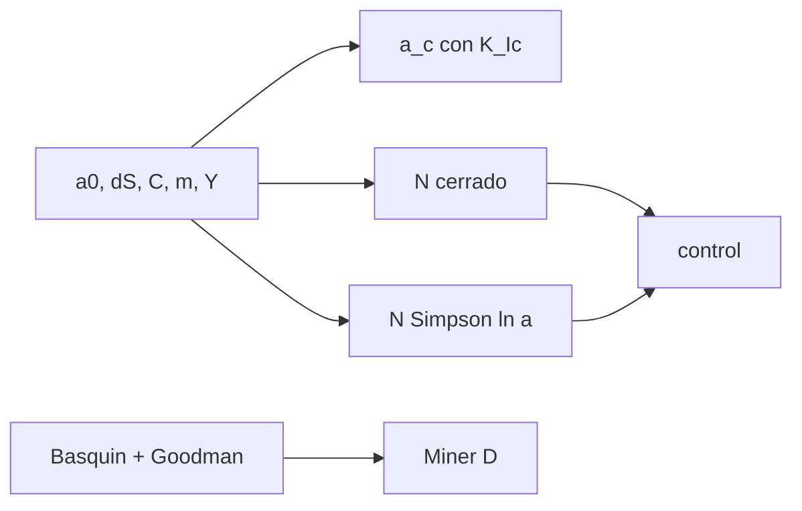

# B84-C08 — Fatiga y fractura

<!-- nav:top -->
[🏠 Programa](../../../../README.md) · [📚 Bloque B84](../../../tronco-comun/B84-estructuras-materiales-y-fabricacion-espacial.md) · [← Anterior: B84-C07 — Desgasificación de materiales](../B84-C07-desgasificacion-de-materiales/CLASE.md) · [Siguiente: B84-C09 — Análisis de cargas →](../B84-C09-analisis-de-cargas/CLASE.md)
<!-- /nav -->

## 1. Ubicación, nivel y alcance

Clase 8 del bloque B84. Nivel N3. Una pieza que resiste la carga máxima puede romperse por cargas pequeñas repetidas o por una grieta que crece. Aquí integras la ley de Paris para obtener los ciclos hasta la fractura, calculas el tamaño crítico de grieta con la tenacidad, aplicas la curva de Basquin con corrección de Goodman y sumas daño con la regla de Miner. El material es una aleación de aluminio **ilustrativa**. La concentración de tensiones se trata en C29 y el control de fractura de hardware real (NASA-STD-5019) solo se menciona.

## 2. Por qué esta clase existe

La mayoría de las fallas estructurales en servicio son por fatiga; saber cuántos ciclos quedan y qué grieta es tolerable decide si una pieza se acepta. La decisión central: **¿cuántos ciclos tarda una grieta inicial en llegar al tamaño crítico y cuánto daño acumula un espectro de cargas?**

## 3. Lo que podrás hacer al terminar

1. Calcular el factor de intensidad de tensión `ΔK = Y Δσ √(π a)`.
2. Hallar el tamaño crítico de grieta `a_c` con `K_Ic`.
3. Integrar la ley de Paris en forma cerrada y numérica.
4. Evaluar la vida con Basquin y la corrección de Goodman.
5. Sumar daño con la regla de Miner.
6. Separar lo ilustrativo de lo consultado.

La evidencia es la **ficha de vida a fatiga y tamaño crítico de grieta** del ejercicio 12 (sección 20).

## 4. Con qué llegas y cómo comprobarlo

1. ¿Qué es la tenacidad a fractura?
2. ¿Qué es un ciclo de carga?
3. ¿Qué es una integral por Simpson?
4. ¿Qué es la tensión media?
5. ¿Qué es un dato ilustrativo?

<details>
<summary>Ver respuestas</summary>

1. La resistencia de un material a la propagación de una grieta, `K_Ic` en MPa√m. 2. Una subida y bajada completa de la tensión. 3. Una regla numérica con ponderaciones 1, 4, 2, 4, …, 1. 4. El promedio entre la tensión máxima y mínima del ciclo. 5. Un valor típico no consultado.
</details>

Con cuatro o cinco aciertos, sigue; si no, repasa los prerrequisitos.

## 5. Un caso de contexto y casos de referencia

Con `C = 10⁻¹¹`, `m = 3`, `Y = 1,12`, `K_Ic = 30 MPa√m` y `Δσ = 100 MPa`, la grieta crítica es `22,838 mm` y una grieta inicial de `0,5 mm` tarda `974 146` ciclos en llegar a ella. Un espectro de tres bloques de carga acumula `D = 0,3989` por Miner. **Ejemplo conductor.** Aleación ilustrativa. NASA-STD-5019 (Rev. A, Cambio 4) se consultó solo en su ficha: exige control de fractura en todo sistema de vuelo tripulado.

## 6. Vocabulario

La **ley de Paris** es `da/dN = C (ΔK)^m`. El **tamaño crítico** `a_c = (K_Ic/(Y σ_max))²/π` es donde `K = K_Ic`. **Basquin**: `S_a = S_f′ (2N)^b`. **Goodman**: `S_ar = S_a/(1 − S_m/S_u)`. **Miner**: `D = Σ nᵢ/Nᵢ`; la falla se espera con `D = 1`.

## 7. Modelo mental: una grieta que avanza un poco cada ciclo



*Descripción textual:* los datos dan el tamaño crítico y los ciclos por dos vías (cerrada y numérica); por separado, Basquin y Miner dan el daño de un espectro.

Analogía: una rasgadura en una tela crece más rápido cuanto más larga: cada ciclo suma un avance mayor. Límite: Paris describe solo el tramo medio de la curva `da/dN`; ignora el umbral, el crecimiento rápido final y los retardos por sobrecargas.

## 8. La explicación, paso a paso

### 8.1 Tamaño crítico y ciclos

`a_c = (30/(1,12 × 100))²/π = 22,838 mm`. Con `m = 3`: `N = 2/((m−2) C (YΔσ√π)^m) (a₀^(1−m/2) − a_c^(1−m/2)) = 974 145,8` ciclos. La integración de Simpson en `ln a` da el mismo valor (diferencia relativa `5,9 × 10⁻¹⁵`).

### 8.2 Sensibilidades

| `Δσ` (MPa) | `a_c` (mm) | `N` (ciclos) |
|---|---|---|
| 50 | 91,352 | 8 469 845 |
| 75 | 40,601 | 2 409 335 |
| 100 | 22,838 | 974 146 |
| 150 | 10,150 | 263 574 |

`N` cae casi como `Δσ⁻³`: el exponente `m` castiga los rangos grandes. Con `Δσ = 100 MPa`, `a₀ = 0,2 mm` da `1 638 571` ciclos y `a₀ = 2 mm` da `402 488`: el tamaño inicial detectable manda.

### 8.3 Basquin y Goodman

`N = ½ (S_ar/S_f′)^(1/b)` con `S_f′ = 900 MPa`, `b = −0,10`. `S_a = 150 MPa` con `S_m = 0` da `3,02 × 10⁷` ciclos; con `S_m = 100 MPa`, `S_ar = 189,5 MPa` y `N = 2,92 × 10⁶`: la tensión media divide la vida entre 10.

### 8.4 Miner

Con `S_a = 200` (3 × 10⁵ ciclos), `150` (5 × 10⁶) y `100 MPa` (10⁸) los cocientes son `0,1762`, `0,1654` y `0,0574`: `D = 0,3989`, queda vida. Miner es lineal y no ve el orden de las cargas.

## 9. Magnitudes, símbolos y unidades

| Símbolo | Qué es | Unidad | Valor / nota |
|---|---|---|---|
| `ΔK` | rango del factor de intensidad | MPa√m | — |
| `a`, `a₀`, `a_c` | tamaño de grieta | m | 0,5 mm → 22,838 mm |
| `C`, `m` | constantes de Paris | — | 10⁻¹¹; 3 |
| `K_Ic` | tenacidad a fractura | MPa√m | 30 |
| `N` | ciclos | — | 974 146 |
| `D` | daño de Miner | — | 0,3989 |

## 10. Convenciones y referencias

MPa, m y ciclos; `C` en m/ciclo con `ΔK` en MPa√m; `R = 0`. Grieta de borde con `Y = 1,12` constante. Aleación ilustrativa, no consultada. Tolerancia: Simpson frente a fórmula cerrada < 10⁻⁶.

## 11. De dónde sale lo que afirmamos

| ID | Fuente | Localizador | Respalda | Estado |
|---|---|---|---|---|
| S1 | NASA, NASA-STD-5019 «Fracture Control Requirements for Spaceflight Hardware», Rev. A con Cambio 4 (2016-02-01; cambio 2024-07-12) — https://standards.nasa.gov/standard/nasa/nasa-std-5019 (ficha consultada 2026-11-10) | ficha del estándar (título, estado, alcance) | que el estándar exige control de fractura en todo sistema de vuelo tripulado, con título, revisión, fecha y estado | Consultada (solo la ficha) |
| — | Constantes de Paris y de Basquin; tenacidad y resistencias del aluminio | — | `C`, `m`, `Y`, `K_Ic`, `S_f′`, `b`, `S_u` y las leyes de Paris, Basquin, Goodman y Miner | No consultada en una fuente concreta |

Límites: de NASA-STD-5019 solo se consultó la ficha; las constantes de material son ilustrativas y no se consultaron; el cálculo no es un análisis de fractura de hardware real.

## 12. Cómo ver la vida a fatiga

| Magnitud | Valor |
|---|---|
| `a_c` con 100 MPa | 22,838 mm |
| `N` de 0,5 mm a `a_c` | 974 146 |
| `N` con 50 MPa | 8 469 845 |
| `N` Basquin 150 MPa, `S_m = 0` | 3,02 × 10⁷ |
| `D` de Miner | 0,3989 |

Descripción larga: la vida crece cerca de 8,7 veces al bajar el rango a la mitad; la tensión media acorta la vida a fatiga 10 veces.

## 13. Ejemplo trabajado: el tamaño crítico a 100 MPa

**Paso 1 · Razón.** `K_Ic/(Y σ_max) = 30/(1,12 × 100) = 0,2679 m^½`.

**Paso 2 · Cuadrado.** `0,07175 m`.

**Paso 3 · Dividir por π.** `a_c = 0,022838 m = 22,838 mm`.

## 14. Distintas formas de describir la fatiga de una pieza

**Por grieta:** Paris y `a_c`. **Por tensión:** Basquin y Goodman. **Por espectro:** Miner. **Por inspección:** tamaño inicial detectable.

## 15. Práctica guiada

**Ejercicio 1 · con los pasos indicados** Calcula `a_c` con `σ_max = 150 MPa`. *Pasos:* `(K_Ic/(Yσ))²/π`.

<details><summary>Solución comentada</summary>

`(30/(1,12 × 150))²/π = 10,15 mm`.
</details>

**Ejercicio 2 · con los pasos indicados** ¿Cuánto cambia `N` si `Δσ` pasa de 50 a 100 MPa? *Pista:* mira la tabla 8.2.

<details><summary>Solución comentada</summary>

Se divide por 8,7: `8 469 845/974 146`.
</details>

**Ejercicio 3 · con los pasos indicados** ¿Por qué Goodman reduce la vida? *Casi autónomo.*

<details><summary>Solución comentada</summary>

Porque convierte la tensión media en una amplitud equivalente mayor.
</details>

## 16. Práctica autónoma, transferencia e integrador

**Ejercicio 4 · autónomo** `N` de Basquin para `S_ar = 200 MPa`.

<details><summary>Solución comentada</summary>

`½ (200/900)^(−10) = 1,70 × 10⁶`.
</details>

**Ejercicio 5 · autónomo** Grieta inicial que da `N = 639 276` con 100 MPa.

<details><summary>Solución comentada</summary>

`a₀ = 1,0 mm`.
</details>

**Ejercicio 6 · autónomo** `D` si solo se aplica el bloque de 150 MPa.

<details><summary>Solución comentada</summary>

`0,1654`.
</details>

**Ejercicio 7 · autónomo** Efecto de duplicar `C`.

<details><summary>Solución comentada</summary>

`N` se divide por 2.
</details>

**Ejercicio 8 · autónomo** ¿Qué `m` haría `N ∝ Δσ⁻⁴`?

<details><summary>Solución comentada</summary>

`m = 4`.
</details>

**Ejercicio 9 · transferencia. **Transferencia.**** Una inspección solo detecta grietas de 2 mm. ¿Qué vida garantiza?

<details><summary>Solución comentada</summary>

Calculada con `a₀ = 2 mm`: 402 488 ciclos en este caso.
</details>

**Ejercicio 10 · transferencia. **Transferencia.**** Un espectro de vuelo tiene un pico raro que retarda el crecimiento. ¿Paris lo ve?

<details><summary>Solución comentada</summary>

No: Paris es conservador y no incluye el retardo.
</details>

**Ejercicio 11 · transferencia. **Transferencia.**** ¿Basta con `D < 1` de Miner para aceptar una pieza?

<details><summary>Solución comentada</summary>

No: se exige un factor de vida y, en hardware real, control de fractura.
</details>

**Ejercicio 12 · integrador. **Integrador.**** Elabora tu *ficha de vida a fatiga y tamaño crítico de grieta*: `a_c`, `N` por dos vías, sensibilidad a `Δσ` y `a₀`, Basquin con Goodman y Miner, con lo ilustrativo rotulado.

<details><summary>Solución comentada</summary>

Secciones 8.1–8.4 y la salida del laboratorio.
</details>

## 17. Laboratorio: Paris, Basquin y Miner

El script [fatiga.py](fatiga.py) integra Paris por dos vías y calcula Basquin con Goodman y el daño de Miner (**comprueba** fórmula cerrada frente a Simpson (< 1e-6) y `N ∝ Δσ⁻³` aproximado).

**Datos:** aleación **ilustrativa**; NASA-STD-5019 consultada solo en su ficha. **Predice antes de ejecutar:** ¿cuántas veces más ciclos con la mitad del rango? (≈ 8,7.) **Ejecución del 2026-11-10 (Python 3.12.9):**

```text
Python 3.12.9 (biblioteca estandar)
Aleacion ILUSTRATIVA: C = 1e-11, m = 3, Y = 1,12, K_Ic = 30 MPa sqrt(m)
a_critico con S_max = 100 MPa: 22.838 mm
Ciclos de a0 = 0,5 mm a a_c: formula cerrada = 974145.8 ; Simpson en ln a = 974145.8 ; dif. relativa = 5.9e-15
Sensibilidad de la vida al rango de tension (a0 = 0,5 mm):
  dS =    50 MPa  a_c =  91.352 mm  N =    8469845.3
  dS =    75 MPa  a_c =  40.601 mm  N =    2409335.0  (cociente con la fila anterior = 0.284)
  dS =   100 MPa  a_c =  22.838 mm  N =     974145.8  (cociente con la fila anterior = 0.404)
  dS =   150 MPa  a_c =  10.150 mm  N =     263573.6  (cociente con la fila anterior = 0.271)
Sensibilidad al tamano inicial de grieta (dS = 100 MPa):
  a0 =  0.2 mm  N =    1638570.8
  a0 =  0.5 mm  N =     974145.8
  a0 =  1.0 mm  N =     639276.4
  a0 =  2.0 mm  N =     402488.0
Basquin (sin y con media), S_a equivalente por Goodman S_ar = S_a/(1 - S_m/S_u):
  S_a =   150, S_m =     0 -> S_ar =  150.00 MPa -> N =    3.023e+07
  S_a =   150, S_m =   100 -> S_ar =  189.47 MPa -> N =    2.924e+06
  S_a =   100, S_m =   100 -> S_ar =  126.32 MPa -> N =    1.686e+08
  bloque S_a =   200: n =  300000.0, N_f =    1.703e+06, n/N = 0.1762
  bloque S_a =   150: n = 5000000.0, N_f =    3.023e+07, n/N = 0.1654
  bloque S_a =   100: n = 100000000.0, N_f =    1.743e+09, n/N = 0.0574
Dano de Miner D = 0.3989 (queda vida)
Pruebas superadas.
```

```bash
python programa/clases/B84/B84-C08-fatiga-y-fractura/fatiga.py
```

**Límites:** Paris de un tramo, grieta de borde, sin retardos ni umbral; Miner lineal.

## 18. Errores frecuentes y cómo corregirlos

**Medir la vida con la carga máxima estática.** Se corrige con 8.1.

**Olvidar la tensión media.** Se corrige con 8.3.

**Ignorar el tamaño inicial detectable.** Se corrige con 8.2.

**Sumar daños de bloques sin su `N` propio.** Se corrige con 8.4.

## 19. Cómo sabrás que vas bien

Tras la sección 8: ¿qué `a_c` esperabas y cuál obtuviste? Si dudas, repasa el ejemplo 13. Tras el laboratorio: ¿qué comprueba? (ver la sección 17).

## 20. Qué entregas y cómo se evalúa

El producto es tu **ficha de vida a fatiga y tamaño crítico de grieta** (ejercicio 12).

| Criterio | Inicial | En desarrollo | Logrado | Destacado |
|---|---|---|---|---|
| Conceptos | Los confunde | Parciales | Integra Paris y suma daño | Explica los límites |
| Cálculo | Sin unidades | Con errores | Tablas completas con unidades | Calcula casos nuevos |
| Numérico | Sin comprobar | Un caso | Contraste con una segunda vía | Interpreta las diferencias |
| Fuentes | Sin fuente | Sin fecha | Fuentes con fecha y estado | Declara lo ilustrativo y lo no consultado |
| Límites | No los nombra | Uno | Tres | Discute qué falta del modelo |

**Condiciones críticas (no se compensan con promedio):** rotular los datos ilustrativos y sintéticos como tales; no presentar un cálculo como ensayo ni como dato de vuelo; citar solo lo consultado.

## 21. Ética, seguridad y límites

Clase educativa: los modelos son simplificados y sus datos son sintéticos, ilustrativos o valores de estándar rotulados; **no es una base de diseño de hardware de vuelo** y ningún resultado sustituye a datos de material cualificados, a los documentos vigentes de la agencia o del lanzador ni a la revisión por personal competente. Accesibilidad: tablas equivalentes a las gráficas, fórmulas en texto, ejercicios sin conexión.

## 22. Para cerrar y seguir

Una grieta de `0,5 mm` tarda `974 146` ciclos en llegar a `22,8 mm`, y la tensión media acorta la vida a fatiga 10 veces. Queda una pregunta: ¿qué cargas actúan sobre la estructura en cada fase del lanzamiento?

**Glosario español–inglés.** fatiga · *fatigue*; fractura · *fracture*; tenacidad · *fracture toughness*; ley de Paris · *Paris law*; regla de Miner · *Miner's rule*.

**Continuidad.** [B84-C09](../B84-C09-analisis-de-cargas/CLASE.md) estudia el análisis de cargas.

**Referencias:** ver sección 11.

<!-- nav:bottom -->
---

[← Anterior: B84-C07 — Desgasificación de materiales](../B84-C07-desgasificacion-de-materiales/CLASE.md) · [📚 Bloque B84](../../../tronco-comun/B84-estructuras-materiales-y-fabricacion-espacial.md) · [Siguiente: B84-C09 — Análisis de cargas →](../B84-C09-analisis-de-cargas/CLASE.md)
<!-- /nav -->
