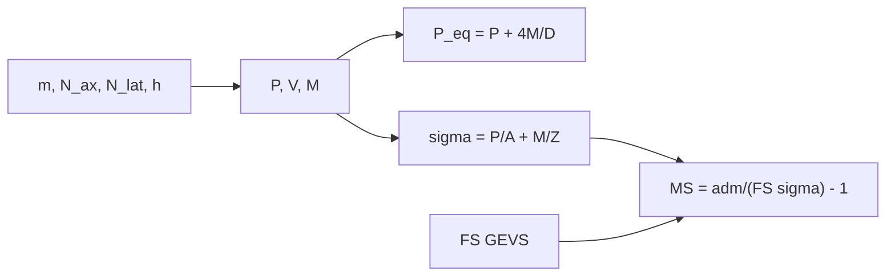

# B84-C09 — Análisis de cargas

<!-- nav:top -->
[🏠 Programa](../../../../README.md) · [📚 Bloque B84](../../../tronco-comun/B84-estructuras-materiales-y-fabricacion-espacial.md) · [← Anterior: B84-C08 — Fatiga y fractura](../B84-C08-fatiga-y-fractura/CLASE.md) · [Siguiente: B84-C10 — Análisis modal →](../B84-C10-analisis-modal/CLASE.md)
<!-- /nav -->

## 1. Ubicación, nivel y alcance

Clase 9 del bloque B84. Nivel N3. Antes de dimensionar hay que saber qué cargas llegan. Aquí conviertes factores de carga cuasiestáticos en fuerza axial, cortante y momento en el anillo de interfaz de un satélite de 100 kg, calculas la tensión máxima y el margen con los factores de seguridad del GEVS (consultados). Los factores de carga, la geometría y el material son **ilustrativos**; los de un lanzador real salen de su manual y del análisis de cargas acopladas.

## 2. Por qué esta clase existe

Un margen sin una carga bien planteada no vale: la carga lateral actúa con brazo de palanca y puede exigir más al anillo que la axial. La decisión central: **¿qué margen tiene el anillo de interfaz con las cargas límite y los factores de seguridad estándar?**

## 3. Lo que podrás hacer al terminar

1. Calcular la fuerza axial y lateral y el momento con factores de carga.
2. Obtener la carga axial equivalente `P + 4M/D`.
3. Calcular la tensión por axial más flexión.
4. Aplicar los factores de seguridad de fluencia y rotura del GEVS.
5. Calcular el margen de seguridad `MS = σ_adm/(FS σ) − 1`.
6. Separar lo consultado de lo ilustrativo.

La evidencia es la **tabla de cargas y márgenes en la interfaz** del ejercicio 12 (sección 20).

## 4. Con qué llegas y cómo comprobarlo

1. ¿Qué es un factor de carga?
2. ¿Qué es un momento flector?
3. ¿Qué es un módulo de sección?
4. ¿Qué es una carga límite?
5. ¿Qué es un margen de seguridad?

<details>
<summary>Ver respuestas</summary>

1. La aceleración del cuerpo dividida por `gₙ`. 2. El producto de una fuerza por la distancia al punto. 3. `Z = I/c`: relaciona momento y tensión de flexión. 4. La máxima esperada en servicio. 5. El exceso de capacidad sobre la demanda con factor, dividido por la demanda.
</details>

Con cuatro o cinco aciertos, sigue; si no, repasa los prerrequisitos.

## 5. Un caso de contexto y casos de referencia

Un satélite de 100 kg con el centro de masas a 0,50 m de la interfaz se somete a `6 g` axial y `3 g` lateral (ilustrativos): `P = 5884,0 N`, `V = 2942,0 N`, `M = 1471,0 N·m`, `P_eq = 12 163,6 N` y tensión máxima `52,30 MPa` en un anillo de aluminio. Con los factores del GEVS (1,25 en fluencia, 1,4 en rotura), `MS_y = 3,206` y `MS_u = 3,234`. **Ejemplo conductor.** Los factores de carga y la geometría son ilustrativos.

## 6. Vocabulario

La **carga límite** es la máxima esperada; la **carga última** es `FS × límite`. El **margen de seguridad** `MS = σ_adm/(FS σ_lim) − 1` es positivo si hay reserva. La **carga axial equivalente** de un momento en un anillo de diámetro `D` es `4M/D`. El GEVS (Tabla 2.2-3) da para metálicos estáticos `FS_y = 1,25` y `FS_u = 1,4`.

## 7. Modelo mental: una mesa con una pata más cargada que las otras



*Descripción textual:* los factores de carga dan fuerzas y momento, de los cuales salen la carga equivalente y la tensión; con los factores de seguridad se calcula el margen.

Analogía: una mesa con una carga alta pesa distinto en cada pata: el momento carga más una. Límite: factores de carga cuasiestáticos no reemplazan el análisis de cargas acopladas lanzador–satélite.

## 8. La explicación, paso a paso

### 8.1 Fuerzas y momento

`P = N_ax m gₙ = 6 × 100 × 9,80665 = 5884,0 N`; `V = 3 × 100 × 9,80665 = 2942,0 N`; `M = V h = 2942,0 × 0,5 = 1471,0 N·m`. Con `D = 0,937 m`, `P_eq = P + 4M/D = 12 163,6 N`: el momento duplica casi la carga axial.

### 8.2 Tensión y margen

`σ = P/A + M/Z = 5884/(3 × 10⁻⁴) + 1471/(4,5 × 10⁻⁵) = 19,61 + 32,69 = 52,30 MPa` (compresión) y `−13,08 MPa` en la fibra opuesta (tracción neta). `MS_y = 275/(1,25 × 52,30) − 1 = 3,206`; `MS_u = 310/(1,4 × 52,30) − 1 = 3,234`. La carga que agotaría el margen es `×4,21` en fluencia y `×4,23` en rotura.

### 8.3 Barrido lateral

| `N_lat` (g) | `σ` (MPa) | `MS_u` |
|---|---|---|
| 1 | 30,51 | 6,258 |
| 3 | 52,30 | 3,234 |
| 5 | 74,09 | 1,988 |
| 8 | 106,78 | 1,074 |

### 8.4 Cuánto confiar

Los factores del GEVS valen para metálicos con cargas estáticas; para vibración aleatoria o acústica son 1,6 y 1,8 (Tabla 2.2-3). Con solo análisis, el estándar pide 2,0 y 2,6 sobre fluencia y rotura. Margen positivo con factores bajos no basta si las cargas no son las del lanzador.

## 9. Magnitudes, símbolos y unidades

| Símbolo | Qué es | Unidad | Valor / nota |
|---|---|---|---|
| `N_ax`, `N_lat` | factores de carga límite | g | 6; 3 (ilustrativos) |
| `P`, `V`, `M` | fuerza axial, cortante y momento | N, N, N·m | 5884,0; 2942,0; 1471,0 |
| `σ` | tensión máxima | MPa | 52,30 |
| `FS_y`, `FS_u` | factores de seguridad | — | 1,25; 1,4 (GEVS) |
| `MS` | margen de seguridad | — | 3,206; 3,234 |
| `gₙ` | gravedad estándar | m/s² | 9,806 65 (NIST) |

## 10. Convenciones y referencias

SI y MPa. Compresión positiva. Factores de carga cuasiestáticos ilustrativos; geometría, área `A`, módulo `Z` y resistencias ilustrativos. Factores de seguridad: Tabla 2.2-3 del GEVS, columna estática.

## 11. De dónde sale lo que afirmamos

| ID | Fuente | Localizador | Respalda | Estado |
|---|---|---|---|---|
| S1 | NASA/GSFC, GSFC-STD-7000 (GEVS) Versión B, Cambio 0, 2021-04-28 — https://standards.nasa.gov/standard/gsfc/gsfc-std-7000 (PDF descargado y leído con PyMuPDF el 2026-11-10) | Tabla 2.2-3 (página 47 del PDF) | factores de seguridad: metálico fluencia 1,25 y rotura 1,4 en estático; 1,6 y 1,8 en aleatorio/acústico; compuesto 1,5; 2,0 y 2,6 si se califica solo por análisis | Consultada |
| S2 | NIST, CODATA, aceleración estándar de la gravedad — https://physics.nist.gov/cgi-bin/cuu/Value?gn (consultada 2026-11-10) | valor de `gₙ` | `gₙ` = 9,806 65 m/s² (exacto por definición) | Consultada |
| — | Factores de carga del lanzador, geometría y material del ejemplo | — | todos los datos de entrada del anillo | No consultada en una fuente concreta |

Límites: los factores de seguridad son los del GEVS (estático); los factores de carga, la geometría y las resistencias son ilustrativos; no se consultó ningún manual de lanzador.

## 12. Cómo ver las cargas y el margen

| Magnitud | Valor |
|---|---|
| `P_eq` | 12 163,6 N |
| `σ` máx. | 52,30 MPa |
| `MS_y` | 3,206 |
| `MS_u` | 3,234 |
| Factor que agota el margen | ×4,23 |

Descripción larga: el momento aporta más tensión que la carga axial; el margen cae de 6,3 a 1,1 al subir la carga lateral de 1 a 8 g.

## 13. Ejemplo trabajado: el margen de rotura

**Paso 1 · Tensión.** `σ = 52,30 MPa`.

**Paso 2 · Demanda.** `1,4 × 52,30 = 73,22 MPa`.

**Paso 3 · Margen.** `310/73,22 − 1 = 3,234`.

## 14. Distintas formas de describir la carga en una interfaz

**Por factor de carga:** `N`. **Por fuerzas:** `P`, `V`, `M`. **Por equivalente:** `P_eq`. **Por tensión:** `σ`. **Por margen:** `MS`.

## 15. Práctica guiada

**Ejercicio 1 · con los pasos indicados** Calcula `M` con `V = 2942 N` y `h = 0,5 m`. *Pasos:* multiplica.

<details><summary>Solución comentada</summary>

`1471 N·m`.
</details>

**Ejercicio 2 · con los pasos indicados** Calcula `P_eq`. *Pista:* `P + 4M/D`.

<details><summary>Solución comentada</summary>

`5884 + 4 × 1471/0,937 = 12 163,6 N`.
</details>

**Ejercicio 3 · con los pasos indicados** ¿Por qué una tensión máxima de compresión de 52,3 MPa y una mínima de −13,1? *Casi autónomo.*

<details><summary>Solución comentada</summary>

La flexión suma en un lado y resta en el otro: `19,61 ± 32,69 MPa`.
</details>

## 16. Práctica autónoma, transferencia e integrador

**Ejercicio 4 · autónomo** `MS_y` con `σ = 74,09 MPa`.

<details><summary>Solución comentada</summary>

`275/(1,25 × 74,09) − 1 = 1,970`.
</details>

**Ejercicio 5 · autónomo** `σ` con `N_lat = 0`.

<details><summary>Solución comentada</summary>

`19,61 MPa`.
</details>

**Ejercicio 6 · autónomo** Factor de carga lateral que hace `MS_u = 0`.

<details><summary>Solución comentada</summary>

`σ = 310/1,4 = 221,4 MPa`: `N_lat ≈ 18,5 g`.
</details>

**Ejercicio 7 · autónomo** `MS_u` con `FS_u = 2,6`.

<details><summary>Solución comentada</summary>

`310/(2,6 × 52,30) − 1 = 1,280`.
</details>

**Ejercicio 8 · autónomo** `P_eq` si `h = 1 m`.

<details><summary>Solución comentada</summary>

`5884 + 4 × 2942/0,937 = 18 443 N`.
</details>

**Ejercicio 9 · transferencia. **Transferencia.**** Un margen de 3,2 parece enorme. ¿Qué puede estar mal?

<details><summary>Solución comentada</summary>

Que las cargas sean ilustrativas o que falten modos de falla (pandeo, fatiga, uniones).
</details>

**Ejercicio 10 · transferencia. **Transferencia.**** ¿Se puede usar 1,25 y 1,4 para vibración aleatoria?

<details><summary>Solución comentada</summary>

No: el GEVS da 1,6 y 1,8 para cargas aleatorias.
</details>

**Ejercicio 11 · transferencia. **Transferencia.**** Un análisis acoplado da una carga 2 veces mayor que el factor ilustrativo. ¿Qué haces?

<details><summary>Solución comentada</summary>

Rehaces los márgenes con la carga del análisis acoplado.
</details>

**Ejercicio 12 · integrador. **Integrador.**** Elabora tu *tabla de cargas y márgenes en la interfaz*: `P`, `V`, `M`, `P_eq`, tensiones, `MS_y`, `MS_u` y el barrido lateral, rotulando lo ilustrativo.

<details><summary>Solución comentada</summary>

Secciones 8.1–8.4 y la salida del laboratorio.
</details>

## 17. Laboratorio: cargas en la interfaz y márgenes

El script [cargas.py](cargas.py) calcula las cargas, la tensión por axial y flexión y los márgenes con los factores del GEVS (**comprueba** `σ·FS` escala al admisible y `σ_máx − σ_mín = 2M/Z`).

**Datos:** factores del GEVS **consultados**; geometría y cargas **ilustrativas**. **Predice antes de ejecutar:** ¿qué margen de rotura tendrá a 3 g lateral? (≈ 3,2.) **Ejecución del 2026-11-10 (Python 3.12.9):**

```text
Python 3.12.9 (biblioteca estandar)
Factores de seguridad del GEVS (Tabla 2.2-3, estatico): fluencia 1,25; ultima 1,4 (metalico)
Datos ILUSTRATIVOS: m = 100 kg, h = 0.5 m, N_ax = 6.0 g, N_lat = 3.0 g
Cargas limite: P = 5884.0 N, V = 2942.0 N, M = 1471.0 N m, P_eq = P + 4M/D = 12163.6 N
Tension limite en el anillo (compresion axial + flexion): max = 52.30 MPa, min = -13.08 MPa
Margen de fluencia  MS_y = 275/(1.25 x 52.30) - 1 = 3.206
Margen de rotura    MS_u = 310/(1.4 x 52.30) - 1 = 3.234
Factor de carga que agota el margen: fluencia x4.2063, rotura x4.2336
Barrido de carga lateral (carga axial fija 6 g):
  N_lat = 1.0 g -> sigma =   30.51 MPa, MS_u =   6.258
  N_lat = 3.0 g -> sigma =   52.30 MPa, MS_u =   3.234
  N_lat = 5.0 g -> sigma =   74.09 MPa, MS_u =   1.988
  N_lat = 8.0 g -> sigma =  106.78 MPa, MS_u =   1.074
Pruebas superadas.
```

```bash
python programa/clases/B84/B84-C09-analisis-de-cargas/cargas.py
```

**Límites:** cuasiestático, un solo modo de falla y anillo simple; sin pandeo, fatiga ni uniones.

## 18. Errores frecuentes y cómo corregirlos

**Olvidar el momento.** Se corrige con 8.1.

**Aplicar el factor equivocado.** Se corrige con 8.4.

**Dar un margen sin carga justificada.** Se corrige con la sección 10.

**Presentar los factores de carga ilustrativos como los de un lanzador.** Se corrige con el alcance.

## 19. Cómo sabrás que vas bien

Tras la sección 8: ¿qué margen esperabas con 5 g lateral y cuál obtuviste? Si dudas, repasa el ejemplo 13. Tras el laboratorio: ¿qué comprueba? (ver la sección 17).

## 20. Qué entregas y cómo se evalúa

El producto es tu **tabla de cargas y márgenes en la interfaz** (ejercicio 12).

| Criterio | Inicial | En desarrollo | Logrado | Destacado |
|---|---|---|---|---|
| Conceptos | Los confunde | Parciales | Calcula cargas y márgenes | Explica los límites |
| Cálculo | Sin unidades | Con errores | Tablas completas con unidades | Calcula casos nuevos |
| Numérico | Sin comprobar | Un caso | Contraste con una segunda vía | Interpreta las diferencias |
| Fuentes | Sin fuente | Sin fecha | Fuentes con fecha y estado | Declara lo ilustrativo y lo no consultado |
| Límites | No los nombra | Uno | Tres | Discute qué falta del modelo |

**Condiciones críticas (no se compensan con promedio):** rotular los datos ilustrativos y sintéticos como tales; no presentar un cálculo como ensayo ni como dato de vuelo; citar solo lo consultado.

## 21. Ética, seguridad y límites

Clase educativa: los modelos son simplificados y sus datos son sintéticos, ilustrativos o valores de estándar rotulados; **no es una base de diseño de hardware de vuelo** y ningún resultado sustituye a datos de material cualificados, a los documentos vigentes de la agencia o del lanzador ni a la revisión por personal competente. Accesibilidad: tablas equivalentes a las gráficas, fórmulas en texto, ejercicios sin conexión.

## 22. Para cerrar y seguir

El anillo tiene `MS_u = 3,234` con `6 g` y `3 g` y `1,074` con `8 g` lateral. Queda una pregunta: ¿a qué frecuencias vibra esta estructura?

**Glosario español–inglés.** factor de carga · *load factor*; carga límite · *limit load*; margen de seguridad · *margin of safety*; factor de seguridad · *factor of safety*; interfaz · *interface*.

**Continuidad.** [B84-C10](../B84-C10-analisis-modal/CLASE.md) estudia el análisis modal.

**Referencias:** ver sección 11.

<!-- nav:bottom -->
---

[← Anterior: B84-C08 — Fatiga y fractura](../B84-C08-fatiga-y-fractura/CLASE.md) · [📚 Bloque B84](../../../tronco-comun/B84-estructuras-materiales-y-fabricacion-espacial.md) · [Siguiente: B84-C10 — Análisis modal →](../B84-C10-analisis-modal/CLASE.md)
<!-- /nav -->
