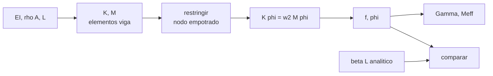

# B84-C10 — Análisis modal

<!-- nav:top -->
[🏠 Programa](../../../../README.md) · [📚 Bloque B84](../../../tronco-comun/B84-estructuras-materiales-y-fabricacion-espacial.md) · [← Anterior: B84-C09 — Análisis de cargas](../B84-C09-analisis-de-cargas/CLASE.md) · [Siguiente: B84-C11 — Vibraciones y resonancias →](../B84-C11-vibraciones-y-resonancias/CLASE.md)
<!-- /nav -->

## 1. Ubicación, nivel y alcance

Clase 10 del bloque B84. Nivel N3. Todo cuerpo elástico tiene frecuencias naturales y formas de vibrar. Aquí resuelves por elementos finitos el problema de autovalores `K φ = ω² M φ` de una viga en voladizo, comparas con la solución analítica, calculas masas efectivas modales y aplicas el criterio del GEVS de modo significativo (masa efectiva ≥ 5 %). La viga es **ilustrativa**. Las clases C11, C32 y C33 usan estos modos; C30 los correlaciona con ensayos.

## 2. Por qué esta clase existe

Un satélite cuyo primer modo cae dentro del rango excitado por el lanzador se amplifica; los modos con más masa efectiva son los que importan. La decisión central: **¿qué modos importan, con qué frecuencia y qué fracción de masa mueven?**

## 3. Lo que podrás hacer al terminar

1. Plantear `K φ = ω² M φ` con restricciones.
2. Resolverlo con Cholesky y Jacobi.
3. Contrastar las frecuencias con la solución analítica `(β_nL)²√(EI/ρAL⁴)`.
4. Calcular factores de participación y masas efectivas.
5. Aplicar el criterio de 5 % de masa efectiva del GEVS.
6. Comprobar que las masas efectivas y la masa de apoyo suman la masa total.

La evidencia es la **tabla de modos, frecuencias y masas efectivas** del ejercicio 12 (sección 20).

## 4. Con qué llegas y cómo comprobarlo

1. ¿Qué es una frecuencia natural?
2. ¿Qué es un autovalor?
3. ¿Qué es una matriz de masa consistente?
4. ¿Qué es un GDL?
5. ¿Qué es un dato ilustrativo?

<details>
<summary>Ver respuestas</summary>

1. La frecuencia a la que una estructura vibra libremente. 2. Un `λ` tal que `K φ = λ M φ` tiene solución no nula. 3. La que deriva de las mismas funciones de forma que la rigidez. 4. Un grado de libertad: una coordenada del modelo. 5. Un valor no consultado.
</details>

Con cuatro o cinco aciertos, sigue; si no, repasa los prerrequisitos.

## 5. Un caso de contexto y casos de referencia

Una viga de aluminio de `1 m` (`b = 50 mm`, `h = 10 mm`, `EI = 287,5 N·m²`, `ρA = 1,35 kg/m`) en voladizo con 10 elementos tiene `f₁ = 8,166 Hz` (analítica `8,166`), `f₂ = 51,179 Hz` y `f₃ = 143,334 Hz`; el modo 1 mueve el `61,3 %` de la masa y los tres primeros son significativos. **Ejemplo conductor.** Todo es ilustrativo salvo el criterio del GEVS.

## 6. Vocabulario

Un **modo** es una forma `φ` con frecuencia `f = ω/(2π)`. La **masa efectiva** de un modo es `(φᵀ M r)²` con `φ` normalizado a masa unitaria y `r` la traslación de sólido rígido; mide cuánta masa mueve el modo. Un modo es **significativo** si su masa efectiva es al menos 5 % de la total (GEVS).

## 7. Modelo mental: las notas de una cuerda de guitarra



*Descripción textual:* se ensamblan `K` y `M`, se restringe el empotramiento, se resuelve el problema generalizado y se calculan frecuencias y masas efectivas, que se comparan con la solución analítica.

Analogía: cada modo es una nota de la cuerda: la fundamental es la que más mueve; los armónicos mueven cada vez menos masa. Límite: el modelo es lineal, sin amortiguamiento y con material uniforme.

## 8. La explicación, paso a paso

### 8.1 Frecuencias

Con 10 elementos de viga de Euler–Bernoulli:

| Modo | `β_nL` | `f` analítica (Hz) | `f` FE (Hz) | Error (%) |
|---|---|---|---|---|
| 1 | 1,8751 | 8,166 | 8,166 | 0,0001 |
| 2 | 4,6941 | 51,177 | 51,179 | 0,0033 |
| 3 | 7,8548 | 143,297 | 143,334 | 0,0255 |
| 4 | 10,9955 | 280,805 | 281,073 | 0,0953 |
| 5 | 14,1372 | 464,191 | 465,361 | 0,2521 |
| 6 | 17,2788 | 693,421 | 697,164 | 0,5398 |

Las raíces `β_nL` salen de `cos x cosh x = −1` por bisección. El error crece con el orden del modo porque la malla tiene menos elementos por semionda.

### 8.2 Masas efectivas

`M_eff = (φᵀ M r)²`: modo 1 `0,8277 kg` (61,3 %), modo 2 `0,2542 kg` (18,8 %), modo 3 `0,0874 kg` (6,5 %), modo 4 `3,3 %` y modo 5 `2,0 %`. Con el criterio del 5 % del GEVS son significativos los modos 1 a 3.

### 8.3 Suma de masas

Los 20 modos suman `1,310308 kg`; la masa de apoyo (complemento de Schur del nodo empotrado) es `0,039692 kg` y la suma es `1,350000 kg`, la masa total: la comprobación funciona al contar la masa que se mueve con la base.

### 8.4 Convergencia

El modo 1 con 1, 2, 4, 8, 16 elementos da `8,2051`, `8,1702`, `8,1665`, `8,1663` y `8,1663 Hz`: errores de `0,475 %` a `0,00001 %`, un método que converge rápido en frecuencias bajas.

## 9. Magnitudes, símbolos y unidades

| Símbolo | Qué es | Unidad | Valor / nota |
|---|---|---|---|
| `K`, `M` | rigidez y masa globales | N/m, kg | — |
| `ω`, `f` | frecuencia angular y natural | rad/s, Hz | 8,166 Hz (modo 1) |
| `φ` | forma modal | — | normalizada a masa 1 |
| `Γ` | factor de participación | kg^½ | — |
| `M_eff` | masa efectiva | kg | 0,8277 (modo 1) |
| `β_nL` | raíz de la viga en voladizo | — | 1,8751; 4,6941 |

## 10. Convenciones y referencias

SI. Viga de Euler–Bernoulli de masa consistente, empotrada en un extremo. Traslación lateral solo. Criterio de 5 % del GEVS (p. 2.4-7). Tolerancias: modo 1 con error < 0,1 %; suma de masas efectivas y de apoyo igual a la masa total a 10⁻⁹.

## 11. De dónde sale lo que afirmamos

| ID | Fuente | Localizador | Respalda | Estado |
|---|---|---|---|---|
| S1 | NASA/GSFC, GSFC-STD-7000 (GEVS) Versión B, Cambio 0, 2021-04-28 — https://standards.nasa.gov/standard/gsfc/gsfc-std-7000 (PDF descargado y leído con PyMuPDF el 2026-11-10) | sección 2.4 (encuesta modal), página 58 del PDF (2.4-7) | la definición de modo significativo (masa efectiva ≥ 5 %), la ortogonalidad cruzada con 0,9 en la diagonal y 0,1 fuera, y el ajuste de frecuencias dentro de 5 % | Consultada |
| — | Propiedades de la viga de aluminio; ecuación de frecuencias de la viga en voladizo | — | los valores de `E`, `ρ` y las raíces de `cos x cosh x = −1`, que verifica el laboratorio | No consultada en una fuente concreta |

Límites: la viga es ilustrativa; del GEVS solo se leyeron los criterios citados; no se modeló ninguna estructura de vuelo.

## 12. Cómo ver los modos de la viga

| Magnitud | Valor |
|---|---|
| `f₁` FE | 8,166 Hz |
| `f₂` FE | 51,179 Hz |
| `M_eff` modo 1 | 61,3 % |
| Modos significativos (≥ 5 %) | 1, 2 y 3 |
| Suma con masa de apoyo | 1,350000 kg |

Descripción larga: tres modos concentran el 86,6 % de la masa; el error de frecuencia crece con el orden del modo.

## 13. Ejemplo trabajado: la frecuencia fundamental analítica

**Paso 1 · Cociente.** `EI/(ρA L⁴) = 287,5/1,35 = 212,96 s⁻²`.

**Paso 2 · Raíz.** `√212,96 = 14,59 s⁻¹`.

**Paso 3 · Frecuencia.** `ω₁ = 1,8751² × 14,59 = 51,31 rad/s`; `f₁ = 51,31/(2π) = 8,166 Hz`.

## 14. Distintas formas de describir la dinámica de una estructura

**Por frecuencias:** `f`. **Por formas:** `φ`. **Por masa:** `M_eff`. **Por significancia:** ≥ 5 %. **Por convergencia:** error frente a la malla.

## 15. Práctica guiada

**Ejercicio 1 · con los pasos indicados** Calcula `ω₂` desde `β₂L = 4,6941`. *Pasos:* `(β₂L)²√(EI/(ρA L⁴))`.

<details><summary>Solución comentada</summary>

`22,03 × 14,59 = 321,5 rad/s`: `f = 51,18 Hz`.
</details>

**Ejercicio 2 · con los pasos indicados** ¿Cuántos modos son significativos con el criterio del 5 %? *Pista:* tabla 8.2.

<details><summary>Solución comentada</summary>

Tres.
</details>

**Ejercicio 3 · con los pasos indicados** ¿Por qué suman 1,3103 y no 1,35? *Casi autónomo.*

<details><summary>Solución comentada</summary>

Falta la masa de apoyo (Schur) de 0,0397 kg, que se mueve con la base.
</details>

## 16. Práctica autónoma, transferencia e integrador

**Ejercicio 4 · autónomo** `f₁` si `E` sube 10 %.

<details><summary>Solución comentada</summary>

`f₁ ∝ √E`: `8,166 × 1,0488 = 8,565 Hz`.
</details>

**Ejercicio 5 · autónomo** `f₁` si `L` se duplica.

<details><summary>Solución comentada</summary>

`f ∝ L⁻²`: `2,04 Hz`.
</details>

**Ejercicio 6 · autónomo** Fracción de masa de los tres primeros modos.

<details><summary>Solución comentada</summary>

`61,3 + 18,8 + 6,5 = 86,6 %`.
</details>

**Ejercicio 7 · autónomo** Error de `f₆` por FE.

<details><summary>Solución comentada</summary>

`0,54 %`.
</details>

**Ejercicio 8 · autónomo** ¿Qué pasa con `f` si `h` se duplica?

<details><summary>Solución comentada</summary>

`I` ×8 y `ρA` ×2: `f` ×2.
</details>

**Ejercicio 9 · transferencia. **Transferencia.**** Un lanzador excita 20–100 Hz. ¿Importa el modo de 8,2 Hz?

<details><summary>Solución comentada</summary>

Sí si el lanzador excita esa banda; con Q alto se amplifica.
</details>

**Ejercicio 10 · transferencia. **Transferencia.**** Un modo con 1 % de masa efectiva tiene una frecuencia cercana a la excitación. ¿Lo ignoras?

<details><summary>Solución comentada</summary>

No: puede dominar la respuesta de un equipo local; el 5 % es un criterio para el ensayo.
</details>

**Ejercicio 11 · transferencia. **Transferencia.**** ¿Puedes usar este modelo para una estructura con juntas flexibles?

<details><summary>Solución comentada</summary>

No sin modelar las juntas: la viga uniforme las ignora.
</details>

**Ejercicio 12 · integrador. **Integrador.**** Elabora tu *tabla de modos, frecuencias y masas efectivas*: seis modos con frecuencia analítica y FE, masas efectivas, criterio del 5 %, suma con la masa de apoyo y convergencia.

<details><summary>Solución comentada</summary>

Secciones 8.1–8.4 y la salida del laboratorio.
</details>

## 17. Laboratorio: modos de una viga en voladizo

El script [modal.py](modal.py) resuelve el problema generalizado de autovalores y calcula masas efectivas y convergencia (**comprueba** `f₁` con error < 0,1 % y suma de masas efectivas más masa de apoyo = masa total (< 1e-9)).

**Datos:** viga **ilustrativa**; criterio del GEVS **consultado**. **Predice antes de ejecutar:** ¿qué fracción de masa mueve el modo 1? (≈ 61 %.) **Ejecución del 2026-11-10 (Python 3.12.9):**

```text
Python 3.12.9 (biblioteca estandar)
Viga ILUSTRATIVA: EI = 287.50 N m2, rho A = 1.350 kg/m, masa total = 1.350 kg, 10 elementos
 modo   beta L    f analitica [Hz]   f FE [Hz]   error [%]   Meff [kg]   Meff/M [%]  significativo (>=5 %)
  1    1.8751            8.166        8.166     0.0001      0.8277      61.308   si
  2    4.6941           51.177       51.179     0.0033      0.2542      18.830   si
  3    7.8548          143.297      143.334     0.0255      0.0874       6.473   si
  4   10.9955          280.805      281.073     0.0953      0.0447       3.308   no
  5   14.1372          464.191      465.361     0.2521      0.0270       2.000   no
  6   17.2788          693.421      697.164     0.5398      0.0180       1.337   no
Suma de masas efectivas de los 20 modos = 1.310307817 kg ; masa de apoyo (Schur) = 0.039692183 kg ; suma = 1.350000000 kg (masa total 1.350000000 kg)
Convergencia del modo 1 con el numero de elementos:
  ne =  1  f1 =    8.2051 Hz  error =   0.47543 %
  ne =  2  f1 =    8.1702 Hz  error =   0.04834 %
  ne =  4  f1 =    8.1665 Hz  error =   0.00327 %
  ne =  8  f1 =    8.1663 Hz  error =   0.00021 %
  ne = 16  f1 =    8.1663 Hz  error =   0.00001 %
Pruebas superadas.
```

```bash
python programa/clases/B84/B84-C10-analisis-modal/modal.py
```

**Límites:** viga uniforme, lineal, sin amortiguamiento y con traslación lateral solo.

## 18. Errores frecuentes y cómo corregirlos

**Olvidar la restricción.** Sin ella, `K` es singular (C28).

**Confundir `f` con `ω`.** Se corrige con el vocabulario.

**Ignorar la masa efectiva.** Se corrige con 8.2.

**Sumar masas efectivas sin la masa de apoyo.** Se corrige con 8.3.

## 19. Cómo sabrás que vas bien

Tras la sección 8: ¿qué `f₁` esperabas y cuál obtuviste? Si dudas, repasa el ejemplo 13. Tras el laboratorio: ¿qué comprueba? (ver la sección 17).

## 20. Qué entregas y cómo se evalúa

El producto es tu **tabla de modos, frecuencias y masas efectivas** (ejercicio 12).

| Criterio | Inicial | En desarrollo | Logrado | Destacado |
|---|---|---|---|---|
| Conceptos | Los confunde | Parciales | Resuelve modos y calcula masas efectivas | Explica los límites |
| Cálculo | Sin unidades | Con errores | Tablas completas con unidades | Calcula casos nuevos |
| Numérico | Sin comprobar | Un caso | Contraste con una segunda vía | Interpreta las diferencias |
| Fuentes | Sin fuente | Sin fecha | Fuentes con fecha y estado | Declara lo ilustrativo y lo no consultado |
| Límites | No los nombra | Uno | Tres | Discute qué falta del modelo |

**Condiciones críticas (no se compensan con promedio):** rotular los datos ilustrativos y sintéticos como tales; no presentar un cálculo como ensayo ni como dato de vuelo; citar solo lo consultado.

## 21. Ética, seguridad y límites

Clase educativa: los modelos son simplificados y sus datos son sintéticos, ilustrativos o valores de estándar rotulados; **no es una base de diseño de hardware de vuelo** y ningún resultado sustituye a datos de material cualificados, a los documentos vigentes de la agencia o del lanzador ni a la revisión por personal competente. Accesibilidad: tablas equivalentes a las gráficas, fórmulas en texto, ejercicios sin conexión.

## 22. Para cerrar y seguir

Una viga de 1,35 kg vibra a `8,166 Hz` y el primer modo mueve `61,3 %` de la masa. Queda una pregunta: ¿qué pasa cuando la excitación coincide con una frecuencia natural?

**Glosario español–inglés.** modo · *mode*; frecuencia natural · *natural frequency*; masa efectiva · *effective mass*; factor de participación · *participation factor*; voladizo · *cantilever*.

**Continuidad.** [B84-C11](../B84-C11-vibraciones-y-resonancias/CLASE.md) estudia las vibraciones y resonancias.

**Referencias:** ver sección 11.

<!-- nav:bottom -->
---

[← Anterior: B84-C09 — Análisis de cargas](../B84-C09-analisis-de-cargas/CLASE.md) · [📚 Bloque B84](../../../tronco-comun/B84-estructuras-materiales-y-fabricacion-espacial.md) · [Siguiente: B84-C11 — Vibraciones y resonancias →](../B84-C11-vibraciones-y-resonancias/CLASE.md)
<!-- /nav -->
