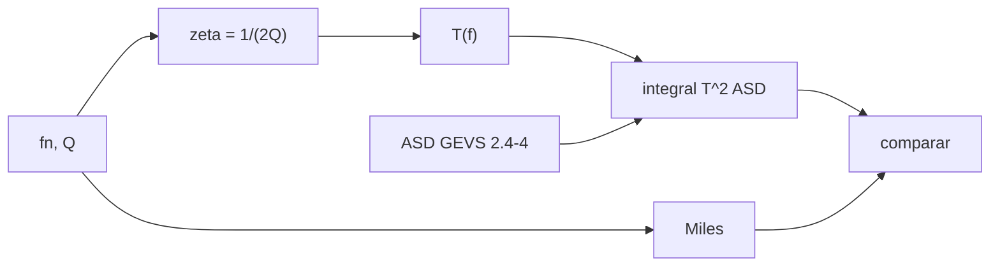

# B84-C11 — Vibraciones y resonancias

<!-- nav:top -->
[🏠 Programa](../../../../README.md) · [📚 Bloque B84](../../../tronco-comun/B84-estructuras-materiales-y-fabricacion-espacial.md) · [← Anterior: B84-C10 — Análisis modal](../B84-C10-analisis-modal/CLASE.md) · [Siguiente: B84-C12 — Análisis de elementos finitos →](../B84-C12-analisis-de-elementos-finitos/CLASE.md)
<!-- /nav -->

## 1. Ubicación, nivel y alcance

Clase 11 del bloque B84. Nivel N3. Cuando la excitación coincide con una frecuencia natural, la respuesta se amplifica `Q` veces. Aquí calculas la transmisibilidad de un oscilador de un grado de libertad excitado por la base, el factor `Q`, y la respuesta eficaz a una densidad espectral con la ecuación de Miles, que contrastas con la integral numérica. Usas el perfil de mano de obra mínima del GEVS (consultado); las frecuencias y `Q` son **ilustrativos**.

## 2. Por qué esta clase existe

Un equipo con `Q = 10` en resonancia recibe 10 veces la aceleración de entrada; Miles da la respuesta rms en una línea. La decisión central: **¿cuánta aceleración eficaz recibe un equipo de frecuencia `f_n` y amortiguamiento dado bajo un perfil de vibración aleatoria?**

## 3. Lo que podrás hacer al terminar

1. Calcular la transmisibilidad `T(f)` de un oscilador.
2. Relacionar `Q = 1/(2ζ)` con el pico.
3. Aplicar la ecuación de Miles `g_rms = √(π/2 f_n Q ASD(f_n))`.
4. Contrastarla con la integral numérica de `T² ASD`.
5. Evaluar la respuesta a un perfil real (GEVS Tabla 2.4-4).
6. Separar lo consultado de lo ilustrativo.

La evidencia es la **ficha de respuesta a vibración de base** del ejercicio 12 (sección 20).

## 4. Con qué llegas y cómo comprobarlo

1. ¿Qué es una resonancia?
2. ¿Qué es el amortiguamiento crítico `ζ`?
3. ¿Qué es una ASD?
4. ¿Qué es la regla de Simpson?
5. ¿Qué es un dato ilustrativo?

<details>
<summary>Ver respuestas</summary>

1. La amplificación de la respuesta cuando la excitación iguala la frecuencia natural. 2. La fracción del amortiguamiento que evitaría la oscilación. 3. Aceleración al cuadrado por Hz. 4. Una integral numérica de ponderaciones 1-4-2-…-4-1. 5. Un valor no consultado.
</details>

Con cuatro o cinco aciertos, sigue; si no, repasa los prerrequisitos.

## 5. Un caso de contexto y casos de referencia

Un equipo de `f_n = 300 Hz` y `Q = 10` bajo `0,04 g²/Hz` plano responde con `13,729 g rms` por Miles y `13,796 g rms` por integración (0,48 % de diferencia); bajo el perfil de mano de obra mínima del GEVS (`6,784 g rms` de entrada) responde con `13,722 g rms`, un factor de 2,02 en rms. **Ejemplo conductor.** `f_n` y `Q` son ilustrativos.

## 6. Vocabulario

La **transmisibilidad** es `T = √((1 + (2ζr)²)/((1 − r²)² + (2ζr)²))` con `r = f/f_n`. El **factor `Q`** es `1/(2ζ)` y es la amplificación en resonancia. La **ecuación de Miles** da `g_rms = √(π/2 · f_n Q · ASD(f_n))` y supone ASD plana cerca de `f_n` y `Q` alto.

## 7. Modelo mental: empujar un columpio al ritmo justo



*Descripción textual:* de `f_n` y `Q` se obtienen `ζ` y la transmisibilidad; se integra `T²·ASD` y se compara con Miles.

Analogía: empujar un columpio al ritmo de su balanceo lo lleva cada vez más alto; con roce (amortiguamiento) el movimiento se limita a `Q` veces el empuje. Límite: Miles supone que la ASD es casi plana en la banda de resonancia.

## 8. La explicación, paso a paso

### 8.1 Pico y Q

`T(f_n) = √(1 + 4ζ²)/(2ζ)`; con `Q = 10` es `10,0499` y el pico exacto `10,0622` en `r = 0,99752`; con `Q = 25`, `25,02` y `25,025` en `0,9996`. Para `Q` alto el pico es `≈ Q` en `f ≈ f_n`.

### 8.2 Miles frente a la integral

| `f_n` (Hz) | `Q` | Miles (g rms) | Numérica (g rms) | Dif. (%) |
|---|---|---|---|---|
| 100 | 10 | 7,927 | 7,964 | 0,464 |
| 100 | 25 | 12,533 | 12,542 | 0,067 |
| 300 | 10 | 13,729 | 13,796 | 0,484 |

La diferencia cae al subir `Q` porque la respuesta se concentra alrededor de `f_n`.

### 8.3 Perfil del GEVS

Con la ASD de mano de obra mínima: `f_n = 100 Hz` da `7,820 g rms` (3σ `23,5 g`); `300 Hz`, `13,722 g rms` (`41,2 g`); `1000 Hz`, `18,326 g rms` (`55,0 g`), donde Miles (`17,725`) subestima porque la ASD cae con `f⁻¹` y no es plana.

### 8.4 Qué significa

La respuesta de un equipo no depende solo de la entrada total (`6,784 g rms`) sino de dónde cae su frecuencia en el espectro: el equipo de 300 Hz amplifica el rms 2,02 veces.

## 9. Magnitudes, símbolos y unidades

| Símbolo | Qué es | Unidad | Valor / nota |
|---|---|---|---|
| `f_n` | frecuencia natural | Hz | 100; 300 (ilustrativos) |
| `Q` | factor de amplificación | — | 10; 25 |
| `ζ` | amortiguamiento crítico | — | 0,05; 0,02 |
| `T` | transmisibilidad | — | 10,0622 (pico, `Q = 10`) |
| `ASD` | densidad espectral | g²/Hz | 0,04 |
| `g_rms` | respuesta eficaz | g | 13,729 (Miles) |

## 10. Convenciones y referencias

Oscilador lineal de un GDL, excitación de base, aceleración absoluta. Hz y g. Simpson de 1 a 5000 Hz con 200 000 pasos. Perfil de la Tabla 2.4-4 del GEVS. Tolerancia: Miles frente a la integral < 1 % con ASD plana y `Q ≥ 10`.

## 11. De dónde sale lo que afirmamos

| ID | Fuente | Localizador | Respalda | Estado |
|---|---|---|---|---|
| S1 | NASA/GSFC, GSFC-STD-7000 (GEVS) Versión B, Cambio 0, 2021-04-28 — https://standards.nasa.gov/standard/gsfc/gsfc-std-7000 (PDF descargado y leído con PyMuPDF el 2026-11-10) | Tabla 2.4-4 (página 71 del PDF) | el perfil de mano de obra mínima (0,01–0,04 g²/Hz, +3 y −3 dB/oct) y su total de 6,8 g rms | Consultada |
| — | Ecuación de Miles y transmisibilidad del oscilador; valores de `f_n` y `Q` | — | las fórmulas, que verifica el laboratorio con la integral numérica, y los valores de ejemplo | No consultada en una fuente concreta |

Límites: del GEVS solo se leyó la Tabla 2.4-4; `f_n` y `Q` son ilustrativos; Miles no se consultó en una fuente concreta.

## 12. Cómo ver la respuesta de un oscilador

| Magnitud | Valor |
|---|---|
| Pico `T`, `Q = 10` | 10,0622 |
| Miles, 300 Hz, `Q = 10` | 13,729 g rms |
| Numérica, 300 Hz | 13,796 g rms |
| Con perfil GEVS, 300 Hz | 13,722 g rms |
| Amplificación rms | 2,02 |

Descripción larga: Miles y la integral coinciden dentro de 0,5 % con ASD plana; con un perfil que cae con la frecuencia la diferencia crece.

## 13. Ejemplo trabajado: Miles para 300 Hz y Q = 10

**Paso 1 · Radicando.** `π/2 × 300 × 10 × 0,04 = 188,5 g²`.

**Paso 2 · Raíz.** `√188,5 = 13,729 g rms`.

**Paso 3 · Pico 3σ.** `3 × 13,729 = 41,2 g`.

## 14. Distintas formas de describir la respuesta a vibración

**Por transmisibilidad:** `T(f)`. **Por `Q`:** amplificación pico. **Por Miles:** `g_rms`. **Por integral:** `∫T² ASD df`. **Por pico:** `3σ`.

## 15. Práctica guiada

**Ejercicio 1 · con los pasos indicados** Calcula `ζ` si `Q = 25`. *Pasos:* `1/(2Q)`.

<details><summary>Solución comentada</summary>

`0,02`.
</details>

**Ejercicio 2 · con los pasos indicados** Calcula Miles para `f_n = 100`, `Q = 25`, `ASD = 0,04`. *Pista:* `√(π/2 · 100 · 25 · 0,04)`.

<details><summary>Solución comentada</summary>

`√157,1 = 12,533 g rms`.
</details>

**Ejercicio 3 · con los pasos indicados** ¿Por qué el pico exacto es algo mayor que `Q`? *Casi autónomo.*

<details><summary>Solución comentada</summary>

Porque el máximo no está en `r = 1` sino en `r = 0,99752`, donde `T = 10,0622`, algo más que `T(f_n) = 10,0499`.
</details>

## 16. Práctica autónoma, transferencia e integrador

**Ejercicio 4 · autónomo** Respuesta si `Q` baja de 10 a 5 con `f_n = 300`.

<details><summary>Solución comentada</summary>

`13,729/√2 = 9,71 g rms`.
</details>

**Ejercicio 5 · autónomo** `T(f_n)` si `ζ = 0,1`.

<details><summary>Solución comentada</summary>

`√(1 + 0,04)/0,2 = 5,10`.
</details>

**Ejercicio 6 · autónomo** Pico `3σ` a 100 Hz con `Q = 10`.

<details><summary>Solución comentada</summary>

`3 × 7,964 = 23,9 g`.
</details>

**Ejercicio 7 · autónomo** Efecto de duplicar la ASD.

<details><summary>Solución comentada</summary>

El rms sube `√2`.
</details>

**Ejercicio 8 · autónomo** `f_n` que dobla el rms con ASD plana y `Q` fijo.

<details><summary>Solución comentada</summary>

`f_n × 4`.
</details>

**Ejercicio 9 · transferencia. **Transferencia.**** Un equipo de 300 Hz recibe 13,7 g rms con entrada de 6,8 g rms. ¿Qué haces?

<details><summary>Solución comentada</summary>

Lo diseñas para esa respuesta o lo aíslas para bajar `Q` o mover `f_n`.
</details>

**Ejercicio 10 · transferencia. **Transferencia.**** Miles da 17,7 g rms a 1000 Hz y la integral 18,3. ¿Por qué?

<details><summary>Solución comentada</summary>

La ASD no es plana en esa banda; usa la integral.
</details>

**Ejercicio 11 · transferencia. **Transferencia.**** ¿Qué mide la diferencia si ensayas con 6,8 g rms y vuelas con otro perfil?

<details><summary>Solución comentada</summary>

Que el ensayo no cubre el entorno real; hay que comparar espectros.
</details>

**Ejercicio 12 · integrador. **Integrador.**** Elabora tu *ficha de respuesta a vibración de base*: transmisibilidad, Miles frente a integral, respuesta al perfil del GEVS y amplificación, rotulando lo ilustrativo.

<details><summary>Solución comentada</summary>

Secciones 8.1–8.4 y la salida del laboratorio.
</details>

## 17. Laboratorio: transmisibilidad, Q y Miles

El script [resonancias.py](resonancias.py) calcula `T(f)`, el pico, Miles y la integral numérica con ASD plana y con el perfil del GEVS (**comprueba** Miles frente a la integral < 1 % con ASD plana).

**Datos:** perfil del GEVS **consultado**; `f_n` y `Q` **ilustrativos**. **Predice antes de ejecutar:** ¿cuánto vale `T(f_n)` con `Q = 10`? (≈ 10,05.) **Ejecución del 2026-11-10 (Python 3.12.9):**

```text
Python 3.12.9 (biblioteca estandar)
Oscilador con excitacion de base (parametros ILUSTRATIVOS)
 fn [Hz]    Q    zeta  Tmax exacta  f del pico/fn    T(fn)
     100   10  0.0500      10.0622        0.99752  10.0499
     100   25  0.0200      25.0250        0.99960  25.0200
     300   10  0.0500      10.0622        0.99752  10.0499
Respuesta rms a ASD plana de 0,04 g2/Hz: Miles frente a integral numerica
  fn =   100 Hz, Q =  10: Miles =   7.927 g rms ; numerica =   7.964 g rms ; dif = 0.464 %
  fn =   100 Hz, Q =  25: Miles =  12.533 g rms ; numerica =  12.542 g rms ; dif = 0.067 %
  fn =   300 Hz, Q =  10: Miles =  13.729 g rms ; numerica =  13.796 g rms ; dif = 0.484 %
Respuesta a la ASD de mano de obra minima del GEVS (Tabla 2.4-4):
  fn =    100 Hz, Q =  10: Miles =   7.927 g rms ; numerica =   7.820 g rms ; 3 sigma =   23.46 g
  fn =    300 Hz, Q =  10: Miles =  13.729 g rms ; numerica =  13.722 g rms ; 3 sigma =   41.17 g
  fn =   1000 Hz, Q =  10: Miles =  17.725 g rms ; numerica =  18.326 g rms ; 3 sigma =   54.98 g
Entrada: 6,784 g rms (calculada en B84-C01); amplificacion rms a 300 Hz, Q = 10 = 2.02
Pruebas superadas.
```

```bash
python programa/clases/B84/B84-C11-vibraciones-y-resonancias/resonancias.py
```

**Límites:** un GDL lineal; Miles exige ASD plana y `Q` alto; sin no linealidades.

## 18. Errores frecuentes y cómo corregirlos

**Creer que `Q` es el amortiguamiento.** Es `1/(2ζ)`.

**Usar Miles con ASD no plana.** Se corrige con 8.3.

**Confundir entrada con respuesta.** Se corrige con 8.4.

**Olvidar el pico `3σ`.** Se corrige con el ejemplo 13.

## 19. Cómo sabrás que vas bien

Tras la sección 8: ¿qué respuesta esperabas a 300 Hz y cuál obtuviste? Si dudas, repasa el ejemplo 13. Tras el laboratorio: ¿qué comprueba? (ver la sección 17).

## 20. Qué entregas y cómo se evalúa

El producto es tu **ficha de respuesta a vibración de base** (ejercicio 12).

| Criterio | Inicial | En desarrollo | Logrado | Destacado |
|---|---|---|---|---|
| Conceptos | Los confunde | Parciales | Calcula `T`, `Q` y Miles | Explica los límites |
| Cálculo | Sin unidades | Con errores | Tablas completas con unidades | Calcula casos nuevos |
| Numérico | Sin comprobar | Un caso | Contraste con una segunda vía | Interpreta las diferencias |
| Fuentes | Sin fuente | Sin fecha | Fuentes con fecha y estado | Declara lo ilustrativo y lo no consultado |
| Límites | No los nombra | Uno | Tres | Discute qué falta del modelo |

**Condiciones críticas (no se compensan con promedio):** rotular los datos ilustrativos y sintéticos como tales; no presentar un cálculo como ensayo ni como dato de vuelo; citar solo lo consultado.

## 21. Ética, seguridad y límites

Clase educativa: los modelos son simplificados y sus datos son sintéticos, ilustrativos o valores de estándar rotulados; **no es una base de diseño de hardware de vuelo** y ningún resultado sustituye a datos de material cualificados, a los documentos vigentes de la agencia o del lanzador ni a la revisión por personal competente. Accesibilidad: tablas equivalentes a las gráficas, fórmulas en texto, ejercicios sin conexión.

## 22. Para cerrar y seguir

Con `Q = 10`, un equipo de 300 Hz responde con `13,7 g rms` a un perfil de `6,8 g rms`. Queda una pregunta: ¿cómo se construye el modelo numérico que predice todo esto?

**Glosario español–inglés.** transmisibilidad · *transmissibility*; resonancia · *resonance*; factor de calidad · *quality factor (Q)*; ecuación de Miles · *Miles equation*; amortiguamiento · *damping*.

**Continuidad.** [B84-C12](../B84-C12-analisis-de-elementos-finitos/CLASE.md) estudia el análisis de elementos finitos.

**Referencias:** ver sección 11.

<!-- nav:bottom -->
---

[← Anterior: B84-C10 — Análisis modal](../B84-C10-analisis-modal/CLASE.md) · [📚 Bloque B84](../../../tronco-comun/B84-estructuras-materiales-y-fabricacion-espacial.md) · [Siguiente: B84-C12 — Análisis de elementos finitos →](../B84-C12-analisis-de-elementos-finitos/CLASE.md)
<!-- /nav -->
