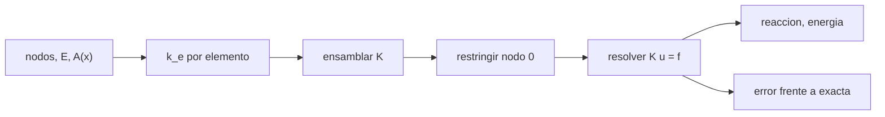

# B84-C12 — Análisis de elementos finitos

<!-- nav:top -->
[🏠 Programa](../../../../README.md) · [📚 Bloque B84](../../../tronco-comun/B84-estructuras-materiales-y-fabricacion-espacial.md) · [← Anterior: B84-C11 — Vibraciones y resonancias](../B84-C11-vibraciones-y-resonancias/CLASE.md) · [Siguiente: B84-C13 — Mecanismos desplegables →](../B84-C13-mecanismos-desplegables/CLASE.md)
<!-- /nav -->

## 1. Ubicación, nivel y alcance

Clase 12 del bloque B84. Nivel N3. El método de los elementos finitos convierte una estructura continua en un sistema de ecuaciones `K u = f`. Aquí ensamblas un modelo de barra afilada con elementos de dos nodos, aplicas el empotramiento, resuelves, y verificas con la solución exacta, el equilibrio de reacciones, la energía y la prueba del parche. La barra de aluminio es **ilustrativa**. Las mallas (C26), los tipos de elementos (C27) y las condiciones de contorno (C28) amplían esta base.

## 2. Por qué esta clase existe

Un modelo que da un resultado no es un modelo correcto: la verificación contra una solución conocida es lo que lo convierte en una herramienta. La decisión central: **¿cómo demuestras que un modelo de elementos finitos resuelve bien las ecuaciones que dice resolver?**

## 3. Lo que podrás hacer al terminar

1. Ensamblar la matriz de rigidez de una barra con área variable.
2. Aplicar restricciones y cargas y resolver `K u = f`.
3. Comparar con la solución exacta y calcular el orden de convergencia.
4. Verificar reacciones y energía.
5. Aplicar la prueba del parche.
6. Rotular los datos ilustrativos.

La evidencia es la **informe de verificación de un modelo de barra** del ejercicio 12 (sección 20).

## 4. Con qué llegas y cómo comprobarlo

1. ¿Qué es la rigidez axial de una barra?
2. ¿Qué es una condición de contorno?
3. ¿Qué es la energía de deformación?
4. ¿Qué es el orden de convergencia?
5. ¿Qué es un dato ilustrativo?

<details>
<summary>Ver respuestas</summary>

1. `EA/l`: fuerza por unidad de alargamiento. 2. Una restricción de desplazamiento o una carga impuesta en el borde. 3. `½ uᵀ K u`: el trabajo almacenado. 4. El exponente con que el error baja al refinar. 5. Un valor no consultado.
</details>

Con cuatro o cinco aciertos, sigue; si no, repasa los prerrequisitos.

## 5. Un caso de contexto y casos de referencia

Una barra de aluminio afilada (`E = 69 GPa`, `L = 1 m`, `A₀ = 4 × 10⁻⁴ m²`, área que baja a la mitad en el extremo) con `P = 10 kN` tiene un alargamiento exacto `u(L) = 0,502281 mm`. Con 1 elemento se obtiene `0,483092 mm` (error 3,8 %) y con 32, `0,502258 mm` (error `4,4 × 10⁻⁵`), con orden observado `1,999`. **Ejemplo conductor.** Datos ilustrativos.

## 6. Vocabulario

La **rigidez de elemento** es `k = EA/l [[1,−1],[−1,1]]`. El **ensamblaje** suma las contribuciones en la matriz global `K`. Las **condiciones de contorno** eliminan los GDL fijos. La **prueba del parche** exige que una malla irregular reproduzca exactamente una solución lineal. El **orden de convergencia** es `log(e₁/e₂)/log 2` al duplicar elementos.

## 7. Modelo mental: una cadena de resortes en serie



*Descripción textual:* se calcula la rigidez de cada elemento, se ensambla `K`, se restringe el empotramiento, se resuelve y se verifican reacción, energía y error.

Analogía: una barra afilada es una cadena de resortes de rigidez decreciente: cada elemento aporta un resorte con el área en su punto medio. Límite: con área constante por tramo, el modelo aproxima la variación; el error baja con el cuadrado de la longitud del elemento.

## 8. La explicación, paso a paso

### 8.1 Ensamblaje

Cada elemento aporta `k = E A_e/l_e` en las posiciones `(i,i)`, `(i+1,i+1)` con signo positivo y `(i,i+1)`, `(i+1,i)` con negativo; `A_e = A(x_medio)`. Se elimina el nodo 0 (empotrado) y se resuelve `K_ff u_f = f_f`.

### 8.2 Convergencia

La solución exacta es `u(L) = P L/(E A₀ c) · (−ln(1 − c))` con `c = 0,5`.

| `n` elementos | `u(L)` (mm) | Error relativo | Orden observado |
|---|---|---|---|
| 1 | 0,483092 | 3,82 × 10⁻² | — |
| 2 | 0,496894 | 1,07 × 10⁻² | 1,833 |
| 4 | 0,500884 | 2,78 × 10⁻³ | 1,947 |
| 8 | 0,501928 | 7,02 × 10⁻⁴ | 1,986 |
| 16 | 0,502192 | 1,76 × 10⁻⁴ | 1,996 |
| 32 | 0,502258 | 4,40 × 10⁻⁵ | 1,999 |

### 8.3 Verificaciones

La reacción es `−10 000,000 N` en todas las mallas (equilibrio). La energía `½ uᵀ K u` iguala a `½ P u(L)` (`2,51129 J` con 32 elementos). La prueba del parche con una malla irregular y área constante da un error nodal máximo `2,2 × 10⁻¹⁹ m`.

### 8.4 Qué demuestra y qué no

Todo esto verifica que el código resuelve la ecuación; no valida que la barra represente a la estructura real (validación con ensayo, C30).

## 9. Magnitudes, símbolos y unidades

| Símbolo | Qué es | Unidad | Valor / nota |
|---|---|---|---|
| `E` | módulo de Young | Pa | 69 GPa |
| `A(x)` | área de la sección | m² | `A₀(1 − 0,5x/L)` |
| `K` | rigidez global | N/m | — |
| `u` | desplazamientos nodales | m | 0,502258 mm (32 elem.) |
| `R` | reacción | N | −10 000 |
| `U` | energía de deformación | J | 2,51129 |

## 10. Convenciones y referencias

SI. Barra de dos nodos con área en el punto medio. Empotrada en `x = 0` y carga en `x = L`. Tolerancias: reacción `= −P` a 10⁻⁹; energía a 10⁻¹²; orden observado entre 1,9 y 2,1.

## 11. De dónde sale lo que afirmamos

| ID | Fuente | Localizador | Respalda | Estado |
|---|---|---|---|---|
| — | Formulación de elementos finitos de barra y solución exacta de la barra afilada | — | las fórmulas, que el laboratorio verifica con la solución exacta, el equilibrio y la prueba del parche | No consultada en una fuente concreta |

Límites: la barra y su material son ilustrativos; la verificación no es validación con ensayo.

## 12. Cómo ver la convergencia del modelo

| Magnitud | Valor |
|---|---|
| `u(L)` exacta | 0,502281 mm |
| Error con 1 elemento | 3,82 % |
| Error con 32 elementos | 4,40 × 10⁻⁵ |
| Orden observado | 1,999 |
| Error del parche | 2,2 × 10⁻¹⁹ m |

Descripción larga: el error cae a una cuarta parte cada vez que se duplican los elementos: orden 2.

## 13. Ejemplo trabajado: la solución exacta de la barra afilada

**Paso 1 · Base.** `P L/(E A₀) = 10 000 × 1/(69e9 × 4e-4) = 0,3623 mm`.

**Paso 2 · Factor.** `−ln(1 − 0,5)/0,5 = 1,3863`.

**Paso 3 · Alargamiento.** `0,3623 × 1,3863 = 0,5023 mm`.

## 14. Distintas formas de describir un modelo de elementos finitos

**Por ecuaciones:** `K u = f`. **Por convergencia:** error y orden. **Por equilibrio:** reacción. **Por energía:** `U = ½ P u`. **Por parche:** exactitud en soluciones lineales.

## 15. Práctica guiada

**Ejercicio 1 · con los pasos indicados** Calcula `k` de un elemento con `A = 4e-4 m²` y `l = 0,5 m`. *Pasos:* `E A/l`.

<details><summary>Solución comentada</summary>

`69e9 × 4e-4/0,5 = 5,52 × 10⁷ N/m`.
</details>

**Ejercicio 2 · con los pasos indicados** ¿Cuánto vale la reacción? *Pista:* equilibrio de la barra.

<details><summary>Solución comentada</summary>

`−P = −10 000 N`.
</details>

**Ejercicio 3 · con los pasos indicados** ¿Por qué el error baja a la cuarta parte al duplicar? *Casi autónomo.*

<details><summary>Solución comentada</summary>

Porque la aproximación de la rigidez por elemento tiene error proporcional a `l²`.
</details>

## 16. Práctica autónoma, transferencia e integrador

**Ejercicio 4 · autónomo** `u` en el nodo medio de una barra uniforme (`L = 1`, `A = 4e-4`, `P = 10 kN`).

<details><summary>Solución comentada</summary>

`P x/(E A) = 0,1812 mm` a `x = 0,5`.
</details>

**Ejercicio 5 · autónomo** `U` con `u(L) = 0,5023 mm` y `P = 10 kN`.

<details><summary>Solución comentada</summary>

`2,51 J`.
</details>

**Ejercicio 6 · autónomo** Error relativo con 4 elementos.

<details><summary>Solución comentada</summary>

`2,78 × 10⁻³`.
</details>

**Ejercicio 7 · autónomo** Orden observado entre 8 y 16 elementos.

<details><summary>Solución comentada</summary>

`log2(7,02e-4/1,76e-4) = 1,996`.
</details>

**Ejercicio 8 · autónomo** ¿Qué pasa con `u(L)` si `A₀` se duplica?

<details><summary>Solución comentada</summary>

Se divide por 2.
</details>

**Ejercicio 9 · transferencia. **Transferencia.**** Un modelo da el resultado esperado. ¿Está verificado?

<details><summary>Solución comentada</summary>

No: se debe probar con una solución exacta, el parche y el equilibrio.
</details>

**Ejercicio 10 · transferencia. **Transferencia.**** Verificaste con la solución exacta. ¿Está validado?

<details><summary>Solución comentada</summary>

No: validar es compararlo con el ensayo (C30).
</details>

**Ejercicio 11 · transferencia. **Transferencia.**** Un análisis usa 1 elemento con error 3,8 %. ¿Es aceptable?

<details><summary>Solución comentada</summary>

Depende del requisito; se demuestra con la convergencia (C26).
</details>

**Ejercicio 12 · integrador. **Integrador.**** Elabora tu *informe de verificación de un modelo de barra*: tabla de convergencia con orden, reacción, energía, parche y la distinción entre verificar y validar.

<details><summary>Solución comentada</summary>

Secciones 8.1–8.4 y la salida del laboratorio.
</details>

## 17. Laboratorio: barra afilada por elementos finitos

El script [mef_barra.py](mef_barra.py) ensambla y resuelve el modelo con 1 a 32 elementos y ejecuta la prueba del parche (**comprueba** reacción `= −P`, energía `= ½ P u`, orden entre 1,9 y 2,1 y parche < 1e-12).

**Datos:** barra **ilustrativa**; solución exacta analítica. **Predice antes de ejecutar:** ¿qué orden de convergencia esperas? (2.) **Ejecución del 2026-11-10 (Python 3.12.9):**

```text
Python 3.12.9 (biblioteca estandar)
Barra ILUSTRATIVA afilada: E = 69 GPa, L = 1 m, A0 = 4e-4 m2, c = 0,5, P = 10 kN; u(L) exacta = 0.502281 mm
 ne   u(L) [mm]   error rel.   orden obs.   reaccion [N]   U [J]    1/2 P u [J]
  1    0.483092    3.820e-02              -10000.000000   2.41546      2.41546
  2    0.496894    1.072e-02       1.833  -10000.000000   2.48447      2.48447
  4    0.500884    2.780e-03       1.947  -10000.000000   2.50442      2.50442
  8    0.501928    7.021e-04       1.986  -10000.000000   2.50964      2.50964
 16    0.502192    1.760e-04       1.996  -10000.000000   2.51096      2.51096
 32    0.502258    4.402e-05       1.999  -10000.000000   2.51129      2.51129
Orden observado en las dos mallas mas finas = 1.999 (teorico 2)
Prueba del parche (area constante, malla irregular): error nodal maximo = 2.17e-19 m
Pruebas superadas.
```

```bash
python programa/clases/B84/B84-C12-analisis-de-elementos-finitos/mef_barra.py
```

**Límites:** barra 1D lineal; la verificación no es validación.

## 18. Errores frecuentes y cómo corregirlos

**Confundir verificación con validación.** Se corrige con 8.4.

**Olvidar restringir.** `K` queda singular.

**Medir el error sin una referencia exacta.** Se corrige con 8.2.

**Usar el área en un nodo en vez del punto medio sin saberlo.** Cambia el orden.

## 19. Cómo sabrás que vas bien

Tras la sección 8: ¿qué error esperabas con 8 elementos y cuál obtuviste? Si dudas, repasa el ejemplo 13. Tras el laboratorio: ¿qué comprueba? (ver la sección 17).

## 20. Qué entregas y cómo se evalúa

El producto es tu **informe de verificación de un modelo de barra** (ejercicio 12).

| Criterio | Inicial | En desarrollo | Logrado | Destacado |
|---|---|---|---|---|
| Conceptos | Los confunde | Parciales | Ensambla, resuelve y verifica un modelo | Explica los límites |
| Cálculo | Sin unidades | Con errores | Tablas completas con unidades | Calcula casos nuevos |
| Numérico | Sin comprobar | Un caso | Contraste con una segunda vía | Interpreta las diferencias |
| Fuentes | Sin fuente | Sin fecha | Fuentes con fecha y estado | Declara lo ilustrativo y lo no consultado |
| Límites | No los nombra | Uno | Tres | Discute qué falta del modelo |

**Condiciones críticas (no se compensan con promedio):** rotular los datos ilustrativos y sintéticos como tales; no presentar un cálculo como ensayo ni como dato de vuelo; citar solo lo consultado.

## 21. Ética, seguridad y límites

Clase educativa: los modelos son simplificados y sus datos son sintéticos, ilustrativos o valores de estándar rotulados; **no es una base de diseño de hardware de vuelo** y ningún resultado sustituye a datos de material cualificados, a los documentos vigentes de la agencia o del lanzador ni a la revisión por personal competente. Accesibilidad: tablas equivalentes a las gráficas, fórmulas en texto, ejercicios sin conexión.

## 22. Para cerrar y seguir

La barra afilada converge con orden `1,999` hacia `0,502281 mm` y la prueba del parche da `2 × 10⁻¹⁹ m`. Queda una pregunta: ¿cómo se mueven y se despliegan las partes de una estructura?

**Glosario español–inglés.** elementos finitos · *finite elements*; ensamblaje · *assembly*; prueba del parche · *patch test*; condición de contorno · *boundary condition*; verificación · *verification*.

**Continuidad.** [B84-C13](../B84-C13-mecanismos-desplegables/CLASE.md) estudia los mecanismos desplegables.

**Referencias:** ver sección 11.

<!-- nav:bottom -->
---

[← Anterior: B84-C11 — Vibraciones y resonancias](../B84-C11-vibraciones-y-resonancias/CLASE.md) · [📚 Bloque B84](../../../tronco-comun/B84-estructuras-materiales-y-fabricacion-espacial.md) · [Siguiente: B84-C13 — Mecanismos desplegables →](../B84-C13-mecanismos-desplegables/CLASE.md)
<!-- /nav -->
