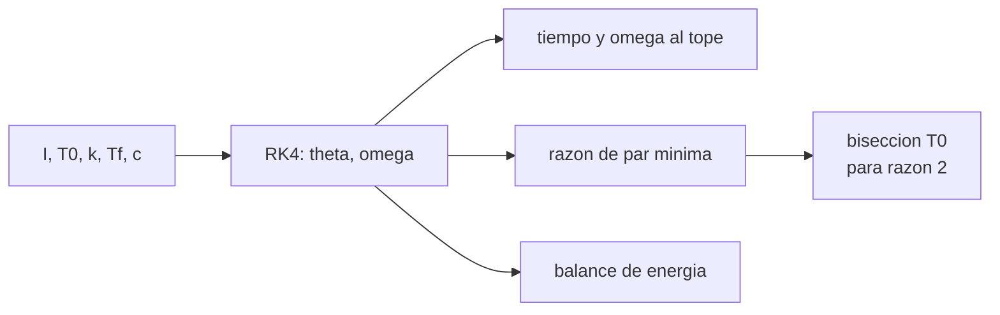

# B84-C13 — Mecanismos desplegables

<!-- nav:top -->
[🏠 Programa](../../../../README.md) · [📚 Bloque B84](../../../tronco-comun/B84-estructuras-materiales-y-fabricacion-espacial.md) · [← Anterior: B84-C12 — Análisis de elementos finitos](../B84-C12-analisis-de-elementos-finitos/CLASE.md) · [Siguiente: B84-C14 — Rodamientos y lubricación espacial →](../B84-C14-rodamientos-y-lubricacion-espacial/CLASE.md)
<!-- /nav -->

## 1. Ubicación, nivel y alcance

Clase 13 del bloque B84. Nivel N3. Los paneles solares, antenas y mástiles se despliegan una sola vez y no hay una segunda oportunidad. Aquí integras la ecuación de movimiento de un panel con resorte de torsión, fricción y amortiguamiento hasta un tope, compruebas el resultado con un balance de energía y calculas la razón de par disponible a par resistente. Todos los parámetros son **ilustrativos**, y el requisito de razón 2,0 también: los valores de los estándares de mecanismos (por ejemplo ECSS-E-ST-33-01) **no se consultaron**.

## 2. Por qué esta clase existe

Un mecanismo que se despliega bien en el banco puede quedarse trabado en órbita si la fricción sube o la precarga baja; el margen de par lo cuantifica. La decisión central: **¿qué razón de par tiene el despliegue y qué precarga hace falta para cumplir el requisito?**

## 3. Lo que podrás hacer al terminar

1. Plantear `I θ'' = T_s − T_f − cθ'` con un resorte de torsión.
2. Integrarla con Runge–Kutta de cuarto orden.
3. Comprobar el balance de energía.
4. Calcular la razón de par mínima en el recorrido.
5. Estudiar la sensibilidad a la fricción y la precarga.
6. Rotular lo ilustrativo y lo no consultado.

La evidencia es la **ficha de despliegue y margen de par** del ejercicio 12 (sección 20).

## 4. Con qué llegas y cómo comprobarlo

1. ¿Qué es un par de torsión?
2. ¿Qué es la inercia rotacional?
3. ¿Qué es la fricción seca?
4. ¿Qué es Runge–Kutta?
5. ¿Qué es una razón de par?

<details>
<summary>Ver respuestas</summary>

1. Fuerza por brazo, en N·m. 2. `I` en kg·m²: la resistencia a cambiar la velocidad angular. 3. Un par resistente casi constante que se opone al movimiento. 4. Un método numérico para integrar ecuaciones diferenciales. 5. El cociente entre par disponible y par resistente.
</details>

Con cuatro o cinco aciertos, sigue; si no, repasa los prerrequisitos.

## 5. Un caso de contexto y casos de referencia

Un panel de `I = 0,05 kg·m²` con resorte `T_s = 0,40 − 0,20 θ` N·m, fricción `0,02 N·m` y amortiguamiento `0,01 N·m·s/rad` se despliega 90° en `0,7178 s` y llega al tope a `3,508 rad/s` (201 °/s). La razón de par mínima es `1,560` en el tope: no cumple el requisito ilustrativo de 2,0. Para cumplirlo hace falta `T₀ = 0,4289 N·m`. **Ejemplo conductor.** Todos los parámetros son ilustrativos.

## 6. Vocabulario

La **razón de par** (*torque ratio*) es `T_s/(T_f + cω)`. La **precarga** `T₀` es el par del resorte con el mecanismo plegado. El **tope** (*latch*) detiene el movimiento en `θ = π/2`. El **balance de energía** compara el trabajo del resorte con la cinética final más las pérdidas.

## 7. Modelo mental: una puerta con resorte y un freno viscoso



*Descripción textual:* los parámetros alimentan la integración; de ella salen el tiempo, la velocidad al tope, la razón de par y el balance de energía; una bisección busca la precarga que cumple el requisito.

Analogía: una puerta que se abre sola con un resorte y se frena con el roce: al final del recorrido el resorte empuja poco y el roce pesa más. Límite: el modelo usa un resorte lineal, una fricción constante y un tope perfecto, sin impacto elástico ni flexibilidad.

## 8. La explicación, paso a paso

### 8.1 Movimiento

`I θ'' = T₀ − kθ − T_f − cθ'`. Con RK4 y paso `10⁻⁴ s` el panel llega a `90°` en `0,7178 s` con `ω = 3,508 rad/s`.

### 8.2 Energía

Trabajo del resorte `T₀θ_f − ½kθ_f² = 0,381578 J`; fricción seca `0,031416 J`; viscosa `0,042503 J`; cinética final `0,307660 J`. El residuo del balance es `1,1 × 10⁻⁹`: el integrador conserva la energía como debe. La energía cinética final es lo que absorbe el tope (impacto).

### 8.3 Margen

La razón `T_s/(T_f + cω)` baja a lo largo del recorrido y es mínima al final: `1,560` a 90°. El par que queda en el tope es `0,0858 N·m`, 4,3 veces la fricción: hay un pequeño par de retención.

| Caso | Tiempo (s) | `ω` al tope (rad/s) | Razón mínima |
|---|---|---|---|
| base | 0,7178 | 3,508 | 1,560 |
| fricción ×3 | 0,7703 | 3,150 | 0,938 |
| precarga −20 % | 0,8371 | 2,748 | 0,124 |

### 8.4 Qué hacer

Con fricción triple o precarga −20 % el margen es menor que 1: el panel puede no llegar al tope. Subir la precarga a `0,4289 N·m` da razón 2,0 con `3,746 rad/s` y energía de impacto `0,3509 J` (más impacto): se compensan margen y carga de choque.

## 9. Magnitudes, símbolos y unidades

| Símbolo | Qué es | Unidad | Valor / nota |
|---|---|---|---|
| `I` | inercia respecto de la bisagra | kg·m² | 0,05 |
| `T₀`, `k` | precarga y rigidez del resorte | N·m, N·m/rad | 0,40; 0,20 |
| `T_f`, `c` | fricción seca y viscosa | N·m, N·m·s/rad | 0,02; 0,01 |
| `ω` | velocidad angular | rad/s | 3,508 al tope |
| `E_c` | energía cinética final | J | 0,3077 |
| razón | par disponible/resistente | — | 1,560 |

## 10. Convenciones y referencias

SI. Resorte lineal; fricción seca constante; amortiguamiento viscoso lineal; parte del reposo. Razón de par requerida 2,0 (ilustrativa, no consultada). RK4 de paso 10⁻⁴ s. Tolerancia: balance de energía < 10⁻⁶.

## 11. De dónde sale lo que afirmamos

| ID | Fuente | Localizador | Respalda | Estado |
|---|---|---|---|---|
| — | ECSS-E-ST-33-01 (factores de par de mecanismos) y los parámetros del panel | — | el requisito de razón 2,0 y los parámetros de inercia, resorte y fricción | No consultada en una fuente concreta |

Límites: no se consultó ningún estándar de mecanismos; la razón 2,0 y los parámetros son ilustrativos; un despliegue real incluye flexibilidad, temperatura y tolerancias.

## 12. Cómo ver el despliegue

| Magnitud | Valor |
|---|---|
| Tiempo | 0,7178 s |
| `ω` al tope | 3,508 rad/s |
| Razón mínima | 1,560 |
| Residuo de energía | 1,1 × 10⁻⁹ |
| `T₀` para razón 2,0 | 0,4289 N·m |

Descripción larga: el margen es mínimo al final del recorrido; subir la precarga 7 % cumple el requisito pero aumenta el impacto 14 %.

## 13. Ejemplo trabajado: el par de resorte en el tope

**Paso 1 · Par del resorte.** `T_s(π/2) = 0,40 − 0,20 × 1,5708 = 0,0858 N·m`.

**Paso 2 · Par resistente.** `0,02 + 0,01 × 3,508 = 0,0551 N·m`.

**Paso 3 · Razón.** `0,0858/0,0551 = 1,556`, el 1,560 del laboratorio al refinar el cruce.

## 14. Distintas formas de describir un despliegue

**Por ecuación:** `I θ''`. **Por energía:** resorte, fricción, cinética. **Por margen:** razón de par. **Por sensibilidad:** fricción y precarga. **Por impacto:** energía en el tope.

## 15. Práctica guiada

**Ejercicio 1 · con los pasos indicados** Calcula `T_s` en `θ = 0`. *Pasos:* `T₀ − k·0`.

<details><summary>Solución comentada</summary>

`0,40 N·m`.
</details>

**Ejercicio 2 · con los pasos indicados** Calcula el trabajo de la fricción seca en 90°. *Pista:* `T_f θ_f`.

<details><summary>Solución comentada</summary>

`0,02 × 1,5708 = 0,0314 J`.
</details>

**Ejercicio 3 · con los pasos indicados** ¿Por qué la razón mínima está al final? *Casi autónomo.*

<details><summary>Solución comentada</summary>

Porque el resorte entrega menos par conforme se descarga y la velocidad (y el amortiguamiento) sube.
</details>

## 16. Práctica autónoma, transferencia e integrador

**Ejercicio 4 · autónomo** Energía cinética con `ω = 3,508` e `I = 0,05`.

<details><summary>Solución comentada</summary>

`0,3077 J`.
</details>

**Ejercicio 5 · autónomo** Par de resorte con `θ = 60°`.

<details><summary>Solución comentada</summary>

`0,40 − 0,2094 = 0,1906 N·m`.
</details>

**Ejercicio 6 · autónomo** Razón en el arranque (`ω = 0`).

<details><summary>Solución comentada</summary>

`0,40/0,02 = 20`.
</details>

**Ejercicio 7 · autónomo** ¿Qué `k` da par nulo en el tope con `T₀ = 0,40`?

<details><summary>Solución comentada</summary>

`k = 0,40/1,5708 = 0,2546 N·m/rad`.
</details>

**Ejercicio 8 · autónomo** Efecto de duplicar la inercia en el tiempo.

<details><summary>Solución comentada</summary>

El tiempo crece cerca de `√2`.
</details>

**Ejercicio 9 · transferencia. **Transferencia.**** En frío la fricción se triplica. ¿Cómo lo verificas?

<details><summary>Solución comentada</summary>

Con el caso de fricción ×3: razón 0,938, no cumple; hay que subir la precarga o reducir la fricción.
</details>

**Ejercicio 10 · transferencia. **Transferencia.**** Un tope rígido absorbe 0,31 J en milisegundos. ¿Qué te preocupa?

<details><summary>Solución comentada</summary>

La carga de impacto en la estructura; hay que dimensionarla o amortiguar.
</details>

**Ejercicio 11 · transferencia. **Transferencia.**** ¿Basta con probar el despliegue una vez en el banco?

<details><summary>Solución comentada</summary>

No: se prueba en el entorno térmico y de gravedad compensada y con tolerancias.
</details>

**Ejercicio 12 · integrador. **Integrador.**** Elabora tu *ficha de despliegue y margen de par*: tiempo, velocidad, balance de energía, razón mínima, sensibilidad y la precarga que cumple el requisito.

<details><summary>Solución comentada</summary>

Secciones 8.1–8.4 y la salida del laboratorio.
</details>

## 17. Laboratorio: despliegue de un panel con resorte de torsión

El script [despliegue.py](despliegue.py) integra el despliegue, comprueba la energía y calcula la razón de par y la precarga necesaria (**comprueba** balance de energía < 1e-6 y razón de par mínima mayor que 1).

**Datos:** parámetros **ilustrativos**; el requisito 2,0 **no consultado**. **Predice antes de ejecutar:** ¿cuándo es mínima la razón de par? (al final, en el tope.) **Ejecución del 2026-11-10 (Python 3.12.9):**

```text
Python 3.12.9 (biblioteca estandar)
Panel ILUSTRATIVO: I = 0,05 kg m2, T0 = 0,40 N m, k = 0,20 N m/rad, T_f = 0,02 N m, c = 0,01 N m s/rad
Tiempo de despliegue = 0.7178 s ; velocidad angular al llegar al tope = 3.5080 rad/s (201.0 grados/s)
Energia: trabajo del resorte = 0.381578 J ; friccion seca = 0.031416 J ; viscosa = 0.042503 J ; cinetica final = 0.307660 J
Residuo del balance de energia = 1.14e-09 (relativo)
Margen de par minimo = 1.560 a theta = 90.0 grados (requisito ilustrativo >= 2,0 -> NO cumple)
Par del resorte en el tope = 0.0858 N m (par de mantenimiento restante frente a la friccion 0.02 N m: razon 4.29)
Sensibilidad (tiempo, velocidad al tope, margen minimo):
  base            t = 0.7178 s  w = 3.5080 rad/s  margen = 1.560
  friccion x3     t = 0.7703 s  w = 3.1502 rad/s  margen = 0.938
  precarga -20 %  t = 0.8371 s  w = 2.7484 rad/s  margen = 0.124
Precarga T0 que da una razon de par de 2,0: 0.4289 N m (tiempo 0.6860 s, velocidad al tope 3.746 rad/s, energia cinetica 0.3509 J)
Pruebas superadas.
```

```bash
python programa/clases/B84/B84-C13-mecanismos-desplegables/despliegue.py
```

**Límites:** modelo de un GDL rígido; sin flexibilidad, temperatura ni holguras; tope perfecto.

## 18. Errores frecuentes y cómo corregirlos

**Medir el margen solo al inicio.** Se corrige con 8.3.

**Ignorar el impacto en el tope.** Se corrige con 8.4.

**Probar solo a temperatura ambiente.** Se corrige con 8.3.

**Presentar la razón 2,0 como requisito de un estándar.** Se corrige con el alcance.

## 19. Cómo sabrás que vas bien

Tras la sección 8: ¿dónde esperabas el margen mínimo y dónde estaba? Si dudas, repasa el ejemplo 13. Tras el laboratorio: ¿qué comprueba? (ver la sección 17).

## 20. Qué entregas y cómo se evalúa

El producto es tu **ficha de despliegue y margen de par** (ejercicio 12).

| Criterio | Inicial | En desarrollo | Logrado | Destacado |
|---|---|---|---|---|
| Conceptos | Los confunde | Parciales | Integra el despliegue y calcula el margen | Explica los límites |
| Cálculo | Sin unidades | Con errores | Tablas completas con unidades | Calcula casos nuevos |
| Numérico | Sin comprobar | Un caso | Contraste con una segunda vía | Interpreta las diferencias |
| Fuentes | Sin fuente | Sin fecha | Fuentes con fecha y estado | Declara lo ilustrativo y lo no consultado |
| Límites | No los nombra | Uno | Tres | Discute qué falta del modelo |

**Condiciones críticas (no se compensan con promedio):** rotular los datos ilustrativos y sintéticos como tales; no presentar un cálculo como ensayo ni como dato de vuelo; citar solo lo consultado.

## 21. Ética, seguridad y límites

Clase educativa: los modelos son simplificados y sus datos son sintéticos, ilustrativos o valores de estándar rotulados; **no es una base de diseño de hardware de vuelo** y ningún resultado sustituye a datos de material cualificados, a los documentos vigentes de la agencia o del lanzador ni a la revisión por personal competente. Accesibilidad: tablas equivalentes a las gráficas, fórmulas en texto, ejercicios sin conexión.

## 22. Para cerrar y seguir

El panel llega al tope a `3,508 rad/s` con razón de par `1,560` y necesita `T₀ = 0,4289 N·m` para cumplir 2,0. Queda una pregunta: ¿cómo se contacta y se lubrica una articulación en vacío?

**Glosario español–inglés.** mecanismo desplegable · *deployable mechanism*; resorte de torsión · *torsion spring*; razón de par · *torque ratio*; tope · *latch*; precarga · *preload*.

**Continuidad.** [B84-C14](../B84-C14-rodamientos-y-lubricacion-espacial/CLASE.md) estudia rodamientos y lubricación espacial.

**Referencias:** ver sección 11.

<!-- nav:bottom -->
---

[← Anterior: B84-C12 — Análisis de elementos finitos](../B84-C12-analisis-de-elementos-finitos/CLASE.md) · [📚 Bloque B84](../../../tronco-comun/B84-estructuras-materiales-y-fabricacion-espacial.md) · [Siguiente: B84-C14 — Rodamientos y lubricación espacial →](../B84-C14-rodamientos-y-lubricacion-espacial/CLASE.md)
<!-- /nav -->
