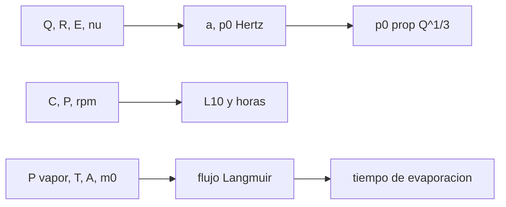

# B84-C14 — Rodamientos y lubricación espacial

<!-- nav:top -->
[🏠 Programa](../../../../README.md) · [📚 Bloque B84](../../../tronco-comun/B84-estructuras-materiales-y-fabricacion-espacial.md) · [← Anterior: B84-C13 — Mecanismos desplegables](../B84-C13-mecanismos-desplegables/CLASE.md) · [Siguiente: B84-C15 — Manufactura aditiva →](../B84-C15-manufactura-aditiva/CLASE.md)
<!-- /nav -->

## 1. Ubicación, nivel y alcance

Clase 14 del bloque B84. Nivel N3. En el vacío un rodamiento no puede usar aceite abierto ni grasa común: el lubricante se evapora y las superficies pueden soldarse en frío. Aquí calculas el contacto de Hertz bola–plano y bola–surco, la vida L10 de un rodamiento y cuánto tarda en evaporarse una cantidad de lubricante con la ley de Langmuir (cota superior). Todos los datos son **ilustrativos**; el contacto del surco es una **aproximación** esférica, no el contacto toroidal real.

## 2. Por qué esta clase existe

La vida de un rodamiento espacial la limita el lubricante, no la fatiga: un cálculo de evaporación de un minuto dice si basta 2 mg o hace falta un depósito. La decisión central: **¿qué presión de contacto soporta el rodamiento y cuánto dura su lubricante en vacío?**

## 3. Lo que podrás hacer al terminar

1. Calcular el radio de contacto y la presión máxima de Hertz.
2. Ver que `p₀ ∝ Q^(1/3)`.
3. Comparar contactos bola–plano y bola–surco.
4. Calcular la vida L10 con `(C/P)³`.
5. Estimar el tiempo de evaporación del lubricante con Langmuir.
6. Rotular lo ilustrativo, la aproximación y lo no consultado.

La evidencia es la **ficha de rodamiento y lubricante en vacío** del ejercicio 12 (sección 20).

## 4. Con qué llegas y cómo comprobarlo

1. ¿Qué es la presión de contacto?
2. ¿Qué es el módulo reducido `E*`?
3. ¿Qué es la vida L10?
4. ¿Qué es la presión de vapor?
5. ¿Qué es una cota superior?

<details>
<summary>Ver respuestas</summary>

1. Fuerza dividida por el área de contacto. 2. La rigidez equivalente de dos cuerpos en contacto. 3. Los millones de revoluciones que el 90 % de los rodamientos supera. 4. La presión de equilibrio de un líquido con su vapor. 5. Un valor que el real no supera.
</details>

Con cuatro o cinco aciertos, sigue; si no, repasa los prerrequisitos.

## 5. Un caso de contexto y casos de referencia

Una bola de acero de `6,35 mm` con `Q = 100 N` sobre plano da `a = 0,1294 mm` y `p₀ = 2851 MPa`; en un surco de conformidad 52 % (aproximado) da `a = 0,3834 mm` y `p₀ = 325 MPa`. Con `C = 4 kN` y `P = 0,8 kN` la vida L10 es `125 millones de revoluciones` (4,0 años a 60 rpm). Un lubricante de `2 mg` con presión de vapor de `10⁻⁷ Pa` a 300 K se evapora en `857 días` a 20 °C y en `3,6 días` a 80 °C. **Ejemplo conductor.** Todo ilustrativo.

## 6. Vocabulario

El **contacto de Hertz** da el radio de contacto `a = (3 Q R′/(4E*))^(1/3)` y la presión máxima `p₀ = 3Q/(2πa²)`. La **vida L10** es `(C/P)³` millones de revoluciones. La **evaporación** del lubricante sigue `J = P √(M/(2πRT))`. La **conformidad** es el cociente radio del surco/diámetro de la bola.

## 7. Modelo mental: un balón sobre un colchón



*Descripción textual:* Hertz da el contacto, la capacidad dinámica da la vida L10 y la presión de vapor da el tiempo de evaporación del lubricante; la menor de las dos vidas gobierna.

Analogía: un balón sobre un colchón blando se apoya en un círculo grande; sobre una mesa dura, en un punto con alta presión. Límite: el contacto real del rodamiento es elíptico y con deslizamiento; la esfera cóncava solo da un orden de magnitud.

## 8. La explicación, paso a paso

### 8.1 Hertz

`E* = 109,9 GPa`. Bola sobre plano: `R′ = 3,175 mm`, `a = 0,1294 mm`, `p₀ = 2851,3 MPa`, `p_media = 1900,9 MPa = ⅔ p₀` (identidad comprobada). En el surco aproximado `R′ = 82,55 mm`, `a = 0,3834 mm` y `p₀ = 324,9 MPa`: la conformidad reparte la carga.

### 8.2 Escala con la carga

`p₀ ∝ Q^(1/3)`: al duplicar `Q`, `p₀` sube `1,260`, igual que `2^(1/3)`.

| `Q` (N) | `p₀` (MPa) |
|---|---|
| 25 | 1796,2 |
| 50 | 2263,1 |
| 100 | 2851,3 |
| 200 | 3592,4 |
| 400 | 4526,2 |

### 8.3 Vida L10

`(4000/800)³ = 125` millones de revoluciones: `3,47 × 10⁴ h` a 60 rpm (4,0 años). La capacidad dinámica y la carga son ilustrativas; no se consultó el texto de ISO 281.

### 8.4 Lubricante en vacío

| `T` (°C) | `P` (Pa) | Tiempo para evaporar 2 mg |
|---|---|---|
| 20 | 4,73 × 10⁻⁸ | 857 días (2,35 años) |
| 50 | 9,95 × 10⁻⁷ | 42,8 días |
| 80 | 1,25 × 10⁻⁵ | 3,56 días |

La evaporación (cota superior) es menor que la vida mecánica de 4 años a 20 °C y más de dos órdenes de magnitud menor a 80 °C: el lubricante limita la vida. Por eso se usan lubricantes de baja presión de vapor, depósitos y sellos.

## 9. Magnitudes, símbolos y unidades

| Símbolo | Qué es | Unidad | Valor / nota |
|---|---|---|---|
| `Q` | carga normal por bola | N | 100 |
| `a` | radio de contacto | mm | 0,1294 (plano) |
| `p₀` | presión máxima | MPa | 2851,3 (plano) |
| `E*` | módulo reducido | GPa | 109,9 |
| `L10` | vida al 90 % | 10⁶ rev | 125 |
| `P_v` | presión de vapor | Pa | 4,73 × 10⁻⁸ (20 °C) |

## 10. Convenciones y referencias

SI. Contacto esférico (aproximación del surco). Acero con `E = 200 GPa`, `ν = 0,30`. `R = 8,314462618` (no consultada en esta sesión). Evaporación con `α = 1` (cota superior). Tolerancia: `p_media = ⅔ p₀` a 10⁻¹².

## 11. De dónde sale lo que afirmamos

| ID | Fuente | Localizador | Respalda | Estado |
|---|---|---|---|---|
| — | Teoría de Hertz, vida L10 de ISO 281 y datos del lubricante | — | las fórmulas, la capacidad dinámica, la presión de vapor y los parámetros del lubricante | No consultada en una fuente concreta |

Límites: todos los datos son ilustrativos; el contacto de surco es una aproximación; no se consultó ISO 281 ni datos de lubricantes espaciales.

## 12. Cómo ver el rodamiento en vacío

| Magnitud | Valor |
|---|---|
| `p₀` bola–plano | 2851,3 MPa |
| `p₀` bola–surco | 324,9 MPa |
| L10 | 125 millones de rev. |
| Evaporación a 20 °C | 857 días |
| Evaporación a 80 °C | 3,56 días |

Descripción larga: la conformidad baja la presión 9 veces; el calor acorta la vida del lubricante en más de 200 veces entre 20 y 80 °C.

## 13. Ejemplo trabajado: el radio de contacto bola–plano

**Paso 1 · Cociente.** `3QR′/(4E*) = 3 × 100 × 3,175e-3/(4 × 109,9e9) = 2,167 × 10⁻¹²`.

**Paso 2 · Raíz cúbica.** `a = 1,294 × 10⁻⁴ m = 0,1294 mm`.

**Paso 3 · Presión.** `p₀ = 3 × 100/(2π (1,294e-4)²) = 2851 MPa`.

## 14. Distintas formas de describir un rodamiento espacial

**Por contacto:** `a`, `p₀`. **Por vida mecánica:** L10. **Por lubricante:** tiempo de evaporación. **Por temperatura:** `P_v(T)`. **Por conformidad:** `R′`.

## 15. Práctica guiada

**Ejercicio 1 · con los pasos indicados** Calcula `p_media` si `p₀ = 2851 MPa`. *Pasos:* `⅔ p₀`.

<details><summary>Solución comentada</summary>

`1901 MPa`.
</details>

**Ejercicio 2 · con los pasos indicados** Calcula L10 con `C = 3 kN` y `P = 1 kN`. *Pista:* `(C/P)³`.

<details><summary>Solución comentada</summary>

`27` millones de revoluciones.
</details>

**Ejercicio 3 · con los pasos indicados** ¿Por qué la presión sube solo `2^(1/3)` al duplicar la carga? *Casi autónomo.*

<details><summary>Solución comentada</summary>

Porque el área de contacto crece con la carga: `a ∝ Q^(1/3)`.
</details>

## 16. Práctica autónoma, transferencia e integrador

**Ejercicio 4 · autónomo** Horas de L10 = 27 millones a 120 rpm.

<details><summary>Solución comentada</summary>

`27e6/(120 × 60) = 3750 h`.
</details>

**Ejercicio 5 · autónomo** `p₀` con `Q = 800 N` (plano).

<details><summary>Solución comentada</summary>

`2851 × 8^(1/3) = 5703 MPa`.
</details>

**Ejercicio 6 · autónomo** Tiempo de evaporar 4 mg a 20 °C.

<details><summary>Solución comentada</summary>

`1714 días`.
</details>

**Ejercicio 7 · autónomo** ¿Qué pasa con el tiempo si el área expuesta se duplica?

<details><summary>Solución comentada</summary>

Se divide por 2.
</details>

**Ejercicio 8 · autónomo** Radio `a` si `E*` se duplica.

<details><summary>Solución comentada</summary>

Cae `2^(1/3)`: `0,1027 mm`.
</details>

**Ejercicio 9 · transferencia. **Transferencia.**** Un rodamiento está limitado por lubricante y no por fatiga. ¿Qué haces?

<details><summary>Solución comentada</summary>

Un lubricante de menor presión de vapor, un depósito o un sello que retenga.
</details>

**Ejercicio 10 · transferencia. **Transferencia.**** ¿Sirve la evaporación calculada como vida del lubricante?

<details><summary>Solución comentada</summary>

Es una cota superior de la pérdida (vida mínima); la vida real depende también de la reposición y la degradación.
</details>

**Ejercicio 11 · transferencia. **Transferencia.**** Un diseñador usa la presión del surco aproximado como definitiva. ¿Qué falta?

<details><summary>Solución comentada</summary>

El contacto elíptico real y su análisis, y el ensayo de vida.
</details>

**Ejercicio 12 · integrador. **Integrador.**** Elabora tu *ficha de rodamiento y lubricante en vacío*: contactos de Hertz, escala `Q^(1/3)`, L10, tiempos de evaporación y lo consultado, aproximado e ilustrativo.

<details><summary>Solución comentada</summary>

Secciones 8.1–8.4 y la salida del laboratorio.
</details>

## 17. Laboratorio: Hertz, L10 y evaporación del lubricante

El script [rodamientos.py](rodamientos.py) calcula los contactos de Hertz, la vida L10 y el tiempo de evaporación del lubricante (**comprueba** `p_media = ⅔ p₀` (< 1e-12) y `p₀ ∝ Q^(1/3)`).

**Datos:** todo **ilustrativo**; el surco, **aproximado**. **Predice antes de ejecutar:** ¿cuánto sube `p₀` al duplicar `Q`? (×1,26.) **Ejecución del 2026-11-10 (Python 3.12.9):**

```text
Python 3.12.9 (biblioteca estandar)
Bola de 6,35 mm de acero (valores ILUSTRATIVOS), carga normal Q = 100 N
contacto                  R_eq [mm]   a [mm]  p0 [MPa]  p_media [MPa]
bola sobre plano                3.175   0.1294    2851.3         1900.9
bola en surco 52 % (aprox.)    82.550   0.3834     324.9          216.6
E* = 109.9 GPa
Presion de contacto frente a la carga (bola sobre plano): p0 ~ Q^(1/3)
  Q =    25 N  p0 =   1796.2 MPa
  Q =    50 N  p0 =   2263.1 MPa (x1.260 al duplicar Q; 2^(1/3) = 1.260)
  Q =   100 N  p0 =   2851.3 MPa (x1.260 al duplicar Q; 2^(1/3) = 1.260)
  Q =   200 N  p0 =   3592.4 MPa (x1.260 al duplicar Q; 2^(1/3) = 1.260)
  Q =   400 N  p0 =   4526.2 MPa (x1.260 al duplicar Q; 2^(1/3) = 1.260)
Vida L10 = (C/P)^3 = 125.0 millones de revoluciones = 3.472e+04 h a 60 rpm = 4.0 anos
Lubricante en vacio (cota superior): m0 = 2,0 mg, A = 1e-4 m2, M = 0,5 kg/mol, P(300 K) = 1e-7 Pa, H = 80 kJ/mol
  T =   20 C  P = 4.73e-08 Pa  flujo = 2.701e-08 mg/s  tiempo para evaporar 2 mg = 8.572e+02 dias = 2.347e+00 anos
  T =   50 C  P = 9.95e-07 Pa  flujo = 5.415e-07 mg/s  tiempo para evaporar 2 mg = 4.275e+01 dias = 1.170e-01 anos
  T =   80 C  P = 1.25e-05 Pa  flujo = 6.499e-06 mg/s  tiempo para evaporar 2 mg = 3.562e+00 dias = 9.752e-03 anos
Pruebas superadas.
```

```bash
python programa/clases/B84/B84-C14-rodamientos-y-lubricacion-espacial/rodamientos.py
```

**Límites:** contacto esférico aproximado; L10 sin factores de modificación; evaporación como cota.

## 18. Errores frecuentes y cómo corregirlos

**Creer que `p₀` crece linealmente con `Q`.** Se corrige con 8.2.

**Ignorar el lubricante.** Se corrige con 8.4.

**Tomar la aproximación del surco por el contacto real.** Se corrige con el alcance.

**Usar la cota superior de evaporación como cálculo de vida.** Se corrige con la sección de transferencia.

## 19. Cómo sabrás que vas bien

Tras la sección 8: ¿qué `p₀` esperabas y cuál obtuviste? Si dudas, repasa el ejemplo 13. Tras el laboratorio: ¿qué comprueba? (ver la sección 17).

## 20. Qué entregas y cómo se evalúa

El producto es tu **ficha de rodamiento y lubricante en vacío** (ejercicio 12).

| Criterio | Inicial | En desarrollo | Logrado | Destacado |
|---|---|---|---|---|
| Conceptos | Los confunde | Parciales | Calcula Hertz, L10 y evaporación | Explica los límites |
| Cálculo | Sin unidades | Con errores | Tablas completas con unidades | Calcula casos nuevos |
| Numérico | Sin comprobar | Un caso | Contraste con una segunda vía | Interpreta las diferencias |
| Fuentes | Sin fuente | Sin fecha | Fuentes con fecha y estado | Declara lo ilustrativo y lo no consultado |
| Límites | No los nombra | Uno | Tres | Discute qué falta del modelo |

**Condiciones críticas (no se compensan con promedio):** rotular los datos ilustrativos y sintéticos como tales; no presentar un cálculo como ensayo ni como dato de vuelo; citar solo lo consultado.

## 21. Ética, seguridad y límites

Clase educativa: los modelos son simplificados y sus datos son sintéticos, ilustrativos o valores de estándar rotulados; **no es una base de diseño de hardware de vuelo** y ningún resultado sustituye a datos de material cualificados, a los documentos vigentes de la agencia o del lanzador ni a la revisión por personal competente. Accesibilidad: tablas equivalentes a las gráficas, fórmulas en texto, ejercicios sin conexión.

## 22. Para cerrar y seguir

El rodamiento tiene `L10 = 125 millones` de revoluciones, pero 2 mg de lubricante duran `857 días` a 20 °C y solo `3,6 días` a 80 °C. Queda una pregunta: ¿cómo se fabrican las piezas con geometrías complejas?

**Glosario español–inglés.** rodamiento · *bearing*; contacto de Hertz · *Hertzian contact*; lubricación · *lubrication*; vida L10 · *L10 life*; presión de vapor · *vapor pressure*.

**Continuidad.** [B84-C15](../B84-C15-manufactura-aditiva/CLASE.md) estudia la manufactura aditiva.

**Referencias:** ver sección 11.

<!-- nav:bottom -->
---

[← Anterior: B84-C13 — Mecanismos desplegables](../B84-C13-mecanismos-desplegables/CLASE.md) · [📚 Bloque B84](../../../tronco-comun/B84-estructuras-materiales-y-fabricacion-espacial.md) · [Siguiente: B84-C15 — Manufactura aditiva →](../B84-C15-manufactura-aditiva/CLASE.md)
<!-- /nav -->
