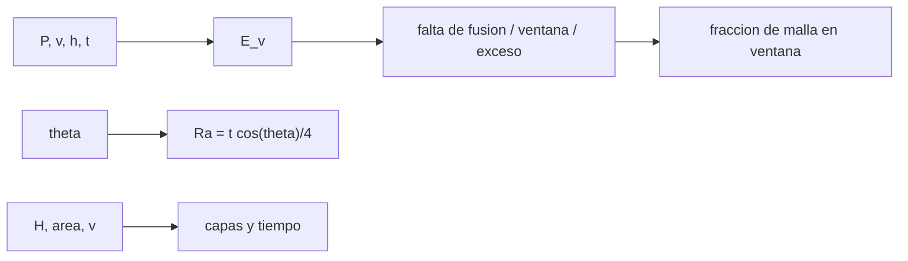

# B84-C15 — Manufactura aditiva

<!-- nav:top -->
[🏠 Programa](../../../../README.md) · [📚 Bloque B84](../../../tronco-comun/B84-estructuras-materiales-y-fabricacion-espacial.md) · [← Anterior: B84-C14 — Rodamientos y lubricación espacial](../B84-C14-rodamientos-y-lubricacion-espacial/CLASE.md) · [Siguiente: B84-C16 — Tolerancias de fabricación →](../B84-C16-tolerancias-de-fabricacion/CLASE.md)
<!-- /nav -->

## 1. Ubicación, nivel y alcance

Clase 15 del bloque B84. Nivel N3. La manufactura aditiva por fusión en lecho de polvo funde un metal capa a capa con un láser. Aquí calculas la densidad de energía volumétrica `E_v = P/(v h t)`, clasificas una malla de potencias y velocidades en falta de fusión, ventana y exceso de energía, calculas la rugosidad escalonada de superficies inclinadas y el tiempo de construcción de una pieza. Todos los números y los umbrales de ventana son **ilustrativos**; dependen del material y del equipo y no se consultaron.

## 2. Por qué esta clase existe

Dos piezas idénticas con otra velocidad de barrido pueden salir porosas; una ventana de proceso bien trazada evita el desperdicio, y la rugosidad escalonada decide qué superficies se mecanizan. La decisión central: **¿con qué potencia y velocidad se imprime dentro de la ventana y cuánto tarda y qué acabado deja?**

## 3. Lo que podrás hacer al terminar

1. Calcular `E_v = P/(v h t)` y su unidad.
2. Clasificar puntos de proceso por `E_v`.
3. Medir la fracción de la malla dentro de la ventana.
4. Calcular la rugosidad escalonada `Ra = t cos θ/4`.
5. Estimar el tiempo de construcción por capas.
6. Rotular lo ilustrativo.

La evidencia es la **mapa de ventana de proceso de manufactura aditiva** del ejercicio 12 (sección 20).

## 4. Con qué llegas y cómo comprobarlo

1. ¿Qué es una densidad de energía?
2. ¿Qué es una capa?
3. ¿Qué es la rugosidad Ra?
4. ¿Qué es una ventana de proceso?
5. ¿Qué es un dato ilustrativo?

<details>
<summary>Ver respuestas</summary>

1. La energía por unidad de volumen, en J/mm³. 2. Un espesor `t` de polvo fundido por pasada. 3. El promedio del valor absoluto de la desviación del perfil. 4. El rango de parámetros que da piezas densas. 5. Un valor no consultado.
</details>

Con cuatro o cinco aciertos, sigue; si no, repasa los prerrequisitos.

## 5. Un caso de contexto y casos de referencia

Con `P = 370 W`, `v = 1300 mm/s`, `h = 0,19 mm` y `t = 0,030 mm`, `E_v = 49,93 J/mm³`: dentro de la ventana ilustrativa (35–70). En una malla de potencia y velocidad, el 39,0 % de los puntos están en la ventana. Una superficie a 45° tiene `Ra = 5,30 µm`; una pieza de 40 mm en capas de 30 µm necesita 1333 capas y `6,70 h`. **Ejemplo conductor.** Todo es ilustrativo.

## 6. Vocabulario

La **densidad de energía volumétrica** `E_v = P/(v h t)` (J/mm³) mide la energía por volumen fundido. La **falta de fusión** ocurre con `E_v` bajo y el **exceso de energía** (ojo de cerradura) con `E_v` alto. El **efecto escalera** (*stair-step*) es la rugosidad por capas en superficies inclinadas. La **separación entre pasadas** `h` es la distancia entre trazas de láser.

## 7. Modelo mental: pintar una pared con una brocha, capa a capa



*Descripción textual:* los parámetros dan la densidad de energía y su clasificación; la inclinación da la rugosidad; la altura y el área dan el tiempo de construcción.

Analogía: una pared con muy poca pintura queda con huecos y con demasiada chorrea; entre ambos hay una ventana. Límite: `E_v` ignora la conducción, la geometría del baño y el material; solo es un indicador de primer orden.

## 8. La explicación, paso a paso

### 8.1 Densidad de energía

`E_v = 370/(1300 × 0,19 × 0,030) = 49,93 J/mm³`. Mapa (valores en J/mm³):

| `P` (W) | v = 600 | 900 | 1300 | 1800 (mm/s) |
|---|---|---|---|---|
| 150 | 43,9 (ventana) | 29,2 (falta) | 20,2 (falta) | 14,6 (falta) |
| 250 | 73,1 (exceso) | 48,7 (ventana) | 33,7 (falta) | 24,4 (falta) |
| 370 | 108,2 (exceso) | 72,1 (exceso) | 49,9 (ventana) | 36,1 (ventana) |
| 400 | 117,0 (exceso) | 78,0 (exceso) | 54,0 (ventana) | 39,0 (ventana) |

En la malla fina de `P` 100–420 W y `v` 400–2000 mm/s, 837 de 2145 puntos (39,0 %) están en la ventana.

### 8.2 Rugosidad escalonada

El perfil es un diente de sierra de amplitud `t cos θ`: `Ra = t cos θ/4`. Con `t = 30 µm`: 7,500 µm (θ = 0°), 6,495 (30°), 5,303 (45°), 3,750 (60°), 1,302 (80°) y 0,131 (89°); la integración numérica coincide.

### 8.3 Tiempo

`40/0,030 = 1333` capas; el barrido de 20 cm² con `h = 0,19` y `v = 1300` toma `8,10 s` y el recubrimiento `10 s` por capa: `6,70 h`; el recubrimiento aporta `3,70 h`. Con capas de 60 µm, `3,35 h` (a costa de la rugosidad: `Ra` se duplica).

### 8.4 Qué falta

Porosidad medida, tensiones residuales, anisotropía por orientación de construcción y tratamiento posterior (HIP, mecanizado, C34) quedan fuera; una pieza de vuelo requiere calificación del proceso.

## 9. Magnitudes, símbolos y unidades

| Símbolo | Qué es | Unidad | Valor / nota |
|---|---|---|---|
| `P` | potencia del láser | W | 370 |
| `v` | velocidad de barrido | mm/s | 1300 |
| `h`, `t` | separación y espesor de capa | mm | 0,19; 0,030 |
| `E_v` | densidad de energía | J/mm³ | 49,93 |
| `θ` | inclinación respecto del plano | ° | 0–89 |
| `Ra` | rugosidad media | µm | 5,303 (45°) |

## 10. Convenciones y referencias

mm, W, s, J. Umbrales de ventana ilustrativos (35 y 70 J/mm³), inventados para el ejercicio. Superficie inclinada `θ` medida desde el plano de construcción. Tolerancia: `Ra` numérica frente a analítica < 10⁻³.

## 11. De dónde sale lo que afirmamos

| ID | Fuente | Localizador | Respalda | Estado |
|---|---|---|---|---|
| — | Parámetros típicos de AlSi10Mg y umbrales de ventana de fusión en lecho de polvo | — | todos los valores y umbrales | No consultada en una fuente concreta |

Límites: los valores y los umbrales de ventana son ilustrativos y no se consultaron; no es una receta de proceso.

## 12. Cómo ver la ventana de proceso

| Magnitud | Valor |
|---|---|
| `E_v` de referencia | 49,93 J/mm³ |
| Puntos en ventana | 39,0 % |
| `Ra` a 45° | 5,303 µm |
| Capas | 1333 |
| Tiempo | 6,70 h |

Descripción larga: solo 4 de cada 10 combinaciones de potencia y velocidad caen en la ventana; el recubrimiento es la mitad del tiempo.

## 13. Ejemplo trabajado: la densidad de energía de referencia

**Paso 1 · Denominador.** `1300 × 0,19 × 0,030 = 7,41 mm³/s`.

**Paso 2 · Energía.** `370/7,41 = 49,93 J/mm³`.

**Paso 3 · Clase.** Entre 35 y 70: ventana.

## 14. Distintas formas de describir un proceso aditivo

**Por densidad de energía:** `E_v`. **Por ventana:** clase de proceso. **Por acabado:** `Ra(θ)`. **Por tiempo:** capas × tiempo por capa. **Por orientación:** ángulo de construcción.

## 15. Práctica guiada

**Ejercicio 1 · con los pasos indicados** Calcula `E_v` con `P = 250 W` y `v = 900 mm/s`. *Pasos:* `P/(v h t)`.

<details><summary>Solución comentada</summary>

`250/(900 × 0,19 × 0,03) = 48,7 J/mm³`: ventana.
</details>

**Ejercicio 2 · con los pasos indicados** Calcula `Ra` a 60°. *Pista:* `t cos θ/4`.

<details><summary>Solución comentada</summary>

`30 × 0,5/4 = 3,75 µm`.
</details>

**Ejercicio 3 · con los pasos indicados** ¿Por qué `Ra` baja con la inclinación? *Casi autónomo.*

<details><summary>Solución comentada</summary>

Porque la altura del escalón `t cos θ` baja cuando la superficie se acerca a la vertical.
</details>

## 16. Práctica autónoma, transferencia e integrador

**Ejercicio 4 · autónomo** `E_v` con `P = 400`, `v = 1800`.

<details><summary>Solución comentada</summary>

`39,0 J/mm³`.
</details>

**Ejercicio 5 · autónomo** Capas para 25 mm con `t = 0,05 mm`.

<details><summary>Solución comentada</summary>

`500`.
</details>

**Ejercicio 6 · autónomo** Tiempo de barrido por capa con 50 cm² y `v = 1300`.

<details><summary>Solución comentada</summary>

`5000/(0,19 × 1300) = 20,2 s`.
</details>

**Ejercicio 7 · autónomo** `v` para `E_v = 60` con `P = 370`.

<details><summary>Solución comentada</summary>

`370/(60 × 0,19 × 0,03) = 1082 mm/s`.
</details>

**Ejercicio 8 · autónomo** ¿Qué pasa con `E_v` si `h` baja?

<details><summary>Solución comentada</summary>

Sube: más solape.
</details>

**Ejercicio 9 · transferencia. **Transferencia.**** Una pieza porosa se imprimió a 120 J/mm³. ¿Cuál es la hipótesis?

<details><summary>Solución comentada</summary>

Exceso de energía y poros de ojo de cerradura; baja `P` o sube `v`.
</details>

**Ejercicio 10 · transferencia. **Transferencia.**** ¿Basta una ventana de `E_v` para calificar un proceso?

<details><summary>Solución comentada</summary>

No: hacen falta ensayos de densidad, tracción, fatiga y control del lote.
</details>

**Ejercicio 11 · transferencia. **Transferencia.**** Una superficie crítica es vertical. ¿Está lisa por el efecto escalera?

<details><summary>Solución comentada</summary>

El escalón es mínimo, pero la rugosidad real depende del contorno del láser; se mide.
</details>

**Ejercicio 12 · integrador. **Integrador.**** Elabora tu *mapa de ventana de proceso de manufactura aditiva*: tabla de `E_v`, fracción en ventana, `Ra(θ)` y tiempo, con la nota de que umbrales y valores son ilustrativos.

<details><summary>Solución comentada</summary>

Secciones 8.1–8.4 y la salida del laboratorio.
</details>

## 17. Laboratorio: ventana de proceso, rugosidad y tiempo

El script [aditiva.py](aditiva.py) calcula `E_v`, clasifica una malla, la rugosidad escalonada y el tiempo de construcción (**comprueba** `Ra` numérica frente a analítica (< 1e-3) y el punto de referencia en la ventana).

**Datos:** todo **ilustrativo**. **Predice antes de ejecutar:** ¿qué fracción de la malla cae en la ventana? (≈ 39 %.) **Ejecución del 2026-11-10 (Python 3.12.9):**

```text
Python 3.12.9 (biblioteca estandar)
Densidad de energia E_v = P/(v h t) [J/mm3] con h = 0,19 mm y t = 0,030 mm (valores ILUSTRATIVOS)
   P [W] | v= 600 mm/s | v= 900 mm/s | v=1300 mm/s | v=1800 mm/s |
    150  |   43.9 ventan|   29.2 falta |   20.2 falta |   14.6 falta |
    250  |   73.1 exceso|   48.7 ventan|   33.7 falta |   24.4 falta |
    370  |  108.2 exceso|   72.1 exceso|   49.9 ventan|   36.1 ventan|
    400  |  117.0 exceso|   78.0 exceso|   54.0 ventan|   39.0 ventan|
Punto de referencia P = 370 W, v = 1300 mm/s: E_v = 49.93 J/mm3 -> ventana
Malla P 100-420 W (paso 10) x v 400-2000 mm/s (paso 25): 837 de 2145 puntos en la ventana (39.0 %)
Rugosidad escalonada Ra [micrometros] segun la inclinacion (t = 30 um):
  theta =  0 grados  Ra analitica =  7.500  numerica =  7.500
  theta = 30 grados  Ra analitica =  6.495  numerica =  6.495
  theta = 45 grados  Ra analitica =  5.303  numerica =  5.303
  theta = 60 grados  Ra analitica =  3.750  numerica =  3.750
  theta = 80 grados  Ra analitica =  1.302  numerica =  1.302
  theta = 89 grados  Ra analitica =  0.131  numerica =  0.131
Tiempo de construccion ILUSTRATIVO: 1333 capas x (8.10 s de barrido + 10 s de recubrimiento) = 6.70 h
El recubrimiento aporta 3.70 h de las 6.70 h: espesor de capa 60 um -> 3.35 h (sin cambiar E_v)
Pruebas superadas.
```

```bash
python programa/clases/B84/B84-C15-manufactura-aditiva/aditiva.py
```

**Límites:** `E_v` es un indicador de primer orden; sin conducción, material ni porosidad medida.

## 18. Errores frecuentes y cómo corregirlos

**Tomar los umbrales como universales.** Se corrige con la sección 10.

**Olvidar el tiempo de recubrimiento.** Se corrige con 8.3.

**Confundir la inclinación con la del eje de construcción.** Se corrige con la sección 10.

**Creer que dentro de la ventana toda pieza es buena.** Se corrige con 8.4.

## 19. Cómo sabrás que vas bien

Tras la sección 8: ¿qué clase esperabas para 250 W y 900 mm/s y cuál obtuviste? Si dudas, repasa el ejemplo 13. Tras el laboratorio: ¿qué comprueba? (ver la sección 17).

## 20. Qué entregas y cómo se evalúa

El producto es tu **mapa de ventana de proceso de manufactura aditiva** (ejercicio 12).

| Criterio | Inicial | En desarrollo | Logrado | Destacado |
|---|---|---|---|---|
| Conceptos | Los confunde | Parciales | Calcula `E_v`, ventana, `Ra` y tiempo | Explica los límites |
| Cálculo | Sin unidades | Con errores | Tablas completas con unidades | Calcula casos nuevos |
| Numérico | Sin comprobar | Un caso | Contraste con una segunda vía | Interpreta las diferencias |
| Fuentes | Sin fuente | Sin fecha | Fuentes con fecha y estado | Declara lo ilustrativo y lo no consultado |
| Límites | No los nombra | Uno | Tres | Discute qué falta del modelo |

**Condiciones críticas (no se compensan con promedio):** rotular los datos ilustrativos y sintéticos como tales; no presentar un cálculo como ensayo ni como dato de vuelo; citar solo lo consultado.

## 21. Ética, seguridad y límites

Clase educativa: los modelos son simplificados y sus datos son sintéticos, ilustrativos o valores de estándar rotulados; **no es una base de diseño de hardware de vuelo** y ningún resultado sustituye a datos de material cualificados, a los documentos vigentes de la agencia o del lanzador ni a la revisión por personal competente. Accesibilidad: tablas equivalentes a las gráficas, fórmulas en texto, ejercicios sin conexión.

## 22. Para cerrar y seguir

El punto de `49,9 J/mm³` está en la ventana, una superficie a 45° tiene `Ra = 5,3 µm` y la pieza tarda `6,7 h`. Queda una pregunta: ¿cómo se asegura que las dimensiones finales caben en la tolerancia?

**Glosario español–inglés.** manufactura aditiva · *additive manufacturing*; fusión en lecho de polvo · *powder bed fusion*; densidad de energía · *energy density*; efecto escalera · *stair-step effect*; ventana de proceso · *process window*.

**Continuidad.** [B84-C16](../B84-C16-tolerancias-de-fabricacion/CLASE.md) estudia las tolerancias de fabricación.

**Referencias:** ver sección 11.

<!-- nav:bottom -->
---

[← Anterior: B84-C14 — Rodamientos y lubricación espacial](../B84-C14-rodamientos-y-lubricacion-espacial/CLASE.md) · [📚 Bloque B84](../../../tronco-comun/B84-estructuras-materiales-y-fabricacion-espacial.md) · [Siguiente: B84-C16 — Tolerancias de fabricación →](../B84-C16-tolerancias-de-fabricacion/CLASE.md)
<!-- /nav -->
