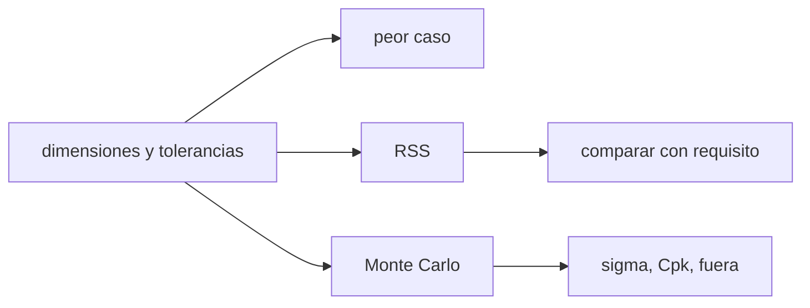

# B84-C16 — Tolerancias de fabricación

<!-- nav:top -->
[🏠 Programa](../../../../README.md) · [📚 Bloque B84](../../../tronco-comun/B84-estructuras-materiales-y-fabricacion-espacial.md) · [← Anterior: B84-C15 — Manufactura aditiva](../B84-C15-manufactura-aditiva/CLASE.md) · [Siguiente: B84-C17 — Soldadura y uniones →](../B84-C17-soldadura-y-uniones/CLASE.md)
<!-- /nav -->

## 1. Ubicación, nivel y alcance

Clase 16 del bloque B84. Nivel N3. Un ensamble funciona si la suma de las variaciones de sus piezas cabe en el hueco disponible. Aquí apilas cinco dimensiones **ilustrativas** de una caja y cuatro piezas, y comparas el método de peor caso, la raíz de la suma de cuadrados (RSS) y una simulación Monte Carlo con semilla fija, con índice de capacidad.

## 2. Por qué esta clase existe

El peor caso rechaza diseños que en la práctica funcionan y la RSS acepta riesgos que hay que cuantificar; elegir sin cálculo cuesta o dinero o fallas. La decisión central: **¿cumple el hueco del ensamble y con qué probabilidad, según el método de apilamiento?**

## 3. Lo que podrás hacer al terminar

1. Plantear una cadena de dimensiones con signos.
2. Calcular la tolerancia del hueco por peor caso y por RSS.
3. Simular el apilamiento con Monte Carlo.
4. Calcular `Cpk` y la fracción fuera de requisito.
5. Identificar la dimensión que más contribuye a la varianza.
6. Rotular lo ilustrativo.

La evidencia es la **ficha de apilamiento de tolerancias** del ejercicio 12 (sección 20).

## 4. Con qué llegas y cómo comprobarlo

1. ¿Qué es una tolerancia?
2. ¿Qué es la desviación típica?
3. ¿Qué es una semilla?
4. ¿Qué es `Cpk`?
5. ¿Qué es un dato ilustrativo?

<details>
<summary>Ver respuestas</summary>

1. El rango permitido de una dimensión. 2. La dispersión de una variable. 3. El valor inicial que hace repetible un generador aleatorio. 4. Un índice de capacidad: distancia de la media al límite más cercano dividida por `3σ`. 5. Un valor no consultado.
</details>

Con cuatro o cinco aciertos, sigue; si no, repasa los prerrequisitos.

## 5. Un caso de contexto y casos de referencia

El hueco `G = A − (B + C + D + E)` tiene nominal `5,000 mm` y se exige entre `4,70` y `5,30 mm`. Por peor caso `G = 5,000 ± 0,330` (no cumple); por RSS `± 0,1546` (cumple); por Monte Carlo con `σ = tol/3`, `σ_G = 0,05151 mm`, `Cpk = 1,941` y 0 fallas en 200 000. **Ejemplo conductor.** Todo ilustrativo.

## 6. Vocabulario

El **peor caso** suma las tolerancias `Σ|tᵢ|`. La **RSS** es `√Σtᵢ²`. **Monte Carlo** muestrea cada dimensión. `Cp` y `Cpk` miden la capacidad del proceso; `σ = tol/3` equivale a `Cp = 1`. La **contribución** de cada dimensión es `tᵢ²/Σt²`.

## 7. Modelo mental: una torre de bloques



*Descripción textual:* las dimensiones alimentan tres métodos; el requisito decide cuál cumple y la simulación da la probabilidad de fuera de límite.

Analogía: apilar bloques: que todos sean los más altos a la vez es raro, pero posible. Límite: RSS y Monte Carlo suponen dimensiones normales, independientes y centradas.

## 8. La explicación, paso a paso

### 8.1 Peor caso y RSS

`Σt = 0,10 + 0,05 + 0,05 + 0,08 + 0,05 = 0,33 mm`: rango `[4,670; 5,330]`, fuera del requisito. RSS `= √(0,10² + 3 × 0,05² + 0,08²) = 0,1546 mm`: `[4,8454; 5,1546]`, cumple.

### 8.2 Contribuciones

A aporta 41,8 % de la varianza, D 26,8 % y B, C y E 10,5 % cada una: reducir A y D rinde más.

### 8.3 Monte Carlo

Con `σᵢ = tolᵢ/3`: `σ_G = 0,05151` (teórica `0,05153`), `Cpk = 1,941`, 0 fuera. Con `σᵢ = tolᵢ/4`: `0,03863` (teórica `0,03865`), `Cpk = 2,588`. Si D pasa a `± 0,04`: RSS `0,1382` y peor caso `0,290 mm`, que ya cumple.

### 8.4 Cuándo usar cada uno

Peor caso para funciones críticas de seguridad; RSS o Monte Carlo cuando el proceso está controlado y se acepta un riesgo declarado.

## 9. Magnitudes, símbolos y unidades

| Símbolo | Qué es | Unidad | Valor / nota |
|---|---|---|---|
| `tᵢ` | tolerancia de la dimensión | mm | 0,05–0,10 |
| `G` | hueco | mm | 5,000 |
| `σ_G` | desviación típica del hueco | mm | 0,05151 |
| `Cpk` | índice de capacidad | — | 1,941 |
| RSS | raíz de suma de cuadrados | mm | 0,1546 |
| `N` | muestras | — | 200 000 |

## 10. Convenciones y referencias

mm. Dimensiones normales, independientes y centradas; semilla 84016. Requisito ilustrativo 4,70–5,30 mm. Tolerancia: `σ` de Monte Carlo frente a RSS/3 dentro de 1 %.

## 11. De dónde sale lo que afirmamos

| ID | Fuente | Localizador | Respalda | Estado |
|---|---|---|---|---|
| — | Dimensiones y tolerancias del ejemplo; métodos de apilamiento | — | todos los valores | No consultada en una fuente concreta |

Límites: datos ilustrativos no consultados; no se aplicó ninguna norma de dimensionado y tolerancias.

## 12. Cómo ver el apilamiento

| Magnitud | Valor |
|---|---|
| Peor caso | ± 0,330 mm |
| RSS | ± 0,1546 mm |
| `σ_G` Monte Carlo | 0,05151 mm |
| `Cpk` | 1,941 |
| Aporte de A | 41,8 % |

Descripción larga: el peor caso rechaza lo que RSS y Monte Carlo aceptan con holgura.

## 13. Ejemplo trabajado: la RSS del hueco

**Paso 1 · Cuadrados.** `0,01 + 0,0025 × 3 + 0,0064 = 0,0239`.

**Paso 2 · Raíz.** `√0,0239 = 0,1546 mm`.

## 14. Distintas formas de describir un apilamiento

**Por peor caso:** `Σt`. **Por RSS:** `√Σt²`. **Por simulación:** `σ`, `Cpk`. **Por contribución:** `t²/Σt²`.

## 15. Práctica guiada

**Ejercicio 1 · con los pasos indicados** Calcula el peor caso con `0,10 + 0,05 + 0,05 + 0,08 + 0,05`.

<details><summary>Solución comentada</summary>

`0,33 mm`.
</details>

**Ejercicio 2 · con los pasos indicados** ¿Cuál es `σ_G` teórica con `σᵢ = tol/3`? *Pista:* RSS/3.

<details><summary>Solución comentada</summary>

`0,1546/3 = 0,05153 mm`.
</details>

**Ejercicio 3 · con los pasos indicados** ¿Por qué `Cpk` es 1,941? *Casi autónomo.*

<details><summary>Solución comentada</summary>

`(5,30 − 5,00)/(3 × 0,05151) = 1,941`.
</details>

## 16. Práctica autónoma, transferencia e integrador

**Ejercicio 4 · autónomo** RSS si todas las tolerancias valen `0,05`.

<details><summary>Solución comentada</summary>

`0,05 × √5 = 0,1118 mm`.
</details>

**Ejercicio 5 · autónomo** `σ_G` con `Cp = 1,33` de cada una.

<details><summary>Solución comentada</summary>

`0,03865 mm`.
</details>

**Ejercicio 6 · autónomo** Contribución de D con `± 0,04`.

<details><summary>Solución comentada</summary>

`0,0016/0,0191 = 8,4 %`.
</details>

**Ejercicio 7 · autónomo** Peor caso con D `± 0,04`.

<details><summary>Solución comentada</summary>

`0,29 mm`.
</details>

**Ejercicio 8 · autónomo** ¿Qué pasa con `Cpk` si la media se descentra 0,1 mm?

<details><summary>Solución comentada</summary>

`(0,2)/(3 × 0,0515) = 1,29`.
</details>

**Ejercicio 9 · transferencia. **Transferencia.**** Un ensamble es crítico para la seguridad. ¿Peor caso o RSS?

<details><summary>Solución comentada</summary>

Peor caso.
</details>

**Ejercicio 10 · transferencia. **Transferencia.**** Las piezas vienen de un proveedor con proceso no controlado. ¿Vale Monte Carlo normal?

<details><summary>Solución comentada</summary>

No: faltan datos de capacidad.
</details>

**Ejercicio 11 · transferencia. **Transferencia.**** ¿Cómo reduces el riesgo sin apretar todas las tolerancias?

<details><summary>Solución comentada</summary>

Con las dimensiones de mayor contribución (A y D).
</details>

**Ejercicio 12 · integrador. **Integrador.**** Elabora tu *ficha de apilamiento de tolerancias*: peor caso, RSS, Monte Carlo, `Cpk`, contribuciones y la decisión, con lo ilustrativo rotulado.

<details><summary>Solución comentada</summary>

Secciones 8.1–8.4 y la salida del laboratorio.
</details>

## 17. Laboratorio: apilamiento de tolerancias

El script [tolerancias.py](tolerancias.py) compara peor caso, RSS y Monte Carlo en una cadena de cinco dimensiones (**comprueba** `σ` de Monte Carlo frente a RSS/3 dentro de 1 %).

**Datos:** dimensiones **ilustrativas**; semilla 84016. **Predice antes de ejecutar:** ¿cumple el peor caso? (no.) **Ejecución del 2026-11-10 (Python 3.12.9):**

```text
Python 3.12.9 (biblioteca estandar)
Cadena ILUSTRATIVA: G = A - (B + C + D + E); requisito 4,70 <= G <= 5,30 mm
Hueco nominal = 5.000 mm
Peor caso: G = 5.000 +/- 0.330  -> [4.670, 5.330] mm  (NO cumple el requisito)
RSS:        G = 5.000 +/- 0.1546  -> [4.8454, 5.1546] mm  (cumple)
Contribucion de cada dimension a la varianza (RSS):
  A: tol = 0.10 mm ->  41.8 % de la varianza
  B: tol = 0.05 mm ->  10.5 % de la varianza
  C: tol = 0.05 mm ->  10.5 % de la varianza
  D: tol = 0.08 mm ->  26.8 % de la varianza
  E: tol = 0.05 mm ->  10.5 % de la varianza
Monte Carlo Cp = 1,00 (sigma = tol/3): media = 5.0000 mm, sigma = 0.05151 mm (teorica 0.05153), Cpk = 1.941, fuera de requisito = 0 de 200000 (0.0000 %)
Monte Carlo Cp = 1,33 (sigma = tol/4): media = 5.0000 mm, sigma = 0.03863 mm (teorica 0.03865), Cpk = 2.588, fuera de requisito = 0 de 200000 (0.0000 %)
Si D se mecaniza a +/- 0,04 mm: RSS = 0.1382 mm (antes 0.1546); peor caso = 0.290 mm
Pruebas superadas.
```

```bash
python programa/clases/B84/B84-C16-tolerancias-de-fabricacion/tolerancias.py
```

**Límites:** normalidad e independencia supuestas; sin desviaciones geométricas.

## 18. Errores frecuentes y cómo corregirlos

**Sumar tolerancias por RSS en funciones críticas.** Se corrige con 8.4.

**Suponer procesos centrados.** Se corrige con el ejercicio 8.

**Ignorar las contribuciones.** Se corrige con 8.2.

**Presentar los valores como de un plano.** Se corrige con la sección 10.

## 19. Cómo sabrás que vas bien

Tras la sección 8: ¿qué método esperabas que cumpliera? Si dudas, repasa el ejemplo 13. Tras el laboratorio: ¿qué comprueba? (ver la sección 17).

## 20. Qué entregas y cómo se evalúa

El producto es tu **ficha de apilamiento de tolerancias** (ejercicio 12).

| Criterio | Inicial | En desarrollo | Logrado | Destacado |
|---|---|---|---|---|
| Conceptos | Los confunde | Parciales | Calcula y compara apilamientos | Explica los límites |
| Cálculo | Sin unidades | Con errores | Tablas completas con unidades | Calcula casos nuevos |
| Numérico | Sin comprobar | Un caso | Contraste con una segunda vía | Interpreta las diferencias |
| Fuentes | Sin fuente | Sin fecha | Fuentes con fecha y estado | Declara lo ilustrativo y lo no consultado |
| Límites | No los nombra | Uno | Tres | Discute qué falta del modelo |

**Condiciones críticas (no se compensan con promedio):** rotular los datos ilustrativos y sintéticos como tales; no presentar un cálculo como ensayo ni como dato de vuelo; citar solo lo consultado.

## 21. Ética, seguridad y límites

Clase educativa: los modelos son simplificados y sus datos son sintéticos, ilustrativos o valores de estándar rotulados; **no es una base de diseño de hardware de vuelo** y ningún resultado sustituye a datos de material cualificados, a los documentos vigentes de la agencia o del lanzador ni a la revisión por personal competente. Accesibilidad: tablas equivalentes a las gráficas, fórmulas en texto, ejercicios sin conexión.

## 22. Para cerrar y seguir

El hueco no cumple por peor caso (`± 0,330`) y sí por RSS (`± 0,1546`). Queda una pregunta: ¿cómo se unen las piezas?

**Glosario español–inglés.** tolerancia · *tolerance*; apilamiento · *tolerance stack-up*; peor caso · *worst case*; capacidad de proceso · *process capability*; hueco · *gap*.

**Continuidad.** [B84-C17](../B84-C17-soldadura-y-uniones/CLASE.md) estudia soldadura y uniones.

**Referencias:** ver sección 11.

<!-- nav:bottom -->
---

[← Anterior: B84-C15 — Manufactura aditiva](../B84-C15-manufactura-aditiva/CLASE.md) · [📚 Bloque B84](../../../tronco-comun/B84-estructuras-materiales-y-fabricacion-espacial.md) · [Siguiente: B84-C17 — Soldadura y uniones →](../B84-C17-soldadura-y-uniones/CLASE.md)
<!-- /nav -->
