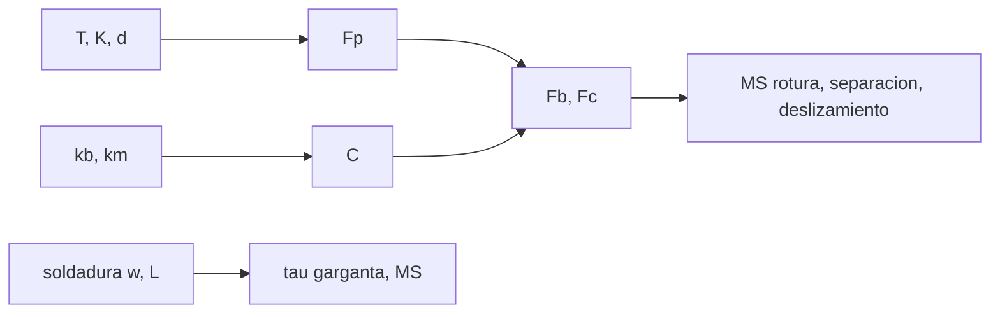

# B84-C17 — Soldadura y uniones

<!-- nav:top -->
[🏠 Programa](../../../../README.md) · [📚 Bloque B84](../../../tronco-comun/B84-estructuras-materiales-y-fabricacion-espacial.md) · [← Anterior: B84-C16 — Tolerancias de fabricación](../B84-C16-tolerancias-de-fabricacion/CLASE.md) · [Siguiente: B84-C18 — Control dimensional →](../B84-C18-control-dimensional/CLASE.md)
<!-- /nav -->

## 1. Ubicación, nivel y alcance

Clase 17 del bloque B84. Nivel N3. Las uniones son el punto débil habitual de una estructura. Aquí dimensionas una unión atornillada M6 **ilustrativa** con precarga, factor de carga y los márgenes de rotura, separación y deslizamiento con el factor de seguridad 1,4 del GEVS (consultado), y calculas la garganta de una soldadura de filete.

## 2. Por qué esta clase existe

Un tornillo que se separa o desliza falla sin romper: la precarga es lo que mantiene la unión, y su dispersión por el par de apriete es grande. La decisión central: **¿qué precarga mantiene la unión cerrada sin romper el tornillo, y cuándo deslizan las placas?**

## 3. Lo que podrás hacer al terminar

1. Calcular la precarga `F_p = T/(K d)`.
2. Calcular rigideces y el factor de carga `C`.
3. Calcular la fuerza máxima en el tornillo y la fuerza de apriete residual.
4. Calcular márgenes de rotura, separación y deslizamiento.
5. Dimensionar una soldadura de filete por su garganta.
6. Rotular lo consultado y lo ilustrativo.

La evidencia es la **ficha de márgenes de una unión atornillada** del ejercicio 12 (sección 20).

## 4. Con qué llegas y cómo comprobarlo

1. ¿Qué es la precarga?
2. ¿Qué es el factor de tuerca?
3. ¿Qué es la rigidez axial?
4. ¿Qué es la garganta de una soldadura?
5. ¿Qué es un margen de seguridad?

<details>
<summary>Ver respuestas</summary>

1. La tensión inicial del tornillo al apretar. 2. `K` que relaciona par y precarga. 3. `EA/L`. 4. La altura efectiva `0,707 w` de un filete. 5. `adm/(FS carga) − 1`.
</details>

Con cuatro o cinco aciertos, sigue; si no, repasa los prerrequisitos.

## 5. Un caso de contexto y casos de referencia

Un tornillo M6 apretado a `8 N·m` (`K = 0,20`) tiene precarga `6667 N` (`5000–8333 N` con ±25 %). El factor de carga es `C = 0,2902`; con una tracción de `3000 N`, `MS_rotura = 0,248`, `MS_separación = 0,677` y, con cortante de `1500 N`, `MS_deslizamiento = −0,727`: la unión desliza y hacen falta pasadores. **Ejemplo conductor.** Datos ilustrativos; FS del GEVS.

## 6. Vocabulario

El **factor de carga** `C = k_b/(k_b + k_m)` es la fracción de la carga externa que toma el tornillo. La **separación** ocurre si `F > F_p/(1 − C)`. El **deslizamiento** ocurre si el cortante supera `μ F_c`, con `F_c = F_p − (1 − C)F`. El filete se calcula con la **garganta** `a = 0,707 w`.

## 7. Modelo mental: dos placas sujetas por un resorte apretado



*Descripción textual:* el par da la precarga, las rigideces dan `C`, ambas dan las fuerzas y los tres márgenes; la soldadura se calcula aparte.

Analogía: un resorte muy apretado entre dos placas: la carga externa apenas lo estira (`C` pequeño) y mientras quede apriete las placas no se abren. Límite: `k_m` con el cilindro de presión equivalente es una aproximación elegida aquí.

## 8. La explicación, paso a paso

### 8.1 Rigidez y precarga

`k_b = 335,0 MN/m`, `k_m = 819,4 MN/m`, `C = 0,2902`. `F_p = 8/(0,20 × 0,006) = 6667 N`; con ±25 %, `[5000; 8333] N` (`414,6 MPa` de tensión de precarga máxima).

### 8.2 Fuerzas y márgenes (FS = 1,4)

`F_b = 8333 + 0,2902 × 3000 = 9204 N`; `F_c = 5000 − 0,7098 × 3000 = 2871 N`. `MS_u = 16 080/(1,4 × 9204) − 1 = 0,248`; `MS_sep = 5000/(1,4 × 0,7098 × 3000) − 1 = 0,677`; `MS_slip = 0,2 × 2871/(1,4 × 1500) − 1 = −0,727`. La carga que separa es `7044 N`.

### 8.3 Efecto de la precarga

| `F_p` (N) | `MS_sep` | `MS_rotura` |
|---|---|---|
| 3333 | 0,118 | 1,732 |
| 5000 | 0,677 | 0,956 |
| 6667 | 1,236 | 0,524 |
| 8333 | 1,795 | 0,248 |

Más precarga mejora la separación y consume margen de rotura: se busca el compromiso.

### 8.4 Soldadura

Filete `w = 4 mm`, `L = 40 mm`, `a = 2,83 mm`: `F = 5000 N` da `44,2 MPa` (`MS = 1,101`); `10 000 N`, `88,4 MPa` (`0,050`); `20 000 N`, `176,8 MPa` (`−0,475`).

## 9. Magnitudes, símbolos y unidades

| Símbolo | Qué es | Unidad | Valor / nota |
|---|---|---|---|
| `F_p` | precarga | N | 6667 |
| `C` | factor de carga | — | 0,2902 |
| `F_b` | fuerza máxima del tornillo | N | 9204 |
| `F_c` | apriete residual | N | 2871 |
| `MS` | margen | — | 0,248; 0,677; −0,727 |
| `FS` | factor de seguridad | — | 1,4 (GEVS) |

## 10. Convenciones y referencias

N, mm y MPa. Tornillo M6 `A_s = 20,1 mm²`, resistencia ilustrativa 800 MPa, aluminio en los miembros. FS 1,4: GEVS Tabla 2.2-3 (metálico, estático). No se consultó NASA-STD-5020.

## 11. De dónde sale lo que afirmamos

| ID | Fuente | Localizador | Respalda | Estado |
|---|---|---|---|---|
| S1 | NASA/GSFC, GSFC-STD-7000 (GEVS) Versión B, Cambio 0, 2021-04-28 — https://standards.nasa.gov/standard/gsfc/gsfc-std-7000 (PDF descargado y leído con PyMuPDF el 2026-11-10) | Tabla 2.2-3 (página 47 del PDF) | factor de seguridad último 1,4 en metálicos con carga estática y 1,5 en uniones adhesivas e insertos | Consultada |
| — | NASA-STD-5020 y datos del tornillo, la placa y la soldadura | — | el método de rigidez de la unión, el factor de tuerca y todos los valores ilustrativos | No consultada en una fuente concreta |

Límites: el FS es del GEVS; el modelo de `k_m`, `K`, `μ` y las resistencias son ilustrativos; no se consultó el estándar de elementos roscados.

## 12. Cómo ver los márgenes de la unión

| Magnitud | Valor |
|---|---|
| `C` | 0,2902 |
| `MS_rotura` | 0,248 |
| `MS_sep` | 0,677 |
| `MS_slip` | −0,727 |
| Soldadura 10 kN | `MS = 0,050` |

Descripción larga: la unión resiste la tracción pero desliza con el cortante: se debe añadir un pasador o más fricción.

## 13. Ejemplo trabajado: la precarga

**Paso 1 · Fórmula.** `F_p = T/(K d)`.

**Paso 2 · Números.** `8/(0,20 × 0,006) = 6667 N`.

## 14. Distintas formas de describir una unión

**Por precarga:** `F_p`. **Por rigidez:** `C`. **Por fuerzas:** `F_b`, `F_c`. **Por margen:** separación, rotura, deslizamiento. **Por garganta:** `τ`.

## 15. Práctica guiada

**Ejercicio 1 · con los pasos indicados** Calcula `C` con `k_b = 335` y `k_m = 819,4`. *Pasos:* `k_b/(k_b + k_m)`.

<details><summary>Solución comentada</summary>

`0,2902`.
</details>

**Ejercicio 2 · con los pasos indicados** ¿Qué fracción de 3000 N llega al tornillo? *Pista:* `C F`.

<details><summary>Solución comentada</summary>

`870,6 N`.
</details>

**Ejercicio 3 · con los pasos indicados** ¿Por qué `MS_slip` es negativo? *Casi autónomo.*

<details><summary>Solución comentada</summary>

`F_c = 2871 N` da `μF_c = 574 N` frente a `1,4 × 1500 = 2100 N`.
</details>

## 16. Práctica autónoma, transferencia e integrador

**Ejercicio 4 · autónomo** `F_sep` con `F_p,min = 5000`.

<details><summary>Solución comentada</summary>

`7044 N`.
</details>

**Ejercicio 5 · autónomo** Precarga con `T = 10 N·m`.

<details><summary>Solución comentada</summary>

`8333 N`.
</details>

**Ejercicio 6 · autónomo** `MS_u` con `F_b = 9204` y `F_u = 16 080`, `FS = 2`.

<details><summary>Solución comentada</summary>

`16 080/(2 × 9204) − 1 = −0,126`.
</details>

**Ejercicio 7 · autónomo** `τ` de la soldadura con `F = 8000 N`.

<details><summary>Solución comentada</summary>

`70,7 MPa`.
</details>

**Ejercicio 8 · autónomo** ¿Qué pasa con `F_c` si `F` sube?

<details><summary>Solución comentada</summary>

Baja: `F_c = F_p − (1 − C)F`.
</details>

**Ejercicio 9 · transferencia. **Transferencia.**** El cortante lo toma el tornillo por fricción. ¿Es buena práctica?

<details><summary>Solución comentada</summary>

No: se usan pasadores o ajustes de cortante.
</details>

**Ejercicio 10 · transferencia. **Transferencia.**** La precarga tiene ±25 %. ¿Qué haces?

<details><summary>Solución comentada</summary>

Dimensionas con la mínima para separar y la máxima para rotura.
</details>

**Ejercicio 11 · transferencia. **Transferencia.**** ¿Se puede usar la tabla del GEVS para uniones adhesivas con 1,4?

<details><summary>Solución comentada</summary>

No: la tabla da 1,5.
</details>

**Ejercicio 12 · integrador. **Integrador.**** Elabora tu *ficha de márgenes de una unión atornillada*: precarga, `C`, fuerzas, tres márgenes, efecto de la precarga y la soldadura, con el FS consultado y lo ilustrativo.

<details><summary>Solución comentada</summary>

Secciones 8.1–8.4 y la salida del laboratorio.
</details>

## 17. Laboratorio: unión atornillada y soldadura de filete

El script [uniones.py](uniones.py) calcula precarga, factor de carga, márgenes y una garganta de soldadura (**comprueba** `F_b − F_c = F` y márgenes de separación y rotura positivos).

**Datos:** FS del GEVS **consultado**; el resto **ilustrativo**. **Predice antes de ejecutar:** ¿desliza la unión con 1500 N de cortante? (sí: `MS = −0,727`.) **Ejecución del 2026-11-10 (Python 3.12.9):**

```text
Python 3.12.9 (biblioteca estandar)
Union ILUSTRATIVA M6 en aluminio, FS = 1,4 (GEVS, metalico estatico)
kb = 335.00 MN/m ; km = 819.39 MN/m ; factor de carga C = kb/(kb+km) = 0.2902
Precarga nominal F_p = T/(K d) = 6666.7 N ; con dispersion +/-25 %: [5000.0, 8333.3] N ; 414.6 MPa de tension maxima por precarga
Fuerza maxima en el tornillo F_b = F_p,max + C F = 9203.9 N ; fuerza de apriete residual F_c = 2870.6 N
MS rotura  = 16080/(1.4 x 9203.9) - 1 = 0.248
MS separacion = 5000.0/(1.4 x (1-C) x 3000) - 1 = 0.677
MS deslizamiento = mu (F_p,min - (1-C) F)/(1.4 V) - 1 = -0.727
Carga de separacion F_sep = F_p,min/(1-C) = 7044 N (carga limite aplicada 3000 N)
Efecto de la precarga (traccion aplicada 3000 N):
  F_p =  3333.3 N -> MS_sep =   0.118  MS_rotura =   1.732
  F_p =  5000.0 N -> MS_sep =   0.677  MS_rotura =   0.956
  F_p =  6666.7 N -> MS_sep =   1.236  MS_rotura =   0.524
  F_p =  8333.3 N -> MS_sep =   1.795  MS_rotura =   0.248
Soldadura de filete w = 4 mm, L = 40 mm: F =    5000 N -> tau =   44.2 MPa, MS =  1.101
Soldadura de filete w = 4 mm, L = 40 mm: F =   10000 N -> tau =   88.4 MPa, MS =  0.050
Soldadura de filete w = 4 mm, L = 40 mm: F =   20000 N -> tau =  176.8 MPa, MS = -0.475
Pruebas superadas.
```

```bash
python programa/clases/B84/B84-C17-soldadura-y-uniones/uniones.py
```

**Límites:** rigidez aproximada; carga estática; sin fatiga ni relajación.

## 18. Errores frecuentes y cómo corregirlos

**Olvidar la dispersión de la precarga.** Se corrige con 8.1.

**Usar el tornillo como pasador.** Se corrige con 8.2.

**Ignorar `C`.** Se corrige con 8.1.

**Presentar los valores como de un estándar de uniones.** Se corrige con la sección 10.

## 19. Cómo sabrás que vas bien

Tras la sección 8: ¿qué margen esperabas negativo? Si dudas, repasa el ejemplo 13. Tras el laboratorio: ¿qué comprueba? (ver la sección 17).

## 20. Qué entregas y cómo se evalúa

El producto es tu **ficha de márgenes de una unión atornillada** (ejercicio 12).

| Criterio | Inicial | En desarrollo | Logrado | Destacado |
|---|---|---|---|---|
| Conceptos | Los confunde | Parciales | Calcula los márgenes de una unión | Explica los límites |
| Cálculo | Sin unidades | Con errores | Tablas completas con unidades | Calcula casos nuevos |
| Numérico | Sin comprobar | Un caso | Contraste con una segunda vía | Interpreta las diferencias |
| Fuentes | Sin fuente | Sin fecha | Fuentes con fecha y estado | Declara lo ilustrativo y lo no consultado |
| Límites | No los nombra | Uno | Tres | Discute qué falta del modelo |

**Condiciones críticas (no se compensan con promedio):** rotular los datos ilustrativos y sintéticos como tales; no presentar un cálculo como ensayo ni como dato de vuelo; citar solo lo consultado.

## 21. Ética, seguridad y límites

Clase educativa: los modelos son simplificados y sus datos son sintéticos, ilustrativos o valores de estándar rotulados; **no es una base de diseño de hardware de vuelo** y ningún resultado sustituye a datos de material cualificados, a los documentos vigentes de la agencia o del lanzador ni a la revisión por personal competente. Accesibilidad: tablas equivalentes a las gráficas, fórmulas en texto, ejercicios sin conexión.

## 22. Para cerrar y seguir

La unión resiste `3000 N` de tracción (`MS = 0,677`) pero desliza con `1500 N` de cortante. Queda una pregunta: ¿cómo se miden las piezas fabricadas?

**Glosario español–inglés.** precarga · *preload*; unión atornillada · *bolted joint*; soldadura de filete · *fillet weld*; garganta · *throat*; deslizamiento · *slip*.

**Continuidad.** [B84-C18](../B84-C18-control-dimensional/CLASE.md) estudia el control dimensional.

**Referencias:** ver sección 11.

<!-- nav:bottom -->
---

[← Anterior: B84-C16 — Tolerancias de fabricación](../B84-C16-tolerancias-de-fabricacion/CLASE.md) · [📚 Bloque B84](../../../tronco-comun/B84-estructuras-materiales-y-fabricacion-espacial.md) · [Siguiente: B84-C18 — Control dimensional →](../B84-C18-control-dimensional/CLASE.md)
<!-- /nav -->
