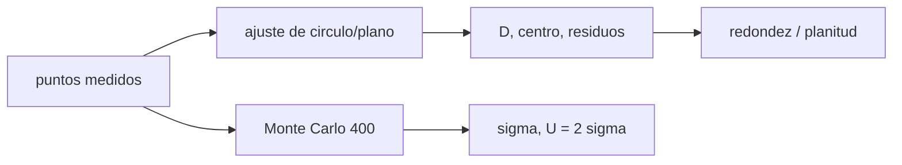

# B84-C18 — Control dimensional

<!-- nav:top -->
[🏠 Programa](../../../../README.md) · [📚 Bloque B84](../../../tronco-comun/B84-estructuras-materiales-y-fabricacion-espacial.md) · [← Anterior: B84-C17 — Soldadura y uniones](../B84-C17-soldadura-y-uniones/CLASE.md) · [Siguiente: B84-C19 — Inspección no destructiva →](../../../tronco-comun/B84-estructuras-materiales-y-fabricacion-espacial.md#b84-c19)
<!-- /nav -->

## 1. Ubicación, nivel y alcance

Clase 18 del bloque B84. Nivel N3. Medir una pieza es estimar: los puntos tienen ruido y el resultado tiene incertidumbre. Aquí ajustas por mínimos cuadrados un círculo a 36 puntos **sintéticos** de un agujero y un plano a 49 puntos con alabeo, calculas redondez y planitud y propagas la incertidumbre del diámetro con Monte Carlo.

## 2. Por qué esta clase existe

Una pieza «dentro de tolerancia» con una medida que tiene 5 µm de incertidumbre en una tolerancia de 10 µm no está demostrada. La decisión central: **¿qué diámetro tiene el agujero, con qué incertidumbre y cuántos puntos hacen falta?**

## 3. Lo que podrás hacer al terminar

1. Ajustar un círculo por mínimos cuadrados algebraicos.
2. Calcular redondez y planitud de los residuos.
3. Estimar la incertidumbre del diámetro por Monte Carlo.
4. Contrastarla con `2σ/√n`.
5. Ver cómo baja con el número de puntos.
6. Rotular lo sintético.

La evidencia es la **informe de control dimensional con incertidumbre** del ejercicio 12 (sección 20).

## 4. Con qué llegas y cómo comprobarlo

1. ¿Qué es un ajuste por mínimos cuadrados?
2. ¿Qué es un residuo?
3. ¿Qué es la incertidumbre de medida?
4. ¿Qué es Monte Carlo?
5. ¿Qué es un dato sintético?

<details>
<summary>Ver respuestas</summary>

1. La curva que minimiza la suma de cuadrados de los residuos. 2. La diferencia entre el punto y el ajuste. 3. La dispersión razonable del resultado. 4. Repetir la medición simulada con ruido nuevo. 5. Uno generado, no medido.
</details>

Con cuatro o cinco aciertos, sigue; si no, repasa los prerrequisitos.

## 5. Un caso de contexto y casos de referencia

Con 36 puntos sintéticos (`R = 25,000 mm`, lóbulo de 4 µm, ruido de 3 µm) el ajuste da `D = 49,99986 mm` y centro `(9,99982; 4,99977)`. La redondez (máx − mín de residuos) es `17,08 µm`. En 400 repeticiones la desviación del diámetro es `0,997 µm` (teórica `1,000 µm`) y la incertidumbre expandida `1,99 µm`. **Ejemplo conductor.** Todo sintético.

## 6. Vocabulario

El **ajuste algebraico (Kåsa)** resuelve `x² + y² = 2ax + 2by + c`. La **redondez** es el rango de los residuos radiales. La **planitud** es el rango de los residuos al plano. La **incertidumbre expandida** `U = k σ` con `k = 2`.

## 7. Modelo mental: medir un aro con una regla temblorosa



*Descripción textual:* los puntos dan el ajuste y los residuos; repetir con ruido nuevo da la incertidumbre.

Analogía: medir un aro con una regla que tiembla: más puntos promedian el temblor. Límite: el ajuste de mínimos cuadrados no es la zona mínima de la norma, y el ruido real no es solo gaussiano.

## 8. La explicación, paso a paso

### 8.1 Círculo

`D = 49,99986 mm` (error `−0,14 µm`); residuos `−7,82` a `+9,26 µm`; redondez `17,08 µm`: ruido más lóbulo.

### 8.2 Incertidumbre

Monte Carlo de 400 repeticiones: media `50,00004 mm`, `σ_D = 0,997 µm`; teórica `2σ/√n = 1,000 µm`. `U(k=2) = 1,99 µm`.

### 8.3 Efecto del número de puntos

| `n` | `σ_D` (µm) | Teórica (µm) |
|---|---|---|
| 9 | 2,119 | 2,000 |
| 18 | 1,478 | 1,414 |
| 36 | 1,009 | 1,000 |
| 72 | 0,736 | 0,707 |

### 8.4 Plano

Con 49 puntos y alabeo de 8 µm más ruido de 2 µm, la planitud (máx − mín de residuos) es `10,72 µm`.

## 9. Magnitudes, símbolos y unidades

| Símbolo | Qué es | Unidad | Valor / nota |
|---|---|---|---|
| `D` | diámetro ajustado | mm | 49,99986 |
| `(a,b)` | centro | mm | (9,99982; 4,99977) |
| `σ_D` | incertidumbre típica | µm | 0,997 |
| `U` | incertidumbre expandida | µm | 1,99 |
| redondez | rango de residuos | µm | 17,08 |
| planitud | rango al plano | µm | 10,72 |

## 10. Convenciones y referencias

mm y µm. Puntos sintéticos con semilla 84018 y 84019; ruido gaussiano de 3 y 2 µm. Planitud por mínimos cuadrados, no zona mínima.

## 11. De dónde sale lo que afirmamos

| ID | Fuente | Localizador | Respalda | Estado |
|---|---|---|---|---|
| — | Normas de especificación geométrica y de incertidumbre de medida | — | los métodos (Kåsa, Monte Carlo) | No consultada en una fuente concreta |

Límites: datos sintéticos; no se consultó ninguna norma de GD&T ni la guía de expresión de la incertidumbre.

## 12. Cómo ver la medida

| Magnitud | Valor |
|---|---|
| `D` | 49,99986 mm |
| Redondez | 17,08 µm |
| `σ_D` | 0,997 µm |
| `U` | 1,99 µm |
| Planitud | 10,72 µm |

Descripción larga: la incertidumbre baja con `1/√n`: cuadruplicar los puntos la reduce a la mitad.

## 13. Ejemplo trabajado: la incertidumbre teórica

**Paso 1 · Fórmula.** `σ_D = 2σ/√n`.

**Paso 2 · Números.** `2 × 3/√36 = 1,000 µm`.

## 14. Distintas formas de describir una medición

**Por ajuste:** `D`, centro. **Por forma:** redondez, planitud. **Por incertidumbre:** `σ`, `U`. **Por muestreo:** `n`.

## 15. Práctica guiada

**Ejercicio 1 · con los pasos indicados** Calcula `σ_D` con `n = 9`. *Pasos:* `2σ/√n`.

<details><summary>Solución comentada</summary>

`2 µm`.
</details>

**Ejercicio 2 · con los pasos indicados** ¿Qué `n` da 0,5 µm? *Pista:* `√n = 2σ/0,5`.

<details><summary>Solución comentada</summary>

`n = 144`.
</details>

**Ejercicio 3 · con los pasos indicados** ¿Por qué la redondez es mayor que 3σ? *Casi autónomo.*

<details><summary>Solución comentada</summary>

Porque incluye el lóbulo de 4 µm además del ruido.
</details>

## 16. Práctica autónoma, transferencia e integrador

**Ejercicio 4 · autónomo** `U` con `σ_D = 1,009`.

<details><summary>Solución comentada</summary>

`2,02 µm`.
</details>

**Ejercicio 5 · autónomo** Redondez si no hubiera ruido.

<details><summary>Solución comentada</summary>

`8 µm` (lóbulo de amplitud 4).
</details>

**Ejercicio 6 · autónomo** `σ_D` con `σ = 6 µm` y `n = 36`.

<details><summary>Solución comentada</summary>

`2 µm`.
</details>

**Ejercicio 7 · autónomo** Efecto en `σ_D` de duplicar `n`.

<details><summary>Solución comentada</summary>

Baja `√2`.
</details>

**Ejercicio 8 · autónomo** Planitud con alabeo 8 µm y sin ruido.

<details><summary>Solución comentada</summary>

`≈ 8 µm`.
</details>

**Ejercicio 9 · transferencia. **Transferencia.**** Una tolerancia de ± 5 µm se mide con `U = 2 µm`. ¿Es suficiente?

<details><summary>Solución comentada</summary>

Es una relación de 5:1 sobre la semitolerancia; se declara la regla de decisión.
</details>

**Ejercicio 10 · transferencia. **Transferencia.**** ¿Cuántos puntos tomas para un diámetro crítico?

<details><summary>Solución comentada</summary>

Los que den `U` bajo el 10–25 % de la tolerancia.
</details>

**Ejercicio 11 · transferencia. **Transferencia.**** Una máquina de medición tiene error sistemático. ¿Lo ve Monte Carlo?

<details><summary>Solución comentada</summary>

No: es sesgo, no ruido; se calibra.
</details>

**Ejercicio 12 · integrador. **Integrador.**** Elabora tu *informe de control dimensional con incertidumbre*: ajuste, redondez, planitud, `σ_D`, `U` y efecto de `n`, rotulando lo sintético.

<details><summary>Solución comentada</summary>

Secciones 8.1–8.4 y la salida del laboratorio.
</details>

## 17. Laboratorio: ajuste de círculo y plano e incertidumbre

El script [dimensional.py](dimensional.py) ajusta, calcula redondez y planitud y estima la incertidumbre por Monte Carlo (**comprueba** `σ_D` de Monte Carlo frente a `2σ/√n` dentro de 20 %).

**Datos:** puntos **sintéticos**. **Predice antes de ejecutar:** ¿cuánto baja `σ_D` al pasar de 36 a 72 puntos? (`1/√2`.) **Ejecución del 2026-11-10 (Python 3.12.9):**

```text
Python 3.12.9 (biblioteca estandar)
36 puntos SINTETICOS de un agujero (R = 25,000 mm, centro 10,000; 5,000; lobulo 4 um; ruido 3 um)
Ajuste: centro = (9.99982; 4.99977) mm, diametro = 49.99986 mm (verdadero 50,00000)
Residuos radiales: min = -7.82 um, max = 9.26 um -> redondez (max-min) = 17.08 um
Monte Carlo (400 repeticiones): diametro medio = 50.00004 mm, desviacion tipica = 0.997 um ; teorica 2 sigma/sqrt(n) = 1.000 um
Incertidumbre expandida (k = 2) del diametro = 1.99 um
Plano de minimos cuadrados: z = 1.28e-05 x + 9.46e-07 y + 0.00081; planitud (max - min de residuos) = 10.72 um
Desviacion tipica del diametro frente al numero de puntos (teorica 2 sigma/sqrt(n)):
  n =   9: sigma_D =  2.119 um ; teorica =  2.000 um
  n =  18: sigma_D =  1.478 um ; teorica =  1.414 um
  n =  36: sigma_D =  1.009 um ; teorica =  1.000 um
  n =  72: sigma_D =  0.736 um ; teorica =  0.707 um
Pruebas superadas.
```

```bash
python programa/clases/B84/B84-C18-control-dimensional/dimensional.py
```

**Límites:** ruido gaussiano; sin sesgo de la máquina; sin zona mínima.

## 18. Errores frecuentes y cómo corregirlos

**Confundir ruido con forma.** Se corrige con 8.1.

**Decidir conformidad sin incertidumbre.** Se corrige con 8.2.

**Tomar pocos puntos.** Se corrige con 8.3.

**Presentar datos sintéticos como medidos.** Se corrige con la sección 10.

## 19. Cómo sabrás que vas bien

Tras la sección 8: ¿qué `σ_D` esperabas con 72 puntos? Si dudas, repasa el ejemplo 13. Tras el laboratorio: ¿qué comprueba? (ver la sección 17).

## 20. Qué entregas y cómo se evalúa

El producto es tu **informe de control dimensional con incertidumbre** (ejercicio 12).

| Criterio | Inicial | En desarrollo | Logrado | Destacado |
|---|---|---|---|---|
| Conceptos | Los confunde | Parciales | Ajusta y calcula incertidumbre | Explica los límites |
| Cálculo | Sin unidades | Con errores | Tablas completas con unidades | Calcula casos nuevos |
| Numérico | Sin comprobar | Un caso | Contraste con una segunda vía | Interpreta las diferencias |
| Fuentes | Sin fuente | Sin fecha | Fuentes con fecha y estado | Declara lo ilustrativo y lo no consultado |
| Límites | No los nombra | Uno | Tres | Discute qué falta del modelo |

**Condiciones críticas (no se compensan con promedio):** rotular los datos ilustrativos y sintéticos como tales; no presentar un cálculo como ensayo ni como dato de vuelo; citar solo lo consultado.

## 21. Ética, seguridad y límites

Clase educativa: los modelos son simplificados y sus datos son sintéticos, ilustrativos o valores de estándar rotulados; **no es una base de diseño de hardware de vuelo** y ningún resultado sustituye a datos de material cualificados, a los documentos vigentes de la agencia o del lanzador ni a la revisión por personal competente. Accesibilidad: tablas equivalentes a las gráficas, fórmulas en texto, ejercicios sin conexión.

## 22. Para cerrar y seguir

El diámetro `49,99986 mm` tiene `U = 1,99 µm`. Queda una pregunta: ¿cómo se detectan defectos internos sin destruir la pieza?

**Glosario español–inglés.** control dimensional · *dimensional inspection*; redondez · *roundness*; planitud · *flatness*; incertidumbre · *uncertainty*; mínimos cuadrados · *least squares*.

**Continuidad.** [B84-C19](../B84-C19-inspeccion-no-destructiva/CLASE.md) estudia la inspección no destructiva.

**Referencias:** ver sección 11.

<!-- nav:bottom -->
---

[← Anterior: B84-C17 — Soldadura y uniones](../B84-C17-soldadura-y-uniones/CLASE.md) · [📚 Bloque B84](../../../tronco-comun/B84-estructuras-materiales-y-fabricacion-espacial.md) · [Siguiente: B84-C19 — Inspección no destructiva →](../../../tronco-comun/B84-estructuras-materiales-y-fabricacion-espacial.md#b84-c19)
<!-- /nav -->
