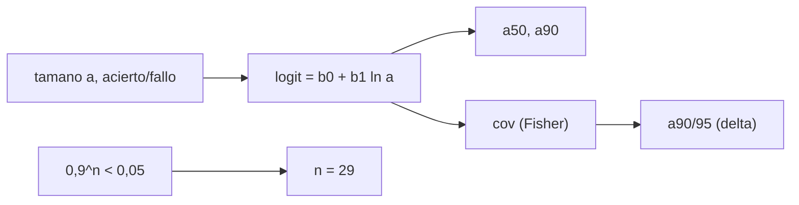

# B84-C19 — Inspección no destructiva

<!-- nav:top -->
[🏠 Programa](../../../../README.md) · [📚 Bloque B84](../../../tronco-comun/B84-estructuras-materiales-y-fabricacion-espacial.md) · [← Anterior: B84-C18 — Control dimensional](../B84-C18-control-dimensional/CLASE.md) · [Siguiente: B84-C20 — Diseño estructural de plataforma satelital →](../B84-C20-diseno-estructural-de-plataforma-satelital/CLASE.md)
<!-- /nav -->

## 1. Ubicación, nivel y alcance

Clase 19 del bloque B84. Nivel N3. Una inspección no destructiva (END) no detecta todo: detecta una fracción de los defectos de cada tamaño. Aquí calculas la regla clásica de 29 aciertos seguidos, ajustas una curva de probabilidad de detección (POD) logística a 80 detecciones **sintéticas** de acierto/fallo, obtienes `a₉₀` y una cota `a₉₀/₉₅`, y conviertes tiempos de vuelo de ultrasonidos en profundidades. La ficha de NASA-STD-5009 (Rev. C) se consultó solo para su alcance; sus requisitos numéricos no se consultaron.

## 2. Por qué esta clase existe

Decir «se inspeccionó» no dice qué se puede haber pasado por alto; la POD convierte la inspección en un tamaño de defecto garantizado que alimenta el cálculo de fatiga (C08). La decisión central: **¿qué tamaño de defecto detecta la inspección con 90 % de probabilidad y 95 % de confianza?**

## 3. Lo que podrás hacer al terminar

1. Calcular `0,9²⁹` y justificar el criterio de 29 de 29.
2. Ajustar una curva POD logística por Newton–Raphson.
3. Obtener `a₅₀` y `a₉₀`.
4. Calcular una cota superior de confianza con el método delta.
5. Comparar la curva ajustada con la verdadera.
6. Convertir tiempos de vuelo en profundidades.

La evidencia es la **ficha de capacidad de detección de defectos** del ejercicio 12 (sección 20).

## 4. Con qué llegas y cómo comprobarlo

1. ¿Qué es una probabilidad de detección?
2. ¿Qué es una regresión logística?
3. ¿Qué es un intervalo de confianza?
4. ¿Qué es la velocidad del sonido en un sólido?
5. ¿Qué es un dato sintético?

<details>
<summary>Ver respuestas</summary>

1. La fracción de defectos de un tamaño que la inspección encuentra. 2. Un ajuste de probabilidades con `logit p = b₀ + b₁x`. 3. Un rango que contiene el valor verdadero con cierta frecuencia. 4. Unos 6000 m/s para ondas longitudinales en aluminio. 5. Uno generado, no medido.
</details>

Con cuatro o cinco aciertos, sigue; si no, repasa los prerrequisitos.

## 5. Un caso de contexto y casos de referencia

Con 0,9 de POD, 29 aciertos seguidos ocurren con probabilidad `0,04710 < 0,05` y 28 con `0,05233`: se necesita `n = 29`. Con 80 defectos sintéticos (44 detectados) el ajuste da `a₅₀ = 0,890 mm`, `a₉₀ = 1,354 mm` (verdadero `1,386 mm`) y `a₉₀/₉₅ = 1,634 mm`. **Ejemplo conductor.** Los datos son sintéticos.

## 6. Vocabulario

La **POD** es `P(detectar | a)`. `a₉₀` es el tamaño con POD de 0,9 y `a₉₀/₉₅` su cota superior con 95 % de confianza. En el modelo logístico `logit POD = b₀ + b₁ ln a`. El **método delta** propaga la incertidumbre de `b₀, b₁` a `a₉₀`. El **tiempo de vuelo** es `t = 2d/v`.

## 7. Modelo mental: una red de pesca con huecos de distintos tamaños



*Descripción textual:* los datos de acierto o fallo ajustan la curva logística; su covarianza da la cota `a₉₀/₉₅`; aparte, la regla `0,9ⁿ < 0,05` da `n = 29`.

Analogía: una red de pesca atrapa los peces grandes y deja pasar los pequeños; la POD dice cuál es el tamaño que la red retiene el 90 % de las veces. Límite: la curva logística supone un solo tipo de defecto y un inspector promedio.

## 8. La explicación, paso a paso

### 8.1 La regla 29/29

`0,9^29 = 0,04710` y `0,9^28 = 0,05233`: con 29 de 29 se puede afirmar POD ≥ 0,9 con 95 % de confianza. Si la POD real es 0,95, se aprueba con probabilidad `0,2259`; con 0,98, `0,5566`; con 0,99, `0,7472`: una inspección muy buena aún puede fallar la demostración.

### 8.2 Ajuste

80 defectos (mediana 1,0 mm), 44 detectados. `b₀ = 0,611`, `b₁ = 5,239`; `a₅₀ = 0,890 mm` (verdadero 0,800), `a₉₀ = 1,354 mm` (1,386), error típico de `ln a₉₀` `0,114`; `a₉₀/₉₅ = 1,634 mm`.

| `a` (mm) | POD ajustada | POD verdadera |
|---|---|---|
| 0,3 | 0,003 | 0,019 |
| 0,5 | 0,047 | 0,132 |
| 0,8 | 0,364 | 0,500 |
| 1,0 | 0,648 | 0,709 |
| 1,5 | 0,939 | 0,925 |
| 2,0 | 0,986 | 0,975 |

### 8.3 Ultrasonidos

Con `v = 6320 m/s` (típico, no consultado): `t = 2; 5; 10 µs` dan `6,32; 15,80; 31,60 mm`. A 5 MHz `λ = 1,264 mm` y la resolución axial gruesa `≈ λ/2 = 0,63 mm`.

### 8.4 Uso

El `a₉₀/₉₅` es el tamaño inicial de grieta `a₀` para el cálculo de vida (C08). Con 1,634 mm la vida es la de la fila de `a₀` mayor.

## 9. Magnitudes, símbolos y unidades

| Símbolo | Qué es | Unidad | Valor / nota |
|---|---|---|---|
| `a` | tamaño de defecto | mm | 0,3–2,0 |
| `b₀`, `b₁` | parámetros logísticos | — | 0,611; 5,239 |
| `a₉₀` | tamaño con POD 0,9 | mm | 1,354 |
| `a₉₀/₉₅` | cota al 95 % | mm | 1,634 |
| `v` | velocidad del sonido | m/s | 6320 (típico) |
| `n` | número de ensayos | — | 80 |

## 10. Convenciones y referencias

mm y µs. Datos sintéticos con semilla 84019. Ajuste de máxima verosimilitud; confianza de Wald (aproximación). La regla 29/29 es un cálculo binomial, no una cita.

## 11. De dónde sale lo que afirmamos

| ID | Fuente | Localizador | Respalda | Estado |
|---|---|---|---|---|
| S1 | NASA, NASA-STD-5009 «Nondestructive Evaluation Requirements for Fracture Critical Metallic Components», Rev. C (2023-08-03) — https://standards.nasa.gov/standard/nasa/nasa-std-5009 (ficha consultada 2026-11-10) | ficha del estándar (título, estado, alcance) | que el estándar exige una demostración cuantitativa de la POD cuando se requiere control de fractura, y que excluye el END en proceso y el de compuestos | Consultada (solo la ficha) |
| — | Requisitos numéricos de NASA-STD-5009, la velocidad del sonido y el modelo logístico de la POD | — | los valores y la forma de la curva | No consultada en una fuente concreta |

Límites: solo se consultó la ficha de NASA-STD-5009; los datos son sintéticos; la `v` del aluminio es típica.

## 12. Cómo ver la capacidad de detección

| Magnitud | Valor |
|---|---|
| `0,9²⁹` | 0,04710 |
| `a₅₀` ajustado | 0,890 mm |
| `a₉₀` ajustado | 1,354 mm |
| `a₉₀/₉₅` | 1,634 mm |
| `λ` a 5 MHz | 1,264 mm |

Descripción larga: el ajuste con 80 defectos subestima la POD en tamaños pequeños; la cota al 95 % queda 21 % por encima de `a₉₀`.

## 13. Ejemplo trabajado: por qué 29 y no 28

**Paso 1 · Condición.** Se exige `0,9ⁿ < 0,05`.

**Paso 2 · Logaritmos.** `n > ln 0,05/ln 0,9 = 28,4`.

**Paso 3 · Entero.** `n = 29`.

## 14. Distintas formas de describir una capacidad de inspección

**Por regla:** 29/29. **Por curva:** POD(a). **Por tamaño:** `a₅₀`, `a₉₀`, `a₉₀/₉₅`. **Por física:** `d = vt/2`, `λ = v/f`.

## 15. Práctica guiada

**Ejercicio 1 · con los pasos indicados** Calcula `0,9^20`. *Pasos:* potencia.

<details><summary>Solución comentada</summary>

`0,1216`: no basta.
</details>

**Ejercicio 2 · con los pasos indicados** ¿Qué profundidad da `t = 8 µs`? *Pista:* `vt/2`.

<details><summary>Solución comentada</summary>

`25,3 mm`.
</details>

**Ejercicio 3 · con los pasos indicados** ¿Por qué la POD ajustada es menor que la verdadera en 0,5 mm? *Casi autónomo.*

<details><summary>Solución comentada</summary>

Con pocos datos pequeños, la curva logística se desplaza (`a₅₀` ajustado 0,890 contra 0,800).
</details>

## 16. Práctica autónoma, transferencia e integrador

**Ejercicio 4 · autónomo** `λ` a 2,25 MHz.

<details><summary>Solución comentada</summary>

`2,81 mm`.
</details>

**Ejercicio 5 · autónomo** `a₉₀/a₅₀` ajustado.

<details><summary>Solución comentada</summary>

`1,354/0,890 = 1,52`.
</details>

**Ejercicio 6 · autónomo** `P(29/29)` si POD real = 0,97.

<details><summary>Solución comentada</summary>

`0,41`.
</details>

**Ejercicio 7 · autónomo** Defecto a 10 mm: tiempo de vuelo.

<details><summary>Solución comentada</summary>

`2d/v = 3,16 µs`.
</details>

**Ejercicio 8 · autónomo** ¿Qué `n` con `0,95` en vez de `0,9`?

<details><summary>Solución comentada</summary>

`n > ln 0,05/ln 0,95 = 58,4`: 59.
</details>

**Ejercicio 9 · transferencia. **Transferencia.**** Un proveedor dice que su END detecta grietas de 0,5 mm. ¿Qué pides?

<details><summary>Solución comentada</summary>

La curva POD con datos de acierto/fallo, no un tamaño aislado.
</details>

**Ejercicio 10 · transferencia. **Transferencia.**** Aprobar 29/29 con una inspección real de POD 0,95. ¿Es de fiar?

<details><summary>Solución comentada</summary>

Aprobarla sí; fallarla no demuestra que sea mala (prob. de aprobar 0,23).
</details>

**Ejercicio 11 · transferencia. **Transferencia.**** El `a₉₀/₉₅` supera el tamaño crítico de grieta. ¿Qué haces?

<details><summary>Solución comentada</summary>

Cambias la inspección, el diseño o el tamaño de pieza.
</details>

**Ejercicio 12 · integrador. **Integrador.**** Elabora tu *ficha de capacidad de detección de defectos*: regla 29/29, ajuste POD con `a₅₀`, `a₉₀` y `a₉₀/₉₅`, curva ajustada frente a verdadera y ultrasonidos, rotulando lo sintético.

<details><summary>Solución comentada</summary>

Secciones 8.1–8.4 y la salida del laboratorio.
</details>

## 17. Laboratorio: POD logística y ultrasonidos

El script [pnd.py](pnd.py) verifica la regla 29/29, ajusta la POD a datos sintéticos y convierte tiempos de vuelo (**comprueba** `0,9²⁹ < 0,05 < 0,9²⁸` y `a₉₀` ajustado dentro de un factor 1,5 del verdadero).

**Datos:** detecciones **sintéticas**; `v` típica no consultada; ficha de NASA-STD-5009 consultada. **Predice antes de ejecutar:** ¿`a₉₀` ajustado quedará por debajo o por encima del verdadero? (algo por debajo: 1,354 frente a 1,386.) **Ejecución del 2026-11-10 (Python 3.12.9):**

```text
Python 3.12.9 (biblioteca estandar)
Regla clasica: con POD = 0,90 la probabilidad de 29 aciertos seguidos es 0,9^29 = 0.04710 (< 0,05); con 28, 0,9^28 = 0.05233 (> 0,05); n minimo = 29
Probabilidad de aprobar la demostracion 29/29 segun la POD real:
  POD real = 0.90 -> P(29 de 29) = 0.0471
  POD real = 0.95 -> P(29 de 29) = 0.2259
  POD real = 0.98 -> P(29 de 29) = 0.5566
  POD real = 0.99 -> P(29 de 29) = 0.7472
80 defectos SINTETICOS: 44 detectados (55.0 %); POD verdadera: a50 = 0,800 mm, a90 = 1.3856 mm
Ajuste logistico: b0 = 0.611, b1 = 5.239 ; a50 = 0.8900 mm ; a90 = 1.3537 mm ; error tipico de ln a90 = 0.114
a90/95 (cota superior de Wald, una cola) = 1.6342 mm
POD ajustada frente a verdadera:
  a = 0.3 mm  POD ajustada = 0.003  verdadera = 0.019
  a = 0.5 mm  POD ajustada = 0.047  verdadera = 0.132
  a = 0.8 mm  POD ajustada = 0.364  verdadera = 0.500
  a = 1.0 mm  POD ajustada = 0.648  verdadera = 0.709
  a = 1.5 mm  POD ajustada = 0.939  verdadera = 0.925
  a = 2.0 mm  POD ajustada = 0.986  verdadera = 0.975
Ultrasonidos (v = 6320 m/s, valor tipico NO consultado):
  tiempo de ida y vuelta  2.0 us -> profundidad   6.32 mm
  tiempo de ida y vuelta  5.0 us -> profundidad  15.80 mm
  tiempo de ida y vuelta 10.0 us -> profundidad  31.60 mm
  f =  2.25 MHz -> lambda = 2.809 mm, resolucion axial gruesa ~ 1.404 mm
  f =  5.00 MHz -> lambda = 1.264 mm, resolucion axial gruesa ~ 0.632 mm
  f = 10.00 MHz -> lambda = 0.632 mm, resolucion axial gruesa ~ 0.316 mm
Pruebas superadas.
```

```bash
python programa/clases/B84/B84-C19-inspeccion-no-destructiva/pnd.py
```

**Límites:** un tipo de defecto; confianza de Wald; sin efectos del inspector ni de la geometría.

## 18. Errores frecuentes y cómo corregirlos

**Dar la POD por un solo tamaño.** Se corrige con 8.2.

**Aprobar 28/28.** Se corrige con 8.1.

**Confundir `a₉₀` con `a₉₀/₉₅`.** Se corrige con 8.2.

**Citar la regla 29/29 como requisito de un estándar.** Se corrige con la sección 10.

## 19. Cómo sabrás que vas bien

Tras la sección 8: ¿qué tamaño esperabas para `a₉₀/₉₅`? Si dudas, repasa el ejemplo 13. Tras el laboratorio: ¿qué comprueba? (ver la sección 17).

## 20. Qué entregas y cómo se evalúa

El producto es tu **ficha de capacidad de detección de defectos** (ejercicio 12).

| Criterio | Inicial | En desarrollo | Logrado | Destacado |
|---|---|---|---|---|
| Conceptos | Los confunde | Parciales | Ajusta la POD y obtiene `a₉₀/₉₅` | Explica los límites |
| Cálculo | Sin unidades | Con errores | Tablas completas con unidades | Calcula casos nuevos |
| Numérico | Sin comprobar | Un caso | Contraste con una segunda vía | Interpreta las diferencias |
| Fuentes | Sin fuente | Sin fecha | Fuentes con fecha y estado | Declara lo ilustrativo y lo no consultado |
| Límites | No los nombra | Uno | Tres | Discute qué falta del modelo |

**Condiciones críticas (no se compensan con promedio):** rotular los datos ilustrativos y sintéticos como tales; no presentar un cálculo como ensayo ni como dato de vuelo; citar solo lo consultado.

## 21. Ética, seguridad y límites

Clase educativa: los modelos son simplificados y sus datos son sintéticos, ilustrativos o valores de estándar rotulados; **no es una base de diseño de hardware de vuelo** y ningún resultado sustituye a datos de material cualificados, a los documentos vigentes de la agencia o del lanzador ni a la revisión por personal competente. Accesibilidad: tablas equivalentes a las gráficas, fórmulas en texto, ejercicios sin conexión.

## 22. Para cerrar y seguir

La inspección detecta `1,354 mm` con 90 % y `1,634 mm` con 95 % de confianza. Queda una pregunta: ¿cómo se diseña la estructura completa del satélite?

**Glosario español–inglés.** inspección no destructiva · *non-destructive evaluation (NDE)*; probabilidad de detección · *probability of detection (POD)*; ultrasonidos · *ultrasonic testing*; tiempo de vuelo · *time of flight*; defecto · *flaw*.

**Continuidad.** [B84-C20](../B84-C20-diseno-estructural-de-plataforma-satelital/CLASE.md) estudia el diseño estructural de una plataforma satelital.

**Referencias:** ver sección 11.

<!-- nav:bottom -->
---

[← Anterior: B84-C18 — Control dimensional](../B84-C18-control-dimensional/CLASE.md) · [📚 Bloque B84](../../../tronco-comun/B84-estructuras-materiales-y-fabricacion-espacial.md) · [Siguiente: B84-C20 — Diseño estructural de plataforma satelital →](../B84-C20-diseno-estructural-de-plataforma-satelital/CLASE.md)
<!-- /nav -->
