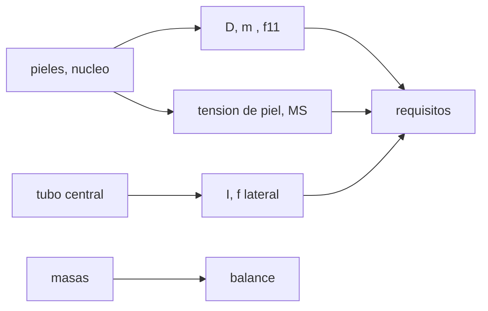

# B84-C20 — Diseño estructural de plataforma satelital

<!-- nav:top -->
[🏠 Programa](../../../../README.md) · [📚 Bloque B84](../../../tronco-comun/B84-estructuras-materiales-y-fabricacion-espacial.md) · [← Anterior: B84-C19 — Inspección no destructiva](../B84-C19-inspeccion-no-destructiva/CLASE.md) · [Siguiente: B84-C21 — Compatibilidad química y galvánica de materiales →](../B84-C21-compatibilidad-quimica-y-galvanica-de-materiales/CLASE.md)
<!-- /nav -->

## 1. Ubicación, nivel y alcance

Clase 20 del bloque B84. Nivel N3. Integra el bloque: dimensionas una estructura preliminar de microsatélite de 100 kg con paneles sándwich de aluminio y un tubo central de caja delgada, comprobando frecuencia del panel, tensión de piel con los factores del GEVS (consultados), frecuencia lateral del cuerpo y balance de masa. Geometría, cargas de diseño (30 g) y requisitos de frecuencia son **ilustrativos**; no hay lanzador ni misión.

## 2. Por qué esta clase existe

Un diseño estructural se justifica con requisitos, un modelo, márgenes y un balance de masa; sin cualquiera de ellos no se puede revisar. La decisión central: **¿cumple esta estructura preliminar los requisitos de frecuencia y de resistencia con la masa disponible?**

## 3. Lo que podrás hacer al terminar

1. Calcular la rigidez y la frecuencia de un panel sándwich.
2. Calcular la tensión de piel bajo carga cuasiestática equivalente.
3. Calcular márgenes con los factores del GEVS.
4. Estimar la frecuencia lateral de un cuerpo con tubo central.
5. Hacer el balance de masa de la estructura.
6. Rotular lo ilustrativo y las limitaciones del modelo.

La evidencia es la **memoria de dimensionado de una plataforma** del ejercicio 12 (sección 20).

## 4. Con qué llegas y cómo comprobarlo

1. ¿Qué es un panel sándwich?
2. ¿Qué es la rigidez a flexión `D`?
3. ¿Qué es una placa simplemente apoyada?
4. ¿Qué es un voladizo con masa en el extremo?
5. ¿Qué es un balance de masa?

<details>
<summary>Ver respuestas</summary>

1. Dos pieles delgadas separadas por un núcleo ligero. 2. La relación entre curvatura y momento por unidad de ancho. 3. Apoyada en sus bordes sin momento en ellos. 4. Una viga empotrada con una masa concentrada libre. 5. La suma de las masas por subsistema.
</details>

Con cuatro o cinco aciertos, sigue; si no, repasa los prerrequisitos.

## 5. Un caso de contexto y casos de referencia

Un panel de `0,6 × 0,6 m` con pieles de `0,5 mm` y núcleo de `20 mm` pesa `1,332 kg` (`3,700 kg/m²`) y tiene `f₁₁ = 409,2 Hz`; con 8 kg de equipo a `30 g`, la piel soporta `12,83 MPa` y los márgenes son `16,15` en fluencia y `16,26` en rotura. El tubo central `0,30 m × 2 mm` da una frecuencia lateral de `123,4 Hz`. La estructura suma `7,68 kg` (7,7 % de 100 kg). **Ejemplo conductor.** Todo ilustrativo salvo los factores del GEVS.

## 6. Vocabulario

La **rigidez del sándwich** es `D = E t_f d²/(2(1 − ν²))` con `d = h + t_f`. La **frecuencia** `f₁₁ = (π/2)√(D/m″)(1/a² + 1/b²)`. El **margen** usa `FS_y = 1,25` y `FS_u = 1,4` (GEVS, metálico estático). El **balance de masa** reparte la masa total entre estructura y resto.

## 7. Modelo mental: una caja de cartón corrugado con un mástil central



*Descripción textual:* el panel da frecuencia y márgenes, el tubo da la frecuencia lateral, y se contrastan con los requisitos y el balance de masa.

Analogía: una caja de cartón corrugado es rígida por su espesor y ligera por su interior hueco; el mástil central rigidiza el conjunto. Límite: el modelo ignora la flexibilidad al cortante del núcleo, los modos locales, las uniones y la masa de los equipos, y por eso sobreestima las frecuencias.

## 8. La explicación, paso a paso

### 8.1 Panel

`d = 20,5 mm`; `D = 8135 N·m`; `m″ = 2 × 0,5e-3 × 2700 + 0,02 × 50 = 3,700 kg/m²`. `f₁₁ = (π/2)√(8135/3,7)(2/0,36) = 409,2 Hz`. Con pieles de `0,3; 0,5; 0,8; 1,0 mm`: `373,0; 409,2; 438,0; 450,7 Hz`: espesor de piel de poco efecto.

### 8.2 Resistencia

`q = (8 + 1,332) × 30 × 9,80665/0,36 = 7626 Pa`; `M = 0,0479 q a² = 131,5 N·m/m`; `σ = M/(t_f d) = 12,83 MPa`. `MS_y = 275/(1,25 × 12,83) − 1 = 16,15` y `MS_u = 16,26`: muy sobredimensionado en piel.

### 8.3 Cuerpo y masa

Tubo central: `I = 3600 cm⁴`, `3,24 kg`; paneles: `4,44 kg`; estructura `7,68 kg` (7,7 %). `f_lat = (1/2π)√(3EI/((m + 0,2357 m_t)L³)) = 123,4 Hz` frente a 25 Hz requeridos.

### 8.4 Qué falta

Los márgenes enormes indican sobredimensionado o un modelo optimista: faltan cortante del núcleo, pandeo de piel, insertos y uniones, modos locales de equipos y cargas del lanzador. Una memoria real compara con análisis de elementos finitos (C12, C26) y ensayo (C30).

## 9. Magnitudes, símbolos y unidades

| Símbolo | Qué es | Unidad | Valor / nota |
|---|---|---|---|
| `D` | rigidez a flexión del panel | N·m | 8135 |
| `m″` | masa por área | kg/m² | 3,700 |
| `f₁₁` | frecuencia del panel | Hz | 409,2 |
| `σ` | tensión de piel | MPa | 12,83 |
| `f_lat` | frecuencia lateral | Hz | 123,4 |
| `MS` | márgenes de piel | — | 16,15; 16,26 |

## 10. Convenciones y referencias

SI y MPa. Aluminio ilustrativo (`E = 69 GPa`, `ρ = 2700`); núcleo 50 kg/m³; carga 30 g (inventada, no de un lanzador); requisitos 25 Hz y 100 Hz ilustrativos; FS del GEVS Tabla 2.2-3; `gₙ` del NIST.

## 11. De dónde sale lo que afirmamos

| ID | Fuente | Localizador | Respalda | Estado |
|---|---|---|---|---|
| S1 | NASA/GSFC, GSFC-STD-7000 (GEVS) Versión B, Cambio 0, 2021-04-28 — https://standards.nasa.gov/standard/gsfc/gsfc-std-7000 (PDF descargado y leído con PyMuPDF el 2026-11-10) | Tabla 2.2-3 (página 47 del PDF) | factores de seguridad estáticos metálicos de 1,25 en fluencia y 1,4 en rotura | Consultada |
| S2 | NIST, CODATA, aceleración estándar de la gravedad — https://physics.nist.gov/cgi-bin/cuu/Value?gn (consultada 2026-11-10) | valor de `gₙ` | `gₙ` = 9,806 65 m/s² (exacto por definición) | Consultada |
| — | Geometría, material, cargas y requisitos del ejemplo; fórmulas del sándwich y del voladizo | — | todos los valores ilustrativos y las fórmulas | No consultada en una fuente concreta |

Límites: solo los FS y `gₙ` son consultados; geometría, cargas y requisitos son inventados; el modelo es preliminar y optimista.

## 12. Cómo ver el dimensionado preliminar

| Magnitud | Valor |
|---|---|
| `f₁₁` panel | 409,2 Hz |
| `σ` de piel | 12,83 MPa |
| `MS_u` piel | 16,26 |
| `f_lat` | 123,4 Hz |
| Estructura | 7,68 kg (7,7 %) |

Descripción larga: todos los márgenes son altos: el diseño es robusto pero probablemente pesado para sus cargas, y el modelo no ve los modos locales.

## 13. Ejemplo trabajado: la masa por área del panel

**Paso 1 · Pieles.** `2 × 0,5e-3 × 2700 = 2,70 kg/m²`.

**Paso 2 · Núcleo.** `0,02 × 50 = 1,00 kg/m²`.

**Paso 3 · Total.** `3,70 kg/m²`.

## 14. Distintas formas de describir una estructura de plataforma

**Por frecuencia:** `f₁₁`, `f_lat`. **Por resistencia:** `σ`, `MS`. **Por masa:** balance. **Por requisito:** cumple/no cumple. **Por modelo:** limitaciones.

## 15. Práctica guiada

**Ejercicio 1 · con los pasos indicados** Calcula `d` con `h = 20` y `t_f = 0,5 mm`. *Pasos:* suma.

<details><summary>Solución comentada</summary>

`20,5 mm`.
</details>

**Ejercicio 2 · con los pasos indicados** Calcula la masa del panel (`0,36 m²`). *Pista:* `m″ A`.

<details><summary>Solución comentada</summary>

`1,332 kg`.
</details>

**Ejercicio 3 · con los pasos indicados** ¿Por qué el modelo sobreestima `f`? *Casi autónomo.*

<details><summary>Solución comentada</summary>

Ignora la flexibilidad al cortante del núcleo y de las uniones.
</details>

## 16. Práctica autónoma, transferencia e integrador

**Ejercicio 4 · autónomo** `f₁₁` si el panel mide 0,8 m.

<details><summary>Solución comentada</summary>

`409,2 × (0,6/0,8)² = 230,2 Hz`.
</details>

**Ejercicio 5 · autónomo** `MS_u` con `N = 60 g`.

<details><summary>Solución comentada</summary>

`σ = 25,7`: `310/(1,4 × 25,7) − 1 = 7,6`.
</details>

**Ejercicio 6 · autónomo** Masa de estructura si el tubo pasa a 3 mm.

<details><summary>Solución comentada</summary>

`4,86 + 4,44 = 9,30 kg`.
</details>

**Ejercicio 7 · autónomo** `f_lat` si `L = 1 m`.

<details><summary>Solución comentada</summary>

`123,4/2,83 = 43,6 Hz` (aprox. `L⁻¹·⁵`).
</details>

**Ejercicio 8 · autónomo** Fracción de masa estructural con 12 kg.

<details><summary>Solución comentada</summary>

`12 %`.
</details>

**Ejercicio 9 · transferencia. **Transferencia.**** Todos los márgenes son mayores que 10. ¿Está bien?

<details><summary>Solución comentada</summary>

Es probable que esté sobredimensionado o que el modelo omita modos de falla; se revisa con elementos finitos y ensayo.
</details>

**Ejercicio 10 · transferencia. **Transferencia.**** Un lanzador exige `f_lat ≥ 40 Hz`. ¿Cumple?

<details><summary>Solución comentada</summary>

Sí con 123,4 Hz en este modelo, pero se verifica con modal real.
</details>

**Ejercicio 11 · transferencia. **Transferencia.**** ¿Puedes entregar esta memoria como diseño de vuelo?

<details><summary>Solución comentada</summary>

No: falta un análisis acoplado, uniones, fatiga, térmica y verificación.
</details>

**Ejercicio 12 · integrador. **Integrador.**** Elabora tu *memoria de dimensionado de una plataforma*: requisitos, modelo, resultados del panel y del cuerpo, márgenes con los FS del GEVS, balance de masa y limitaciones.

<details><summary>Solución comentada</summary>

Secciones 8.1–8.4 y la salida del laboratorio.
</details>

## 17. Laboratorio: dimensionado preliminar de una plataforma

El script [plataforma.py](plataforma.py) calcula frecuencia y tensión del panel, frecuencia del cuerpo, márgenes y balance de masa (**comprueba** las dos expresiones de `f₁₁` coinciden a 1e-12 y los márgenes son positivos).

**Datos:** FS y `gₙ` **consultados**; el resto **ilustrativo**. **Predice antes de ejecutar:** ¿cumple la frecuencia lateral de 25 Hz? (sí, con 123,4 Hz.) **Ejecución del 2026-11-10 (Python 3.12.9):**

```text
Python 3.12.9 (biblioteca estandar)
Panel sandwich ILUSTRATIVO 0,60 x 0,60 m: pieles 0,5 mm, nucleo 20 mm
Rigidez a flexion D = 8135.2 N m ; masa por area = 3.700 kg/m2 ; masa del panel = 1.332 kg
Frecuencia fundamental del panel simplemente apoyado f11 = 409.2 Hz (requisito ilustrativo >= 100 Hz: cumple)
Presion equivalente a 30 g con 8 kg de equipo: q = 7626 Pa ; M = 131.51 N m/m ; tension de piel = 12.83 MPa
Margenes de piel: fluencia = 275/(1.25 x 12.83) - 1 = 16.15 ; ultima = 16.26
Tubo central caja 0,30 m x 2 mm, L = 0,50 m: I = 3600.00 cm4 ; masa = 3.24 kg
Paneles laterales (4 de 0,60 x 0,50 m): masa = 4.44 kg
Balance de masa: estructura = 7.68 kg (7.7 % de 100 kg) ; resto = 92.32 kg
Frecuencia lateral del cuerpo (voladizo con masa en el extremo): f = 123.4 Hz (requisito ilustrativo >= 25 Hz: cumple)
Barrido del espesor de piel del panel:
  t_f = 0.3 mm  m'' = 2.620 kg/m2  f11 =  373.0 Hz
  t_f = 0.5 mm  m'' = 3.700 kg/m2  f11 =  409.2 Hz
  t_f = 0.8 mm  m'' = 5.320 kg/m2  f11 =  438.0 Hz
  t_f = 1.0 mm  m'' = 6.400 kg/m2  f11 =  450.7 Hz
Pruebas superadas.
```

```bash
python programa/clases/B84/B84-C20-diseno-estructural-de-plataforma-satelital/plataforma.py
```

**Límites:** placa de Navier sin cortante del núcleo; sin modos locales, uniones ni cargas reales.

## 18. Errores frecuentes y cómo corregirlos

**Dar por válido un margen enorme.** Se corrige con 8.4.

**Olvidar el balance de masa.** Se corrige con 8.3.

**Usar cargas ilustrativas como de lanzador.** Se corrige con la sección 10.

**Omitir los requisitos.** Se corrige con el alcance.

## 19. Cómo sabrás que vas bien

Tras la sección 8: ¿qué esperabas para `f_lat` y qué obtuviste? Si dudas, repasa el ejemplo 13. Tras el laboratorio: ¿qué comprueba? (ver la sección 17).

## 20. Qué entregas y cómo se evalúa

El producto es tu **memoria de dimensionado de una plataforma** (ejercicio 12).

| Criterio | Inicial | En desarrollo | Logrado | Destacado |
|---|---|---|---|---|
| Conceptos | Los confunde | Parciales | Integra requisitos, cálculo y márgenes | Explica los límites |
| Cálculo | Sin unidades | Con errores | Tablas completas con unidades | Calcula casos nuevos |
| Numérico | Sin comprobar | Un caso | Contraste con una segunda vía | Interpreta las diferencias |
| Fuentes | Sin fuente | Sin fecha | Fuentes con fecha y estado | Declara lo ilustrativo y lo no consultado |
| Límites | No los nombra | Uno | Tres | Discute qué falta del modelo |

**Condiciones críticas (no se compensan con promedio):** rotular los datos ilustrativos y sintéticos como tales; no presentar un cálculo como ensayo ni como dato de vuelo; citar solo lo consultado.

## 21. Ética, seguridad y límites

Clase educativa: los modelos son simplificados y sus datos son sintéticos, ilustrativos o valores de estándar rotulados; **no es una base de diseño de hardware de vuelo** y ningún resultado sustituye a datos de material cualificados, a los documentos vigentes de la agencia o del lanzador ni a la revisión por personal competente. Accesibilidad: tablas equivalentes a las gráficas, fórmulas en texto, ejercicios sin conexión.

## 22. Para cerrar y seguir

La estructura preliminar pesa `7,68 kg`, tiene `f_lat = 123,4 Hz` y márgenes mayores que 16, con un modelo optimista. Queda una pregunta: ¿cómo se elige un material que no se corroa en contacto con otro?

**Glosario español–inglés.** panel sándwich · *sandwich panel*; plataforma · *platform / bus*; frecuencia fundamental · *fundamental frequency*; balance de masa · *mass budget*; piel · *facesheet*.

**Continuidad.** [B84-C21](../B84-C21-compatibilidad-quimica-y-galvanica-de-materiales/CLASE.md) estudia la compatibilidad química y galvánica de materiales.

**Referencias:** ver sección 11.

<!-- nav:bottom -->
---

[← Anterior: B84-C19 — Inspección no destructiva](../B84-C19-inspeccion-no-destructiva/CLASE.md) · [📚 Bloque B84](../../../tronco-comun/B84-estructuras-materiales-y-fabricacion-espacial.md) · [Siguiente: B84-C21 — Compatibilidad química y galvánica de materiales →](../B84-C21-compatibilidad-quimica-y-galvanica-de-materiales/CLASE.md)
<!-- /nav -->
