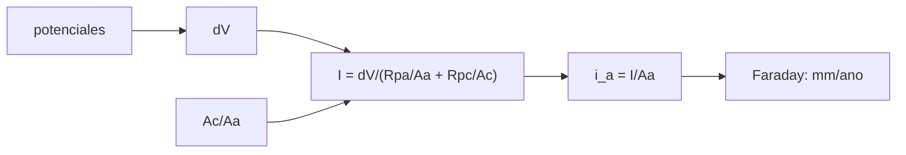

# B84-C21 — Compatibilidad química y galvánica de materiales

<!-- nav:top -->
[🏠 Programa](../../../../README.md) · [📚 Bloque B84](../../../tronco-comun/B84-estructuras-materiales-y-fabricacion-espacial.md) · [← Anterior: B84-C20 — Diseño estructural de plataforma satelital](../B84-C20-diseno-estructural-de-plataforma-satelital/CLASE.md) · [Siguiente: B84-C22 — Tensión, deformación y elasticidad lineal →](../B84-C22-tension-deformacion-y-elasticidad-lineal/CLASE.md)
<!-- /nav -->

## 1. Ubicación, nivel y alcance

Clase 21 del bloque B84. Nivel N3. Dos metales distintos en contacto con un electrolito forman una pila: el menos noble se corroe. Aquí calculas la diferencia de potencial de seis materiales **ilustrativos**, aplicas una regla de contacto ilustrativa y calculas con un modelo de resistencias de polarización lineal cómo la relación de áreas cátodo/ánodo multiplica la velocidad de corrosión del aluminio. La compatibilidad con fluidos y propelentes se menciona pero no se calcula.

## 2. Por qué esta clase existe

Un tornillo de acero inoxidable en un panel de aluminio puede corroerlo 90 veces más rápido que otro de aluminio, y la corrosión ocurre en tierra, antes del lanzamiento. La decisión central: **¿qué pares de materiales pueden ir en contacto y cómo debe ser la relación de áreas?**

## 3. Lo que podrás hacer al terminar

1. Calcular la diferencia de potencial de un par.
2. Aplicar una regla de contacto ilustrativa.
3. Calcular la corriente galvánica con un modelo de resistencias.
4. Convertir corriente en velocidad de corrosión con la ley de Faraday.
5. Ver el efecto de la relación de áreas.
6. Rotular lo ilustrativo.

La evidencia es la **matriz de compatibilidad galvánica de pares** del ejercicio 12 (sección 20).

## 4. Con qué llegas y cómo comprobarlo

1. ¿Qué es un ánodo?
2. ¿Qué es un electrolito?
3. ¿Qué es la ley de Faraday?
4. ¿Qué es una relación de áreas?
5. ¿Qué es un dato ilustrativo?

<details>
<summary>Ver respuestas</summary>

1. El electrodo donde el metal se oxida (se corroe). 2. Un medio conductor de iones, como agua salada o condensación. 3. `m = I t M/(n F)`: la masa depositada o disuelta por una corriente. 4. El cociente entre el área del cátodo y la del ánodo. 5. Un valor típico no consultado.
</details>

Con cuatro o cinco aciertos, sigue; si no, repasa los prerrequisitos.

## 5. Un caso de contexto y casos de referencia

Con aluminio de `10⁻³ m²` de ánodo acoplado a acero 304 pasivo (`ΔV = 0,75 V`): si el cátodo es 10 veces menor la corrosión es `0,0162 mm/año`; con igual área, `0,1486`; con 10 veces más, `0,8171`; con 100 veces más, `1,4856 mm/año`. El factor entre el mejor y el peor caso es `91,8`. **Ejemplo conductor.** Todo ilustrativo.

## 6. Vocabulario

El **potencial de corrosión** ordena los metales en una serie galvánica. La **corriente galvánica** `I = ΔV/(Rp_a/A_a + Rp_c/A_c)` es la de la pila. La **velocidad de corrosión** `v = i_a M/(n F ρ)`. La **relación de áreas** `A_c/A_a` decide la densidad de corriente anódica.

## 7. Modelo mental: una pila con electrodos de distinto tamaño



*Descripción textual:* la diferencia de potencial y las áreas dan la corriente, que se convierte en densidad anódica y en velocidad de corrosión.

Analogía: una pila con un electrodo pequeño que debe dar toda la corriente: se gasta rápido. Límite: el modelo lineal ignora la forma de la polarización, la conductividad del electrolito y la geometría; solo sirve como comparación relativa.

## 8. La explicación, paso a paso

### 8.1 Diferencias de potencial

Con potenciales ilustrativos (V): Mg `−1,60`, Al `−0,80`, acero C `−0,65`, Ti `−0,10`, acero 304 `−0,05`, CFRP `+0,20`:

| Par (ánodo–cátodo) | `ΔV` (V) | Húmedo (≤ 0,25) | Interior (≤ 0,50) |
|---|---|---|---|
| Al–acero C | 0,15 | ok | ok |
| Al–acero 304 | 0,75 | no | no |
| Al–Ti | 0,70 | no | no |
| Al–CFRP | 1,00 | no | no |
| Mg–Al | 0,80 | no | no |
| Ti–acero 304 | 0,05 | ok | ok |

### 8.2 Relación de áreas (Al con acero 304, `A_a = 10⁻³ m²`)

| `A_c/A_a` | `I` (mA) | `i_a` (A/m²) | Corrosión (mm/año) | Masa perdida (g/año) |
|---|---|---|---|---|
| 0,1 | 0,015 | 0,0149 | 0,0162 | 0,044 |
| 1 | 0,136 | 0,1364 | 0,1486 | 0,401 |
| 10 | 0,750 | 0,7500 | 0,8171 | 2,206 |
| 100 | 1,364 | 1,3636 | 1,4856 | 4,011 |

### 8.3 Verificación

La masa de Faraday coincide con la de `ρ × espesor × área` a `10⁻¹²`: valida la conversión, no los potenciales.

### 8.4 Reglas de diseño

Un cátodo pequeño sobre un ánodo grande reduce la corrosión 92 veces respecto al caso inverso. Se evitan pares con `ΔV` alto, se aíslan con barreras o recubrimientos (C34) y se prefiere el ánodo grande. Con CFRP se aísla el aluminio con una capa de vidrio.

## 9. Magnitudes, símbolos y unidades

| Símbolo | Qué es | Unidad | Valor / nota |
|---|---|---|---|
| `ΔV` | diferencia de potencial | V | 0,75 (Al–304) |
| `Rp` | resistencia de polarización | Ω·m² | 0,5 (ánodo); 5 (cátodo) |
| `I` | corriente galvánica | A | 1,364 × 10⁻³ máx. |
| `i_a` | densidad anódica | A/m² | 1,3636 |
| `v` | velocidad de corrosión | mm/año | 1,4856 |
| `F` | constante de Faraday | C/mol | 96 485,33212 |

## 10. Convenciones y referencias

SI y mm/año. Potenciales ilustrativos frente a calomelanos en agua de mar. Aluminio: `M = 26,98 g/mol`, `n = 3`. Regla de contacto ilustrativa (0,25 y 0,50 V). `F` exacta del SI 2019 (no consultada en esta sesión).

## 11. De dónde sale lo que afirmamos

| ID | Fuente | Localizador | Respalda | Estado |
|---|---|---|---|---|
| — | Serie galvánica, resistencias de polarización y reglas de contacto | — | los potenciales, las `Rp` y los límites de `ΔV` | No consultada en una fuente concreta |

Límites: todos los datos son ilustrativos y no se consultaron; no se consultó ninguna norma de compatibilidad (por ejemplo, de prevención de corrosión de naves).

## 12. Cómo ver la corrosión galvánica

| Magnitud | Valor |
|---|---|
| `ΔV` Al–acero 304 | 0,75 V |
| Corrosión `A_c/A_a = 0,1` | 0,0162 mm/año |
| Corrosión `A_c/A_a = 100` | 1,4856 mm/año |
| Factor | 91,8 |
| Al–acero C | 0,15 V (ok) |

Descripción larga: la corrosión del ánodo crece con la relación de áreas, pero más despacio (saturación) cuando el cátodo ya domina.

## 13. Ejemplo trabajado: la corrosión con áreas iguales

**Paso 1 · Corriente.** `I = 0,75/(0,5/10⁻³ + 5/10⁻³) = 0,136 mA`.

**Paso 2 · Densidad.** `i_a = 0,1364 A/m²`.

**Paso 3 · Velocidad.** `0,1364 × 26,98e-3/(3 × 96485 × 2700) × 3,156e7 = 1,49e-4 m/año = 0,1486 mm/año`.

## 14. Distintas formas de describir un contacto galvánico

**Por potencial:** `ΔV`. **Por corriente:** `I`. **Por velocidad:** mm/año. **Por geometría:** `A_c/A_a`. **Por regla:** apto/no apto.

## 15. Práctica guiada

**Ejercicio 1 · con los pasos indicados** Calcula `ΔV` entre Al y Ti. *Pasos:* diferencia de potenciales.

<details><summary>Solución comentada</summary>

`0,70 V`.
</details>

**Ejercicio 2 · con los pasos indicados** ¿Cuál es el ánodo de un par Al–acero C? *Pista:* el más negativo.

<details><summary>Solución comentada</summary>

El aluminio (`−0,80`).
</details>

**Ejercicio 3 · con los pasos indicados** ¿Por qué crece la corrosión con `A_c/A_a`? *Casi autónomo.*

<details><summary>Solución comentada</summary>

Porque el término `Rp_c/A_c` baja y la corriente sube, concentrada en el ánodo.
</details>

## 16. Práctica autónoma, transferencia e integrador

**Ejercicio 4 · autónomo** Masa perdida con `I = 0,136 mA` en un año.

<details><summary>Solución comentada</summary>

`0,401 g`.
</details>

**Ejercicio 5 · autónomo** `ΔV` Mg–Ti.

<details><summary>Solución comentada</summary>

`1,50 V`.
</details>

**Ejercicio 6 · autónomo** Corrosión con `A_c/A_a = 1` y `ΔV = 0,15`.

<details><summary>Solución comentada</summary>

`0,1486 × 0,15/0,75 = 0,0297 mm/año`.
</details>

**Ejercicio 7 · autónomo** ¿Qué `ΔV` cumple la regla de interior?

<details><summary>Solución comentada</summary>

`≤ 0,50 V`.
</details>

**Ejercicio 8 · autónomo** Factor entre `A_c/A_a = 10` y 1.

<details><summary>Solución comentada</summary>

`5,50`.
</details>

**Ejercicio 9 · transferencia. **Transferencia.**** Una pieza de aluminio lleva tornillos de acero 304. ¿Qué haces?

<details><summary>Solución comentada</summary>

Aíslas con una arandela dieléctrica o un recubrimiento, o cambias el tornillo.
</details>

**Ejercicio 10 · transferencia. **Transferencia.**** Un panel de CFRP se une con remaches de aluminio. ¿Riesgo?

<details><summary>Solución comentada</summary>

Sí: `ΔV = 1,0 V`; se aísla con vidrio y sellante.
</details>

**Ejercicio 11 · transferencia. **Transferencia.**** ¿Importa en el espacio, sin electrolito?

<details><summary>Solución comentada</summary>

Sí en tierra: montaje, almacenamiento y humedad antes del lanzamiento.
</details>

**Ejercicio 12 · integrador. **Integrador.**** Elabora tu *matriz de compatibilidad galvánica de pares*: `ΔV` de seis pares, regla, efecto de la relación de áreas y medidas de aislamiento, rotulando lo ilustrativo.

<details><summary>Solución comentada</summary>

Secciones 8.1–8.4 y la salida del laboratorio.
</details>

## 17. Laboratorio: corrosión galvánica y relación de áreas

El script [galvanica.py](galvanica.py) calcula `ΔV`, la corriente galvánica y la velocidad de corrosión según la relación de áreas (**comprueba** coincidencia entre la masa de Faraday y `ρ × espesor × área` (< 1e-12)).

**Datos:** potenciales y `Rp` **ilustrativos**. **Predice antes de ejecutar:** ¿cuánto crece la corrosión al pasar de `A_c/A_a = 0,1` a 100? (≈ 92 veces.) **Ejecución del 2026-11-10 (Python 3.12.9):**

```text
Python 3.12.9 (biblioteca estandar)
Potenciales ILUSTRATIVOS (V vs calomelanos, agua de mar): Mg AZ31 -1.60; Al 6061 -0.80; Acero C -0.65; Ti-6Al-4V -0.10; Acero 304 -0.05; CFRP +0.20
Diferencias de potencial y regla de contacto ilustrativa (<= 0,25 V humedo; <= 0,50 V interior):
  Al 6061    - Acero C    dV = 0.15 V  humedo: ok  interior: ok
  Al 6061    - Acero 304  dV = 0.75 V  humedo: NO  interior: NO
  Al 6061    - Ti-6Al-4V  dV = 0.70 V  humedo: NO  interior: NO
  Al 6061    - CFRP       dV = 1.00 V  humedo: NO  interior: NO
  Mg AZ31    - Al 6061    dV = 0.80 V  humedo: NO  interior: NO
  Ti-6Al-4V  - Acero 304  dV = 0.05 V  humedo: ok  interior: ok
Aluminio (anodo) acoplado a acero 304 (catodo): efecto de la relacion de areas A_c/A_a, con A_a = 1e-3 m2
 A_c/A_a    I [mA]  i_a [A/m2]  corrosion [mm/ano]   perdida de masa en 1 ano [g]
     0.1     0.015      0.0149              0.0162                          0.044
     1.0     0.136      0.1364              0.1486                          0.401  (x9.18)
    10.0     0.750      0.7500              0.8171                          2.206  (x5.50)
   100.0     1.364      1.3636              1.4856                          4.011  (x1.82)
Ventaja del area: anodo grande y catodo pequeno (A_c/A_a = 0,1) frente al caso desfavorable (100):
  0.0162 mm/ano frente a 1.4856 mm/ano: factor 91.8
Pruebas superadas.
```

```bash
python programa/clases/B84/B84-C21-compatibilidad-quimica-y-galvanica-de-materiales/galvanica.py
```

**Límites:** modelo lineal; sin geometría, conductividad ni película pasiva.

## 18. Errores frecuentes y cómo corregirlos

**Mirar solo el potencial.** Se corrige con 8.2.

**Ignorar la relación de áreas.** Se corrige con 8.2.

**Creer que en el espacio no hay corrosión.** Se corrige con el ejercicio 12.

**Tomar los potenciales ilustrativos por datos de diseño.** Se corrige con la sección 10.

## 19. Cómo sabrás que vas bien

Tras la sección 8: ¿qué relación de áreas esperabas peor? Si dudas, repasa el ejemplo 13. Tras el laboratorio: ¿qué comprueba? (ver la sección 17).

## 20. Qué entregas y cómo se evalúa

El producto es tu **matriz de compatibilidad galvánica de pares** (ejercicio 12).

| Criterio | Inicial | En desarrollo | Logrado | Destacado |
|---|---|---|---|---|
| Conceptos | Los confunde | Parciales | Calcula la corrosión galvánica | Explica los límites |
| Cálculo | Sin unidades | Con errores | Tablas completas con unidades | Calcula casos nuevos |
| Numérico | Sin comprobar | Un caso | Contraste con una segunda vía | Interpreta las diferencias |
| Fuentes | Sin fuente | Sin fecha | Fuentes con fecha y estado | Declara lo ilustrativo y lo no consultado |
| Límites | No los nombra | Uno | Tres | Discute qué falta del modelo |

**Condiciones críticas (no se compensan con promedio):** rotular los datos ilustrativos y sintéticos como tales; no presentar un cálculo como ensayo ni como dato de vuelo; citar solo lo consultado.

## 21. Ética, seguridad y límites

Clase educativa: los modelos son simplificados y sus datos son sintéticos, ilustrativos o valores de estándar rotulados; **no es una base de diseño de hardware de vuelo** y ningún resultado sustituye a datos de material cualificados, a los documentos vigentes de la agencia o del lanzador ni a la revisión por personal competente. Accesibilidad: tablas equivalentes a las gráficas, fórmulas en texto, ejercicios sin conexión.

## 22. Para cerrar y seguir

Aluminio y acero 304 con `ΔV = 0,75 V` corroen `1,49 mm/año` con cátodo grande y `0,016` con cátodo pequeño. Queda una pregunta: ¿cómo se relacionan tensión y deformación en una pieza?

**Glosario español–inglés.** corrosión galvánica · *galvanic corrosion*; ánodo · *anode*; cátodo · *cathode*; serie galvánica · *galvanic series*; compatibilidad · *compatibility*.

**Continuidad.** [B84-C22](../B84-C22-tension-deformacion-y-elasticidad-lineal/CLASE.md) estudia tensión, deformación y elasticidad lineal.

**Referencias:** ver sección 11.

<!-- nav:bottom -->
---

[← Anterior: B84-C20 — Diseño estructural de plataforma satelital](../B84-C20-diseno-estructural-de-plataforma-satelital/CLASE.md) · [📚 Bloque B84](../../../tronco-comun/B84-estructuras-materiales-y-fabricacion-espacial.md) · [Siguiente: B84-C22 — Tensión, deformación y elasticidad lineal →](../B84-C22-tension-deformacion-y-elasticidad-lineal/CLASE.md)
<!-- /nav -->
