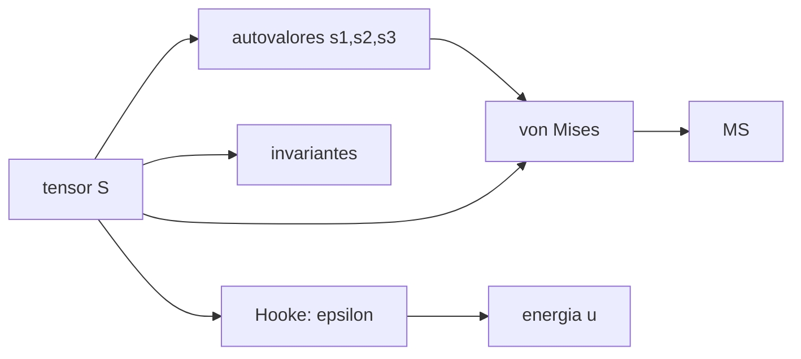

# B84-C22 — Tensión, deformación y elasticidad lineal

<!-- nav:top -->
[🏠 Programa](../../../../README.md) · [📚 Bloque B84](../../../tronco-comun/B84-estructuras-materiales-y-fabricacion-espacial.md) · [← Anterior: B84-C21 — Compatibilidad química y galvánica de materiales](../B84-C21-compatibilidad-quimica-y-galvanica-de-materiales/CLASE.md) · [Siguiente: B84-C23 — Vigas y placas: flexión y pandeo →](../B84-C23-vigas-y-placas-flexion-y-pandeo/CLASE.md)
<!-- /nav -->

## 1. Ubicación, nivel y alcance

Clase 22 del bloque B84. Nivel N3. La base de toda la mecánica de estructuras: el estado de tensión en un punto es un tensor, y de él salen las tensiones principales, el cortante máximo y la tensión equivalente de von Mises. Aquí analizas un tensor 3D **ilustrativo**, aplicas la ley de Hooke generalizada, y verificas por dos vías los invariantes, von Mises y la energía de deformación. C23–C29 construyen sobre esto.

## 2. Por qué esta clase existe

Una tensión de 120 MPa en una dirección no dice si la pieza cede: la fluencia depende de la combinación de las seis componentes. La decisión central: **¿cede el material en este punto y con qué margen, dado un estado de tensión 3D?**

## 3. Lo que podrás hacer al terminar

1. Obtener las tensiones principales de un tensor.
2. Calcular invariantes `I₁, I₂, I₃`.
3. Calcular von Mises por dos vías.
4. Aplicar la ley de Hooke generalizada.
5. Calcular la energía de deformación y separar su parte volumétrica y distorsional.
6. Calcular el margen de fluencia.

La evidencia es la **ficha de un estado de tensión en un punto** del ejercicio 12 (sección 20).

## 4. Con qué llegas y cómo comprobarlo

1. ¿Qué es un tensor de tensiones?
2. ¿Qué es un autovalor?
3. ¿Qué es el coeficiente de Poisson?
4. ¿Qué es la fluencia?
5. ¿Qué es un dato ilustrativo?

<details>
<summary>Ver respuestas</summary>

1. Una matriz simétrica 3×3 con las tensiones normales y cortantes en un punto. 2. Un valor `λ` tal que `S v = λ v`. 3. La razón entre la contracción lateral y el alargamiento. 4. El inicio de la deformación plástica. 5. Un valor no consultado.
</details>

Con cuatro o cinco aciertos, sigue; si no, repasa los prerrequisitos.

## 5. Un caso de contexto y casos de referencia

El tensor `[[120,40,0],[40,−30,20],[0,20,60]] MPa` tiene tensiones principales `130,345; 63,292; −43,637 MPa`, cortante máximo `86,991 MPa` y von Mises `151,987 MPa`. Con `σ_y = 275 MPa` y `FS = 1,25` el margen es `0,447`. **Ejemplo conductor.** Tensor y material ilustrativos; FS del GEVS.

## 6. Vocabulario

Las **tensiones principales** son los autovalores del tensor. Los **invariantes** `I₁ = tr S`, `I₂ = (I₁² − tr S²)/2` e `I₃ = det S` no cambian al girar los ejes. La **tensión de von Mises** es `σ_vm = √(3 J₂)`. La **ley de Hooke generalizada** es `ε = [(1+ν)σ − ν tr(σ) I]/E`.

## 7. Modelo mental: girar un cubo hasta que solo sufra tracción



*Descripción textual:* el tensor da los autovalores y los invariantes, dos vías para von Mises, la deformación y la energía, y el margen.

Analogía: girar un cubo de gelatina hasta que sus caras solo sufran empuje o tirón, sin cortante: son las direcciones principales. Límite: el criterio de von Mises es válido para materiales dúctiles; los frágiles se evalúan con otros criterios.

## 8. La explicación, paso a paso

### 8.1 Principales e invariantes

`s₁ = 130,3453`, `s₂ = 63,2920`, `s₃ = −43,6373 MPa`. `I₁ = 150`, `I₂ = −200`, `I₃ = −360 000`; coinciden con los autovalores a `10⁻¹⁴` o mejor.

### 8.2 Von Mises y cortante

Por principales `√(½[(s₁−s₂)² + (s₂−s₃)² + (s₃−s₁)²]) = 151,9868 MPa`; por componentes `√(3 J₂)` da lo mismo (`5,7 × 10⁻¹⁴`). Cortante máximo `(s₁−s₃)/2 = 86,991 MPa`.

### 8.3 Deformaciones y energía

`ε_xx = 1595,65 × 10⁻⁶`, `ε_yy = −1295,65`, `ε_zz = 439,13`, `ε_xy = 771,01`, `ε_yz = 385,51`, `ε_xz = 0`. `u = ½ σ:ε = 0,16690 MJ/m³`, igual con las principales. Parte volumétrica `0,01848` y distorsional `0,14842 MJ/m³`, igual a `(1+ν)σ_vm²/(3E)`.

### 8.4 Margen

`MS = 275/(1,25 × 151,99) − 1 = 0,447`: positivo, aunque `σ_xx = 120 MPa` solo diría `0,833`: el estado combinado exige más.

## 9. Magnitudes, símbolos y unidades

| Símbolo | Qué es | Unidad | Valor / nota |
|---|---|---|---|
| `s₁, s₂, s₃` | tensiones principales | MPa | 130,345; 63,292; −43,637 |
| `I₁, I₂, I₃` | invariantes | MPa, MPa², MPa³ | 150; −200; −360 000 |
| `σ_vm` | von Mises | MPa | 151,987 |
| `τ_máx` | cortante máximo | MPa | 86,991 |
| `u` | energía por volumen | MJ/m³ | 0,16690 |
| `E`, `ν` | módulo y Poisson | GPa, — | 69; 0,33 |

## 10. Convenciones y referencias

MPa y GPa. Tensor simétrico en ejes `x, y, z`; sin tensión residual. Aluminio ilustrativo. `σ_y = 275 MPa` ilustrativo; `FS = 1,25` del GEVS (Tabla 2.2-3, fluencia metálica estática).

## 11. De dónde sale lo que afirmamos

| ID | Fuente | Localizador | Respalda | Estado |
|---|---|---|---|---|
| S1 | NASA/GSFC, GSFC-STD-7000 (GEVS) Versión B, Cambio 0, 2021-04-28 — https://standards.nasa.gov/standard/gsfc/gsfc-std-7000 (PDF descargado y leído con PyMuPDF el 2026-11-10) | Tabla 2.2-3 (página 47 del PDF) | factor de seguridad de fluencia de 1,25 para metálicos con carga estática | Consultada |
| — | Tensor del ejemplo y propiedades del aluminio; teoría de la elasticidad lineal | — | el tensor, `E`, `ν`, `σ_y` y las fórmulas, que verifica el laboratorio por dos vías | No consultada en una fuente concreta |

Límites: solo el FS es consultado; el resto es ilustrativo; las fórmulas son estándar y se verifican por dos vías.

## 12. Cómo ver el estado de tensión

| Magnitud | Valor |
|---|---|
| `s₁` | 130,345 MPa |
| `σ_vm` | 151,987 MPa |
| `τ_máx` | 86,991 MPa |
| `u` | 0,16690 MJ/m³ |
| `MS` | 0,447 |

Descripción larga: von Mises (152 MPa) supera la mayor tensión normal inicial (120 MPa) porque suma las componentes.

## 13. Ejemplo trabajado: la presión hidrostática

**Paso 1 · Traza.** `tr S = 120 − 30 + 60 = 150 MPa`.

**Paso 2 · Media.** `tr/3 = 50 MPa`.

**Paso 3 · Presión.** `p = −50 MPa`.

## 14. Distintas formas de describir un estado de tensión

**Por componentes:** `S`. **Por principales:** `s₁, s₂, s₃`. **Por invariantes:** `I₁, I₂, I₃`. **Por equivalente:** `σ_vm`. **Por energía:** `u`.

## 15. Práctica guiada

**Ejercicio 1 · con los pasos indicados** Calcula `I₁`. *Pasos:* suma la diagonal.

<details><summary>Solución comentada</summary>

`150 MPa`.
</details>

**Ejercicio 2 · con los pasos indicados** Calcula el cortante máximo con `s₁` y `s₃`. *Pista:* `(s₁−s₃)/2`.

<details><summary>Solución comentada</summary>

`86,99 MPa`.
</details>

**Ejercicio 3 · con los pasos indicados** ¿Por qué `ε_xz = 0`? *Casi autónomo.*

<details><summary>Solución comentada</summary>

Porque `σ_xz = 0` y Hooke da `ε_xz = (1+ν)σ_xz/E`.
</details>

## 16. Práctica autónoma, transferencia e integrador

**Ejercicio 4 · autónomo** `ε_xx` con Hooke.

<details><summary>Solución comentada</summary>

`(1,33 × 120 − 0,33 × 150)/69 000 = 1595,7 × 10⁻⁶`.
</details>

**Ejercicio 5 · autónomo** `σ_vm` de tracción pura `100 MPa`.

<details><summary>Solución comentada</summary>

`100 MPa`.
</details>

**Ejercicio 6 · autónomo** Margen con `FS = 1,4` y `σ_y = 275`.

<details><summary>Solución comentada</summary>

`275/(1,4 × 151,99) − 1 = 0,292`.
</details>

**Ejercicio 7 · autónomo** Energía distorsional si `σ_vm = 100`.

<details><summary>Solución comentada</summary>

`1,33 × 10⁴/(3 × 69 000) = 0,0642 MJ/m³`.
</details>

**Ejercicio 8 · autónomo** ¿Cambia `I₁` al girar los ejes?

<details><summary>Solución comentada</summary>

No: es invariante.
</details>

**Ejercicio 9 · transferencia. **Transferencia.**** Una pieza tiene 120 MPa de tracción máxima y cede a 275 MPa. ¿Está segura?

<details><summary>Solución comentada</summary>

No necesariamente: von Mises es 152 MPa; se calcula con el criterio, no con la componente.
</details>

**Ejercicio 10 · transferencia. **Transferencia.**** El modelo de elementos finitos da von Mises en cada nodo. ¿Qué compruebas?

<details><summary>Solución comentada</summary>

Que la tensión de von Mises coincide con la teoría en un punto simple.
</details>

**Ejercicio 11 · transferencia. **Transferencia.**** ¿Sirve von Mises para una cerámica?

<details><summary>Solución comentada</summary>

No: para frágiles se usa un criterio de tensión principal máxima y estadístico (C04).
</details>

**Ejercicio 12 · integrador. **Integrador.**** Elabora tu *ficha de un estado de tensión en un punto*: principales, invariantes, von Mises, cortante, deformaciones, energía y margen, con lo consultado e ilustrativo.

<details><summary>Solución comentada</summary>

Secciones 8.1–8.4 y la salida del laboratorio.
</details>

## 17. Laboratorio: estado de tensión 3D

El script [elasticidad.py](elasticidad.py) calcula principales, invariantes, von Mises, Hooke, energía y margen (**comprueba** invariantes frente a autovalores (< 1e-9), von Mises por dos vías (< 1e-9) y energía por dos vías (< 1e-12)).

**Datos:** tensor y material **ilustrativos**; FS del GEVS **consultado**. **Predice antes de ejecutar:** ¿von Mises será mayor o menor que 120 MPa? (mayor: 152.) **Ejecución del 2026-11-10 (Python 3.12.9):**

```text
Python 3.12.9 (biblioteca estandar)
Tensor ILUSTRATIVO [MPa]: [[120, 40, 0], [40, -30, 20], [0, 20, 60]]
Tensiones principales: s1 = 130.3453, s2 = 63.2920, s3 = -43.6373 MPa
Invariantes: I1 = 150.0000, I2 = -200.0000, I3 = -360000.0000
Diferencias relativas de los invariantes frente a los autovalores: 9.5e-16, 3.2e-14, 1.5e-15
Von Mises por principales = 151.986842 MPa ; por componentes sqrt(3 J2) = 151.986842 MPa ; dif = 5.7e-14
Cortante maximo (s1 - s3)/2 = 86.9913 MPa ; presion hidrostatica -tr/3 = -50.0000 MPa
Deformaciones (x 1e-6): exx =  1595.65; exy =   771.01; exz =     0.00; eyy = -1295.65; eyz =   385.51; ezz =   439.13
Energia de deformacion por volumen: componentes = 1.668986e-01 MJ/m3 ; principales = 1.668986e-01 MJ/m3 ; dif = 1.9e-16
Parte volumetrica = 1.847826e-02 ; distorsional = 1.484203e-01 MJ/m3 ; distorsional con von Mises: (1+nu)/(3E) sigma_vm^2 = 1.484203e-01
Margen de fluencia con sigma_y = 275 MPa y FS = 1,25 (GEVS): 0.447
Pruebas superadas.
```

```bash
python programa/clases/B84/B84-C22-tension-deformacion-y-elasticidad-lineal/elasticidad.py
```

**Límites:** elástico lineal e isótropo; criterio de von Mises solo para dúctiles.

## 18. Errores frecuentes y cómo corregirlos

**Evaluar la fluencia con una componente.** Se corrige con 8.4.

**Olvidar que `I₁` es invariante.** Se corrige con 8.1.

**Confundir principales con componentes.** Se corrige con el vocabulario.

**Usar von Mises en frágiles.** Se corrige con la sección 10.

## 19. Cómo sabrás que vas bien

Tras la sección 8: ¿qué `σ_vm` esperabas? Si dudas, repasa el ejemplo 13. Tras el laboratorio: ¿qué comprueba? (ver la sección 17).

## 20. Qué entregas y cómo se evalúa

El producto es tu **ficha de un estado de tensión en un punto** (ejercicio 12).

| Criterio | Inicial | En desarrollo | Logrado | Destacado |
|---|---|---|---|---|
| Conceptos | Los confunde | Parciales | Calcula tensiones y deformaciones | Explica los límites |
| Cálculo | Sin unidades | Con errores | Tablas completas con unidades | Calcula casos nuevos |
| Numérico | Sin comprobar | Un caso | Contraste con una segunda vía | Interpreta las diferencias |
| Fuentes | Sin fuente | Sin fecha | Fuentes con fecha y estado | Declara lo ilustrativo y lo no consultado |
| Límites | No los nombra | Uno | Tres | Discute qué falta del modelo |

**Condiciones críticas (no se compensan con promedio):** rotular los datos ilustrativos y sintéticos como tales; no presentar un cálculo como ensayo ni como dato de vuelo; citar solo lo consultado.

## 21. Ética, seguridad y límites

Clase educativa: los modelos son simplificados y sus datos son sintéticos, ilustrativos o valores de estándar rotulados; **no es una base de diseño de hardware de vuelo** y ningún resultado sustituye a datos de material cualificados, a los documentos vigentes de la agencia o del lanzador ni a la revisión por personal competente. Accesibilidad: tablas equivalentes a las gráficas, fórmulas en texto, ejercicios sin conexión.

## 22. Para cerrar y seguir

El punto tiene `σ_vm = 151,987 MPa` y `MS = 0,447`. Queda una pregunta: ¿cómo se flexionan y pandean vigas y placas?

**Glosario español–inglés.** tensor de tensiones · *stress tensor*; tensión principal · *principal stress*; von Mises · *von Mises stress*; ley de Hooke · *Hooke's law*; invariante · *invariant*.

**Continuidad.** [B84-C23](../B84-C23-vigas-y-placas-flexion-y-pandeo/CLASE.md) estudia vigas y placas: flexión y pandeo.

**Referencias:** ver sección 11.

<!-- nav:bottom -->
---

[← Anterior: B84-C21 — Compatibilidad química y galvánica de materiales](../B84-C21-compatibilidad-quimica-y-galvanica-de-materiales/CLASE.md) · [📚 Bloque B84](../../../tronco-comun/B84-estructuras-materiales-y-fabricacion-espacial.md) · [Siguiente: B84-C23 — Vigas y placas: flexión y pandeo →](../B84-C23-vigas-y-placas-flexion-y-pandeo/CLASE.md)
<!-- /nav -->
