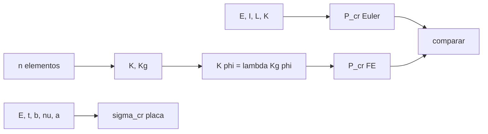

# B84-C23 — Vigas y placas: flexión y pandeo

<!-- nav:top -->
[🏠 Programa](../../../../README.md) · [📚 Bloque B84](../../../tronco-comun/B84-estructuras-materiales-y-fabricacion-espacial.md) · [← Anterior: B84-C22 — Tensión, deformación y elasticidad lineal](../B84-C22-tension-deformacion-y-elasticidad-lineal/CLASE.md) · [Siguiente: B84-C24 — Factores de seguridad y márgenes estructurales →](../../../tronco-comun/B84-estructuras-materiales-y-fabricacion-espacial.md#b84-c24)
<!-- /nav -->

## 1. Ubicación, nivel y alcance

Clase 23 del bloque B84. Nivel N3. Un elemento esbelto comprimido falla por pandeo mucho antes de que el material ceda. Aquí calculas la flecha de dos vigas, la carga crítica de Euler de una columna según sus apoyos, la tensión crítica de pandeo de una placa y verificas el pandeo de la columna con autovalores de elementos finitos. Las dimensiones son **ilustrativas**.

## 2. Por qué esta clase existe

Una columna de aluminio de 30 × 10 mm y 0,5 m se pandea a 6810 N, cuando su sección podría soportar 82 500 N en compresión simple: el 8 %. La decisión central: **¿a qué carga pandea un elemento esbelto y cómo cambia con los apoyos y con el espesor?**

## 3. Lo que podrás hacer al terminar

1. Calcular la flecha de un voladizo y de una viga apoyada.
2. Calcular `P_cr = π²EI/(KL)²` para cuatro apoyos.
3. Calcular `σ_cr` de una placa y ver su escala con `t²`.
4. Verificar el pandeo con autovalores de elementos finitos.
5. Medir la convergencia con la malla.
6. Rotular lo ilustrativo.

La evidencia es la **ficha de pandeo de columna y de placa** del ejercicio 12 (sección 20).

## 4. Con qué llegas y cómo comprobarlo

1. ¿Qué es el momento de inercia `I`?
2. ¿Qué es la esbeltez?
3. ¿Qué es una matriz geométrica?
4. ¿Qué es un autovalor de pandeo?
5. ¿Qué es un dato ilustrativo?

<details>
<summary>Ver respuestas</summary>

1. Una propiedad de la sección que mide su resistencia a flexión. 2. `KL/r`: longitud efectiva sobre radio de giro. 3. Un término de rigidez que depende de la carga axial. 4. El factor de carga `λ` con que la estructura pandea. 5. Un valor no consultado.
</details>

Con cuatro o cinco aciertos, sigue; si no, repasa los prerrequisitos.

## 5. Un caso de contexto y casos de referencia

Una columna de aluminio `30 × 10 mm`, `L = 0,50 m`, articulada, pandea a `P_cr = 6810 N`; empotrada en ambos extremos, a `27 240 N`; en voladizo, a `1703 N`. Con 8 elementos, el pandeo por autovalores da `6810,250 N` (error `0,0033 %`). Una placa `0,30 × 0,20 × 0,002 m` pandea a `27,64 MPa` con 2 semiondas. **Ejemplo conductor.** Ilustrativo.

## 6. Vocabulario

La **carga crítica de Euler** es `P_cr = π²EI/(KL)²` con `K = 1; 0,5; 0,7; 2` según los apoyos. La **tensión crítica de placa** es `σ_cr = kπ²E/(12(1 − ν²))(t/b)²`. La **matriz geométrica** `K_g` hace que `K φ = λ K_g φ` dé `λ = P_cr/P`.

## 7. Modelo mental: una regla de plástico comprimida entre las manos



*Descripción textual:* Euler y los autovalores dan la misma carga crítica; la placa se calcula con su fórmula de `k`.

Analogía: una regla de plástico comprimida se dobla de golpe sin haber cedido. Límite: Euler supone material elástico y columna recta; imperfecciones y plasticidad reducen la carga real.

## 8. La explicación, paso a paso

### 8.1 Flechas

`I = 2500 mm⁴`, `EI = 172,5 N·m²`. Con `P = 100 N`: voladizo `24,155 mm`; apoyo simple con carga central `1,510 mm`.

### 8.2 Euler

| Apoyos | `K` | `P_cr` (N) |
|---|---|---|
| articulada–articulada | 1,0 | 6810,0 |
| empotrada–empotrada | 0,5 | 27 240,1 |
| empotrada–articulada | 0,7 | 13 898,0 |
| voladizo | 2,0 | 1702,5 |

Esbeltez `173,2`: bien por encima del rango donde Euler vale (> 100 aprox.).

### 8.3 Elementos finitos

`n = 2; 4; 8; 16` dan `6861,25; 6813,52; 6810,25; 6810,04 N` (errores `0,752; 0,0512; 0,0033; 0,0002 %`).

### 8.4 Placa

`σ_cr` para `m = 1; 2; 3; 4`: `29,90; 27,64; 39,80; 58,92 MPa`; el mínimo `27,64 MPa` (2 semiondas) equivale a `55,3 kN/m`. Con `k = 4`, `t = 1; 2; 3 mm` da `6,37; 25,47; 57,32 MPa`: escala con `t²`.

## 9. Magnitudes, símbolos y unidades

| Símbolo | Qué es | Unidad | Valor / nota |
|---|---|---|---|
| `EI` | rigidez a flexión | N·m² | 172,5 |
| `K` | factor de longitud efectiva | — | 1; 0,5; 0,7; 2 |
| `P_cr` | carga crítica | N | 6810 |
| `σ_cr` | tensión crítica de placa | MPa | 27,64 |
| `k` | coeficiente de placa | — | 4,340 |
| `λ` | autovalor de pandeo | — | `P_cr/P` |

## 10. Convenciones y referencias

SI. Aluminio `E = 69 GPa`, `ν = 0,33`. Placa simplemente apoyada en los cuatro bordes, compresión según `a`. Viga con elementos de Euler–Bernoulli y matriz geométrica de 4×4. Tolerancia: `P_cr` FE con 8 elementos a menos del 0,5 % de Euler.

## 11. De dónde sale lo que afirmamos

| ID | Fuente | Localizador | Respalda | Estado |
|---|---|---|---|---|
| — | Fórmulas de Euler, de pandeo de placas y la matriz geométrica de viga | — | las fórmulas, que verifica el laboratorio por autovalores, y las dimensiones del ejemplo | No consultada en una fuente concreta |

Límites: datos ilustrativos; fórmulas estándar no consultadas en una fuente concreta; sin imperfecciones ni plasticidad.

## 12. Cómo ver el pandeo

| Magnitud | Valor |
|---|---|
| `P_cr` articulada | 6810,0 N |
| `P_cr` voladizo | 1702,5 N |
| Error FE (8 elem.) | 0,0033 % |
| `σ_cr` placa | 27,64 MPa |
| Flecha voladizo (100 N) | 24,155 mm |

Descripción larga: los apoyos cambian la carga crítica en un factor 16 entre voladizo y empotrada–empotrada.

## 13. Ejemplo trabajado: la carga crítica articulada

**Paso 1 · EI.** `69e9 × 2,5e-9 = 172,5 N·m²`.

**Paso 2 · Euler.** `π² × 172,5/0,5² = 6810,0 N`.

## 14. Distintas formas de describir un elemento esbelto comprimido

**Por carga crítica:** `P_cr`. **Por apoyos:** `K`. **Por autovalor:** `λ`. **Por tensión:** `σ_cr`. **Por esbeltez:** `KL/r`.

## 15. Práctica guiada

**Ejercicio 1 · con los pasos indicados** Calcula `EI`. *Pasos:* `E b h³/12`.

<details><summary>Solución comentada</summary>

`172,5 N·m²`.
</details>

**Ejercicio 2 · con los pasos indicados** Calcula `P_cr` voladizo. *Pista:* `K = 2`.

<details><summary>Solución comentada</summary>

`6810/4 = 1702,5 N`.
</details>

**Ejercicio 3 · con los pasos indicados** ¿Por qué el pandeo de placa escala con `t²`? *Casi autónomo.*

<details><summary>Solución comentada</summary>

Porque la rigidez de flexión de la placa es `∝ t³` y la tensión es fuerza/`t`.
</details>

## 16. Práctica autónoma, transferencia e integrador

**Ejercicio 4 · autónomo** `P_cr` empotrada–articulada con `L = 1 m`.

<details><summary>Solución comentada</summary>

`13 898/4 = 3474,5 N`.
</details>

**Ejercicio 5 · autónomo** `σ_cr` con `b = 0,3 m`, `t = 2 mm`, `k = 4`.

<details><summary>Solución comentada</summary>

`11,3 MPa`.
</details>

**Ejercicio 6 · autónomo** Flecha del voladizo con `P = 50 N`.

<details><summary>Solución comentada</summary>

`12,08 mm`.
</details>

**Ejercicio 7 · autónomo** `P_cr` si `h = 20 mm`.

<details><summary>Solución comentada</summary>

`× 8`: `54 480 N`.
</details>

**Ejercicio 8 · autónomo** Error FE con 4 elementos.

<details><summary>Solución comentada</summary>

`0,0512 %`.
</details>

**Ejercicio 9 · transferencia. **Transferencia.**** Una columna esbelta cumple la tensión de fluencia. ¿Está segura?

<details><summary>Solución comentada</summary>

No: se verifica `P_cr` primero.
</details>

**Ejercicio 10 · transferencia. **Transferencia.**** Un panel delgado de piel se arruga bajo compresión. ¿Está roto?

<details><summary>Solución comentada</summary>

No necesariamente: pandeó localmente; puede soportar más en postpandeo, pero con rigidez menor.
</details>

**Ejercicio 11 · transferencia. **Transferencia.**** ¿Es suficiente con `λ = 1` en el análisis de pandeo?

<details><summary>Solución comentada</summary>

No: se aplican factores de seguridad de estabilidad (GEVS: 1,4 en último).
</details>

**Ejercicio 12 · integrador. **Integrador.**** Elabora tu *ficha de pandeo de columna y de placa*: flechas, `P_cr` con cuatro apoyos, verificación FE, `σ_cr` de placa y su escala con `t²`.

<details><summary>Solución comentada</summary>

Secciones 8.1–8.4 y la salida del laboratorio.
</details>

## 17. Laboratorio: flexión y pandeo de columna y placa

El script [pandeo.py](pandeo.py) calcula flechas, cargas críticas de Euler, tensión crítica de placa y el pandeo por autovalores (**comprueba** `P_cr` FE con 8 elementos a menos del 0,5 % de Euler).

**Datos:** dimensiones **ilustrativas**. **Predice antes de ejecutar:** ¿cuántas veces mayor es `P_cr` empotrada–empotrada que articulada? (4.) **Ejecución del 2026-11-10 (Python 3.12.9):**

```text
Python 3.12.9 (biblioteca estandar)
Seccion 30 x 10 mm: I = 2500.0 mm4 ; EI = 172.500 N m2 ; L = 0.5 m
Flecha con P = 100 N: voladizo = 24.155 mm ; apoyo simple, carga central = 1.510 mm
Carga critica de Euler segun las condiciones de borde:
  articulada-articulada  K = 1.0  P_cr =   6810.03 N
  empotrada-empotrada    K = 0.5  P_cr =  27240.11 N
  empotrada-articulada   K = 0.7  P_cr =  13898.01 N
  voladizo               K = 2.0  P_cr =   1702.51 N
Esbeltez: lambda = K L/r con r = h/sqrt(12) = 173.2 (articulada-articulada)
Pandeo por elementos finitos (articulada-articulada) frente a Euler:
  n =  2  P_cr FE =  6861.254 N  error =   0.7522 %
  n =  4  P_cr FE =  6813.515 N  error =   0.0512 %
  n =  8  P_cr FE =  6810.250 N  error =   0.0033 %
  n = 16  P_cr FE =  6810.041 N  error =   0.0002 %
Placa de 0,30 x 0,20 x 0,002 m simplemente apoyada, compresion en la direccion de a:
  m = 1 semiondas: k = 4.694  sigma_cr = 29.90 MPa
  m = 2 semiondas: k = 4.340  sigma_cr = 27.64 MPa
  m = 3 semiondas: k = 6.250  sigma_cr = 39.80 MPa
  m = 4 semiondas: k = 9.252  sigma_cr = 58.92 MPa
Tension critica de la placa = 27.64 MPa ; fuerza critica por ancho = 55.3 kN/m
  espesor 1 mm (k = 4): sigma_cr = 6.37 MPa (escala con t^2)
  espesor 2 mm (k = 4): sigma_cr = 25.47 MPa (escala con t^2)
  espesor 3 mm (k = 4): sigma_cr = 57.32 MPa (escala con t^2)
Pruebas superadas.
```

```bash
python programa/clases/B84/B84-C23-vigas-y-placas-flexion-y-pandeo/pandeo.py
```

**Límites:** elástico, columna recta, sin imperfecciones; pandeo local de placas aislado.

## 18. Errores frecuentes y cómo corregirlos

**Verificar solo la fluencia.** Se corrige con la sección 2.

**Usar `K = 1` siempre.** Se corrige con 8.2.

**Olvidar `t²`.** Se corrige con 8.4.

**Confiar en Euler con columnas cortas.** Se corrige con 8.2.

## 19. Cómo sabrás que vas bien

Tras la sección 8: ¿qué `P_cr` esperabas para el voladizo? Si dudas, repasa el ejemplo 13. Tras el laboratorio: ¿qué comprueba? (ver la sección 17).

## 20. Qué entregas y cómo se evalúa

El producto es tu **ficha de pandeo de columna y de placa** (ejercicio 12).

| Criterio | Inicial | En desarrollo | Logrado | Destacado |
|---|---|---|---|---|
| Conceptos | Los confunde | Parciales | Calcula cargas críticas y verifica por FE | Explica los límites |
| Cálculo | Sin unidades | Con errores | Tablas completas con unidades | Calcula casos nuevos |
| Numérico | Sin comprobar | Un caso | Contraste con una segunda vía | Interpreta las diferencias |
| Fuentes | Sin fuente | Sin fecha | Fuentes con fecha y estado | Declara lo ilustrativo y lo no consultado |
| Límites | No los nombra | Uno | Tres | Discute qué falta del modelo |

**Condiciones críticas (no se compensan con promedio):** rotular los datos ilustrativos y sintéticos como tales; no presentar un cálculo como ensayo ni como dato de vuelo; citar solo lo consultado.

## 21. Ética, seguridad y límites

Clase educativa: los modelos son simplificados y sus datos son sintéticos, ilustrativos o valores de estándar rotulados; **no es una base de diseño de hardware de vuelo** y ningún resultado sustituye a datos de material cualificados, a los documentos vigentes de la agencia o del lanzador ni a la revisión por personal competente. Accesibilidad: tablas equivalentes a las gráficas, fórmulas en texto, ejercicios sin conexión.

## 22. Para cerrar y seguir

La columna articulada pandea a `6810 N` y la FE lo confirma con `0,0033 %`. Queda una pregunta: ¿cuánto margen hay entre cargas y capacidades?

**Glosario español–inglés.** pandeo · *buckling*; columna · *column*; carga crítica · *critical load*; esbeltez · *slenderness*; placa · *plate*.

**Continuidad.** [B84-C24](../B84-C24-factores-de-seguridad-y-margenes-estructurales/CLASE.md) estudia factores de seguridad y márgenes estructurales.

**Referencias:** ver sección 11.

<!-- nav:bottom -->
---

[← Anterior: B84-C22 — Tensión, deformación y elasticidad lineal](../B84-C22-tension-deformacion-y-elasticidad-lineal/CLASE.md) · [📚 Bloque B84](../../../tronco-comun/B84-estructuras-materiales-y-fabricacion-espacial.md) · [Siguiente: B84-C24 — Factores de seguridad y márgenes estructurales →](../../../tronco-comun/B84-estructuras-materiales-y-fabricacion-espacial.md#b84-c24)
<!-- /nav -->
