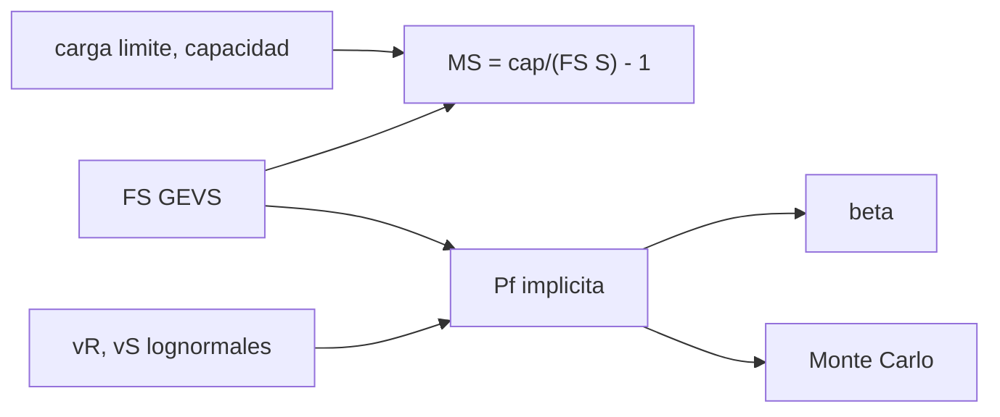

# B84-C24 — Factores de seguridad y márgenes estructurales

<!-- nav:top -->
[🏠 Programa](../../../../README.md) · [📚 Bloque B84](../../../tronco-comun/B84-estructuras-materiales-y-fabricacion-espacial.md) · [← Anterior: B84-C23 — Vigas y placas: flexión y pandeo](../B84-C23-vigas-y-placas-flexion-y-pandeo/CLASE.md) · [Siguiente: B84-C25 — Comportamiento estructural no lineal: plasticidad y contacto →](../B84-C25-comportamiento-estructural-no-lineal-plasticidad-y-contacto/CLASE.md)
<!-- /nav -->

## 1. Ubicación, nivel y alcance

Clase 24 del bloque B84. Nivel N3. Un factor de seguridad es una regla para cubrir incertidumbres; un margen de seguridad dice cuánto sobra. Aquí aplicas los factores de la Tabla 2.2-3 del GEVS (consultada) a seis miembros **ilustrativos**, calculas sus márgenes y estimas con un modelo lognormal la probabilidad de falla que implica cada factor. La ficha de ECSS-E-ST-32-10C Rev. 1 se consultó solo para saber que define factores deterministas; sus valores no se consultaron.

## 2. Por qué esta clase existe

Dos miembros con margen positivo no son igual de seguros si sus factores y sus dispersiones difieren; y un margen negativo exige rediseño o una justificación explícita. La decisión central: **¿qué miembros cumplen con sus factores y qué probabilidad de falla implica cada factor?**

## 3. Lo que podrás hacer al terminar

1. Distinguir carga límite, carga última y factor de seguridad.
2. Calcular `MS = cap/(FS·carga) − 1`.
3. Elegir el factor de la Tabla 2.2-3 según el tipo de carga y de material.
4. Calcular una probabilidad de falla implícita con un modelo lognormal.
5. Comprobarla con Monte Carlo.
6. Rotular lo consultado y lo ilustrativo.

La evidencia es la **tabla de márgenes con su probabilidad implícita** del ejercicio 12 (sección 20).

## 4. Con qué llegas y cómo comprobarlo

1. ¿Qué es una carga límite?
2. ¿Qué es un percentil?
3. ¿Qué es una distribución lognormal?
4. ¿Qué es un margen positivo?
5. ¿Qué es un dato ilustrativo?

<details>
<summary>Ver respuestas</summary>

1. La máxima esperada en servicio. 2. El valor bajo el cual cae un porcentaje de los datos. 3. Una cuya logaritmo es normal; no toma valores negativos. 4. Capacidad por encima de la demanda con factor. 5. Un valor no consultado.
</details>

Con cuatro o cinco aciertos, sigue; si no, repasa los prerrequisitos.

## 5. Un caso de contexto y casos de referencia

Seis miembros con factores del GEVS (1,25–1,8): el larguero de aluminio tiene `MS = 0,415` (fluencia) y `0,429` (rotura); la unión adhesiva `−0,053` y la columna `−0,032`: incumplen. Con resistencia de `v = 0,08` y carga de `v = 0,20`, el factor 1,4 implica `P_f = 6,9 × 10⁻⁶` (`β = 4,35`) y el 2,0, `8,8 × 10⁻¹⁰`. **Ejemplo conductor.** Los miembros y los coeficientes de variación son ilustrativos.

## 6. Vocabulario

La **carga última** es `FS × carga límite`. El **margen** `MS = adm/(FS·lím) − 1` es positivo si cumple. El **índice de fiabilidad** `β = −Φ⁻¹(P_f)`. El factor de **estabilidad** se aplica a pandeo. La probabilidad **implícita** es la que tiene el diseño si resistencia y carga siguen los modelos supuestos.

## 7. Modelo mental: una balanza con tolerancia a ambos lados



*Descripción textual:* el margen sale de la carga, la capacidad y el factor; las dispersiones convierten el factor en una probabilidad de falla comprobada por Monte Carlo.

Analogía: una balanza con peso de seguridad: el factor es el peso extra y el margen lo que sobra; la probabilidad dice cuántas veces de un millón se vence. Límite: los modelos lognormales y los coeficientes de variación son supuestos ilustrativos, no datos de un material.

## 8. La explicación, paso a paso

### 8.1 Factores del GEVS

Tabla 2.2-3, carga estática: metálico fluencia `1,25` y rotura `1,4`; estabilidad `1,4`; compuesto `1,5`; unión adhesiva o inserto `1,5`. Aleatoria/acústica: metálico `1,6` y `1,8`; compuesto `1,9`. Con calificación solo por análisis se piden `2,0` y `2,6`.

### 8.2 Márgenes

| Miembro (ilustrativo) | Carga (N) | Capacidad (N) | FS | MS |
|---|---|---|---|---|
| Larguero Al (fluencia) | 8200 | 14 500 | 1,25 | 0,415 |
| Larguero Al (rotura) | 8200 | 16 400 | 1,4 | 0,429 |
| Panel CFRP (rotura) | 5600 | 9800 | 1,5 | 0,167 |
| Unión adhesiva | 1900 | 2700 | 1,5 | **−0,053** |
| Columna (estabilidad) | 3100 | 4200 | 1,4 | **−0,032** |
| Larguero (aleatoria) | 4000 | 8200 | 1,8 | 0,139 |

### 8.3 Probabilidad implícita

Resistencia lognormal con `R₅ = FS·S₉₉` y `v_R = 0,08`; carga con `v_S = 0,20`:

| FS | `P_f` | `β` |
|---|---|---|
| 1,00 | 2,78 × 10⁻³ | 2,773 |
| 1,25 | 6,74 × 10⁻⁵ | 3,818 |
| 1,40 | 6,86 × 10⁻⁶ | 4,348 |
| 1,50 | 1,50 × 10⁻⁶ | 4,671 |
| 2,00 | 8,79 × 10⁻¹⁰ | 6,019 |

Monte Carlo (400 000 muestras): `2,69 × 10⁻³` frente a `2,78 × 10⁻³` en FS 1,0, y `5,75 × 10⁻⁵` frente a `6,74 × 10⁻⁵` en FS 1,25, dentro de 3 errores estándar.

### 8.4 Lectura

El factor 1,4 no «garantiza» nada: con otras dispersiones la probabilidad cambia por órdenes de magnitud. Un margen negativo se corrige con más capacidad, menos carga o un análisis refinado.

## 9. Magnitudes, símbolos y unidades

| Símbolo | Qué es | Unidad | Valor / nota |
|---|---|---|---|
| `FS` | factor de seguridad | — | 1,25–1,8 (GEVS) |
| `MS` | margen de seguridad | — | −0,053 a 0,429 |
| `v_R`, `v_S` | coef. de variación | — | 0,08; 0,20 (ilustrativos) |
| `P_f` | probabilidad de falla | — | 6,86 × 10⁻⁶ (FS 1,4) |
| `β` | índice de fiabilidad | — | 4,348 |
| `Φ` | distribución normal acumulada | — | — |

## 10. Convenciones y referencias

Cargas en N. Factores de la Tabla 2.2-3 del GEVS. Modelo lognormal con resistencia en percentil 5 % y carga en percentil 99 % (ilustrativo). Semilla 84024.

## 11. De dónde sale lo que afirmamos

| ID | Fuente | Localizador | Respalda | Estado |
|---|---|---|---|---|
| S1 | NASA/GSFC, GSFC-STD-7000 (GEVS) Versión B, Cambio 0, 2021-04-28 — https://standards.nasa.gov/standard/gsfc/gsfc-std-7000 (PDF descargado y leído con PyMuPDF el 2026-11-10) | Tabla 2.2-3 y sección 2.2.5 (páginas 46–47 del PDF) | los factores de seguridad estáticos y aleatorios, los de estabilidad, compuesto y unión adhesiva, y los 2,0 y 2,6 si se califica solo por análisis | Consultada |
| S2 | ECSS, ECSS-E-ST-32-10C Rev. 1 «Structural factors of safety for spaceflight hardware» (2009-03-06), sustituida por la Rev. 2 (2019-05-15) — https://ecss.nl/standard/ecss-e-st-32-10c-rev-1-structural-factors-of-safety-for-spaceflight-hardware/ (ficha consultada 2026-11-10) | ficha del estándar (alcance) | que ECSS define factores de seguridad deterministas y permite una alternativa probabilista con aprobación del cliente | Consultada (solo la ficha; no los valores) |
| — | Cargas y capacidades de los miembros; modelos lognormales y coeficientes de variación | — | todos los datos de entrada y el modelo de probabilidad | No consultada en una fuente concreta |

Límites: los valores de ECSS-E-ST-32-10C no se consultaron; los miembros y las dispersiones son ilustrativos; `P_f` es del modelo, no de un material.

## 12. Cómo ver los márgenes

| Magnitud | Valor |
|---|---|
| `MS` larguero (rotura) | 0,429 |
| `MS` unión adhesiva | −0,053 |
| `MS` columna | −0,032 |
| `P_f` con FS 1,4 | 6,86 × 10⁻⁶ |
| `β` con FS 2,0 | 6,019 |

Descripción larga: dos de seis miembros incumplen; subir el factor de 1,25 a 1,4 reduce la probabilidad implícita 10 veces.

## 13. Ejemplo trabajado: el margen de la unión adhesiva

**Paso 1 · Demanda.** `1,5 × 1900 = 2850 N`.

**Paso 2 · Cociente.** `2700/2850 = 0,947`.

**Paso 3 · Margen.** `0,947 − 1 = −0,053`: negativo.

## 14. Distintas formas de describir un margen

**Por factor:** `FS`. **Por margen:** `MS`. **Por probabilidad:** `P_f`. **Por índice:** `β`. **Por tipo de carga:** estática, aleatoria.

## 15. Práctica guiada

**Ejercicio 1 · con los pasos indicados** Calcula `MS` de la columna. *Pasos:* `4200/(1,4 × 3100) − 1`.

<details><summary>Solución comentada</summary>

`−0,032`.
</details>

**Ejercicio 2 · con los pasos indicados** ¿Qué factor usa un compuesto con carga estática? *Pista:* Tabla 2.2-3.

<details><summary>Solución comentada</summary>

`1,5` en rotura.
</details>

**Ejercicio 3 · con los pasos indicados** ¿Por qué una carga aleatoria exige más factor? *Casi autónomo.*

<details><summary>Solución comentada</summary>

Porque el pico estadístico (3σ) y la fatiga aumentan la incertidumbre: 1,6 y 1,8.
</details>

## 16. Práctica autónoma, transferencia e integrador

**Ejercicio 4 · autónomo** Capacidad mínima para `MS = 0` en el larguero (8200 N, FS 1,4).

<details><summary>Solución comentada</summary>

`11 480 N`.
</details>

**Ejercicio 5 · autónomo** `MS` del panel con capacidad de 11 000 N.

<details><summary>Solución comentada</summary>

`11 000/(1,5 × 5600) − 1 = 0,310`.
</details>

**Ejercicio 6 · autónomo** Factor que hace `MS = 0` en el larguero de fluencia.

<details><summary>Solución comentada</summary>

`14 500/8200 = 1,768`.
</details>

**Ejercicio 7 · autónomo** ¿`P_f` baja al subir el FS?

<details><summary>Solución comentada</summary>

Sí: de `2,8 × 10⁻³` a `8,8 × 10⁻¹⁰` al pasar de 1,0 a 2,0.
</details>

**Ejercicio 8 · autónomo** ¿Qué `β` corresponde a `P_f = 10⁻³`?

<details><summary>Solución comentada</summary>

`3,09`.
</details>

**Ejercicio 9 · transferencia. **Transferencia.**** Un análisis por sí solo debe demostrar la rotura. ¿Qué factor usas con el GEVS?

<details><summary>Solución comentada</summary>

`2,6` en rotura y `2,0` en fluencia.
</details>

**Ejercicio 10 · transferencia. **Transferencia.**** El margen es 0,02. ¿Es «positivo» y aceptable?

<details><summary>Solución comentada</summary>

Es positivo; depende de la incertidumbre de la carga y del análisis.
</details>

**Ejercicio 11 · transferencia. **Transferencia.**** ¿Puedes decir que FS 1,4 equivale a `P_f = 6,9 × 10⁻⁶`?

<details><summary>Solución comentada</summary>

Solo bajo los modelos supuestos; con otros datos cambia.
</details>

**Ejercicio 12 · integrador. **Integrador.**** Elabora tu *tabla de márgenes con su probabilidad implícita*: factores del GEVS, márgenes de seis miembros, `P_f` y `β` por factor, comprobación Monte Carlo y acciones para los márgenes negativos.

<details><summary>Solución comentada</summary>

Secciones 8.1–8.4 y la salida del laboratorio.
</details>

## 17. Laboratorio: márgenes y probabilidad de falla implícita

El script [margenes.py](margenes.py) calcula los márgenes de seis miembros y la probabilidad de falla implícita por factor, con Monte Carlo (**comprueba** `P_f` analítica frente a Monte Carlo dentro de 3 errores estándar).

**Datos:** factores del GEVS **consultados**; miembros y dispersiones **ilustrativos**. **Predice antes de ejecutar:** ¿cuántos miembros tienen margen negativo? (dos.) **Ejecución del 2026-11-10 (Python 3.12.9):**

```text
Python 3.12.9 (biblioteca estandar)
Factores de seguridad del GEVS (Tabla 2.2-3, estatico): metalico 1,25/1,4; compuesto 1,5; union adhesiva 1,5; estabilidad 1,4
miembro (datos ILUSTRATIVOS)       carga lim. [N]  capacidad [N]    FS       MS
Larguero Al (fluencia)                       8200          14500  1.25    0.415  positivo
Larguero Al (ultima)                         8200          16400  1.40    0.429  positivo
Panel CFRP (ultima)                          5600           9800  1.50    0.167  positivo
Union adhesiva (ultima)                      1900           2700  1.50   -0.053  NEGATIVO
Columna (pandeo, estabilidad)                3100           4200  1.40   -0.032  NEGATIVO
Larguero Al (aleatoria, ultima)              4000           8200  1.80    0.139  positivo
Probabilidad de falla implicita (resistencia: percentil 5 %, v_R = 0,08; carga: percentil 99 %, v_S = 0,20; lognormales):
   FS   P_f analitica  indice beta
 1.00       2.780e-03        2.773
 1.25       6.736e-05        3.818
 1.40       6.858e-06        4.348
 1.50       1.495e-06        4.671
 2.00       8.794e-10        6.019
Comprobacion por Monte Carlo (400000 muestras):
  FS = 1.00: P_f MC = 2.6900e-03 ; analitica = 2.7797e-03 ; dif relativa = 3.23 %
  FS = 1.25: P_f MC = 5.7500e-05 ; analitica = 6.7363e-05 ; dif relativa = 14.64 %
Pruebas superadas.
```

```bash
python programa/clases/B84/B84-C24-factores-de-seguridad-y-margenes-estructurales/margenes.py
```

**Límites:** modelo lognormal supuesto; sin correlaciones ni modos combinados.

## 18. Errores frecuentes y cómo corregirlos

**Aplicar el factor equivocado.** Se corrige con 8.1.

**Creer que el factor «garantiza» la seguridad.** Se corrige con 8.4.

**Dar el margen sin decir el factor.** Se corrige con el vocabulario.

**Citar los valores de ECSS sin haberlos consultado.** Se corrige con la sección 11.

## 19. Cómo sabrás que vas bien

Tras la sección 8: ¿qué miembros esperabas negativos? Si dudas, repasa el ejemplo 13. Tras el laboratorio: ¿qué comprueba? (ver la sección 17).

## 20. Qué entregas y cómo se evalúa

El producto es tu **tabla de márgenes con su probabilidad implícita** (ejercicio 12).

| Criterio | Inicial | En desarrollo | Logrado | Destacado |
|---|---|---|---|---|
| Conceptos | Los confunde | Parciales | Calcula márgenes y probabilidad implícita | Explica los límites |
| Cálculo | Sin unidades | Con errores | Tablas completas con unidades | Calcula casos nuevos |
| Numérico | Sin comprobar | Un caso | Contraste con una segunda vía | Interpreta las diferencias |
| Fuentes | Sin fuente | Sin fecha | Fuentes con fecha y estado | Declara lo ilustrativo y lo no consultado |
| Límites | No los nombra | Uno | Tres | Discute qué falta del modelo |

**Condiciones críticas (no se compensan con promedio):** rotular los datos ilustrativos y sintéticos como tales; no presentar un cálculo como ensayo ni como dato de vuelo; citar solo lo consultado.

## 21. Ética, seguridad y límites

Clase educativa: los modelos son simplificados y sus datos son sintéticos, ilustrativos o valores de estándar rotulados; **no es una base de diseño de hardware de vuelo** y ningún resultado sustituye a datos de material cualificados, a los documentos vigentes de la agencia o del lanzador ni a la revisión por personal competente. Accesibilidad: tablas equivalentes a las gráficas, fórmulas en texto, ejercicios sin conexión.

## 22. Para cerrar y seguir

Dos de seis miembros incumplen y el factor 1,4 implica `P_f = 6,9 × 10⁻⁶` bajo los modelos supuestos. Queda una pregunta: ¿qué ocurre cuando el material cede y el análisis lineal ya no vale?

**Glosario español–inglés.** factor de seguridad · *factor of safety*; margen de seguridad · *margin of safety*; carga última · *ultimate load*; índice de fiabilidad · *reliability index*; probabilidad de falla · *probability of failure*.

**Continuidad.** [B84-C25](../B84-C25-comportamiento-estructural-no-lineal-plasticidad-y-contacto/CLASE.md) estudia el comportamiento estructural no lineal.

**Referencias:** ver sección 11.

<!-- nav:bottom -->
---

[← Anterior: B84-C23 — Vigas y placas: flexión y pandeo](../B84-C23-vigas-y-placas-flexion-y-pandeo/CLASE.md) · [📚 Bloque B84](../../../tronco-comun/B84-estructuras-materiales-y-fabricacion-espacial.md) · [Siguiente: B84-C25 — Comportamiento estructural no lineal: plasticidad y contacto →](../B84-C25-comportamiento-estructural-no-lineal-plasticidad-y-contacto/CLASE.md)
<!-- /nav -->
