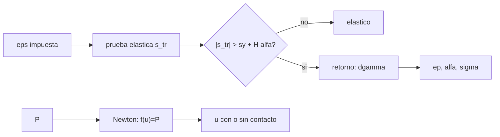

# B84-C25 — Comportamiento estructural no lineal: plasticidad y contacto

<!-- nav:top -->
[🏠 Programa](../../../../README.md) · [📚 Bloque B84](../../../tronco-comun/B84-estructuras-materiales-y-fabricacion-espacial.md) · [← Anterior: B84-C24 — Factores de seguridad y márgenes estructurales](../B84-C24-factores-de-seguridad-y-margenes-estructurales/CLASE.md) · [Siguiente: B84-C26 — Generación de mallas y convergencia en elementos finitos →](../B84-C26-generacion-de-mallas-y-convergencia-en-elementos-finitos/CLASE.md)
<!-- /nav -->

## 1. Ubicación, nivel y alcance

Clase 25 del bloque B84. Nivel N3. Más allá del límite elástico o cuando dos cuerpos se tocan, la respuesta ya no es proporcional a la carga y el análisis lineal falla. Aquí resuelves con retorno radial una barra elastoplástica con endurecimiento isótropo sometida a un ciclo de deformación y un contacto con holgura con Newton–Raphson. El material y las rigideces son **ilustrativos**.

## 2. Por qué esta clase existe

Un modelo lineal da tensiones de 400 MPa en un material que cedió a 275: el resultado correcto es una deformación permanente y una tensión residual que solo el análisis no lineal muestra. La decisión central: **¿qué deformación permanente y tensión residual deja una carga que excede el límite elástico, y cuándo actúa un contacto?**

## 3. Lo que podrás hacer al terminar

1. Aplicar el algoritmo de retorno 1D con endurecimiento isótropo.
2. Reconocer la carga elástica, la fluencia, la descarga elástica y la fluencia inversa.
3. Calcular la deformación plástica residual.
4. Resolver un contacto con holgura con Newton–Raphson.
5. Contrastar con las soluciones analíticas.
6. Rotular lo ilustrativo.

La evidencia es la **ficha de respuesta no lineal con carga y descarga** del ejercicio 12 (sección 20).

## 4. Con qué llegas y cómo comprobarlo

1. ¿Qué es la deformación plástica?
2. ¿Qué es el endurecimiento?
3. ¿Qué es Newton–Raphson?
4. ¿Qué es una holgura (gap)?
5. ¿Qué es un dato ilustrativo?

<details>
<summary>Ver respuestas</summary>

1. La deformación permanente que no se recupera al descargar. 2. El aumento del límite elástico al deformar plásticamente. 3. Un método iterativo `x ← x − f/f′`. 4. Una distancia libre antes de que dos cuerpos se toquen. 5. Un valor no consultado.
</details>

Con cuatro o cinco aciertos, sigue; si no, repasa los prerrequisitos.

## 5. Un caso de contexto y casos de referencia

Una barra con `E = 69 000 MPa`, `σ_y = 275 MPa` y `H = 3000 MPa` cargada hasta `ε = 0,8 %` llega a `σ = 286,542 MPa` con `ε_p = 0,3847 %` (analítica `286,541667`); al descargar a `ε = 0` queda a `−265,458 MPa` y, tras un ciclo hasta `−0,4 %` y vuelta a cero, `−21,163 MPa` residual con `ε_p = 0,0307 %`. Un contacto con holgura de 1 mm da `u = 1,2 mm` con 2000 N. **Ejemplo conductor.** Datos ilustrativos.

## 6. Vocabulario

El **retorno radial** corrige la tensión de prueba elástica al límite de fluencia actual. El **endurecimiento isótropo** eleva el límite `σ_y + Hα`. La **carga monotónica** analítica es `σ = σ_y + E_t(ε − σ_y/E)` con `E_t = EH/(E+H)`. El **contacto** activa un segundo resorte cuando `u > g`.

## 7. Modelo mental: doblar un clip de papel hasta que no vuelve



*Descripción textual:* en cada paso se hace una prueba elástica y, si excede el límite, se retorna; el contacto se resuelve con Newton cambiando la tangente al cerrar la holgura.

Analogía: un clip de papel doblado poco vuelve; doblado mucho queda torcido y más duro. Límite: el modelo es 1D, sin efecto Bauschinger (endurecimiento isótropo, no cinemático) y sin temperatura.

## 8. La explicación, paso a paso

### 8.1 Ciclo elastoplástico

| Punto | `ε` | `σ` (MPa) | `ε_p` (%) |
|---|---|---|---|
| carga a +0,8 % | +0,80 % | 286,542 | 0,3847 |
| descarga a `ε = 0` | 0 | −265,458 | 0,3847 |
| carga inversa a −0,4 % | −0,40 % | −297,163 | 0,0307 |
| cierre a `ε = 0` | 0 | −21,163 | 0,0307 |

El límite sube con el endurecimiento: `275 + 3000 × 0,007388 = 297,16 MPa`.

### 8.2 Verificación monotónica

`E_t = 2875 MPa`; `σ(0,8 %) = 275 + 2875 × (0,008 − 0,003986) = 286,541667 MPa`; `ε_p = 0,384722 %`: la numérica coincide exacta (dif `0`). La descarga a `ε = 0` deja `σ = −E ε_p = −265,458 MPa`, aún elástica por estar dentro del límite `286,5`.

### 8.3 Energía

La energía disipada en el ciclo es `2,1167 MJ/m³`: el trabajo plástico se convierte en calor.

### 8.4 Contacto

`f(u) = k₁u + k₂ máx(0, u − g) − P`. `P = 500 N` → `0,5 mm` (1 iteración); `1000 N` → `1,0 mm` (justo en la holgura); `2000 N` → `1,2 mm` (2 iteraciones); `5000 N` → `1,8 mm`. Con contacto la rigidez sube de `10⁶` a `5 × 10⁶ N/m`.

## 9. Magnitudes, símbolos y unidades

| Símbolo | Qué es | Unidad | Valor / nota |
|---|---|---|---|
| `E`, `σ_y`, `H` | módulo, fluencia y endurecimiento | MPa | 69 000; 275; 3000 |
| `ε_p` | deformación plástica | % | 0,3847 |
| `α` | deformación plástica acumulada | % | 0,7388 |
| `E_t` | módulo tangente | MPa | 2875 |
| `k₁`, `k₂`, `g` | rigideces y holgura | N/m, N/m, mm | 10⁶; 4 × 10⁶; 1 |
| `W` | energía disipada | MJ/m³ | 2,1167 |

## 10. Convenciones y referencias

MPa y mm. Plasticidad 1D con endurecimiento isótropo lineal; 400 pasos por tramo. Contacto 1D con tangente discontinua. Datos ilustrativos, no consultados. Tolerancias: `σ` monotónica < 10⁻⁹ y residuo de Newton < 10⁻⁹ N.

## 11. De dónde sale lo que afirmamos

| ID | Fuente | Localizador | Respalda | Estado |
|---|---|---|---|---|
| — | Parámetros de material y algoritmo de retorno radial | — | los valores y el algoritmo, que el laboratorio verifica con la solución analítica monotónica | No consultada en una fuente concreta |

Límites: datos ilustrativos; el algoritmo es estándar y no se consultó en una fuente concreta; sin efecto Bauschinger ni temperatura.

## 12. Cómo ver el ciclo elastoplástico

| Magnitud | Valor |
|---|---|
| `σ` en +0,8 % | 286,542 MPa |
| `ε_p` | 0,3847 % |
| `σ` residual al cierre | −21,163 MPa |
| Energía disipada | 2,1167 MJ/m³ |
| `u` con 2000 N | 1,2 mm |

Descripción larga: el endurecimiento sube el límite y la plasticidad deja una deformación y una tensión residual tras la descarga.

## 13. Ejemplo trabajado: el contacto con 2000 N

**Paso 1 · Con contacto.** `u > g` si `P > k₁ g = 1000 N`.

**Paso 2 · Solución.** `u = (P + k₂ g)/(k₁ + k₂) = (2000 + 4000)/(5 × 10⁶) = 1,2 mm`.

## 14. Distintas formas de describir la respuesta no lineal

**Por curva:** `σ(ε)` con ciclo. **Por variables internas:** `ε_p`, `α`. **Por energía:** `W`. **Por contacto:** `u(P)`. **Por iteraciones:** Newton.

## 15. Práctica guiada

**Ejercicio 1 · con los pasos indicados** Calcula `E_t`. *Pasos:* `EH/(E+H)`.

<details><summary>Solución comentada</summary>

`2875 MPa`.
</details>

**Ejercicio 2 · con los pasos indicados** ¿Cuál es `σ` al descargar a `ε = 0` con `ε_p = 0,3847 %`? *Pista:* `−E ε_p`.

<details><summary>Solución comentada</summary>

`−265,5 MPa`.
</details>

**Ejercicio 3 · con los pasos indicados** ¿Por qué Newton converge en 1–2 iteraciones? *Casi autónomo.*

<details><summary>Solución comentada</summary>

Porque `f` es lineal por tramos: cada tangente es exacta en su tramo.
</details>

## 16. Práctica autónoma, transferencia e integrador

**Ejercicio 4 · autónomo** `u` con `P = 3000 N`.

<details><summary>Solución comentada</summary>

`(3000 + 4000)/(5e6) = 1,4 mm`.
</details>

**Ejercicio 5 · autónomo** Rigidez del conjunto con contacto.

<details><summary>Solución comentada</summary>

`5 × 10⁶ N/m`.
</details>

**Ejercicio 6 · autónomo** `σ` en `ε = 0,5 %` (monotónica).

<details><summary>Solución comentada</summary>

`275 + 2875 × (0,005 − 0,003986) = 277,9 MPa`.
</details>

**Ejercicio 7 · autónomo** `ε_p` en `ε = 0,5 %`.

<details><summary>Solución comentada</summary>

`ε − σ/E = 0,005 − 0,004028 = 0,0972 %`.
</details>

**Ejercicio 8 · autónomo** ¿Qué pasa si `H = 0`?

<details><summary>Solución comentada</summary>

Plasticidad perfecta: `σ` queda en 275.
</details>

**Ejercicio 9 · transferencia. **Transferencia.**** Un análisis lineal da 400 MPa en una zona que cede a 275. ¿Qué haces?

<details><summary>Solución comentada</summary>

Un análisis no lineal con la curva del material, que dará menos tensión y una deformación permanente.
</details>

**Ejercicio 10 · transferencia. **Transferencia.**** Una carga cíclica supera la fluencia solo al principio. ¿Qué buscas?

<details><summary>Solución comentada</summary>

Si se estabiliza (shakedown) con tensión residual y respuesta elástica.
</details>

**Ejercicio 11 · transferencia. **Transferencia.**** Un contacto inicia sin holgura y con fricción. ¿Basta este modelo?

<details><summary>Solución comentada</summary>

No: la fricción y la geometría 2D/3D exigen un modelo de contacto completo.
</details>

**Ejercicio 12 · integrador. **Integrador.**** Elabora tu *ficha de respuesta no lineal con carga y descarga*: tabla del ciclo, verificación monotónica, energía, contacto por Newton y qué falta del modelo.

<details><summary>Solución comentada</summary>

Secciones 8.1–8.4 y la salida del laboratorio.
</details>

## 17. Laboratorio: plasticidad 1D y contacto con holgura

El script [nolineal.py](nolineal.py) integra un ciclo elastoplástico con retorno radial y resuelve un contacto con Newton (**comprueba** `σ` monotónica frente a analítica (< 1e-9) y `u` de contacto exacta).

**Datos:** material y rigideces **ilustrativos**. **Predice antes de ejecutar:** ¿qué tensión queda al volver a `ε = 0`? (negativa: −21,2 MPa.) **Ejecución del 2026-11-10 (Python 3.12.9):**

```text
Python 3.12.9 (biblioteca estandar)
Material ILUSTRATIVO: E = 69 000 MPa, sigma_y = 275 MPa, H = 3000 MPa (endurecimiento isotropo)
  fin de la carga a +0,8 %                 eps =  +0.80 %  sigma =   286.542 MPa  eps_p =  +0.3847 %  alfa =  0.3847 %
  fin de la descarga a 0 de deformacion    eps =  +0.00 %  sigma =  -265.458 MPa  eps_p =  +0.3847 %  alfa =  0.3847 %
  fin de la carga inversa a -0,4 %         eps =  -0.40 %  sigma =  -297.163 MPa  eps_p =  +0.0307 %  alfa =  0.7388 %
  cierre del ciclo a 0                     eps =  +0.00 %  sigma =   -21.163 MPa  eps_p =  +0.0307 %  alfa =  0.7388 %
Analitica de la carga monotona: E_t = 2875.000 MPa ; sigma(0,8 %) = 286.541667 MPa ; eps_p = 0.384722 %
Numerica: sigma = 286.541667 MPa ; eps_p = 0.384722 % ; dif relativa sigma = 0.0e+00
Energia disipada en el ciclo (integral de sigma d eps) = 2.1167 MJ/m3
Tension de fluencia actual tras el ciclo = sigma_y + H alfa = 297.16 MPa (endurecimiento acumulado)
Contacto con holgura (k1 = 1e6 N/m, g = 1 mm, k2 = 4e6 N/m): Newton frente a analitica
  P =    500 N  u =  0.5000 mm  (analitica  0.5000) iteraciones = 1  sin contacto
  P =   1000 N  u =  1.0000 mm  (analitica  1.0000) iteraciones = 1  sin contacto
  P =   2000 N  u =  1.2000 mm  (analitica  1.2000) iteraciones = 2  con contacto
  P =   5000 N  u =  1.8000 mm  (analitica  1.8000) iteraciones = 2  con contacto
Pruebas superadas.
```

```bash
python programa/clases/B84/B84-C25-comportamiento-estructural-no-lineal-plasticidad-y-contacto/nolineal.py
```

**Límites:** 1D, endurecimiento isótropo, contacto sin fricción.

## 18. Errores frecuentes y cómo corregirlos

**Extrapolar la rigidez elástica más allá de `σ_y`.** Se corrige con 8.1.

**Olvidar la tensión residual.** Se corrige con 8.1.

**Usar Newton sin cambiar la tangente.** Se corrige con 8.4.

**Dar por válido un resultado lineal sobre `σ_y`.** Se corrige con la sección 2.

## 19. Cómo sabrás que vas bien

Tras la sección 8: ¿qué `σ` esperabas al cierre? Si dudas, repasa el ejemplo 13. Tras el laboratorio: ¿qué comprueba? (ver la sección 17).

## 20. Qué entregas y cómo se evalúa

El producto es tu **ficha de respuesta no lineal con carga y descarga** (ejercicio 12).

| Criterio | Inicial | En desarrollo | Logrado | Destacado |
|---|---|---|---|---|
| Conceptos | Los confunde | Parciales | Resuelve plasticidad y contacto | Explica los límites |
| Cálculo | Sin unidades | Con errores | Tablas completas con unidades | Calcula casos nuevos |
| Numérico | Sin comprobar | Un caso | Contraste con una segunda vía | Interpreta las diferencias |
| Fuentes | Sin fuente | Sin fecha | Fuentes con fecha y estado | Declara lo ilustrativo y lo no consultado |
| Límites | No los nombra | Uno | Tres | Discute qué falta del modelo |

**Condiciones críticas (no se compensan con promedio):** rotular los datos ilustrativos y sintéticos como tales; no presentar un cálculo como ensayo ni como dato de vuelo; citar solo lo consultado.

## 21. Ética, seguridad y límites

Clase educativa: los modelos son simplificados y sus datos son sintéticos, ilustrativos o valores de estándar rotulados; **no es una base de diseño de hardware de vuelo** y ningún resultado sustituye a datos de material cualificados, a los documentos vigentes de la agencia o del lanzador ni a la revisión por personal competente. Accesibilidad: tablas equivalentes a las gráficas, fórmulas en texto, ejercicios sin conexión.

## 22. Para cerrar y seguir

La barra queda con `ε_p = 0,0307 %` y `−21,2 MPa` residual tras el ciclo; el contacto cambia la rigidez de `10⁶` a `5 × 10⁶ N/m`. Queda una pregunta: ¿cómo se construye una malla fiable?

**Glosario español–inglés.** plasticidad · *plasticity*; endurecimiento · *hardening*; retorno radial · *radial return*; contacto · *contact*; Newton–Raphson · *Newton–Raphson*.

**Continuidad.** [B84-C26](../B84-C26-generacion-de-mallas-y-convergencia-en-elementos-finitos/CLASE.md) estudia la generación de mallas y la convergencia.

**Referencias:** ver sección 11.

<!-- nav:bottom -->
---

[← Anterior: B84-C24 — Factores de seguridad y márgenes estructurales](../B84-C24-factores-de-seguridad-y-margenes-estructurales/CLASE.md) · [📚 Bloque B84](../../../tronco-comun/B84-estructuras-materiales-y-fabricacion-espacial.md) · [Siguiente: B84-C26 — Generación de mallas y convergencia en elementos finitos →](../B84-C26-generacion-de-mallas-y-convergencia-en-elementos-finitos/CLASE.md)
<!-- /nav -->
