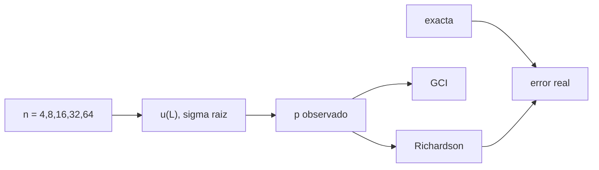

# B84-C26 — Generación de mallas y convergencia en elementos finitos

<!-- nav:top -->
[🏠 Programa](../../../../README.md) · [📚 Bloque B84](../../../tronco-comun/B84-estructuras-materiales-y-fabricacion-espacial.md) · [← Anterior: B84-C25 — Comportamiento estructural no lineal: plasticidad y contacto](../B84-C25-comportamiento-estructural-no-lineal-plasticidad-y-contacto/CLASE.md) · [Siguiente: B84-C27 — Tipos de elementos finitos: viga, placa y sólido →](../B84-C27-tipos-de-elementos-finitos-viga-placa-y-solido/CLASE.md)
<!-- /nav -->

## 1. Ubicación, nivel y alcance

Clase 26 del bloque B84. Nivel N3. Un resultado de elementos finitos solo es confiable si no cambia al refinar la malla. Aquí resuelves una barra ensanchada **ilustrativa** con 4 a 64 elementos, mides el orden observado de convergencia, aplicas la extrapolación de Richardson y calculas el índice de convergencia de malla (GCI) para dos magnitudes: el desplazamiento del extremo (orden 2) y la tensión de la raíz (orden 1).

## 2. Por qué esta clase existe

Una malla más gruesa puede errar 30 % en tensión sin que el resultado «parezca» mal; la convergencia dice cuánto y cuánto refinar. La decisión central: **¿cuántos elementos hacen falta para que la magnitud de interés cambie menos que una tolerancia dada?**

## 3. Lo que podrás hacer al terminar

1. Resolver el mismo problema en mallas sucesivas.
2. Calcular el orden observado `p`.
3. Extrapolar con Richardson al límite de malla infinitamente fina.
4. Calcular el GCI con factor 1,25.
5. Distinguir magnitudes de orden distinto (desplazamiento y tensión).
6. Estimar los elementos necesarios para una tolerancia.

La evidencia es la **informe de convergencia de malla** del ejercicio 12 (sección 20).

## 4. Con qué llegas y cómo comprobarlo

1. ¿Qué es una malla?
2. ¿Qué es el orden de convergencia?
3. ¿Qué es la extrapolación de Richardson?
4. ¿Qué es una razón de refinamiento?
5. ¿Qué es una solución exacta?

<details>
<summary>Ver respuestas</summary>

1. La discretización de la estructura en elementos. 2. El exponente `p` con que el error baja como `h^p`. 3. Estimar el valor límite con dos mallas y `p`. 4. `r = h_gruesa/h_fina`; aquí 2. 5. La analítica o de referencia que se usa para medir el error.
</details>

Con cuatro o cinco aciertos, sigue; si no, repasa los prerrequisitos.

## 5. Un caso de contexto y casos de referencia

Una barra de área `A₀(1 + 2x/L)` con `q = 10 kN/m` tiene desplazamiento exacto `u(L) = 0,11737653 mm`. Con 64 elementos el error es `8,4 × 10⁻⁵`, el orden observado `1,996` y el GCI `0,0105 %`. La tensión de la raíz tiene error `2,3 %` con 64 elementos, orden `0,935` y GCI `3,14 %`; harían falta 4096 elementos para `10⁻⁴`. **Ejemplo conductor.** Datos ilustrativos.

## 6. Vocabulario

El **orden observado** es `p = ln((f₂ − f₁)/(f₃ − f₂))/ln r` con tres mallas. **Richardson**: `f_ext = f₃ + (f₃ − f₂)/(r^p − 1)`. El **GCI** (Roache) es `1,25 |f₃ − f₂|/(|f₃| (r^p − 1))`. La **malla fina** es la de menor `h`.

## 7. Modelo mental: afinar el trazo de un dibujo hasta que ya no cambie



*Descripción textual:* las mallas dan la magnitud de interés, de ellas salen el orden, el valor extrapolado y el GCI, y se contrastan con la solución exacta.

Analogía: afinar un dibujo con trazos cada vez más finos hasta que ya no cambia. Límite: el orden `p` supone que las mallas están en el régimen asintótico; con singularidades o mallas muy gruesas no es válido.

## 8. La explicación, paso a paso

### 8.1 Desplazamiento

| `n` | `u(L)` (mm) | Error relativo |
|---|---|---|
| 4 | 0,11496957 | 2,05 × 10⁻² |
| 8 | 0,11675491 | 5,30 × 10⁻³ |
| 16 | 0,11721975 | 1,34 × 10⁻³ |
| 32 | 0,11733724 | 3,35 × 10⁻⁴ |
| 64 | 0,11736670 | 8,37 × 10⁻⁵ |

`p = 1,996`; Richardson `1,17376557 × 10⁻⁴ m` frente a `1,17376528 × 10⁻⁴` exacta (dif `2,5 × 10⁻⁷`); GCI `0,0105 %`.

### 8.2 Tensión de la raíz

Con `σ(0) = 25 MPa` exacta, las mallas dan `17,50; 20,83; 22,79; 23,86; 24,42 MPa` (errores `30 %` a `2,3 %`). `p = 0,935`, Richardson `25,0367 MPa` (dif `1,5 × 10⁻³`) y GCI `3,14 %`.

### 8.3 Lectura

El desplazamiento (integral de la solución) converge con orden 2; la tensión (derivada) con orden 1 en el elemento de la raíz. Para `10⁻⁴` en tensión harían falta 4096 elementos: se prefiere un elemento de mayor orden o suavizar tensiones.

### 8.4 Cómo documentar

Se reporta el valor de la malla fina, `p`, la extrapolación y el GCI; si `p` difiere mucho del teórico se investiga (singularidad, malla pobre).

## 9. Magnitudes, símbolos y unidades

| Símbolo | Qué es | Unidad | Valor / nota |
|---|---|---|---|
| `n` | número de elementos | — | 4–64 |
| `p` | orden observado | — | 1,996; 0,935 |
| `r` | razón de refinamiento | — | 2 |
| `f_ext` | valor extrapolado | — | 1,17376557e-4 m |
| GCI | índice de convergencia | % | 0,0105; 3,14 |
| `σ(0)` | tensión exacta en la raíz | MPa | 25 |

## 10. Convenciones y referencias

SI. Barra de dos nodos con área en el punto medio y carga consistente. `r = 2`. GCI con factor 1,25 (Roache; no consultado). Exacta por Simpson con 2 000 000 pasos. Tolerancias: `p` del desplazamiento entre 1,8 y 2,2; extrapolado dentro de 10⁻⁶.

## 11. De dónde sale lo que afirmamos

| ID | Fuente | Localizador | Respalda | Estado |
|---|---|---|---|---|
| — | Método del GCI de Roache y la barra del ejemplo | — | el factor 1,25 y la fórmula del GCI | No consultada en una fuente concreta |

Límites: datos ilustrativos; el GCI no se consultó en su fuente; el problema es 1D y regular, sin singularidades.

## 12. Cómo ver la convergencia

| Magnitud | Valor |
|---|---|
| `p` de `u(L)` | 1,996 |
| Error `u(L)` n = 64 | 8,37 × 10⁻⁵ |
| GCI de `u(L)` | 0,0105 % |
| `p` de la tensión | 0,935 |
| GCI de la tensión | 3,14 % |

Descripción larga: el desplazamiento converge con orden 2 y la tensión con orden 1: el GCI es 300 veces mayor en la tensión.

## 13. Ejemplo trabajado: el orden observado

**Paso 1 · Diferencias (mallas 16, 32, 64).** `f₂ − f₁ = 1,1749 × 10⁻⁴ mm`; `f₃ − f₂ = 2,946 × 10⁻⁵ mm`.

**Paso 2 · Cociente.** `3,988`.

**Paso 3 · Orden.** `p = ln 3,988/ln 2 = 1,996`.

## 14. Distintas formas de describir la convergencia de una malla

**Por error:** frente a la exacta. **Por orden:** `p`. **Por extrapolación:** `f_ext`. **Por GCI:** %. **Por elementos:** para una tolerancia.

## 15. Práctica guiada

**Ejercicio 1 · con los pasos indicados** Calcula la razón de errores entre `n = 4` y 8 en `u(L)`. *Pasos:* `2,05e-2/5,30e-3`.

<details><summary>Solución comentada</summary>

`3,87 ≈ 4`: orden 2.
</details>

**Ejercicio 2 · con los pasos indicados** ¿Qué orden da una razón de errores 2? *Pista:* `log₂ 2`.

<details><summary>Solución comentada</summary>

`p = 1`.
</details>

**Ejercicio 3 · con los pasos indicados** ¿Por qué la tensión converge más lento? *Casi autónomo.*

<details><summary>Solución comentada</summary>

Porque es una derivada de la solución y el elemento da deformación constante.
</details>

## 16. Práctica autónoma, transferencia e integrador

**Ejercicio 4 · autónomo** Estimación de `n` para error `10⁻⁴` en `u(L)` si con `n = 64` es `8,4e-5`.

<details><summary>Solución comentada</summary>

Ya cumple con 64.
</details>

**Ejercicio 5 · autónomo** `f_ext` con `f₂ = 24,00`, `f₃ = 24,50` y `p = 1`.

<details><summary>Solución comentada</summary>

`24,50 + 0,50/(2 − 1) = 25,00`.
</details>

**Ejercicio 6 · autónomo** GCI con `|f₃ − f₂|/f₃ = 0,01`, `p = 2`.

<details><summary>Solución comentada</summary>

`1,25 × 0,01/3 = 0,42 %`.
</details>

**Ejercicio 7 · autónomo** Orden si el error pasa de `1e-2` a `2,5e-3`.

<details><summary>Solución comentada</summary>

`2`.
</details>

**Ejercicio 8 · autónomo** ¿Qué elementos necesita la tensión para `0,1 %` con `p = 1`?

<details><summary>Solución comentada</summary>

Cerca de 1500.
</details>

**Ejercicio 9 · transferencia. **Transferencia.**** Una malla da 200 MPa y otra 210. ¿Cuál reportas?

<details><summary>Solución comentada</summary>

Ninguna sin tercera malla: se necesita `p`, la extrapolación y el GCI.
</details>

**Ejercicio 10 · transferencia. **Transferencia.**** El `p` observado es 0,3. ¿Qué sospechas?

<details><summary>Solución comentada</summary>

Una singularidad o una malla fuera del régimen asintótico.
</details>

**Ejercicio 11 · transferencia. **Transferencia.**** ¿Basta con un GCI pequeño para validar el modelo?

<details><summary>Solución comentada</summary>

No: solo prueba la convergencia numérica, no que el modelo represente la realidad.
</details>

**Ejercicio 12 · integrador. **Integrador.**** Elabora tu *informe de convergencia de malla*: tabla de mallas, `p`, Richardson y GCI de las dos magnitudes, y la malla recomendada.

<details><summary>Solución comentada</summary>

Secciones 8.1–8.4 y la salida del laboratorio.
</details>

## 17. Laboratorio: convergencia, Richardson y GCI

El script [convergencia.py](convergencia.py) resuelve la barra en cinco mallas y calcula `p`, Richardson y GCI (**comprueba** `p` del desplazamiento entre 1,8 y 2,2 y extrapolado dentro de 1e-6).

**Datos:** barra **ilustrativa**; solución exacta por Simpson. **Predice antes de ejecutar:** ¿converge más rápido el desplazamiento o la tensión? (el desplazamiento: orden 2 frente a 1.) **Ejecución del 2026-11-10 (Python 3.12.9):**

```text
Python 3.12.9 (biblioteca estandar)
Barra ILUSTRATIVA ensanchada: u(L) exacta = 0.11737653 mm ; sigma(0) exacta = 25.0000 MPa
   n     u(L) [mm]   err rel u  sigma raiz [MPa]   err rel s
   4    0.11496957   2.051e-02           17.5000   3.000e-01
   8    0.11675491   5.296e-03           20.8333   1.667e-01
  16    0.11721975   1.336e-03           22.7941   8.824e-02
  32    0.11733724   3.347e-04           23.8636   4.545e-02
  64    0.11736670   8.372e-05           24.4231   2.308e-02
desplazamiento del extremo: orden observado p = 1.996 ; Richardson = 1.17376557e-04 (exacta 1.17376528e-04, dif rel 2.5e-07) ; GCI(n = 64) = 0.0105 %
tension de la raiz: orden observado p = 0.935 ; Richardson = 2.50366569e+07 (exacta 2.50000000e+07, dif rel 1.5e-03) ; GCI(n = 64) = 3.1404 %
Elementos necesarios (potencias de 2) para un error relativo de la tension de la raiz < 1e-4: 4096
Pruebas superadas.
```

```bash
python programa/clases/B84/B84-C26-generacion-de-mallas-y-convergencia-en-elementos-finitos/convergencia.py
```

**Límites:** 1D regular; el GCI con factor 1,25 no consultado.

## 18. Errores frecuentes y cómo corregirlos

**Confiar en una sola malla.** Se corrige con 8.4.

**Usar el mismo `p` para toda magnitud.** Se corrige con 8.3.

**Extrapolar con mallas gruesas.** Se corrige con el alcance.

**Confundir convergencia con validación.** Se corrige con transferencia 11.

## 19. Cómo sabrás que vas bien

Tras la sección 8: ¿qué orden esperabas para la tensión? Si dudas, repasa el ejemplo 13. Tras el laboratorio: ¿qué comprueba? (ver la sección 17).

## 20. Qué entregas y cómo se evalúa

El producto es tu **informe de convergencia de malla** (ejercicio 12).

| Criterio | Inicial | En desarrollo | Logrado | Destacado |
|---|---|---|---|---|
| Conceptos | Los confunde | Parciales | Calcula orden, extrapolación y GCI | Explica los límites |
| Cálculo | Sin unidades | Con errores | Tablas completas con unidades | Calcula casos nuevos |
| Numérico | Sin comprobar | Un caso | Contraste con una segunda vía | Interpreta las diferencias |
| Fuentes | Sin fuente | Sin fecha | Fuentes con fecha y estado | Declara lo ilustrativo y lo no consultado |
| Límites | No los nombra | Uno | Tres | Discute qué falta del modelo |

**Condiciones críticas (no se compensan con promedio):** rotular los datos ilustrativos y sintéticos como tales; no presentar un cálculo como ensayo ni como dato de vuelo; citar solo lo consultado.

## 21. Ética, seguridad y límites

Clase educativa: los modelos son simplificados y sus datos son sintéticos, ilustrativos o valores de estándar rotulados; **no es una base de diseño de hardware de vuelo** y ningún resultado sustituye a datos de material cualificados, a los documentos vigentes de la agencia o del lanzador ni a la revisión por personal competente. Accesibilidad: tablas equivalentes a las gráficas, fórmulas en texto, ejercicios sin conexión.

## 22. Para cerrar y seguir

El desplazamiento converge con `p = 1,996` y GCI `0,0105 %`; la tensión con `p = 0,935` y GCI `3,14 %`. Queda una pregunta: ¿qué elemento elegir para cada parte de la estructura?

**Glosario español–inglés.** malla · *mesh*; convergencia · *convergence*; extrapolación de Richardson · *Richardson extrapolation*; índice de convergencia de malla · *grid convergence index*; orden · *order*.

**Continuidad.** [B84-C27](../B84-C27-tipos-de-elementos-finitos-viga-placa-y-solido/CLASE.md) estudia los tipos de elementos finitos.

**Referencias:** ver sección 11.

<!-- nav:bottom -->
---

[← Anterior: B84-C25 — Comportamiento estructural no lineal: plasticidad y contacto](../B84-C25-comportamiento-estructural-no-lineal-plasticidad-y-contacto/CLASE.md) · [📚 Bloque B84](../../../tronco-comun/B84-estructuras-materiales-y-fabricacion-espacial.md) · [Siguiente: B84-C27 — Tipos de elementos finitos: viga, placa y sólido →](../B84-C27-tipos-de-elementos-finitos-viga-placa-y-solido/CLASE.md)
<!-- /nav -->
