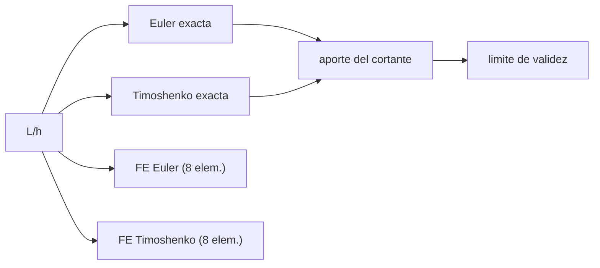

# B84-C27 — Tipos de elementos finitos: viga, placa y sólido

<!-- nav:top -->
[🏠 Programa](../../../../README.md) · [📚 Bloque B84](../../../tronco-comun/B84-estructuras-materiales-y-fabricacion-espacial.md) · [← Anterior: B84-C26 — Generación de mallas y convergencia en elementos finitos](../B84-C26-generacion-de-mallas-y-convergencia-en-elementos-finitos/CLASE.md) · [Siguiente: B84-C28 — Condiciones de contorno y cargas en modelos de elementos finitos →](../B84-C28-condiciones-de-contorno-y-cargas-en-modelos-de-elementos-finitos/CLASE.md)
<!-- /nav -->

## 1. Ubicación, nivel y alcance

Clase 27 del bloque B84. Nivel N3. Elegir el elemento decide la validez del modelo: una viga de Euler–Bernoulli ignora la deformación por cortante, una barra no resiste flexión y un sólido 3D lo captura todo pero cuesta mucho. Aquí comparas, para un voladizo de aluminio **ilustrativo**, el elemento de Euler (Hermite cúbico) y el de Timoshenko con integración reducida frente a las soluciones exactas, desde esbeltez `L/h = 40` hasta `2`. Los elementos de placa y los sólidos se describen pero **no se implementan** aquí.

## 2. Por qué esta clase existe

Una viga corta modelada con Euler subestima la flecha en 17 %; no es un error de malla sino de hipótesis. La decisión central: **¿para qué esbeltez es válido el elemento de Euler y cuándo hace falta cortante?**

## 3. Lo que podrás hacer al terminar

1. Distinguir barra, viga de Euler, viga de Timoshenko, placa y sólido.
2. Calcular la flecha exacta de Euler y de Timoshenko.
3. Medir la contribución del cortante `3EI/(κGAL²)`.
4. Implementar un elemento de Timoshenko con integración reducida.
5. Hallar el límite de esbeltez para un criterio de 5 %.
6. Rotular lo ilustrativo y lo no implementado.

La evidencia es la **tabla de validez de elementos por esbeltez** del ejercicio 12 (sección 20).

## 4. Con qué llegas y cómo comprobarlo

1. ¿Qué es la deformación por cortante?
2. ¿Qué es el factor de cortante `κ`?
3. ¿Qué es la esbeltez `L/h`?
4. ¿Qué es la integración reducida?
5. ¿Qué es el bloqueo?

<details>
<summary>Ver respuestas</summary>

1. El deslizamiento de las secciones entre sí, que añade flecha a la flexión. 2. Una corrección de la sección; `5/6` para un rectángulo. 3. Longitud sobre canto. 4. Evaluar un término en menos puntos para evitar el bloqueo por cortante. 5. Rigidez excesiva de un elemento que no puede representar la flexión pura.
</details>

Con cuatro o cinco aciertos, sigue; si no, repasa los prerrequisitos.

## 5. Un caso de contexto y casos de referencia

Un voladizo de `0,50 m` con `b = 20 mm` y `P = 100 N` con `L/h = 5` tiene flecha de Euler `0,0362 mm` y de Timoshenko `0,0374 mm`: el cortante aporta `3,19 %`; con `L/h = 2` la flecha de Euler `0,0023 mm` queda `16,6 %` por debajo de la de Timoshenko `0,0028`. **Ejemplo conductor.** Datos ilustrativos.

## 6. Vocabulario

La **viga de Euler–Bernoulli** supone que las secciones planas son perpendiculares al eje. La de **Timoshenko** añade el giro de la sección independiente, con cortante `κ G A`. La **integración reducida** evalúa el cortante en un punto. El **aporte del cortante** es `3EI/(κGAL²)` en un voladizo.

## 7. Modelo mental: una regla larga frente a un taco de madera



*Descripción textual:* para cada esbeltez se calculan las dos soluciones exactas y los dos modelos FE, y de su diferencia sale el límite de validez de Euler.

Analogía: una regla larga se dobla como una curva suave, pero un taco de madera corto se «corta» además de doblarse. Límite: el modelo de viga supone sección rectangular constante y material isótropo.

## 8. La explicación, paso a paso

### 8.1 Flechas

| `L/h` | `h` (mm) | Euler (mm) | Timoshenko (mm) | Cortante (%) | Error de Euler (%) | FE Euler | FE Timo (8 el.) |
|---|---|---|---|---|---|---|---|
| 40 | 12,5 | 18,5507 | 18,5600 | 0,05 | −0,05 | 18,5507 | 18,4875 |
| 20 | 25,0 | 2,3188 | 2,3235 | 0,20 | −0,20 | 2,3188 | 2,3144 |
| 10 | 50,0 | 0,2899 | 0,2922 | 0,80 | −0,79 | 0,2899 | 0,2910 |
| 5 | 100,0 | 0,0362 | 0,0374 | 3,19 | −3,09 | 0,0362 | 0,0372 |
| 3 | 166,7 | 0,0078 | 0,0085 | 8,87 | −8,14 | 0,0078 | 0,0085 |
| 2 | 250,0 | 0,0023 | 0,0028 | 19,95 | −16,63 | 0,0023 | 0,0028 |

### 8.2 Lectura

El elemento de Euler FE coincide con su exacta (`10⁻⁹`) pero la exacta de Euler subestima la flecha cuando `L/h` baja: el error es de hipótesis. El Timoshenko FE (8 elementos, error < 2 % en todos los casos) sigue a Timoshenko.

### 8.3 Límite práctico

El aporte del cortante `3EI/(κGAL²)` cae con `(h/L)²`; con el criterio ilustrativo de 5 %, Euler es aceptable desde `L/h ≥ 4` en sección rectangular.

### 8.4 Otros elementos

La barra solo da rigidez axial: una cadena de barras en voladizo con carga transversal es un mecanismo. Las placas y láminas capturan flexión de superficies y los sólidos 3D la distribución de tensión local, con mucho más coste; ninguno se implementa en este laboratorio.

## 9. Magnitudes, símbolos y unidades

| Símbolo | Qué es | Unidad | Valor / nota |
|---|---|---|---|
| `L/h` | esbeltez | — | 40–2 |
| `κ` | factor de cortante | — | 5/6 |
| `G` | módulo de cortante | GPa | 25,94 |
| `δ_E`, `δ_T` | flecha de Euler y de Timoshenko | mm | 0,0362; 0,0374 (`L/h = 5`) |
| cortante | `δ_T/δ_E − 1` | % | 3,19 |
| `I`, `A` | inercia y área | m⁴, m² | — |

## 10. Convenciones y referencias

SI. Voladizo con carga puntual en el extremo, 8 elementos, aluminio `E = 69 GPa`, `ν = 0,33`. Timoshenko con cortante integrado en un punto. Criterio de 5 % ilustrativo.

## 11. De dónde sale lo que afirmamos

| ID | Fuente | Localizador | Respalda | Estado |
|---|---|---|---|---|
| — | Teorías de Euler–Bernoulli y de Timoshenko y el factor de cortante 5/6 | — | las fórmulas, que el laboratorio verifica con la solución exacta, y los datos | No consultada en una fuente concreta |

Límites: datos ilustrativos; no se implementaron placas, láminas ni sólidos; las fórmulas no se consultaron en una fuente concreta.

## 12. Cómo ver la validez del elemento

| Magnitud | Valor |
|---|---|
| Cortante a `L/h = 5` | 3,19 % |
| Cortante a `L/h = 2` | 19,95 % |
| Error de Euler a `L/h = 2` | −16,63 % |
| FE Euler frente a exacta | < 10⁻⁹ |
| Límite de Euler (5 %) | `L/h ≥ 4` |

Descripción larga: el error de Euler crece de 0,05 % a 16,6 % entre esbeltez 40 y 2.

## 13. Ejemplo trabajado: el aporte del cortante en `L/h = 5`

**Paso 1 · Constantes.** `E/(κG) = 69/(0,8333 × 25,94) = 3,192`.

**Paso 2 · Fórmula.** `3EI/(κGAL²) = 3 × (h²/12)/L² × 3,192 = 0,25 (h/L)² × 3,192`.

**Paso 3 · Número.** `0,25 × 0,04 × 3,192 = 0,0319 = 3,19 %`.

## 14. Distintas formas de describir un elemento estructural

**Por dimensión:** barra (axial), viga (flexión), placa, sólido. **Por hipótesis:** Euler, Timoshenko. **Por esbeltez:** `L/h`. **Por error:** frente a la exacta.

## 15. Práctica guiada

**Ejercicio 1 · con los pasos indicados** Calcula `G` con `E = 69` y `ν = 0,33`. *Pasos:* `E/(2(1+ν))`.

<details><summary>Solución comentada</summary>

`25,94 GPa`.
</details>

**Ejercicio 2 · con los pasos indicados** ¿Qué aporte del cortante tiene `L/h = 10`? *Pista:* tabla 8.1.

<details><summary>Solución comentada</summary>

`0,80 %`.
</details>

**Ejercicio 3 · con los pasos indicados** ¿Por qué el Euler FE coincide con la exacta de Euler? *Casi autónomo.*

<details><summary>Solución comentada</summary>

Porque el Hermite cúbico es exacto en los nodos para carga puntual.
</details>

## 16. Práctica autónoma, transferencia e integrador

**Ejercicio 4 · autónomo** Aporte del cortante con `L/h = 20`.

<details><summary>Solución comentada</summary>

`0,20 %`.
</details>

**Ejercicio 5 · autónomo** Flecha de Euler con `L/h = 2`.

<details><summary>Solución comentada</summary>

`0,0023 mm`.
</details>

**Ejercicio 6 · autónomo** Error de Euler con `L/h = 3`.

<details><summary>Solución comentada</summary>

`−8,14 %`.
</details>

**Ejercicio 7 · autónomo** ¿Qué pasa con el cortante si `h` se duplica con `L` fijo?

<details><summary>Solución comentada</summary>

Se multiplica por 4.
</details>

**Ejercicio 8 · autónomo** `κ` de un círculo (valor típico 0,9). ¿Efecto?

<details><summary>Solución comentada</summary>

Menor aporte del cortante.
</details>

**Ejercicio 9 · transferencia. **Transferencia.**** Una viga corta de aluminio se modela con Euler y da 15 % menos de flecha. ¿Hay error de malla?

<details><summary>Solución comentada</summary>

No: hay error de hipótesis; se usa Timoshenko o un sólido.
</details>

**Ejercicio 10 · transferencia. **Transferencia.**** Un modelo de barras reproduce un larguero que flexiona. ¿Qué pasa?

<details><summary>Solución comentada</summary>

Es un mecanismo: faltan rigideces de flexión.
</details>

**Ejercicio 11 · transferencia. **Transferencia.**** ¿Cuándo hace falta un sólido 3D?

<details><summary>Solución comentada</summary>

Cuando la tensión local, un agujero o una unión exigen resolver el campo 3D.
</details>

**Ejercicio 12 · integrador. **Integrador.**** Elabora tu *tabla de validez de elementos por esbeltez*: flechas exactas y FE para seis esbelteces, aporte del cortante, límite de validez de Euler y los elementos que no implementaste.

<details><summary>Solución comentada</summary>

Secciones 8.1–8.4 y la salida del laboratorio.
</details>

## 17. Laboratorio: Euler frente a Timoshenko

El script [elementos.py](elementos.py) compara las flechas exactas y de elementos finitos de Euler y Timoshenko para seis esbelteces (**comprueba** Euler FE frente a su exacta (< 1e-9) y Timoshenko FE frente a la suya (< 2 %)).

**Datos:** voladizo **ilustrativo**. **Predice antes de ejecutar:** ¿qué pasa con el error de Euler al bajar `L/h`? (crece: −0,05 % a −16,6 %.) **Ejecución del 2026-11-10 (Python 3.12.9):**

```text
Python 3.12.9 (biblioteca estandar)
Voladizo de aluminio ILUSTRATIVO: L = 0,50 m, b = 20 mm, P = 100 N, kappa = 5/6
  L/h  h [mm]  Euler [mm]  Timoshenko [mm]  cortante [%]  error de Euler [%]  FE Euler [mm]  FE Timo [mm]
   40    12.5     18.5507          18.5600          0.05               -0.05        18.5507       18.4875
   20    25.0      2.3188           2.3235          0.20               -0.20         2.3188        2.3144
   10    50.0      0.2899           0.2922          0.80               -0.79         0.2899        0.2910
    5   100.0      0.0362           0.0374          3.19               -3.09         0.0362        0.0372
    3   166.7      0.0078           0.0085          8.87               -8.14         0.0078        0.0085
    2   250.0      0.0023           0.0028         19.95              -16.63         0.0023        0.0028
Criterio practico ILUSTRATIVO: viga de Euler aceptable si el cortante aporta < 5 % -> L/h >= 4 para seccion rectangular
Una barra (solo axial) no tiene rigidez transversal: una cadena de barras en voladizo con carga transversal es un mecanismo (matriz singular)
Pruebas superadas.
```

```bash
python programa/clases/B84/B84-C27-tipos-de-elementos-finitos-viga-placa-y-solido/elementos.py
```

**Límites:** sin placas ni sólidos; sección rectangular; material isótropo.

## 18. Errores frecuentes y cómo corregirlos

**Atribuir el error de Euler a la malla.** Se corrige con 8.2.

**Usar vigas en estructuras cortas.** Se corrige con 8.3.

**Olvidar `κ`.** Se corrige con el vocabulario.

**Modelar flexión con barras.** Se corrige con 8.4.

## 19. Cómo sabrás que vas bien

Tras la sección 8: ¿qué esbeltez esperabas como límite? Si dudas, repasa el ejemplo 13. Tras el laboratorio: ¿qué comprueba? (ver la sección 17).

## 20. Qué entregas y cómo se evalúa

El producto es tu **tabla de validez de elementos por esbeltez** (ejercicio 12).

| Criterio | Inicial | En desarrollo | Logrado | Destacado |
|---|---|---|---|---|
| Conceptos | Los confunde | Parciales | Compara elementos y su validez | Explica los límites |
| Cálculo | Sin unidades | Con errores | Tablas completas con unidades | Calcula casos nuevos |
| Numérico | Sin comprobar | Un caso | Contraste con una segunda vía | Interpreta las diferencias |
| Fuentes | Sin fuente | Sin fecha | Fuentes con fecha y estado | Declara lo ilustrativo y lo no consultado |
| Límites | No los nombra | Uno | Tres | Discute qué falta del modelo |

**Condiciones críticas (no se compensan con promedio):** rotular los datos ilustrativos y sintéticos como tales; no presentar un cálculo como ensayo ni como dato de vuelo; citar solo lo consultado.

## 21. Ética, seguridad y límites

Clase educativa: los modelos son simplificados y sus datos son sintéticos, ilustrativos o valores de estándar rotulados; **no es una base de diseño de hardware de vuelo** y ningún resultado sustituye a datos de material cualificados, a los documentos vigentes de la agencia o del lanzador ni a la revisión por personal competente. Accesibilidad: tablas equivalentes a las gráficas, fórmulas en texto, ejercicios sin conexión.

## 22. Para cerrar y seguir

A `L/h = 2` Euler subestima la flecha `16,6 %`; el límite ilustrativo está en `L/h ≥ 4`. Queda una pregunta: ¿cómo se representan los apoyos y las cargas reales?

**Glosario español–inglés.** viga de Euler–Bernoulli · *Euler–Bernoulli beam*; viga de Timoshenko · *Timoshenko beam*; cortante · *shear*; integración reducida · *reduced integration*; elemento · *element*.

**Continuidad.** [B84-C28](../B84-C28-condiciones-de-contorno-y-cargas-en-modelos-de-elementos-finitos/CLASE.md) estudia condiciones de contorno y cargas en modelos de elementos finitos.

**Referencias:** ver sección 11.

<!-- nav:bottom -->
---

[← Anterior: B84-C26 — Generación de mallas y convergencia en elementos finitos](../B84-C26-generacion-de-mallas-y-convergencia-en-elementos-finitos/CLASE.md) · [📚 Bloque B84](../../../tronco-comun/B84-estructuras-materiales-y-fabricacion-espacial.md) · [Siguiente: B84-C28 — Condiciones de contorno y cargas en modelos de elementos finitos →](../B84-C28-condiciones-de-contorno-y-cargas-en-modelos-de-elementos-finitos/CLASE.md)
<!-- /nav -->
