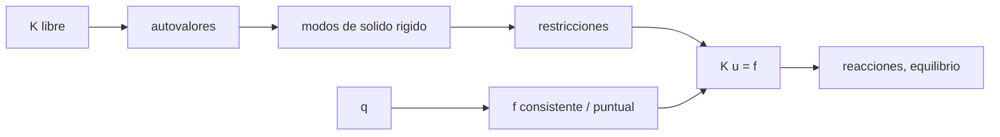

# B84-C28 — Condiciones de contorno y cargas en modelos de elementos finitos

<!-- nav:top -->
[🏠 Programa](../../../../README.md) · [📚 Bloque B84](../../../tronco-comun/B84-estructuras-materiales-y-fabricacion-espacial.md) · [← Anterior: B84-C27 — Tipos de elementos finitos: viga, placa y sólido](../B84-C27-tipos-de-elementos-finitos-viga-placa-y-solido/CLASE.md) · [Siguiente: B84-C29 — Concentraciones de tensión y entallas →](../B84-C29-concentraciones-de-tension-y-entallas/CLASE.md)
<!-- /nav -->

## 1. Ubicación, nivel y alcance

Clase 28 del bloque B84. Nivel N3. Un modelo mal restringido da resultados falsos aunque la malla sea perfecta. Aquí detectas los modos de sólido rígido de una viga libre, ves cómo las restricciones los eliminan, comparas cargas equivalentes consistentes y puntuales, verificas que las reacciones equilibren la carga y calculas la tensión térmica de una barra empotrada en ambos extremos. Viga y datos **ilustrativos**.

## 2. Por qué esta clase existe

Una restricción de menos deja la matriz singular; una de más introduce tensiones falsas; una carga mal repartida cambia la flecha 1,25 %: son los errores más frecuentes en los modelos. La decisión central: **¿está el modelo bien restringido y cargado y cómo lo demuestro?**

## 3. Lo que podrás hacer al terminar

1. Contar los modos de sólido rígido de un modelo libre.
2. Reconocer una restricción insuficiente.
3. Calcular cargas nodales equivalentes consistentes y puntuales.
4. Verificar el equilibrio de reacciones.
5. Calcular la tensión térmica de un elemento sobrerrestringido.
6. Rotular lo ilustrativo.

La evidencia es la **lista de verificación de apoyos y cargas** del ejercicio 12 (sección 20).

## 4. Con qué llegas y cómo comprobarlo

1. ¿Qué es un modo de sólido rígido?
2. ¿Qué es una matriz singular?
3. ¿Qué es una carga nodal equivalente?
4. ¿Qué es una reacción?
5. ¿Qué es la dilatación térmica?

<details>
<summary>Ver respuestas</summary>

1. Un movimiento sin deformación: traslación o giro. 2. Una sin inversa; `K u = f` no tiene solución única. 3. Las fuerzas y momentos en los nodos que reproducen una carga distribuida. 4. La fuerza que ejerce el apoyo. 5. El alargamiento `αΔT`; impedida, produce tensión.
</details>

Con cuatro o cinco aciertos, sigue; si no, repasa los prerrequisitos.

## 5. Un caso de contexto y casos de referencia

La viga plana libre de 8 elementos tiene `2` modos de sólido rígido; con un solo apoyo `w₀ = 0` queda `1` (giro); con dos apoyos simples, `0` y el menor autovalor es `257,46`. Con carga consistente la flecha central es `4,528986 mm` (exacta) y con cargas puntuales equivalentes `4,472373 mm` (`−1,25 %`). La barra empotrada con `ΔT = 50 K` tiene `σ = −79,35 MPa`. **Ejemplo conductor.** Datos ilustrativos.

## 6. Vocabulario

Un **modo de sólido rígido** tiene autovalor nulo. Las **cargas consistentes** de `q` uniforme son `[qL/2, qL²/12, qL/2, −qL²/12]`. La **reacción** es `R = K u − f` en los GDL restringidos. La **tensión térmica** impedida es `σ = −EαΔT`.

## 7. Modelo mental: una mesa con patas de menos o de más



*Descripción textual:* la matriz libre muestra los modos rígidos, las restricciones los eliminan, las cargas equivalentes cargan el modelo y las reacciones comprueban el equilibrio.

Analogía: una mesa con una pata de menos cojea (sigue moviéndose) y con una de más puede quedar tensionada. Límite: aquí el modelo es una viga plana; en 3D hay 6 modos de sólido rígido.

## 8. La explicación, paso a paso

### 8.1 Modos de sólido rígido

| Condición | Modos de sólido rígido |
|---|---|
| libre | 2 (traslación y giro) |
| `w₀ = 0` solamente | 1 (giro) |
| `w₀ = wₙ = 0` | 0 (menor autovalor `257,46`) |

### 8.2 Cargas equivalentes

Para `q = 100 N/m` y flecha central exacta `5qL⁴/(384EI) = 4,528986 mm`: la carga consistente la da exacta (`0,0000 %`); la puntual equivalente `[qL/2, 0]` da `4,472373 mm` (`−1,25 %`). En ambos casos las reacciones son `−50 N` y `−50 N` (suma `−100 N = −qL`).

### 8.3 Equilibrio

La suma de reacciones iguala la carga total: es la comprobación mínima de cualquier modelo.

### 8.4 Sobrerrestricción térmica

Barra de `A = 4 × 10⁻⁴ m²`, `α = 23 × 10⁻⁶ K⁻¹` y `ΔT = 50 K` empotrada en ambos extremos: `σ_FE = −79,35 MPa` frente a `−EαΔT = −79,35 MPa`. Con un extremo libre la tensión sería nula: la restricción de más crea la tensión.

## 9. Magnitudes, símbolos y unidades

| Símbolo | Qué es | Unidad | Valor / nota |
|---|---|---|---|
| `n_rb` | modos de sólido rígido | — | 2; 1; 0 |
| `q` | carga distribuida | N/m | 100 |
| `w_c` | flecha central | mm | 4,528986 |
| `R` | reacción | N | −50 |
| `σ_t` | tensión térmica | MPa | −79,35 |
| `α`, `ΔT` | dilatación y salto de temperatura | 1/K, K | 23e-6; 50 |

## 10. Convenciones y referencias

SI. Viga de Euler–Bernoulli plana, 8 elementos. Autovalor nulo si `λ/λ_máx < 10⁻¹⁰`. Cargas consistentes frente a puntuales. Aluminio ilustrativo.

## 11. De dónde sale lo que afirmamos

| ID | Fuente | Localizador | Respalda | Estado |
|---|---|---|---|---|
| — | Cargas consistentes y teoría de sólidos rígidos y térmica | — | las fórmulas, que verifica el laboratorio con la solución exacta | No consultada en una fuente concreta |

Límites: datos ilustrativos; no se modeló ninguna estructura real; sin 3D.

## 12. Cómo ver los apoyos y las cargas

| Magnitud | Valor |
|---|---|
| Modos rígidos (libre) | 2 |
| Con un apoyo | 1 |
| Error con carga puntual | −1,25 % |
| Suma de reacciones | −100 N |
| `σ_t` | −79,35 MPa |

Descripción larga: cada restricción faltante deja un modo de sólido rígido; cada restricción extra crea tensiones.

## 13. Ejemplo trabajado: la tensión térmica impedida

**Paso 1 · Deformación.** `αΔT = 23e-6 × 50 = 1,15 × 10⁻³`.

**Paso 2 · Tensión.** `σ = −Eα ΔT = −69 000 × 1,15e-3 = −79,35 MPa`.

## 14. Distintas formas de describir un apoyo y una carga

**Por autovalores:** modos de sólido rígido. **Por restricciones:** GDL fijados. **Por carga:** consistente o puntual. **Por reacción:** `R = Ku − f`. **Por temperatura:** `σ_t`.

## 15. Práctica guiada

**Ejercicio 1 · con los pasos indicados** ¿Cuántos modos rígidos tiene una viga 3D libre? *Pasos:* 3 traslaciones y 3 giros.

<details><summary>Solución comentada</summary>

6.
</details>

**Ejercicio 2 · con los pasos indicados** Calcula `qL/2` con `q = 100`, `L = 1`.

<details><summary>Solución comentada</summary>

`50 N`.
</details>

**Ejercicio 3 · con los pasos indicados** ¿Por qué la carga puntual equivalente da otra flecha? *Casi autónomo.*

<details><summary>Solución comentada</summary>

Porque omite los momentos `±qL²/12` en los nodos de cada elemento.
</details>

## 16. Práctica autónoma, transferencia e integrador

**Ejercicio 4 · autónomo** Suma de reacciones con `q = 200 N/m`.

<details><summary>Solución comentada</summary>

`−200 N`.
</details>

**Ejercicio 5 · autónomo** `σ_t` con `ΔT = 100 K`.

<details><summary>Solución comentada</summary>

`−158,7 MPa`.
</details>

**Ejercicio 6 · autónomo** Modos rígidos con apoyos `w₀ = 0` y `θ₀ = 0`.

<details><summary>Solución comentada</summary>

0 (empotramiento).
</details>

**Ejercicio 7 · autónomo** Error de la carga puntual con 2 elementos.

<details><summary>Solución comentada</summary>

Mayor que `1,25 %`.
</details>

**Ejercicio 8 · autónomo** ¿Qué pasa si solo se restringe `θ₀ = 0`?

<details><summary>Solución comentada</summary>

Queda el modo de traslación.
</details>

**Ejercicio 9 · transferencia. **Transferencia.**** El solver da «matriz singular». ¿Qué revisas primero?

<details><summary>Solución comentada</summary>

Las restricciones: modos de sólido rígido.
</details>

**Ejercicio 10 · transferencia. **Transferencia.**** Un modelo con apoyos redundantes da tensiones a temperatura uniforme. ¿Por qué?

<details><summary>Solución comentada</summary>

Por la dilatación impedida; se libera un GDL.
</details>

**Ejercicio 11 · transferencia. **Transferencia.**** ¿Cómo compruebas que una carga se aplicó bien?

<details><summary>Solución comentada</summary>

Con la suma de reacciones frente a la carga total.
</details>

**Ejercicio 12 · integrador. **Integrador.**** Elabora tu *lista de verificación de apoyos y cargas*: modos rígidos según las restricciones, cargas consistentes frente a puntuales, equilibrio de reacciones y el caso térmico.

<details><summary>Solución comentada</summary>

Secciones 8.1–8.4 y la salida del laboratorio.
</details>

## 17. Laboratorio: modos rígidos, cargas y equilibrio

El script [contorno.py](contorno.py) cuenta los modos de sólido rígido, compara cargas equivalentes, verifica reacciones y calcula la tensión térmica (**comprueba** 2, 1 y 0 modos rígidos, flecha consistente exacta (< 1e-9) y `σ_t = −EαΔT`).

**Datos:** viga y barra **ilustrativas**. **Predice antes de ejecutar:** ¿cuántos modos rígidos quedan con un solo apoyo `w₀ = 0`? (1.) **Ejecución del 2026-11-10 (Python 3.12.9):**

```text
Python 3.12.9 (biblioteca estandar)
Viga libre de 8 elementos (18 GDL): modos de solido rigido = 2 (esperados 2: traslacion y giro)
Con una sola restriccion w0 = 0: modos de solido rigido restantes = 1 (giro libre: el modelo sigue singular)
Con apoyos simples w0 = wn = 0: modos de solido rigido = 0; menor autovalor = 2.5746e+02
Carga consistente         : flecha central = 4.528986 mm (exacta 4.528986, error 0.0000 %) ; reacciones = -50.0000 N y -50.0000 N ; suma = -100.000000 N
Carga puntual equivalente : flecha central = 4.472373 mm (exacta 4.528986, error 1.2500 %) ; reacciones = -50.0000 N y -50.0000 N ; suma = -100.000000 N
Barra empotrada en ambos extremos con DeltaT = 50 K: sigma FE = -79.3500 MPa ; -E alpha DeltaT = -79.3500 MPa
Pruebas superadas.
```

```bash
python programa/clases/B84/B84-C28-condiciones-de-contorno-y-cargas-en-modelos-de-elementos-finitos/contorno.py
```

**Límites:** plano; sin contacto ni fricción; cargas estáticas.

## 18. Errores frecuentes y cómo corregirlos

**Resolver sin restricciones.** Se corrige con 8.1.

**Aplicar la carga distribuida solo en fuerzas.** Se corrige con 8.2.

**No comprobar reacciones.** Se corrige con 8.3.

**Sobrerrestringir sin querer.** Se corrige con 8.4.

## 19. Cómo sabrás que vas bien

Tras la sección 8: ¿cuántos modos rígidos esperabas? Si dudas, repasa el ejemplo 13. Tras el laboratorio: ¿qué comprueba? (ver la sección 17).

## 20. Qué entregas y cómo se evalúa

El producto es tu **lista de verificación de apoyos y cargas** (ejercicio 12).

| Criterio | Inicial | En desarrollo | Logrado | Destacado |
|---|---|---|---|---|
| Conceptos | Los confunde | Parciales | Verifica apoyos y cargas | Explica los límites |
| Cálculo | Sin unidades | Con errores | Tablas completas con unidades | Calcula casos nuevos |
| Numérico | Sin comprobar | Un caso | Contraste con una segunda vía | Interpreta las diferencias |
| Fuentes | Sin fuente | Sin fecha | Fuentes con fecha y estado | Declara lo ilustrativo y lo no consultado |
| Límites | No los nombra | Uno | Tres | Discute qué falta del modelo |

**Condiciones críticas (no se compensan con promedio):** rotular los datos ilustrativos y sintéticos como tales; no presentar un cálculo como ensayo ni como dato de vuelo; citar solo lo consultado.

## 21. Ética, seguridad y límites

Clase educativa: los modelos son simplificados y sus datos son sintéticos, ilustrativos o valores de estándar rotulados; **no es una base de diseño de hardware de vuelo** y ningún resultado sustituye a datos de material cualificados, a los documentos vigentes de la agencia o del lanzador ni a la revisión por personal competente. Accesibilidad: tablas equivalentes a las gráficas, fórmulas en texto, ejercicios sin conexión.

## 22. Para cerrar y seguir

Con dos apoyos simples no quedan modos rígidos y las reacciones suman `−100 N`; la carga puntual da `−1,25 %`. Queda una pregunta: ¿qué tensiones aparecen alrededor de un agujero?

**Glosario español–inglés.** condición de contorno · *boundary condition*; modo de sólido rígido · *rigid body mode*; reacción · *reaction*; carga consistente · *consistent load*; restricción · *constraint*.

**Continuidad.** [B84-C29](../B84-C29-concentraciones-de-tension-y-entallas/CLASE.md) estudia concentraciones de tensión y entallas.

**Referencias:** ver sección 11.

<!-- nav:bottom -->
---

[← Anterior: B84-C27 — Tipos de elementos finitos: viga, placa y sólido](../B84-C27-tipos-de-elementos-finitos-viga-placa-y-solido/CLASE.md) · [📚 Bloque B84](../../../tronco-comun/B84-estructuras-materiales-y-fabricacion-espacial.md) · [Siguiente: B84-C29 — Concentraciones de tensión y entallas →](../B84-C29-concentraciones-de-tension-y-entallas/CLASE.md)
<!-- /nav -->
