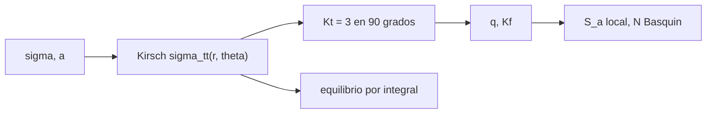

# B84-C29 — Concentraciones de tensión y entallas

<!-- nav:top -->
[🏠 Programa](../../../../README.md) · [📚 Bloque B84](../../../tronco-comun/B84-estructuras-materiales-y-fabricacion-espacial.md) · [← Anterior: B84-C28 — Condiciones de contorno y cargas en modelos de elementos finitos](../B84-C28-condiciones-de-contorno-y-cargas-en-modelos-de-elementos-finitos/CLASE.md) · [Siguiente: B84-C30 — Correlación modelo-ensayo y actualización de modelos →](../B84-C30-correlacion-modelo-ensayo-y-actualizacion-de-modelos/CLASE.md)
<!-- /nav -->

## 1. Ubicación, nivel y alcance

Clase 29 del bloque B84. Nivel N3. Un agujero o un cambio de sección concentra la tensión y es el origen habitual de las grietas de fatiga. Aquí calculas con la solución analítica de Kirsch la tensión alrededor de un agujero circular en una placa **ilustrativa**, verificas el equilibrio de fuerzas por integración numérica, aplicas una corrección empírica de ancho finito (no consultada) y calculas el factor de entalla a fatiga `K_f` con sensibilidad `q`.

## 2. Por qué esta clase existe

Una tensión remota de 100 MPa se triplica a 300 MPa en el borde de un agujero; con `K_f = 2,8` la vida baja de 10¹¹ a 10⁷ ciclos. La decisión central: **¿qué tensión local y qué vida resultan de un agujero en una placa cargada?**

## 3. Lo que podrás hacer al terminar

1. Calcular `σ_θθ` de Kirsch alrededor de un agujero.
2. Obtener `K_t = 3` y el decaimiento con la distancia.
3. Verificar el equilibrio por integración numérica.
4. Aplicar la corrección de ancho finito (rotulada como empírica).
5. Calcular `K_f = 1 + q(K_t − 1)`.
6. Estimar la vida con y sin entalla.

La evidencia es la **ficha de concentración en un agujero** del ejercicio 12 (sección 20).

## 4. Con qué llegas y cómo comprobarlo

1. ¿Qué es un factor de concentración de tensión?
2. ¿Qué es una coordenada polar?
3. ¿Qué es la sensibilidad a la entalla `q`?
4. ¿Qué es una integral numérica de Simpson?
5. ¿Qué es Basquin?

<details>
<summary>Ver respuestas</summary>

1. El cociente entre la tensión máxima local y la nominal. 2. `(r, θ)`: distancia y ángulo. 3. El grado en que un material reduce el efecto teórico de una entalla en fatiga. 4. Una regla con ponderación 1-4-2-4-…-1. 5. `S_a = S_f′ (2N)^b` (C08).
</details>

Con cuatro o cinco aciertos, sigue; si no, repasa los prerrequisitos.

## 5. Un caso de contexto y casos de referencia

Una placa infinita con agujero de `a = 5 mm` y `σ = 100 MPa` tiene `σ_θθ = 300 MPa` en `θ = 90°` (`K_t = 3`), `200` a 60°, `0` a 30° y `−100` a 0°. A `r/a = 2`, `1,219σ`; a `r/a = 5`, `1,022σ`. Con `a_p = 0,5 mm` el agujero de 5 mm da `q = 0,909` y `K_f = 2,818`; con `S_a = 60 MPa` la vida baja de `2,9 × 10¹¹` a `9,1 × 10⁶` ciclos. **Ejemplo conductor.** Datos ilustrativos.

## 6. Vocabulario

La **solución de Kirsch** da `σ_θθ = σ/2[(1 + a²/r²) − (1 + 3a⁴/r⁴) cos 2θ]`. En el borde `σ_θθ = σ(1 − 2cos 2θ)`. El **factor teórico** `K_t = σ_máx/σ_nom`. La **sensibilidad** `q = 1/(1 + a_p/r)` da el **factor de fatiga** `K_f = 1 + q(K_t − 1)`.

## 7. Modelo mental: un río que se estrecha alrededor de una roca



*Descripción textual:* Kirsch da el campo y el factor teórico; la integral verifica el equilibrio; con la sensibilidad se pasa a `K_f` y a la vida.

Analogía: un río que se estrecha alrededor de una roca acelera en los costados: las líneas de fuerza se apiñan. Límite: Kirsch es para placa infinita, material elástico lineal y agujero circular; con ancho finito o plasticidad cambia.

## 8. La explicación, paso a paso

### 8.1 Campo de Kirsch

| `θ` (°) | `σ_θθ` (MPa) en el borde | `K_t` local |
|---|---|---|
| 0 | −100 | −1 |
| 30 | 0 | 0 |
| 60 | 200 | 2 |
| 90 | 300 | 3 |

A lo largo de `θ = 90°`: `r/a = 1; 1,25; 1,5; 2; 3; 5` da `3,000; 1,934; 1,519; 1,219; 1,074; 1,022` veces `σ`: la perturbación es local.

### 8.2 Equilibrio

`∫_a^∞ (σ_θθ − σ) dr = σ a = 0,5 MPa·m` por integración numérica (Simpson, cambio de variable `t = a/r`) con diferencia `2 × 10⁻¹²`: el campo conserva la fuerza.

### 8.3 Ancho finito (empírico, no consultado)

`K_t,neto = 3 − 3,14x + 3,667x² − 1,527x³`, `x = d/w`: `3,000; 2,721; 2,506; 2,347; 2,156` para `x = 0; 0,1; 0,2; 0,3; 0,5`. Referido a la tensión bruta, el factor sube a `3,023; 3,133; 3,353; 4,312`: el ancho finito agrava la tensión.

### 8.4 Fatiga

`q = 1/(1 + 0,5/r)`: `r = 1; 2; 5; 10 mm` da `0,667; 0,800; 0,909; 0,952` y `K_f = 2,333; 2,600; 2,818; 2,905`. Con `S_a = 60 MPa`, `S_f′ = 900`, `b = −0,10`: sin entalla `N = 2,88 × 10¹¹`; con `K_f = 2,818`, `S_a = 169,1 MPa` y `N = 9,12 × 10⁶`.

## 9. Magnitudes, símbolos y unidades

| Símbolo | Qué es | Unidad | Valor / nota |
|---|---|---|---|
| `σ` | tensión remota | MPa | 100 |
| `a` | radio del agujero | mm | 5 |
| `σ_θθ` | tensión circunferencial | MPa | 300 (máx.) |
| `K_t` | factor teórico | — | 3 |
| `q` | sensibilidad a la entalla | — | 0,909 |
| `K_f` | factor de fatiga | — | 2,818 |

## 10. Convenciones y referencias

MPa y mm. Placa infinita, tensión uniaxial en `x`, `θ` desde el eje de carga. Constante `a_p = 0,5 mm` ilustrativa. La corrección de ancho finito es una fórmula empírica recordada, no consultada.

## 11. De dónde sale lo que afirmamos

| ID | Fuente | Localizador | Respalda | Estado |
|---|---|---|---|---|
| — | Solución de Kirsch, fórmulas empíricas de ancho finito y sensibilidad a la entalla de Peterson | — | las fórmulas (Kirsch lo verifica el equilibrio) y los valores de `a_p`, `S_f′` y `b` | No consultada en una fuente concreta |

Límites: datos ilustrativos; la fórmula de ancho finito y `q` no se consultaron en una fuente concreta; sin plasticidad.

## 12. Cómo ver la concentración

| Magnitud | Valor |
|---|---|
| `K_t` | 3,000 |
| `σ_θθ` a 90° | 300 MPa |
| `σ_θθ/σ` a `r/a = 2` | 1,219 |
| `K_f` | 2,818 |
| `N` con entalla | 9,12 × 10⁶ |

Descripción larga: la tensión se triplica en el borde y vuelve al nominal a unos 5 radios; en fatiga la vida cae 4 órdenes de magnitud.

## 13. Ejemplo trabajado: la tensión en el borde a 60°

**Paso 1 · Borde.** `σ_θθ = σ(1 − 2cos 2θ)`.

**Paso 2 · Ángulo.** `cos 120° = −0,5`.

**Paso 3 · Número.** `100 × (1 + 1) = 200 MPa`.

## 14. Distintas formas de describir una concentración

**Por campo:** `σ_θθ(r, θ)`. **Por factor:** `K_t`, `K_f`. **Por decaimiento:** `r/a`. **Por ancho:** `d/w`. **Por vida:** Basquin.

## 15. Práctica guiada

**Ejercicio 1 · con los pasos indicados** Calcula `σ_θθ` a `θ = 0`. *Pasos:* `100 (1 − 2)`.

<details><summary>Solución comentada</summary>

`−100 MPa`.
</details>

**Ejercicio 2 · con los pasos indicados** Calcula `K_f` con `q = 0,8` y `K_t = 3`. *Pista:* `1 + q(K_t − 1)`.

<details><summary>Solución comentada</summary>

`2,6`.
</details>

**Ejercicio 3 · con los pasos indicados** ¿Por qué la tensión es negativa a 0°? *Casi autónomo.*

<details><summary>Solución comentada</summary>

Porque a lo largo del eje de carga el borde del agujero queda comprimido.
</details>

## 16. Práctica autónoma, transferencia e integrador

**Ejercicio 4 · autónomo** `σ_θθ` a `r/a = 2` y 90° con `σ = 150`.

<details><summary>Solución comentada</summary>

`1,219 × 150 = 182,9 MPa`.
</details>

**Ejercicio 5 · autónomo** `q` con `r = 3 mm`, `a_p = 0,5`.

<details><summary>Solución comentada</summary>

`0,857`.
</details>

**Ejercicio 6 · autónomo** `S_a` local con `K_f = 2,5` y `S_a` nominal 80.

<details><summary>Solución comentada</summary>

`200 MPa`.
</details>

**Ejercicio 7 · autónomo** `K_t` con `d/w = 0,25`.

<details><summary>Solución comentada</summary>

`2,42` (empírica).
</details>

**Ejercicio 8 · autónomo** Efecto de duplicar `σ`.

<details><summary>Solución comentada</summary>

`σ_máx = 600 MPa`.
</details>

**Ejercicio 9 · transferencia. **Transferencia.**** Un diseñador usa `K_t = 3` en un agujero de 0,5 mm en un material sensible. ¿Qué cambia?

<details><summary>Solución comentada</summary>

`q` baja y `K_f` es menor que 3.
</details>

**Ejercicio 10 · transferencia. **Transferencia.**** Un agujero se redondea con radio de borde. ¿Qué haces con `K_t`?

<details><summary>Solución comentada</summary>

Se usa el `K_t` de la geometría real, no el de Kirsch.
</details>

**Ejercicio 11 · transferencia. **Transferencia.**** Dos agujeros cercanos. ¿Vale Kirsch?

<details><summary>Solución comentada</summary>

No: interactúan; se usa elementos finitos.
</details>

**Ejercicio 12 · integrador. **Integrador.**** Elabora tu *ficha de concentración en un agujero*: campo de Kirsch, decaimiento, equilibrio, efecto del ancho finito, `K_f` y vida, rotulando lo empírico y lo ilustrativo.

<details><summary>Solución comentada</summary>

Secciones 8.1–8.4 y la salida del laboratorio.
</details>

## 17. Laboratorio: Kirsch, equilibrio y factor de entalla

El script [entallas.py](entallas.py) evalúa el campo de Kirsch, verifica el equilibrio por Simpson y calcula `K_f` y la vida (**comprueba** el equilibrio `∫(σ_θθ − σ)dr = σ a` (< 1e-6)).

**Datos:** placa **ilustrativa**; fórmulas empíricas **no consultadas**. **Predice antes de ejecutar:** ¿cuánto vale `K_t`? (3.) **Ejecución del 2026-11-10 (Python 3.12.9):**

```text
Python 3.12.9 (biblioteca estandar)
Placa con agujero de radio a = 5 mm y tension remota 100 MPa (ILUSTRATIVO)
Tension circunferencial en el borde del agujero (Kirsch):
  theta =  0 grados: sigma_tt = -100.000 MPa  (Kt local = -1.00)
  theta = 30 grados: sigma_tt =   -0.000 MPa  (Kt local = -0.00)
  theta = 60 grados: sigma_tt =  200.000 MPa  (Kt local =  2.00)
  theta = 90 grados: sigma_tt =  300.000 MPa  (Kt local =  3.00)
Decaimiento a lo largo del eje y (theta = 90 grados): sigma_tt(r)/sigma
  r/a = 1.00:  3.000
  r/a = 1.25:  1.934
  r/a = 1.50:  1.519
  r/a = 2.00:  1.219
  r/a = 3.00:  1.074
  r/a = 5.00:  1.022
Equilibrio: int_a^inf (sigma_tt - sigma) dr = 5.000000e-01 MPa m ; sigma a = 5.000000e-01 ; dif relativa = 2.1e-12
Ancho finito (aproximacion empirica NO consultada) Kt respecto de la tension neta frente a d/w:
  d/w = 0.0: Kt_neto = 3.000 ; sigma_max = Kt (sigma_bruta/(1 - d/w)) -> factor sobre la tension bruta = 3.000
  d/w = 0.1: Kt_neto = 2.721 ; sigma_max = Kt (sigma_bruta/(1 - d/w)) -> factor sobre la tension bruta = 3.023
  d/w = 0.2: Kt_neto = 2.506 ; sigma_max = Kt (sigma_bruta/(1 - d/w)) -> factor sobre la tension bruta = 3.133
  d/w = 0.3: Kt_neto = 2.347 ; sigma_max = Kt (sigma_bruta/(1 - d/w)) -> factor sobre la tension bruta = 3.353
  d/w = 0.5: Kt_neto = 2.156 ; sigma_max = Kt (sigma_bruta/(1 - d/w)) -> factor sobre la tension bruta = 4.312
Factor de entalla a fatiga: Kf = 1 + q (Kt - 1), q = 1/(1 + a_p/r) con a_p = 0,5 mm (ILUSTRATIVO):
  radio de entalla r =  1.0 mm: q = 0.667  Kf = 2.333
  radio de entalla r =  2.0 mm: q = 0.800  Kf = 2.600
  radio de entalla r =  5.0 mm: q = 0.909  Kf = 2.818
  radio de entalla r = 10.0 mm: q = 0.952  Kf = 2.905
Agujero de 5 mm: q = 0.909, Kf = 2.818
Vida con Basquin (S_a nominal 60 MPa, R = -1): sin entalla frente a con entalla
  Kf = 1.000: S_a local =   60.00 MPa -> N = 2.883e+11 ciclos
  Kf = 2.818: S_a local =  169.09 MPa -> N = 9.124e+06 ciclos
Pruebas superadas.
```

```bash
python programa/clases/B84/B84-C29-concentraciones-de-tension-y-entallas/entallas.py
```

**Límites:** placa infinita elástica; sin plasticidad ni interacción.

## 18. Errores frecuentes y cómo corregirlos

**Usar `K_t` directo en fatiga.** Se corrige con 8.4.

**Olvidar el ancho finito.** Se corrige con 8.3.

**Aplicar Kirsch a agujeros con borde.** Se corrige con transferencia 10.

**Confundir tensión nominal bruta y neta.** Se corrige con 8.3.

## 19. Cómo sabrás que vas bien

Tras la sección 8: ¿qué `σ` esperabas a 90°? Si dudas, repasa el ejemplo 13. Tras el laboratorio: ¿qué comprueba? (ver la sección 17).

## 20. Qué entregas y cómo se evalúa

El producto es tu **ficha de concentración en un agujero** (ejercicio 12).

| Criterio | Inicial | En desarrollo | Logrado | Destacado |
|---|---|---|---|---|
| Conceptos | Los confunde | Parciales | Calcula concentraciones y `K_f` | Explica los límites |
| Cálculo | Sin unidades | Con errores | Tablas completas con unidades | Calcula casos nuevos |
| Numérico | Sin comprobar | Un caso | Contraste con una segunda vía | Interpreta las diferencias |
| Fuentes | Sin fuente | Sin fecha | Fuentes con fecha y estado | Declara lo ilustrativo y lo no consultado |
| Límites | No los nombra | Uno | Tres | Discute qué falta del modelo |

**Condiciones críticas (no se compensan con promedio):** rotular los datos ilustrativos y sintéticos como tales; no presentar un cálculo como ensayo ni como dato de vuelo; citar solo lo consultado.

## 21. Ética, seguridad y límites

Clase educativa: los modelos son simplificados y sus datos son sintéticos, ilustrativos o valores de estándar rotulados; **no es una base de diseño de hardware de vuelo** y ningún resultado sustituye a datos de material cualificados, a los documentos vigentes de la agencia o del lanzador ni a la revisión por personal competente. Accesibilidad: tablas equivalentes a las gráficas, fórmulas en texto, ejercicios sin conexión.

## 22. Para cerrar y seguir

El agujero triplica la tensión (`300 MPa`) y con `K_f = 2,818` la vida baja a `9,1 × 10⁶` ciclos. Queda una pregunta: ¿cómo se compara el modelo con el ensayo?

**Glosario español–inglés.** concentración de tensión · *stress concentration*; entalla · *notch*; solución de Kirsch · *Kirsch solution*; sensibilidad a la entalla · *notch sensitivity*; agujero · *hole*.

**Continuidad.** [B84-C30](../B84-C30-correlacion-modelo-ensayo-y-actualizacion-de-modelos/CLASE.md) estudia la correlación modelo-ensayo y la actualización de modelos.

**Referencias:** ver sección 11.

<!-- nav:bottom -->
---

[← Anterior: B84-C28 — Condiciones de contorno y cargas en modelos de elementos finitos](../B84-C28-condiciones-de-contorno-y-cargas-en-modelos-de-elementos-finitos/CLASE.md) · [📚 Bloque B84](../../../tronco-comun/B84-estructuras-materiales-y-fabricacion-espacial.md) · [Siguiente: B84-C30 — Correlación modelo-ensayo y actualización de modelos →](../B84-C30-correlacion-modelo-ensayo-y-actualizacion-de-modelos/CLASE.md)
<!-- /nav -->
