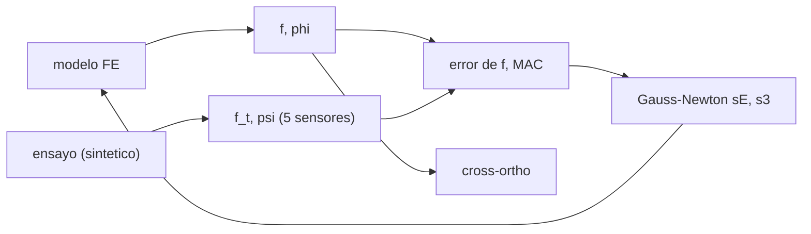

# B84-C30 — Correlación modelo-ensayo y actualización de modelos

<!-- nav:top -->
[🏠 Programa](../../../../README.md) · [📚 Bloque B84](../../../tronco-comun/B84-estructuras-materiales-y-fabricacion-espacial.md) · [← Anterior: B84-C29 — Concentraciones de tensión y entallas](../B84-C29-concentraciones-de-tension-y-entallas/CLASE.md) · [Siguiente: B84-C31 — Documentación y revisión de análisis de elementos finitos →](../B84-C31-documentacion-y-revision-de-analisis-de-elementos-finitos/CLASE.md)
<!-- /nav -->

## 1. Ubicación, nivel y alcance

Clase 30 del bloque B84. Nivel N3. Un modelo estructural se acepta cuando coincide con el ensayo. Aquí correlacionas un modelo de viga con un «ensayo» **sintético** (rigidez global 6 % mayor, un elemento 30 % más blando y ruido), con los criterios del GEVS (consultados): frecuencias dentro de 5 % y ortogonalidad cruzada ≥ 0,9 en la diagonal y ≤ 0,1 fuera. Calculas MAC, actualizas dos parámetros por mínimos cuadrados no lineales y discutes qué se puede identificar. El ensayo no es real.

## 2. Por qué esta clase existe

Un MAC de 0,999 no basta: puede coexistir con un error de 3,6 % en frecuencia, y actualizar parámetros que no se pueden identificar da un modelo que ajusta pero no es físico. La decisión central: **¿cumple el modelo los criterios de correlación y qué parámetros se pueden actualizar con los datos?**

## 3. Lo que podrás hacer al terminar

1. Calcular el MAC entre formas modales.
2. Calcular la ortogonalidad cruzada con la matriz de masa.
3. Comparar frecuencias con el criterio de 5 %.
4. Actualizar parámetros por Gauss–Newton.
5. Evaluar la identificabilidad de los parámetros.
6. Rotular lo sintético y lo consultado.

La evidencia es la **informe de correlación modelo-ensayo** del ejercicio 12 (sección 20).

## 4. Con qué llegas y cómo comprobarlo

1. ¿Qué es el MAC?
2. ¿Qué es la matriz de masa?
3. ¿Qué es una actualización de modelo?
4. ¿Qué es Gauss–Newton?
5. ¿Qué es la identificabilidad?

<details>
<summary>Ver respuestas</summary>

1. Un índice de correlación entre dos formas modales, entre 0 y 1. 2. La que pondera la inercia en `φᵀMφ`. 3. Ajustar parámetros para que el modelo reproduzca el ensayo. 4. Un método de mínimos cuadrados no lineales. 5. Que los datos fijen los parámetros de forma única.
</details>

Con cuatro o cinco aciertos, sigue; si no, repasa los prerrequisitos.

## 5. Un caso de contexto y casos de referencia

El «ensayo» (`s_E = 1,06`, `s₃ = 0,70`) da `8,083; 53,101; 146,067 Hz`; el modelo inicial `8,166; 51,179; 143,334` (errores `+1,03; −3,62; −1,87 %`) con MAC `0,9999; 0,9997; 0,9993`. Tras actualizar, `s_E = 1,0908` y `s₃ = 0,6328` (distintos de los verdaderos), errores `0,57; 0,33; −0,91 %`. **Ejemplo conductor.** Ensayo sintético; criterios del GEVS consultados.

## 6. Vocabulario

El **MAC** es `(φᵀψ)²/((φᵀφ)(ψᵀψ))`. La **ortogonalidad cruzada** es `X = φ_modeloᵀ M ψ_ensayo`. El GEVS pide diagonal ≥ 0,9 y fuera ≤ 0,1, y frecuencias dentro de 5 %. La **actualización** minimiza el error relativo de frecuencias en `(s_E, s₃)`.

## 7. Modelo mental: afinar un instrumento comparándolo con una nota patrón



*Descripción textual:* el modelo y el ensayo se comparan por frecuencia, MAC y ortogonalidad cruzada; una actualización de parámetros cierra el ciclo.

Analogía: afinar una guitarra con un diapasón: se ajusta la cuerda hasta igualar la nota, pero dos ajustes distintos pueden dar la misma nota. Límite: tres frecuencias no determinan dos parámetros con seguridad (aquí no se recuperan los verdaderos).

## 8. La explicación, paso a paso

### 8.1 Antes de actualizar

| Modo | `f` ensayo (Hz) | `f` modelo (Hz) | Error (%) | MAC |
|---|---|---|---|---|
| 1 | 8,083 | 8,166 | 1,03 | 0,9999 |
| 2 | 53,101 | 51,179 | −3,62 | 0,9997 |
| 3 | 146,067 | 143,334 | −1,87 | 0,9993 |

El modelo ya cumple el criterio de 5 % y de ortogonalidad (`diagonal ≥ 0,9999`, fuera `0,0055`).

### 8.2 Actualización

Gauss–Newton sobre `(s_E, s₃)` con 3 frecuencias da `s_E = 1,0908` y `s₃ = 0,6328` (verdaderos `1,06` y `0,70`). Errores: `0,57; 0,33; −0,91 %`; MAC `1,0000; 0,9998; 0,9996`; fuera de la diagonal `0,0018`.

### 8.3 Lectura

El error máximo baja de `3,62 %` a `0,91 %`, pero los parámetros se alejan de los verdaderos: dos parámetros con tres frecuencias ruidosas son casi equivalentes (`s_E` alto con `s₃` bajo). El MAC cercano a 1 no distingue estos modelos: es insensible a escalas globales.

### 8.4 Qué documentar

Frecuencias antes y después, MAC, ortogonalidad cruzada, parámetros actualizados con su rango físico y una nota de identificabilidad; el modelo actualizado no es la «verdad», es un modelo que ajusta.

## 9. Magnitudes, símbolos y unidades

| Símbolo | Qué es | Unidad | Valor / nota |
|---|---|---|---|
| `MAC` | criterio de aseguramiento modal | — | 0,9999 → 1,0000 |
| `X` | ortogonalidad cruzada | — | diag ≥ 0,9999 |
| `s_E`, `s₃` | factores de rigidez | — | 1,0908; 0,6328 |
| `f` | frecuencia | Hz | 8,083; 53,101; 146,067 |
| error | `(f_m − f_t)/f_t` | % | −3,62 → 0,33 |
| 5 sensores | nodos 2, 4, 6, 8, 10 | — | — |

## 10. Convenciones y referencias

Viga de 10 elementos como en C10. Ensayo sintético con ruido de 1 % en frecuencia y 2 % en forma (semilla 84030). Criterios del GEVS: frecuencias dentro de 5 %; ortogonalidad cruzada ≥ 0,9 y ≤ 0,1.

## 11. De dónde sale lo que afirmamos

| ID | Fuente | Localizador | Respalda | Estado |
|---|---|---|---|---|
| S1 | NASA/GSFC, GSFC-STD-7000 (GEVS) Versión B, Cambio 0, 2021-04-28 — https://standards.nasa.gov/standard/gsfc/gsfc-std-7000 (PDF descargado y leído con PyMuPDF el 2026-11-10) | sección 2.4 (página 58 del PDF, 2.4-7) | el criterio de ortogonalidad cruzada (≥ 0,9 en la diagonal, ≤ 0,1 fuera) y de frecuencias dentro de 5 % | Consultada |
| — | Método de actualización de modelos y el «ensayo» del ejemplo | — | el ensayo es sintético y el método Gauss–Newton es estándar | No consultada en una fuente concreta |

Límites: el ensayo es sintético; solo se leyeron los criterios citados del GEVS; la actualización no se comparó con otro método.

## 12. Cómo ver la correlación

| Magnitud | Valor |
|---|---|
| Error máx. antes | 3,62 % |
| Error máx. después | 0,91 % |
| MAC mínimo después | 0,9996 |
| Fuera de la diagonal | 0,0018 |
| `s_E`, `s₃` | 1,0908; 0,6328 |

Descripción larga: el modelo cumple los criterios antes y después; la actualización mejora el error pero no recupera los parámetros verdaderos.

## 13. Ejemplo trabajado: el error del modo 2

**Paso 1 · Diferencia.** `51,179 − 53,101 = −1,922 Hz`.

**Paso 2 · Relativo.** `−1,922/53,101 = −3,62 %`.

**Paso 3 · Criterio.** Dentro de 5 %: cumple.

## 14. Distintas formas de describir una correlación

**Por frecuencia:** error relativo. **Por forma:** MAC. **Por masa:** ortogonalidad cruzada. **Por parámetros:** actualización. **Por identificabilidad:** unicidad.

## 15. Práctica guiada

**Ejercicio 1 · con los pasos indicados** Calcula el error del modo 1 (`8,166` frente a `8,083`). *Pasos:* `(8,166 − 8,083)/8,083`.

<details><summary>Solución comentada</summary>

`1,03 %`.
</details>

**Ejercicio 2 · con los pasos indicados** ¿Qué valor tiene el MAC de dos formas idénticas? *Pista:* `(φᵀφ)²/(φᵀφ)²`.

<details><summary>Solución comentada</summary>

`1`.
</details>

**Ejercicio 3 · con los pasos indicados** ¿Por qué MAC 0,9999 no basta? *Casi autónomo.*

<details><summary>Solución comentada</summary>

Porque no ve diferencias de escala: la frecuencia puede diferir 3,6 % con MAC casi 1.
</details>

## 16. Práctica autónoma, transferencia e integrador

**Ejercicio 4 · autónomo** Error del modo 3 antes de actualizar.

<details><summary>Solución comentada</summary>

`−1,87 %`.
</details>

**Ejercicio 5 · autónomo** ¿Cumple el criterio GEVS de frecuencias el modelo inicial?

<details><summary>Solución comentada</summary>

Sí: 3,62 % es menor que 5 %.
</details>

**Ejercicio 6 · autónomo** `MAC` de `[1, 2]` y `[2, 4]`.

<details><summary>Solución comentada</summary>

`1`.
</details>

**Ejercicio 7 · autónomo** `MAC` de `[1, 0]` y `[0, 1]`.

<details><summary>Solución comentada</summary>

`0`.
</details>

**Ejercicio 8 · autónomo** ¿Cuántos parámetros puedes actualizar con 3 frecuencias?

<details><summary>Solución comentada</summary>

Como mucho 3, y con cautela.
</details>

**Ejercicio 9 · transferencia. **Transferencia.**** Una actualización iguala las 3 frecuencias con `s₃ = 0,63`. ¿Es un daño real del 37 %?

<details><summary>Solución comentada</summary>

No necesariamente: puede ser un artefacto de identificabilidad; hace falta evidencia física.
</details>

**Ejercicio 10 · transferencia. **Transferencia.**** El MAC es 0,99 y la frecuencia difiere 12 %. ¿Está correlacionado?

<details><summary>Solución comentada</summary>

No: falla el criterio de 5 %.
</details>

**Ejercicio 11 · transferencia. **Transferencia.**** ¿Qué haces si falla la ortogonalidad cruzada en un modo?

<details><summary>Solución comentada</summary>

Revisas la distribución de masa y rigidez y el número de sensores.
</details>

**Ejercicio 12 · integrador. **Integrador.**** Elabora tu *informe de correlación modelo-ensayo*: errores de frecuencia, MAC, ortogonalidad cruzada antes y después, parámetros actualizados y nota de identificabilidad, rotulando el ensayo como sintético.

<details><summary>Solución comentada</summary>

Secciones 8.1–8.4 y la salida del laboratorio.
</details>

## 17. Laboratorio: MAC, ortogonalidad cruzada y actualización

El script [correlacion.py](correlacion.py) correlaciona el modelo con un ensayo sintético y actualiza dos parámetros por Gauss–Newton (**comprueba** error de frecuencia menor tras actualizar y bajo 5 %).

**Datos:** ensayo **sintético**; criterios del GEVS **consultados**. **Predice antes de ejecutar:** ¿se recuperarán `s_E = 1,06` y `s₃ = 0,70`? (no: 1,0908 y 0,6328.) **Ejecución del 2026-11-10 (Python 3.12.9):**

```text
Python 3.12.9 (biblioteca estandar)
'Ensayo' SINTETICO: sE = 1,06 y s3 = 0,70 (desconocidos para el modelo) con ruido de 1 % en frecuencias y 2 % en formas
Antes de actualizar (modelo sE = 1, s3 = 1):
 modo  f ensayo [Hz]  f modelo [Hz]  error [%]   MAC
  1          8.083          8.166       1.03   0.9999
  2         53.101         51.179      -3.62   0.9997
  3        146.067        143.334      -1.87   0.9993
Parametros actualizados por Gauss-Newton: sE = 1.0908, s3 = 0.6328 (verdaderos 1,06 y 0,70; 3 frecuencias para 2 parametros)
Despues de actualizar:
 modo  f ensayo [Hz]  f modelo [Hz]  error [%]   MAC
  1          8.083          8.129       0.57   1.0000
  2         53.101         53.275       0.33   0.9998
  3        146.067        144.736      -0.91   0.9996
Ortogonalidad cruzada phi_modelo^T M psi_ensayo (formas completas del ensayo sintetico, masa del modelo actualizado):
  antes    diagonal = 1.0000, 1.0000, 0.9993 ; maximo fuera de la diagonal = 0.0055 ; criterio GEVS (>= 0,9 y <= 0,1): cumple
  despues  diagonal = 1.0000, 1.0000, 0.9999 ; maximo fuera de la diagonal = 0.0018 ; criterio GEVS (>= 0,9 y <= 0,1): cumple
Error maximo de frecuencia: antes = 3.62 %, despues = 0.91 % (criterio GEVS: dentro de 5 %)
Pruebas superadas.
```

```bash
python programa/clases/B84/B84-C30-correlacion-modelo-ensayo-y-actualizacion-de-modelos/correlacion.py
```

**Límites:** 3 frecuencias para 2 parámetros; ruido pequeño; sin amortiguamiento.

## 18. Errores frecuentes y cómo corregirlos

**Confiar en el MAC solo.** Se corrige con 8.3.

**Actualizar más parámetros que datos.** Se corrige con 8.3.

**Tomar el modelo actualizado por la verdad.** Se corrige con 8.4.

**Presentar el ensayo sintético como real.** Se corrige con la sección 10.

## 19. Cómo sabrás que vas bien

Tras la sección 8: ¿qué error esperabas tras actualizar? Si dudas, repasa el ejemplo 13. Tras el laboratorio: ¿qué comprueba? (ver la sección 17).

## 20. Qué entregas y cómo se evalúa

El producto es tu **informe de correlación modelo-ensayo** (ejercicio 12).

| Criterio | Inicial | En desarrollo | Logrado | Destacado |
|---|---|---|---|---|
| Conceptos | Los confunde | Parciales | Correlaciona y actualiza un modelo | Explica los límites |
| Cálculo | Sin unidades | Con errores | Tablas completas con unidades | Calcula casos nuevos |
| Numérico | Sin comprobar | Un caso | Contraste con una segunda vía | Interpreta las diferencias |
| Fuentes | Sin fuente | Sin fecha | Fuentes con fecha y estado | Declara lo ilustrativo y lo no consultado |
| Límites | No los nombra | Uno | Tres | Discute qué falta del modelo |

**Condiciones críticas (no se compensan con promedio):** rotular los datos ilustrativos y sintéticos como tales; no presentar un cálculo como ensayo ni como dato de vuelo; citar solo lo consultado.

## 21. Ética, seguridad y límites

Clase educativa: los modelos son simplificados y sus datos son sintéticos, ilustrativos o valores de estándar rotulados; **no es una base de diseño de hardware de vuelo** y ningún resultado sustituye a datos de material cualificados, a los documentos vigentes de la agencia o del lanzador ni a la revisión por personal competente. Accesibilidad: tablas equivalentes a las gráficas, fórmulas en texto, ejercicios sin conexión.

## 22. Para cerrar y seguir

El error máximo baja de `3,62 %` a `0,91 %`, pero `s₃` queda en `0,63` en vez de `0,70`. Queda una pregunta: ¿cómo se documenta un análisis para que otro lo revise?

**Glosario español–inglés.** correlación · *correlation*; criterio de aseguramiento modal · *modal assurance criterion (MAC)*; ortogonalidad cruzada · *cross-orthogonality*; actualización de modelo · *model updating*; identificabilidad · *identifiability*.

**Continuidad.** [B84-C31](../B84-C31-documentacion-y-revision-de-analisis-de-elementos-finitos/CLASE.md) estudia la documentación y revisión de análisis de elementos finitos.

**Referencias:** ver sección 11.

<!-- nav:bottom -->
---

[← Anterior: B84-C29 — Concentraciones de tensión y entallas](../B84-C29-concentraciones-de-tension-y-entallas/CLASE.md) · [📚 Bloque B84](../../../tronco-comun/B84-estructuras-materiales-y-fabricacion-espacial.md) · [Siguiente: B84-C31 — Documentación y revisión de análisis de elementos finitos →](../B84-C31-documentacion-y-revision-de-analisis-de-elementos-finitos/CLASE.md)
<!-- /nav -->
