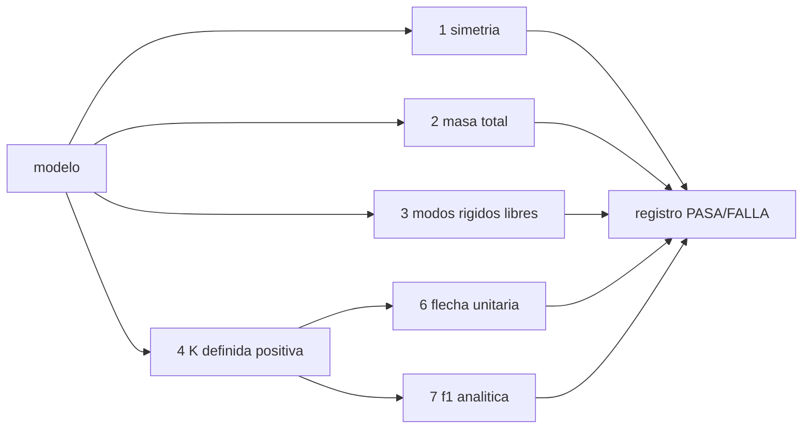

# B84-C31 — Documentación y revisión de análisis de elementos finitos

<!-- nav:top -->
[🏠 Programa](../../../../README.md) · [📚 Bloque B84](../../../tronco-comun/B84-estructuras-materiales-y-fabricacion-espacial.md) · [← Anterior: B84-C30 — Correlación modelo-ensayo y actualización de modelos](../B84-C30-correlacion-modelo-ensayo-y-actualizacion-de-modelos/CLASE.md) · [Siguiente: B84-C32 — Vibración aleatoria y densidad espectral de potencia →](../../../tronco-comun/B84-estructuras-materiales-y-fabricacion-espacial.md#b84-c32)
<!-- /nav -->

## 1. Ubicación, nivel y alcance

Clase 31 del bloque B84. Nivel N3. Un análisis solo es revisable si queda documentado con sus supuestos y verificaciones. Aquí automatizas una lista de verificación (simetría, masa total, modos de sólido rígido, definición positiva, flecha con carga unitaria y primera frecuencia) y la aplicas a cuatro versiones de una viga **ilustrativa**: una correcta y tres con errores inyectados (unidades, densidad y falta de restricción), para ver que cada error cae en una comprobación distinta.

## 2. Por qué esta clase existe

Un error de unidades da una frecuencia de 0,008 Hz o de 258 Hz sin aviso; solo las comprobaciones sistemáticas lo detectan antes de la revisión. La decisión central: **¿qué comprobaciones demuestran que el modelo es correcto antes de revisar sus resultados?**

## 3. Lo que podrás hacer al terminar

1. Definir una lista de verificación con tolerancias.
2. Comprobar simetría y masa total.
3. Contar modos de sólido rígido.
4. Comprobar definición positiva con Cholesky.
5. Comparar con una solución analítica de referencia.
6. Interpretar un registro de PASA/FALLA.

La evidencia es la **registro de revisión de un análisis** del ejercicio 12 (sección 20).

## 4. Con qué llegas y cómo comprobarlo

1. ¿Qué es una lista de verificación?
2. ¿Qué es Cholesky?
3. ¿Por qué comprobar la masa total?
4. ¿Qué es un error de unidades?
5. ¿Qué es un registro de revisión?

<details>
<summary>Ver respuestas</summary>

1. Un conjunto de comprobaciones con criterio de paso o falla. 2. Una factorización `K = LLᵀ` que existe si `K` es definida positiva. 3. Detecta errores de densidad y de unidades. 4. Mezclar sistemas, como MPa con metros. 5. El documento con las comprobaciones, sus resultados y sus fechas.
</details>

Con cuatro o cinco aciertos, sigue; si no, repasa los prerrequisitos.

## 5. Un caso de contexto y casos de referencia

Cuatro versiones de una viga de 10 elementos: la correcta pasa las seis comprobaciones (`8,166 Hz`, `1,15942 mm`); con `E` en MPa la flecha da `1 159 420 mm` y la frecuencia `0,008 Hz` (2 fallas); con densidad en g/cm³ la masa da `0,0014 kg` y la frecuencia `258,24 Hz` (2 fallas); sin restricción, 3 fallas. **Ejemplo conductor.** Datos ilustrativos.

## 6. Vocabulario

La **verificación** comprueba que el modelo resuelve bien las ecuaciones; la **validación**, que representa la realidad (C30). Un **registro de revisión** guarda cada comprobación con su criterio, resultado y fecha. La **definición positiva** de `K` restringida garantiza solución única.

## 7. Modelo mental: una lista de control previa al despegue



*Descripción textual:* cada comprobación es independiente y sus resultados forman un registro; los errores caen en comprobaciones distintas.

Analogía: la lista previa al despegue de un avión: cada punto detecta un fallo distinto y ninguno sustituye a los demás. Límite: pasar la lista no demuestra que el modelo represente la estructura real.

## 8. La explicación, paso a paso

### 8.1 La lista

(1) simetría de `K` (`10⁻¹²`); (2) masa total `ρAL` (`10⁻⁹`); (3) 2 modos de sólido rígido en el modelo libre; (4) `K` restringida definida positiva; (6) flecha con carga unitaria frente a `PL³/(3EI)` (`10⁻⁶`); (7) primera frecuencia frente a la analítica (1 %).

### 8.2 Resultados

| Modelo | Fallas | Comprobaciones que fallan |
|---|---|---|
| A correcto (SI) | 0 | — |
| B `E` en MPa | 2 | 6 (flecha 1 159 420 mm) y 7 (0,008 Hz) |
| C densidad en g/cm³ | 2 | 2 (masa 0,0014 kg) y 7 (258,24 Hz) |
| D sin restricción | 3 | 4, 6 y 7 (singular) |

### 8.3 Qué detecta cada una

El error de unidades pasa simetría, masa y rigidez relativa: solo lo ven las comparaciones con valores físicos. El error de densidad lo ve la masa total. La falta de restricción la ve Cholesky.

### 8.4 Documentar

El registro incluye: versión del modelo y del solver, unidades, comprobaciones y tolerancias, resultados, firmante y fecha. La revisión de un análisis real añade supuestos, cargas, condiciones de contorno, convergencia (C26) y correlación (C30).

## 9. Magnitudes, símbolos y unidades

| Símbolo | Qué es | Unidad | Valor / nota |
|---|---|---|---|
| simetría | `max|K − Kᵀ|/máx diag` | — | 0 |
| masa | `rwᵀ M rw` | kg | 1,3500 |
| `n_rb` | modos rígidos libres | — | 2 |
| `w_tip` | flecha con 1 N | mm | 1,15942 |
| `f₁` | primera frecuencia | Hz | 8,166 |
| fallas | comprobaciones que fallan | — | 0; 2; 2; 3 |

## 10. Convenciones y referencias

SI en el modelo correcto. Tolerancias: simetría 10⁻¹²; masa 10⁻⁹; flecha 10⁻⁶; frecuencia 1 %; autovalor nulo si `λ/λ_máx < 10⁻¹⁰`. Viga de aluminio ilustrativa (50 × 10 mm).

## 11. De dónde sale lo que afirmamos

| ID | Fuente | Localizador | Respalda | Estado |
|---|---|---|---|---|
| — | Prácticas de verificación y documentación de análisis de elementos finitos | — | las comprobaciones y sus tolerancias, que son elección de esta clase | No consultada en una fuente concreta |

Límites: datos ilustrativos; la lista es un ejemplo y no sustituye a un procedimiento de revisión de la agencia o de la empresa.

## 12. Cómo ver el registro de revisión

| Magnitud | Valor |
|---|---|
| Modelo correcto | 0 fallas |
| Error de unidades | 2 fallas |
| Error de densidad | 2 fallas |
| Sin restricción | 3 fallas |
| `f₁` correcta | 8,166 Hz |

Descripción larga: los tres errores inyectados se detectan, cada uno por comprobaciones distintas.

## 13. Ejemplo trabajado: la masa total esperada

**Paso 1 · Área.** `A = 0,05 × 0,01 = 5 × 10⁻⁴ m²`.

**Paso 2 · Masa.** `ρ A L = 2700 × 5e-4 × 1 = 1,350 kg`.

## 14. Distintas formas de describir una revisión

**Por comprobación:** PASA/FALLA. **Por tolerancia:** criterio. **Por error:** cuál lo detecta. **Por registro:** versión, fecha, firmante.

## 15. Práctica guiada

**Ejercicio 1 · con los pasos indicados** Calcula la masa esperada con `ρ = 2700`, `A = 5e-4`, `L = 1`. *Pasos:* producto.

<details><summary>Solución comentada</summary>

`1,35 kg`.
</details>

**Ejercicio 2 · con los pasos indicados** ¿Qué comprobación detecta `ρ` en g/cm³? *Pista:* masa total.

<details><summary>Solución comentada</summary>

La 2.
</details>

**Ejercicio 3 · con los pasos indicados** ¿Por qué el error de `E` en MPa pasa la simetría? *Casi autónomo.*

<details><summary>Solución comentada</summary>

Porque la simetría no depende de la escala.
</details>

## 16. Práctica autónoma, transferencia e integrador

**Ejercicio 4 · autónomo** `f₁` si `E` queda en MPa (`÷ 10⁶`).

<details><summary>Solución comentada</summary>

`÷ 1000`: `0,008 Hz`.
</details>

**Ejercicio 5 · autónomo** Flecha con `E` 1000 veces menor.

<details><summary>Solución comentada</summary>

`× 1000`.
</details>

**Ejercicio 6 · autónomo** ¿Qué comprobación detecta una restricción faltante?

<details><summary>Solución comentada</summary>

La 4 (Cholesky).
</details>

**Ejercicio 7 · autónomo** Masa con `ρ = 2,7`.

<details><summary>Solución comentada</summary>

`0,0014 kg`.
</details>

**Ejercicio 8 · autónomo** ¿Cuántas comprobaciones fallan si `L` está en mm?

<details><summary>Solución comentada</summary>

Varias: masa, flecha y frecuencia.
</details>

**Ejercicio 9 · transferencia. **Transferencia.**** Todas las comprobaciones pasan. ¿Está validado el modelo?

<details><summary>Solución comentada</summary>

No: solo verificado; falta compararlo con el ensayo.
</details>

**Ejercicio 10 · transferencia. **Transferencia.**** ¿Qué añades para un análisis real?

<details><summary>Solución comentada</summary>

Supuestos, cargas, convergencia, correlación y firma de revisión.
</details>

**Ejercicio 11 · transferencia. **Transferencia.**** Un revisor pide el archivo de entrada y la versión del solver. ¿Por qué?

<details><summary>Solución comentada</summary>

Para reproducir los resultados.
</details>

**Ejercicio 12 · integrador. **Integrador.**** Elabora tu *registro de revisión de un análisis*: lista de comprobaciones con tolerancias, resultados de cuatro modelos y las acciones que tomarías.

<details><summary>Solución comentada</summary>

Secciones 8.1–8.4 y la salida del laboratorio.
</details>

## 17. Laboratorio: lista de verificación automática

El script [revision_mef.py](revision_mef.py) aplica seis comprobaciones a un modelo correcto y a tres con errores inyectados (**comprueba** 0 fallas en el modelo correcto y al menos 1 en cada modelo con error).

**Datos:** viga **ilustrativa**; errores **inyectados**. **Predice antes de ejecutar:** ¿qué comprobación detecta la densidad en g/cm³? (la masa total.) **Ejecución del 2026-11-10 (Python 3.12.9):**

```text
Python 3.12.9 (biblioteca estandar)
Viga ILUSTRATIVA: 10 elementos, L = 1 m, 50 x 10 mm, aluminio
Modelo A correcto (SI):
   PASA   1 simetria de K                        0.0e+00
   PASA   2 masa total                           1.3500 kg (esperada 1.3500)
   PASA   3 modos de solido rigido libres = 2    2
   PASA   4 K restringida definida positiva      si
   PASA   6 flecha con carga unitaria            1.15942 mm (esperada 1.15942)
   PASA   7 primera frecuencia                   8.166 Hz (esperada 8.166)
Modelo B error de unidades (E en MPa):
   PASA   1 simetria de K                        0.0e+00
   PASA   2 masa total                           1.3500 kg (esperada 1.3500)
   PASA   3 modos de solido rigido libres = 2    2
   PASA   4 K restringida definida positiva      si
   FALLA  6 flecha con carga unitaria            1159420.28986 mm (esperada 1.15942)
   FALLA  7 primera frecuencia                   0.008 Hz (esperada 8.166)
Modelo C error de densidad (g/cm3):
   PASA   1 simetria de K                        0.0e+00
   FALLA  2 masa total                           0.0014 kg (esperada 1.3500)
   PASA   3 modos de solido rigido libres = 2    2
   PASA   4 K restringida definida positiva      si
   PASA   6 flecha con carga unitaria            1.15942 mm (esperada 1.15942)
   FALLA  7 primera frecuencia                   258.240 Hz (esperada 8.166)
Modelo D sin restriccion:
   PASA   1 simetria de K                        0.0e+00
   PASA   2 masa total                           1.3500 kg (esperada 1.3500)
   PASA   3 modos de solido rigido libres = 2    2
   FALLA  4 K restringida definida positiva      no
   FALLA  6 flecha con carga unitaria            no calculable (singular)
   FALLA  7 primera frecuencia                   no calculable (singular)
Resumen de fallas por modelo: A correcto (SI): 0; B error de unidades (E en MPa): 2; C error de densidad (g/cm3): 2; D sin restriccion: 3
Pruebas superadas.
```

```bash
python programa/clases/B84/B84-C31-documentacion-y-revision-de-analisis-de-elementos-finitos/revision_mef.py
```

**Límites:** solo viga plana; no sustituye al procedimiento de revisión.

## 18. Errores frecuentes y cómo corregirlos

**Confundir verificar con validar.** Se corrige con 8.4.

**Depender de una sola comprobación.** Se corrige con 8.3.

**No registrar versiones ni unidades.** Se corrige con 8.4.

**Dar por bueno un modelo que «converge».** Se corrige con la sección 2.

## 19. Cómo sabrás que vas bien

Tras la sección 8: ¿qué comprobaciones esperabas que fallaran en cada error? Si dudas, repasa el ejemplo 13. Tras el laboratorio: ¿qué comprueba? (ver la sección 17).

## 20. Qué entregas y cómo se evalúa

El producto es tu **registro de revisión de un análisis** (ejercicio 12).

| Criterio | Inicial | En desarrollo | Logrado | Destacado |
|---|---|---|---|---|
| Conceptos | Los confunde | Parciales | Aplica y registra la revisión | Explica los límites |
| Cálculo | Sin unidades | Con errores | Tablas completas con unidades | Calcula casos nuevos |
| Numérico | Sin comprobar | Un caso | Contraste con una segunda vía | Interpreta las diferencias |
| Fuentes | Sin fuente | Sin fecha | Fuentes con fecha y estado | Declara lo ilustrativo y lo no consultado |
| Límites | No los nombra | Uno | Tres | Discute qué falta del modelo |

**Condiciones críticas (no se compensan con promedio):** rotular los datos ilustrativos y sintéticos como tales; no presentar un cálculo como ensayo ni como dato de vuelo; citar solo lo consultado.

## 21. Ética, seguridad y límites

Clase educativa: los modelos son simplificados y sus datos son sintéticos, ilustrativos o valores de estándar rotulados; **no es una base de diseño de hardware de vuelo** y ningún resultado sustituye a datos de material cualificados, a los documentos vigentes de la agencia o del lanzador ni a la revisión por personal competente. Accesibilidad: tablas equivalentes a las gráficas, fórmulas en texto, ejercicios sin conexión.

## 22. Para cerrar y seguir

Los tres errores inyectados caen en comprobaciones distintas y el modelo correcto pasa las seis. Queda una pregunta: ¿cómo se describe la vibración aleatoria de un lanzamiento?

**Glosario español–inglés.** revisión · *review*; verificación · *verification*; validación · *validation*; lista de verificación · *checklist*; registro · *record*.

**Continuidad.** [B84-C32](../B84-C32-vibracion-aleatoria-y-densidad-espectral-de-potencia/CLASE.md) estudia la vibración aleatoria y la densidad espectral de potencia.

**Referencias:** ver sección 11.

<!-- nav:bottom -->
---

[← Anterior: B84-C30 — Correlación modelo-ensayo y actualización de modelos](../B84-C30-correlacion-modelo-ensayo-y-actualizacion-de-modelos/CLASE.md) · [📚 Bloque B84](../../../tronco-comun/B84-estructuras-materiales-y-fabricacion-espacial.md) · [Siguiente: B84-C32 — Vibración aleatoria y densidad espectral de potencia →](../../../tronco-comun/B84-estructuras-materiales-y-fabricacion-espacial.md#b84-c32)
<!-- /nav -->
