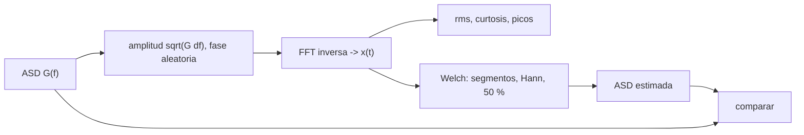

# B84-C32 — Vibración aleatoria y densidad espectral de potencia

<!-- nav:top -->
[🏠 Programa](../../../../README.md) · [📚 Bloque B84](../../../tronco-comun/B84-estructuras-materiales-y-fabricacion-espacial.md) · [← Anterior: B84-C31 — Documentación y revisión de análisis de elementos finitos](../B84-C31-documentacion-y-revision-de-analisis-de-elementos-finitos/CLASE.md) · [Siguiente: B84-C33 — Respuesta armónica y funciones de transferencia estructural →](../B84-C33-respuesta-armonica-y-funciones-de-transferencia-estructural/CLASE.md)
<!-- /nav -->

## 1. Ubicación, nivel y alcance

Clase 32 del bloque B84. Nivel N3. La vibración aleatoria no se describe con una señal sino con su densidad espectral. Aquí sintetizas una señal gaussiana **sintética** de 4 s a partir de la ASD de mano de obra mínima del GEVS (consultada, `6,8 g rms`), recuperas esa ASD con periodogramas de Welch, y mides valor eficaz, curtosis y picos de 3σ. Complementa C01 (integrar una ASD) y C11 (respuesta de un oscilador).

## 2. Por qué esta clase existe

Un ensayo se controla con una ASD pero el daño lo producen los picos de la señal: saber que la señal es gaussiana (curtosis 3, 0,27 % fuera de 3σ) justifica usar `3σ` como pico de diseño. La decisión central: **¿qué valor eficaz, qué picos y qué incertidumbre espectral tiene una vibración aleatoria definida por una ASD?**

## 3. Lo que podrás hacer al terminar

1. Sintetizar una señal gaussiana con una ASD dada.
2. Estimar la ASD con un periodograma de Welch.
3. Calcular el valor eficaz en el tiempo y en frecuencia.
4. Medir curtosis y fracción fuera de `3σ`.
5. Estimar el error aleatorio de la estimación.
6. Rotular lo sintético y lo consultado.

La evidencia es la **informe de vibración aleatoria con `g` rms y picos** del ejercicio 12 (sección 20).

## 4. Con qué llegas y cómo comprobarlo

1. ¿Qué es una FFT?
2. ¿Qué es una ventana de Hann?
3. ¿Qué es la curtosis?
4. ¿Qué es una densidad espectral?
5. ¿Qué es un dato sintético?

<details>
<summary>Ver respuestas</summary>

1. Un algoritmo rápido de la transformada discreta de Fourier. 2. Una función `0,5 − 0,5 cos` que reduce las fugas espectrales. 3. El momento de cuarto orden normalizado; 3 para una gaussiana. 4. Potencia por unidad de frecuencia (C01). 5. Uno generado, no medido.
</details>

Con cuatro o cinco aciertos, sigue; si no, repasa los prerrequisitos.

## 5. Un caso de contexto y casos de referencia

Con la ASD de la Tabla 2.4-4 (`6,7842 g rms`) se sintetizan `32 768` muestras a `8192 Hz`: `g rms = 6,7844`, curtosis `3,057`, pico `31,835 g = 4,69σ` y `0,290 %` de muestras fuera de 3σ (gaussiana `0,270 %`). El periodograma de Welch con 31 segmentos recupera `6,7779 g rms` y la ASD por bandas dentro de `±6 %`. **Ejemplo conductor.** Señal sintética; ASD del GEVS consultada.

## 6. Vocabulario

La **síntesis espectral** asigna a cada frecuencia una amplitud `√(G df)` y fase uniforme. El **periodograma de Welch** promedia espectros de segmentos con ventana y solape. La **curtosis** `E[x⁴]/σ⁴` vale 3 en una gaussiana. El **pico 3σ** es `3 g_rms`.

## 7. Modelo mental: ruido de lluvia sobre un tejado



*Descripción textual:* la ASD genera la señal; de la señal se miden rms, curtosis y picos y se estima de nuevo la ASD para compararla con la original.

Analogía: la lluvia sobre un tejado suena como ruido, pero su espectro es estable: cuántas gotas por segundo en cada tono. Límite: la señal es estacionaria y gaussiana; un transitorio no cumple.

## 8. La explicación, paso a paso

### 8.1 Señal

`N = 32 768`, `fs = 8192 Hz`, semilla 84032. Media `0`, `g rms = 6,7844` (teórico `6,7842`), curtosis `3,057`, pico `31,835 g` (4,69σ), `0,290 %` fuera de 3σ.

### 8.2 Estimación de Welch

31 segmentos de 2048 muestras (4,0 Hz), Hann, 50 %. `g rms` estimado `6,7779`. Por bandas:

| Banda (Hz) | Estimada (g²/Hz) | Teórica | Cociente |
|---|---|---|---|
| 20–80 | 0,02252 | 0,02400 | 0,938 |
| 80–200 | 0,03970 | 0,04000 | 0,992 |
| 200–500 | 0,04068 | 0,04000 | 1,017 |
| 500–1000 | 0,02757 | 0,02781 | 0,991 |
| 1000–2000 | 0,01381 | 0,01388 | 0,995 |

### 8.3 Incertidumbre

Cada bin tiene error aleatorio del orden `1/√31 = 18 %`; al promediar bandas baja. La banda de 20–80 Hz tiene el peor cociente por la fuga de la rampa y pocos bins.

### 8.4 Lectura

La señal gaussiana justifica `3σ` como pico estadístico, pero los 4,69σ muestran que en 32 768 muestras aparecen picos mayores; el diseño usa `3σ` por convención (GEVS), no como cota.

## 9. Magnitudes, símbolos y unidades

| Símbolo | Qué es | Unidad | Valor / nota |
|---|---|---|---|
| `fs` | frecuencia de muestreo | Hz | 8192 |
| `N` | muestras | — | 32 768 |
| `g_rms` | valor eficaz | g | 6,7844 |
| curtosis | momento de cuarto orden | — | 3,057 |
| `G` | ASD | g²/Hz | 0,04 (meseta) |
| segmentos | de Welch | — | 31 |

## 10. Convenciones y referencias

g y Hz. ASD de mano de obra mínima (GEVS Tabla 2.4-4) de 20 a 2000 Hz. Señal sintética con semilla 84032. Welch con segmentos de 2048, Hann, 50 % de solape. Tolerancias: rms dentro de 3 %, curtosis entre 2,7 y 3,3.

## 11. De dónde sale lo que afirmamos

| ID | Fuente | Localizador | Respalda | Estado |
|---|---|---|---|---|
| S1 | NASA/GSFC, GSFC-STD-7000 (GEVS) Versión B, Cambio 0, 2021-04-28 — https://standards.nasa.gov/standard/gsfc/gsfc-std-7000 (PDF descargado y leído con PyMuPDF el 2026-11-10) | Tabla 2.4-4 (página 71 del PDF) | el perfil de mano de obra mínima y su total de 6,8 g rms | Consultada |
| — | Método de síntesis espectral y de Welch | — | los métodos, que el laboratorio verifica recuperando la ASD de partida | No consultada en una fuente concreta |

Límites: la señal es sintética; del GEVS solo se leyó la Tabla 2.4-4; no se midió ninguna vibración.

## 12. Cómo ver la señal aleatoria

| Magnitud | Valor |
|---|---|
| `g rms` temporal | 6,7844 |
| `g rms` de Welch | 6,7779 |
| Curtosis | 3,057 |
| Fuera de 3σ | 0,290 % |
| Pico máximo | 4,69σ |

Descripción larga: la señal reproduce la ASD y es gaussiana; el pico máximo de una señal de 4 s supera los 3σ.

## 13. Ejemplo trabajado: el pico 3σ

**Paso 1 · rms.** `g_rms = 6,7844 g`.

**Paso 2 · Pico.** `3σ = 20,35 g`.

## 14. Distintas formas de describir una vibración aleatoria

**Por ASD:** `G(f)`. **Por señal:** `x(t)`. **Por rms:** `√∫G df`. **Por estadística:** curtosis, `3σ`. **Por estimación:** Welch.

## 15. Práctica guiada

**Ejercicio 1 · con los pasos indicados** Calcula `3σ` con `g_rms = 6,78`. *Pasos:* `3 × 6,78`.

<details><summary>Solución comentada</summary>

`20,3 g`.
</details>

**Ejercicio 2 · con los pasos indicados** ¿Qué curtosis tiene una gaussiana? *Pista:* es la del enunciado.

<details><summary>Solución comentada</summary>

`3`.
</details>

**Ejercicio 3 · con los pasos indicados** ¿Por qué el pico máximo es mayor que `3σ`? *Casi autónomo.*

<details><summary>Solución comentada</summary>

Porque en 32 768 muestras hay unas 90 fuera de 3σ y alguna llega a 4σ.
</details>

## 16. Práctica autónoma, transferencia e integrador

**Ejercicio 4 · autónomo** Resolución espectral con segmentos de 4096 a 8192 Hz.

<details><summary>Solución comentada</summary>

`2 Hz`.
</details>

**Ejercicio 5 · autónomo** Error aleatorio con 100 segmentos independientes.

<details><summary>Solución comentada</summary>

`10 %`.
</details>

**Ejercicio 6 · autónomo** Fracción fuera de 3σ en 32 768 muestras.

<details><summary>Solución comentada</summary>

`≈ 88`.
</details>

**Ejercicio 7 · autónomo** `g rms` si la ASD se duplica.

<details><summary>Solución comentada</summary>

`× √2`: `9,59 g`.
</details>

**Ejercicio 8 · autónomo** ¿Qué pasa con la resolución si `N` se duplica?

<details><summary>Solución comentada</summary>

Mejora a la mitad con el mismo número de segmentos.
</details>

**Ejercicio 9 · transferencia. **Transferencia.**** Una señal medida tiene curtosis 8. ¿Vale `3σ`?

<details><summary>Solución comentada</summary>

No: tiene impactos o no es gaussiana; los picos se evalúan estadísticamente.
</details>

**Ejercicio 10 · transferencia. **Transferencia.**** ¿Cómo reduces el error aleatorio de la ASD estimada?

<details><summary>Solución comentada</summary>

Con más segmentos promediados (más tiempo o más solape).
</details>

**Ejercicio 11 · transferencia. **Transferencia.**** El ensayo se controla con una ASD y la respuesta se mide en el tiempo. ¿Qué comparas?

<details><summary>Solución comentada</summary>

Su valor eficaz y su ASD, no el tiempo.
</details>

**Ejercicio 12 · integrador. **Integrador.**** Elabora tu *informe de vibración aleatoria con `g` rms y picos*: señal sintética, rms, curtosis, picos, Welch por bandas e incertidumbre, rotulando lo sintético y lo consultado.

<details><summary>Solución comentada</summary>

Secciones 8.1–8.4 y la salida del laboratorio.
</details>

## 17. Laboratorio: síntesis y estimación de una vibración aleatoria

El script [aleatoria.py](aleatoria.py) sintetiza una señal desde la ASD del GEVS y la estima con Welch (**comprueba** rms dentro del 3 % del teórico, ASD estimada dentro del 3 % y curtosis entre 2,7 y 3,3).

**Datos:** señal **sintética**; ASD del GEVS **consultada**. **Predice antes de ejecutar:** ¿qué curtosis tendrá la señal? (≈ 3.) **Ejecución del 2026-11-10 (Python 3.12.9):**

```text
Python 3.12.9 (biblioteca estandar)
ASD de mano de obra minima (GEVS, Tabla 2.4-4): g rms teorico = 6.7842 (publicado 6,8)
Senal SINTETICA de 32768 muestras a 8192 Hz: media = 0.0000 g, g rms = 6.7844 g (diferencia con el teorico 0.00 %)
Curtosis = 3.057 (gaussiana: 3) ; pico absoluto = 31.835 g = 4.69 sigma ; fraccion de muestras fuera de 3 sigma = 0.290 % (gaussiana: 0,270 %)
Estimacion de Welch con 31 segmentos de 2048 muestras (resolucion 4.0 Hz): g rms de la ASD estimada = 6.7779
ASD estimada frente a teorica en bandas (promedio por banda):
    20-  80 Hz: estimada = 0.02252  teorica = 0.02400  cociente = 0.938
    80- 200 Hz: estimada = 0.03970  teorica = 0.04000  cociente = 0.992
   200- 500 Hz: estimada = 0.04068  teorica = 0.04000  cociente = 1.017
   500-1000 Hz: estimada = 0.02757  teorica = 0.02781  cociente = 0.991
  1000-2000 Hz: estimada = 0.01381  teorica = 0.01388  cociente = 0.995
Con 31 segmentos solapados el error aleatorio de cada bin es del orden de 1/sqrt(31) = 18 % (mas por el solape)
Pruebas superadas.
```

```bash
python programa/clases/B84/B84-C32-vibracion-aleatoria-y-densidad-espectral-de-potencia/aleatoria.py
```

**Límites:** estacionaria y gaussiana; resolución de 4 Hz; fuga en la rampa baja.

## 18. Errores frecuentes y cómo corregirlos

**Tomar `3σ` como cota.** Se corrige con 8.4.

**Estimar la ASD con un solo periodograma.** Se corrige con 8.3.

**Confundir rms con pico.** Se corrige con el ejemplo 13.

**Presentar la señal sintética como medida.** Se corrige con la sección 10.

## 19. Cómo sabrás que vas bien

Tras la sección 8: ¿qué rms esperabas y cuál obtuviste? Si dudas, repasa el ejemplo 13. Tras el laboratorio: ¿qué comprueba? (ver la sección 17).

## 20. Qué entregas y cómo se evalúa

El producto es tu **informe de vibración aleatoria con `g` rms y picos** (ejercicio 12).

| Criterio | Inicial | En desarrollo | Logrado | Destacado |
|---|---|---|---|---|
| Conceptos | Los confunde | Parciales | Sintetiza y estima una vibración aleatoria | Explica los límites |
| Cálculo | Sin unidades | Con errores | Tablas completas con unidades | Calcula casos nuevos |
| Numérico | Sin comprobar | Un caso | Contraste con una segunda vía | Interpreta las diferencias |
| Fuentes | Sin fuente | Sin fecha | Fuentes con fecha y estado | Declara lo ilustrativo y lo no consultado |
| Límites | No los nombra | Uno | Tres | Discute qué falta del modelo |

**Condiciones críticas (no se compensan con promedio):** rotular los datos ilustrativos y sintéticos como tales; no presentar un cálculo como ensayo ni como dato de vuelo; citar solo lo consultado.

## 21. Ética, seguridad y límites

Clase educativa: los modelos son simplificados y sus datos son sintéticos, ilustrativos o valores de estándar rotulados; **no es una base de diseño de hardware de vuelo** y ningún resultado sustituye a datos de material cualificados, a los documentos vigentes de la agencia o del lanzador ni a la revisión por personal competente. Accesibilidad: tablas equivalentes a las gráficas, fórmulas en texto, ejercicios sin conexión.

## 22. Para cerrar y seguir

La señal sintética reproduce `6,78 g rms`, tiene curtosis `3,06` y el Welch recupera la ASD dentro de ±6 %. Queda una pregunta: ¿cómo responde la estructura a una excitación periódica?

**Glosario español–inglés.** vibración aleatoria · *random vibration*; periodograma de Welch · *Welch periodogram*; curtosis · *kurtosis*; ventana de Hann · *Hann window*; solape · *overlap*.

**Continuidad.** [B84-C33](../B84-C33-respuesta-armonica-y-funciones-de-transferencia-estructural/CLASE.md) estudia la respuesta armónica y las funciones de transferencia estructural.

**Referencias:** ver sección 11.

<!-- nav:bottom -->
---

[← Anterior: B84-C31 — Documentación y revisión de análisis de elementos finitos](../B84-C31-documentacion-y-revision-de-analisis-de-elementos-finitos/CLASE.md) · [📚 Bloque B84](../../../tronco-comun/B84-estructuras-materiales-y-fabricacion-espacial.md) · [Siguiente: B84-C33 — Respuesta armónica y funciones de transferencia estructural →](../B84-C33-respuesta-armonica-y-funciones-de-transferencia-estructural/CLASE.md)
<!-- /nav -->
