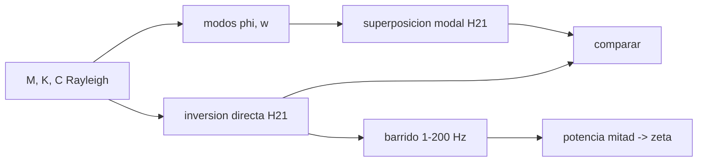

# B84-C33 — Respuesta armónica y funciones de transferencia estructural

<!-- nav:top -->
[🏠 Programa](../../../../README.md) · [📚 Bloque B84](../../../tronco-comun/B84-estructuras-materiales-y-fabricacion-espacial.md) · [← Anterior: B84-C32 — Vibración aleatoria y densidad espectral de potencia](../B84-C32-vibracion-aleatoria-y-densidad-espectral-de-potencia/CLASE.md) · [Siguiente: B84-C34 — Tratamientos y recubrimientos superficiales de componentes espaciales →](../B84-C34-tratamientos-y-recubrimientos-superficiales-de-componentes-espaciales/CLASE.md)
<!-- /nav -->

## 1. Ubicación, nivel y alcance

Clase 33 del bloque B84. Nivel N3. Para predecir la respuesta de una estructura a una fuerza periódica se usa su función de transferencia (receptancia) `H(ω)`. Aquí calculas la de una estructura **ilustrativa** de dos masas y dos resortes por inversión directa y por superposición modal, y estimas el amortiguamiento con el método de potencia mitad. Es el puente entre los modos (C10) y la vibración aleatoria (C32).

## 2. Por qué esta clase existe

La función de transferencia dice cuánto se amplifica cada frecuencia entre el punto donde se excita y el punto donde se mide; es la herramienta que usan el análisis y el ensayo de barrido sinusoidal. La decisión central: **¿cuánto se amplifica la respuesta en cada frecuencia y cuánto amortiguamiento tiene cada modo?**

## 3. Lo que podrás hacer al terminar

1. Plantear `(K − ω²M + iωC) X = F`.
2. Calcular `H₂₁(ω)` por inversión directa.
3. Calcularla por superposición modal.
4. Comparar ambas.
5. Estimar `ζ` por potencia mitad.
6. Leer módulo y fase.

La evidencia es la **ficha de función de transferencia estructural** del ejercicio 12 (sección 20).

## 4. Con qué llegas y cómo comprobarlo

1. ¿Qué es una receptancia?
2. ¿Qué es un número complejo?
3. ¿Qué es el amortiguamiento de Rayleigh?
4. ¿Qué es la potencia mitad?
5. ¿Qué es la superposición modal?

<details>
<summary>Ver respuestas</summary>

1. El desplazamiento por unidad de fuerza armónica, en m/N. 2. `a + ib`; módulo y fase. 3. `C = aM + bK`. 4. Los puntos donde `|H|` cae a `1/√2` del pico. 5. Suma de las respuestas modo a modo.
</details>

Con cuatro o cinco aciertos, sigue; si no, repasa los prerrequisitos.

## 5. Un caso de contexto y casos de referencia

Una estructura de `m₁ = 2 kg`, `m₂ = 1 kg`, `k₁ = 2 × 10⁵` y `k₂ = 10⁵ N/m` tiene `f₁ = 35,588 Hz` y `f₂ = 71,176 Hz`. Con `ζ = 0,02` en ambos modos, `|H₂₁|` vale `5,0 × 10⁻⁶ m/N` en estático, `1,666 × 10⁻⁴` en el primer pico y `4,17 × 10⁻⁵` en el segundo; la inversión directa y la modal difieren `1,6 × 10⁻¹⁵`. **Ejemplo conductor.** Todo ilustrativo.

## 6. Vocabulario

La **receptancia** `H_ij(ω)` es el desplazamiento en `i` por fuerza unitaria en `j`. La **superposición modal** es `H_ij = Σ φ_ir φ_jr/(ω_r² − ω² + 2iζ_r ω_r ω)`. El **método de potencia mitad** estima `ζ ≈ (f₂ − f₁)/(2 f_pico)`. La **fase** pasa de 0° a −90° en un pico.

## 7. Modelo mental: empujar un columpio doble



*Descripción textual:* se calcula `H₂₁` por dos vías, se comparan y el barrido da los picos y el amortiguamiento.

Analogía: un columpio doble tiene dos ritmos de balanceo; empujado a cada ritmo, se amplifica. Límite: con amortiguamiento no proporcional o modos muy cercanos, el método de potencia mitad falla.

## 8. La explicación, paso a paso

### 8.1 Modos y amortiguamiento

`f₁ = 35,5881 Hz`, `f₂ = 71,1763 Hz`; modo 1 `[0,40825; 0,81650]` (en fase), modo 2 `[0,57735; −0,57735]` (en contrafase). Rayleigh `a = 5,9628 s⁻¹`, `b = 5,963 × 10⁻⁵ s` da `ζ = 0,02000` en ambos.

### 8.2 Receptancia

| `f` (Hz) | `|H₂₁|` (m/N) | Fase (°) |
|---|---|---|
| 1,0 | 5,005 × 10⁻⁶ | −0,08 |
| 17,8 | 7,108 × 10⁻⁶ | −1,76 |
| 35,6 (pico 1) | 1,666 × 10⁻⁴ | −90,76 |
| 53,4 | 9,113 × 10⁻⁶ | 179,97 |
| 71,2 (pico 2) | 4,167 × 10⁻⁵ | 93,06 |
| 150 | 8,677 × 10⁻⁸ | 5,20 |

La respuesta estática `5,0 × 10⁻⁶ m/N = 1/k₁`. Entre los dos picos hay una antirresonancia.

### 8.3 Verificación y amortiguamiento

Directa frente a modal: `1,6 × 10⁻¹⁵`. Potencia mitad: modo 1 pico `35,583 Hz`, puntos `34,873` y `36,298 Hz`, `ζ = 0,02002` (0,12 % de error); modo 2 pico `71,071 Hz`, `69,533` y `72,422`, `ζ = 0,02032` (1,62 %).

### 8.4 Uso

La función de transferencia permite predecir la respuesta a cualquier carga periódica y, con la ASD de entrada, la respuesta aleatoria `G_y = |H|² G_x` (C32).

## 9. Magnitudes, símbolos y unidades

| Símbolo | Qué es | Unidad | Valor / nota |
|---|---|---|---|
| `H₂₁` | receptancia | m/N | 5,0 × 10⁻⁶ (estática) |
| `f_r` | frecuencias naturales | Hz | 35,588; 71,176 |
| `ζ` | amortiguamiento modal | — | 0,02 |
| `φ` | formas modales | — | — |
| `a`, `b` | coeficientes de Rayleigh | 1/s, s | 5,9628; 5,963e-5 |
| `Q` | `1/(2ζ)` | — | 25 |

## 10. Convenciones y referencias

SI. Sistema de 2 GDL con fuerza en la masa 1 y respuesta en la 2. Barrido de 1 a 200 Hz con paso 0,001. Tolerancias: directa frente a modal < 10⁻⁹; `ζ` de potencia mitad dentro de 5 %.

## 11. De dónde sale lo que afirmamos

| ID | Fuente | Localizador | Respalda | Estado |
|---|---|---|---|---|
| — | Respuesta armónica, superposición modal y método de potencia mitad | — | las fórmulas, que el laboratorio verifica por dos vías, y los parámetros | No consultada en una fuente concreta |

Límites: datos ilustrativos; amortiguamiento de Rayleigh; las fórmulas no se consultaron en una fuente concreta.

## 12. Cómo ver la función de transferencia

| Magnitud | Valor |
|---|---|
| `f₁`, `f₂` | 35,588; 71,176 Hz |
| `|H|` en el pico 1 | 1,666 × 10⁻⁴ m/N |
| `ζ` estimada modo 1 | 0,02002 |
| Directa − modal | 1,6 × 10⁻¹⁵ |
| `H(0)` | 5,0 × 10⁻⁶ m/N |

Descripción larga: el pico del modo 1 amplifica 33 veces la respuesta estática; la fase pasa por −90° en cada resonancia.

## 13. Ejemplo trabajado: la amplificación en el primer pico

**Paso 1 · Estática.** `|H(0)| = 5,0 × 10⁻⁶ m/N`.

**Paso 2 · Pico.** `|H(f₁)| = 1,666 × 10⁻⁴ m/N`.

**Paso 3 · Cociente.** `33,3`: no es `Q = 25` porque la respuesta estática y la del pico dependen de la participación modal en los dos puntos.

## 14. Distintas formas de describir una respuesta armónica

**Por función:** `H(ω)`. **Por modos:** superposición. **Por módulo y fase:** polar. **Por amortiguamiento:** potencia mitad. **Por picos:** frecuencias naturales.

## 15. Práctica guiada

**Ejercicio 1 · con los pasos indicados** Calcula `Q` con `ζ = 0,02`. *Pasos:* `1/(2ζ)`.

<details><summary>Solución comentada</summary>

`25`.
</details>

**Ejercicio 2 · con los pasos indicados** ¿Qué fase tiene la respuesta justo en la resonancia? *Pista:* tabla 8.2.

<details><summary>Solución comentada</summary>

Cerca de `−90°`.
</details>

**Ejercicio 3 · con los pasos indicados** ¿Por qué directa y modal coinciden? *Casi autónomo.*

<details><summary>Solución comentada</summary>

Con amortiguamiento proporcional los modos desacoplan la ecuación; son la misma solución.
</details>

## 16. Práctica autónoma, transferencia e integrador

**Ejercicio 4 · autónomo** `ζ` con `Δf = 1,0 Hz` a `f = 50 Hz`.

<details><summary>Solución comentada</summary>

`0,01`.
</details>

**Ejercicio 5 · autónomo** `H(0)` si `k₁` se duplica.

<details><summary>Solución comentada</summary>

`2,5 × 10⁻⁶ m/N`.
</details>

**Ejercicio 6 · autónomo** `|H|` a `f₁` con `ζ = 0,04`.

<details><summary>Solución comentada</summary>

Aprox. la mitad.
</details>

**Ejercicio 7 · autónomo** Frecuencia de la antirresonancia.

<details><summary>Solución comentada</summary>

`≈ 53 Hz` (mínimo de `|H|`).
</details>

**Ejercicio 8 · autónomo** Fase a 150 Hz.

<details><summary>Solución comentada</summary>

`5,2°`.
</details>

**Ejercicio 9 · transferencia. **Transferencia.**** Un pico de la función de transferencia medida tiene `ζ = 0,2`. ¿Sirve potencia mitad?

<details><summary>Solución comentada</summary>

Es poco preciso: el método supone modos separados y `ζ` pequeño.
</details>

**Ejercicio 10 · transferencia. **Transferencia.**** Dos modos cercanos se solapan. ¿Qué haces?

<details><summary>Solución comentada</summary>

Un ajuste de curvas multimodal, no potencia mitad.
</details>

**Ejercicio 11 · transferencia. **Transferencia.**** ¿Cómo usas `H` para la respuesta aleatoria?

<details><summary>Solución comentada</summary>

`G_y(f) = |H(f)|² G_x(f)`.
</details>

**Ejercicio 12 · integrador. **Integrador.**** Elabora tu *ficha de función de transferencia estructural*: modos, receptancia directa y modal, picos, fases, `ζ` por potencia mitad y su uso en vibración aleatoria.

<details><summary>Solución comentada</summary>

Secciones 8.1–8.4 y la salida del laboratorio.
</details>

## 17. Laboratorio: receptancia de 2 GDL y potencia mitad

El script [armonica.py](armonica.py) calcula `H₂₁` por inversión directa y superposición modal y estima `ζ` (**comprueba** directa frente a modal (< 1e-9) y `ζ` dentro del 5 %).

**Datos:** estructura **ilustrativa**. **Predice antes de ejecutar:** ¿cuántas veces supera el pico 1 a la respuesta estática? (≈ 33.) **Ejecución del 2026-11-10 (Python 3.12.9):**

```text
Python 3.12.9 (biblioteca estandar)
Estructura ILUSTRATIVA de 2 GDL: frecuencias naturales f1 = 35.5881 Hz, f2 = 71.1763 Hz
Modos (masa unitaria): modo 1 = [0.40825, 0.81650], modo 2 = [0.57735, -0.57735]
Rayleigh: a = 5.9628 1/s, b = 5.963e-05 s ; zeta modal = 0.02000, 0.02000
Diferencia relativa maxima entre inversion directa y superposicion modal en 6 frecuencias = 1.6e-15
Receptancia |H21| [m/N] y fase en frecuencias seleccionadas:
  f =    1.000 Hz  |H| = 5.0049e-06  fase =    -0.08 grados
  f =   17.794 Hz  |H| = 7.1083e-06  fase =    -1.76 grados
  f =   35.588 Hz  |H| = 1.6662e-04  fase =   -90.76 grados
  f =   53.382 Hz  |H| = 9.1128e-06  fase =   179.97 grados
  f =   71.176 Hz  |H| = 4.1667e-05  fase =    93.06 grados
  f =  150.000 Hz  |H| = 8.6769e-08  fase =     5.20 grados
Respuesta estatica |H21(0)| = 5.0000e-06 m/N (= 1/k1: la fuerza sobre m1 la soporta el resorte k1)
Modo 1: pico en 35.583 Hz, |H| = 1.6663e-04 ; puntos de potencia mitad 34.873 y 36.298 Hz -> zeta estimada = 0.02002 (modal 0.02000, dif 0.12 %)
Modo 2: pico en 71.071 Hz, |H| = 4.1779e-05 ; puntos de potencia mitad 69.533 y 72.422 Hz -> zeta estimada = 0.02032 (modal 0.02000, dif 1.62 %)
Pruebas superadas.
```

```bash
python programa/clases/B84/B84-C33-respuesta-armonica-y-funciones-de-transferencia-estructural/armonica.py
```

**Límites:** 2 GDL, Rayleigh, sin no linealidad.

## 18. Errores frecuentes y cómo corregirlos

**Confundir módulo con fase.** Se corrige con 8.2.

**Usar potencia mitad con modos solapados.** Se corrige con la transferencia 11.

**Olvidar el amortiguamiento.** Sin él `H` diverge en resonancia.

**Presentar los parámetros como los de una estructura real.** Se corrige con la sección 10.

## 19. Cómo sabrás que vas bien

Tras la sección 8: ¿dónde esperabas los picos y cuál era su fase? Si dudas, repasa el ejemplo 13. Tras el laboratorio: ¿qué comprueba? (ver la sección 17).

## 20. Qué entregas y cómo se evalúa

El producto es tu **ficha de función de transferencia estructural** (ejercicio 12).

| Criterio | Inicial | En desarrollo | Logrado | Destacado |
|---|---|---|---|---|
| Conceptos | Los confunde | Parciales | Calcula y verifica `H` | Explica los límites |
| Cálculo | Sin unidades | Con errores | Tablas completas con unidades | Calcula casos nuevos |
| Numérico | Sin comprobar | Un caso | Contraste con una segunda vía | Interpreta las diferencias |
| Fuentes | Sin fuente | Sin fecha | Fuentes con fecha y estado | Declara lo ilustrativo y lo no consultado |
| Límites | No los nombra | Uno | Tres | Discute qué falta del modelo |

**Condiciones críticas (no se compensan con promedio):** rotular los datos ilustrativos y sintéticos como tales; no presentar un cálculo como ensayo ni como dato de vuelo; citar solo lo consultado.

## 21. Ética, seguridad y límites

Clase educativa: los modelos son simplificados y sus datos son sintéticos, ilustrativos o valores de estándar rotulados; **no es una base de diseño de hardware de vuelo** y ningún resultado sustituye a datos de material cualificados, a los documentos vigentes de la agencia o del lanzador ni a la revisión por personal competente. Accesibilidad: tablas equivalentes a las gráficas, fórmulas en texto, ejercicios sin conexión.

## 22. Para cerrar y seguir

La estructura de dos masas tiene picos en `35,6` y `71,2 Hz` y `ζ = 0,0200` recuperado con potencia mitad. Queda una pregunta: ¿cómo se protegen las superficies de los componentes?

**Glosario español–inglés.** función de transferencia · *transfer function*; receptancia · *receptance*; antirresonancia · *antiresonance*; potencia mitad · *half-power*; superposición modal · *modal superposition*.

**Continuidad.** [B84-C34](../B84-C34-tratamientos-y-recubrimientos-superficiales-de-componentes-espaciales/CLASE.md) estudia tratamientos y recubrimientos superficiales de componentes espaciales.

**Referencias:** ver sección 11.

<!-- nav:bottom -->
---

[← Anterior: B84-C32 — Vibración aleatoria y densidad espectral de potencia](../B84-C32-vibracion-aleatoria-y-densidad-espectral-de-potencia/CLASE.md) · [📚 Bloque B84](../../../tronco-comun/B84-estructuras-materiales-y-fabricacion-espacial.md) · [Siguiente: B84-C34 — Tratamientos y recubrimientos superficiales de componentes espaciales →](../B84-C34-tratamientos-y-recubrimientos-superficiales-de-componentes-espaciales/CLASE.md)
<!-- /nav -->
