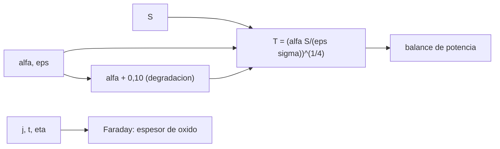

# B84-C34 — Tratamientos y recubrimientos superficiales de componentes espaciales

<!-- nav:top -->
[🏠 Programa](../../../../README.md) · [📚 Bloque B84](../../../tronco-comun/B84-estructuras-materiales-y-fabricacion-espacial.md) · [← Anterior: B84-C33 — Respuesta armónica y funciones de transferencia estructural](../B84-C33-respuesta-armonica-y-funciones-de-transferencia-estructural/CLASE.md) · [Siguiente: B84-C35 — Control de procesos de fabricación y calidad →](../B84-C35-control-de-procesos-de-fabricacion-y-calidad/CLASE.md)
<!-- /nav -->

## 1. Ubicación, nivel y alcance

Clase 34 del bloque B84. Nivel N3. Los recubrimientos y los tratamientos superficiales (pinturas, anodizado, dorado, reflectores solares) fijan la temperatura de una superficie al controlar cuánta luz solar absorbe (`α`) y cuánto calor emite (`ε`). Aquí calculas la temperatura de equilibrio de una placa **ilustrativa** con seis recubrimientos, su cambio por degradación y el espesor de una capa anódica por la ley de Faraday. Todos los valores `α`, `ε` y `S` son ilustrativos; no se consultaron.

## 2. Por qué esta clase existe

Cambiar el recubrimiento de una placa de aluminio cambia su temperatura de equilibrio en 400 K; la degradación en órbita lo desplaza decenas de kelvin. La decisión central: **¿qué recubrimiento mantiene la temperatura de una superficie en su rango y qué espesor de anodizado se necesita?**

## 3. Lo que podrás hacer al terminar

1. Calcular `T = (αS/(εσ))^(1/4)`.
2. Interpretar `α/ε`.
3. Estimar el efecto de la degradación de `α`.
4. Calcular el espesor anódico con la ley de Faraday.
5. Verificar el balance de potencia.
6. Rotular lo ilustrativo.

La evidencia es la **tabla de recubrimientos y temperaturas de equilibrio** del ejercicio 12 (sección 20).

## 4. Con qué llegas y cómo comprobarlo

1. ¿Qué es la absortividad solar?
2. ¿Qué es la emisividad?
3. ¿Qué es la ley de Stefan–Boltzmann?
4. ¿Qué es el anodizado?
5. ¿Qué es la ley de Faraday?

<details>
<summary>Ver respuestas</summary>

1. La fracción de la luz solar que absorbe la superficie. 2. La fracción de la emisión de un cuerpo negro que emite. 3. `q = εσT⁴`. 4. Una capa de óxido crecida electroquímicamente sobre el aluminio. 5. `m = ηQM/(nF)`.
</details>

Con cuatro o cinco aciertos, sigue; si no, repasa los prerrequisitos.

## 5. Un caso de contexto y casos de referencia

Una placa con la cara al Sol (`S = 1361 W/m²`, ilustrativo) alcanza `14,2 °C` con pintura blanca (`α/ε = 0,284`), `125,8 °C` con pintura negra, `283,5 °C` con aluminio pulido, `47,0 °C` con aluminio anodizado, `426,8 °C` con oro y `−51,8 °C` con un reflector solar óptico. Con `α + 0,10` la pintura blanca sube `25,2 K`. Una capa anódica de 30 min a `150 A/m²` mide `12,68 µm`. **Ejemplo conductor.** Todo ilustrativo.

## 6. Vocabulario

La **temperatura de equilibrio** iguala `αS` a `εσT⁴`. La **razón** `α/ε` la ordena: baja enfría, alta calienta. El **OSR** (*optical solar reflector*) es un vidrio plateado de `α` baja y `ε` alta. El **anodizado** genera óxido: `espesor = η j t M_ox/(3Fρ_ox)`.

## 7. Modelo mental: una camiseta blanca frente a una negra al sol



*Descripción textual:* `α`, `ε` y `S` dan la temperatura de equilibrio, comprobada con el balance; la degradación la desplaza; el anodizado se calcula aparte con Faraday.

Analogía: una camiseta blanca se calienta menos al sol que una negra, pero la emisividad en el infrarrojo también cuenta. Límite: se supone una placa con la trasera aislada y sin carga interna ni albedo.

## 8. La explicación, paso a paso

### 8.1 Temperatura de equilibrio

`T = (αS/(εσ))^(1/4)`:

| Recubrimiento | `α` | `ε` | `α/ε` | `T` (°C) | Fin de vida (°C) |
|---|---|---|---|---|---|
| Pintura blanca | 0,25 | 0,88 | 0,284 | 14,21 | 39,43 |
| Pintura negra | 0,95 | 0,90 | 1,056 | 125,81 | 135,92 |
| Aluminio pulido | 0,20 | 0,05 | 4,000 | 283,49 | 342,88 |
| Aluminio anodizado | 0,35 | 0,80 | 0,437 | 46,97 | 67,72 |
| Oro | 0,30 | 0,03 | 10,000 | 426,79 | 478,99 |
| OSR | 0,08 | 0,80 | 0,100 | −51,81 | −2,06 |

El balance `αS − εσT⁴` da un residuo máximo de `1,7 × 10⁻¹³ W/m²`.

### 8.2 Degradación

`Δα = +0,10` sube la temperatura `25,22 K` (blanca), `10,11 K` (negra), `59,38 K` (Al pulido), `20,76 K` (anodizado), `52,19 K` (oro) y `49,75 K` (OSR): las superficies de `α` baja son las más sensibles.

### 8.3 Anodizado

Con `η = 0,8`, `j = 150 A/m²` y `ρ_ox = 3000 kg/m³`: `10, 20, 30, 60 min` dan `4,23; 8,45; 12,68; 25,36 µm` (`12,68; 25,36; 38,04; 76,09 g/m²`). El espesor es proporcional a la carga.

### 8.4 Qué falta

Un diseño térmico real incluye las dos caras, la carga interna, el albedo, la geometría y el cambio de `α`, `ε` con el espesor de la capa (C34 solo da el espesor).

## 9. Magnitudes, símbolos y unidades

| Símbolo | Qué es | Unidad | Valor / nota |
|---|---|---|---|
| `α` | absortividad solar | — | 0,08–0,95 |
| `ε` | emisividad infrarroja | — | 0,03–0,90 |
| `S` | constante solar | W/m² | 1361 (ilustrativo) |
| `T` | temperatura de equilibrio | K, °C | 287,36; 14,21 |
| `σ` | constante de Stefan–Boltzmann | W/(m²K⁴) | 5,670374419e-8 |
| `F` | constante de Faraday | C/mol | 96 485,33212 |

## 10. Convenciones y referencias

SI y °C. Placa de una cara al Sol con trasera aislada. `α` y `ε` de inicio de vida ilustrativos; degradación `+0,10` ilustrativa. `σ` y `F` valores del SI/CODATA (no consultados en esta sesión).

## 11. De dónde sale lo que afirmamos

| ID | Fuente | Localizador | Respalda | Estado |
|---|---|---|---|---|
| — | Propiedades termo-ópticas de los recubrimientos, constante solar y densidad del óxido | — | todos los valores `α`, `ε`, `S`, `η` y `ρ_ox` | No consultada en una fuente concreta |

Límites: valores ilustrativos no consultados; sin carga interna, albedo ni geometría; no es un diseño térmico.

## 12. Cómo ver los recubrimientos

| Magnitud | Valor |
|---|---|
| Blanca | 14,21 °C |
| Negra | 125,81 °C |
| OSR | −51,81 °C |
| `Δα = 0,10` en Al pulido | +59,38 K |
| Anodizado 30 min | 12,68 µm |

Descripción larga: la razón `α/ε` ordena las temperaturas y las superficies de `ε` baja son las más sensibles a la degradación.

## 13. Ejemplo trabajado: la pintura blanca

**Paso 1 · Potencia absorbida.** `0,25 × 1361 = 340,25 W/m²`.

**Paso 2 · Temperatura.** `T⁴ = 340,25/(0,88 × 5,67e-8) = 6,82 × 10⁹ K⁴`.

**Paso 3 · Raíz.** `T = 287,4 K = 14,2 °C`.

## 14. Distintas formas de describir un recubrimiento térmico

**Por propiedades:** `α`, `ε`. **Por razón:** `α/ε`. **Por temperatura:** `T`. **Por degradación:** `Δα`. **Por espesor:** µm de óxido.

## 15. Práctica guiada

**Ejercicio 1 · con los pasos indicados** Calcula `α/ε` del OSR. *Pasos:* `0,08/0,80`.

<details><summary>Solución comentada</summary>

`0,10`.
</details>

**Ejercicio 2 · con los pasos indicados** ¿Qué recubrimiento enfría más? *Pista:* menor `α/ε`.

<details><summary>Solución comentada</summary>

El OSR.
</details>

**Ejercicio 3 · con los pasos indicados** ¿Por qué el oro se calienta tanto? *Casi autónomo.*

<details><summary>Solución comentada</summary>

Porque `ε = 0,03` casi no emite y `α = 0,30` absorbe.
</details>

## 16. Práctica autónoma, transferencia e integrador

**Ejercicio 4 · autónomo** `T` con `α = 0,5`, `ε = 0,5`.

<details><summary>Solución comentada</summary>

`(0,5 × 1361/(0,5 × 5,67e-8))^(1/4) = 394 K`.
</details>

**Ejercicio 5 · autónomo** Espesor en 45 min.

<details><summary>Solución comentada</summary>

`19,0 µm`.
</details>

**Ejercicio 6 · autónomo** `T` de la pintura negra con `S = 1000`.

<details><summary>Solución comentada</summary>

`(0,95 × 1000/(0,9 × 5,67e-8))^(1/4) = 369 K`.
</details>

**Ejercicio 7 · autónomo** Si `η = 0,6`, espesor en 30 min.

<details><summary>Solución comentada</summary>

`9,5 µm`.
</details>

**Ejercicio 8 · autónomo** Relación `T` entre `α/ε = 4` y 1.

<details><summary>Solución comentada</summary>

`4^(1/4) = 1,41`.
</details>

**Ejercicio 9 · transferencia. **Transferencia.**** Un radiador debe mantenerse a 280 K. ¿Qué eliges?

<details><summary>Solución comentada</summary>

Pintura blanca u OSR según la carga interna y la degradación.
</details>

**Ejercicio 10 · transferencia. **Transferencia.**** El recubrimiento se degrada con UV y `α` sube. ¿Cuándo verificas el diseño?

<details><summary>Solución comentada</summary>

Al fin de vida, con el `α` degradado.
</details>

**Ejercicio 11 · transferencia. **Transferencia.**** ¿Basta el anodizado para controlar temperatura?

<details><summary>Solución comentada</summary>

Depende de su `α` y `ε`, que cambian con el espesor; se miden.
</details>

**Ejercicio 12 · integrador. **Integrador.**** Elabora tu *tabla de recubrimientos y temperaturas de equilibrio*: `α`, `ε`, `T` de inicio y fin de vida, sensibilidad a la degradación y espesor anódico, rotulando lo ilustrativo.

<details><summary>Solución comentada</summary>

Secciones 8.1–8.4 y la salida del laboratorio.
</details>

## 17. Laboratorio: temperatura de equilibrio y anodizado

El script [recubrimientos.py](recubrimientos.py) calcula la temperatura de seis recubrimientos con degradación y el espesor de anodizado (**comprueba** balance de potencia (< 1e-9) y orden blanca < negra).

**Datos:** todo **ilustrativo**. **Predice antes de ejecutar:** ¿qué recubrimiento da la temperatura más baja? (el OSR.) **Ejecución del 2026-11-10 (Python 3.12.9):**

```text
Python 3.12.9 (biblioteca estandar)
Placa de una cara al Sol, trasera aislada, S = 1361 W/m2 (ILUSTRATIVO); alfa y epsilon ILUSTRATIVOS
recubrimiento             alfa   eps  alfa/eps  T inicio [K]  T inicio [C]  T fin de vida [C]
Pintura blanca            0.25  0.88     0.284        287.36         14.21              39.43
Pintura negra             0.95  0.90     1.056        398.96        125.81             135.92
Aluminio pulido           0.20  0.05     4.000        556.64        283.49             342.88
Aluminio anodizado        0.35  0.80     0.437        320.12         46.97              67.72
Oro                       0.30  0.03    10.000        699.94        426.79             478.99
OSR (vidrio plateado)     0.08  0.80     0.100        221.34        -51.81              -2.06
Residuo maximo del balance de potencia = 1.7e-13 W/m2
Sensibilidad: aumento de temperatura por +0,10 de absortividad (K):
  Pintura blanca           + 25.22 K
  Pintura negra            + 10.11 K
  Aluminio pulido          + 59.38 K
  Aluminio anodizado       + 20.76 K
  Oro                      + 52.19 K
  OSR (vidrio plateado)    + 49.75 K
Anodizado: espesor de oxido segun la carga (eta = 0,8; rho_ox = 3000 kg/m3, ILUSTRATIVO)
  j = 150 A/m2, 10 min: carga =     90000 C/m2 ; oxido =  12.68 g/m2 ; espesor =   4.23 um
  j = 150 A/m2, 20 min: carga =    180000 C/m2 ; oxido =  25.36 g/m2 ; espesor =   8.45 um
  j = 150 A/m2, 30 min: carga =    270000 C/m2 ; oxido =  38.04 g/m2 ; espesor =  12.68 um
  j = 150 A/m2, 60 min: carga =    540000 C/m2 ; oxido =  76.09 g/m2 ; espesor =  25.36 um
Pruebas superadas.
```

```bash
python programa/clases/B84/B84-C34-tratamientos-y-recubrimientos-superficiales-de-componentes-espaciales/recubrimientos.py
```

**Límites:** una cara, sin carga interna; `α` y `ε` constantes salvo la degradación.

## 18. Errores frecuentes y cómo corregirlos

**Mirar solo `α`.** Se corrige con 8.1.

**Olvidar la degradación.** Se corrige con 8.2.

**Confundir emisividad con reflectividad.** Se corrige con el vocabulario.

**Usar estos valores como de proveedor.** Se corrige con la sección 10.

## 19. Cómo sabrás que vas bien

Tras la sección 8: ¿qué temperatura esperabas para la blanca? Si dudas, repasa el ejemplo 13. Tras el laboratorio: ¿qué comprueba? (ver la sección 17).

## 20. Qué entregas y cómo se evalúa

El producto es tu **tabla de recubrimientos y temperaturas de equilibrio** (ejercicio 12).

| Criterio | Inicial | En desarrollo | Logrado | Destacado |
|---|---|---|---|---|
| Conceptos | Los confunde | Parciales | Calcula `T` y el espesor anódico | Explica los límites |
| Cálculo | Sin unidades | Con errores | Tablas completas con unidades | Calcula casos nuevos |
| Numérico | Sin comprobar | Un caso | Contraste con una segunda vía | Interpreta las diferencias |
| Fuentes | Sin fuente | Sin fecha | Fuentes con fecha y estado | Declara lo ilustrativo y lo no consultado |
| Límites | No los nombra | Uno | Tres | Discute qué falta del modelo |

**Condiciones críticas (no se compensan con promedio):** rotular los datos ilustrativos y sintéticos como tales; no presentar un cálculo como ensayo ni como dato de vuelo; citar solo lo consultado.

## 21. Ética, seguridad y límites

Clase educativa: los modelos son simplificados y sus datos son sintéticos, ilustrativos o valores de estándar rotulados; **no es una base de diseño de hardware de vuelo** y ningún resultado sustituye a datos de material cualificados, a los documentos vigentes de la agencia o del lanzador ni a la revisión por personal competente. Accesibilidad: tablas equivalentes a las gráficas, fórmulas en texto, ejercicios sin conexión.

## 22. Para cerrar y seguir

La pintura blanca queda a `14,2 °C` y el OSR a `−51,8 °C`; una capa anódica de 30 min mide `12,7 µm`. Queda una pregunta: ¿cómo se asegura que cada pieza sale igual?

**Glosario español–inglés.** absortividad · *absorptance*; emisividad · *emissivity*; anodizado · *anodizing*; reflector solar óptico · *optical solar reflector (OSR)*; recubrimiento · *coating*.

**Continuidad.** [B84-C35](../B84-C35-control-de-procesos-de-fabricacion-y-calidad/CLASE.md) estudia el control de procesos de fabricación y calidad.

**Referencias:** ver sección 11.

<!-- nav:bottom -->
---

[← Anterior: B84-C33 — Respuesta armónica y funciones de transferencia estructural](../B84-C33-respuesta-armonica-y-funciones-de-transferencia-estructural/CLASE.md) · [📚 Bloque B84](../../../tronco-comun/B84-estructuras-materiales-y-fabricacion-espacial.md) · [Siguiente: B84-C35 — Control de procesos de fabricación y calidad →](../B84-C35-control-de-procesos-de-fabricacion-y-calidad/CLASE.md)
<!-- /nav -->
