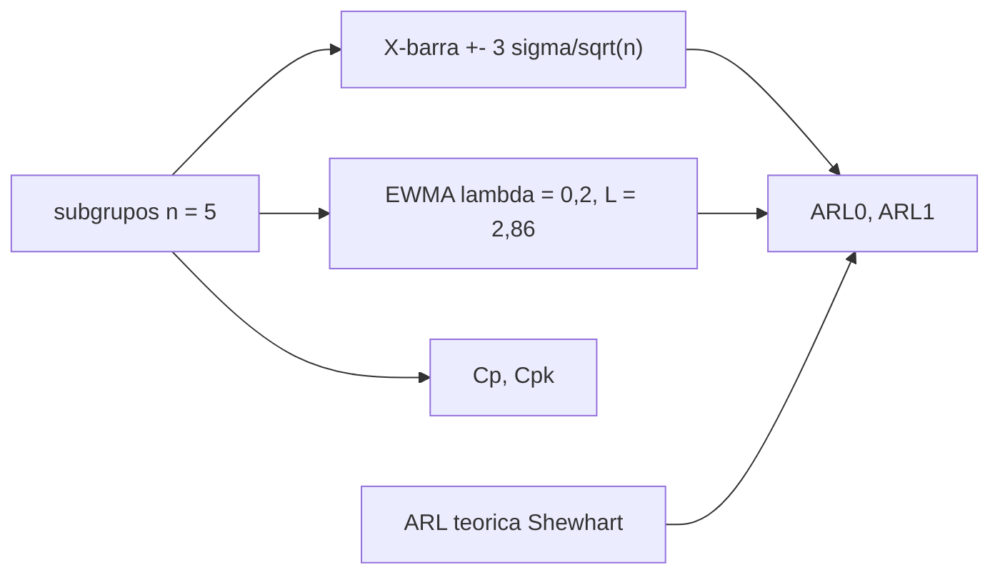

# B84-C35 — Control de procesos de fabricación y calidad

<!-- nav:top -->
[🏠 Programa](../../../../README.md) · [📚 Bloque B84](../../../tronco-comun/B84-estructuras-materiales-y-fabricacion-espacial.md) · [← Anterior: B84-C34 — Tratamientos y recubrimientos superficiales de componentes espaciales](../B84-C34-tratamientos-y-recubrimientos-superficiales-de-componentes-espaciales/CLASE.md) · [Siguiente: B84-C36 — Desgaste abrasivo por regolito en mecanismos →](../../../tronco-comun/B84-estructuras-materiales-y-fabricacion-espacial.md#b84-c36)
<!-- /nav -->

## 1. Ubicación, nivel y alcance

Clase 35 del bloque B84. Nivel N3. Garantizar piezas repetibles exige controlar el proceso y no solo inspeccionar el producto. Aquí simulas un proceso **sintético** de dimensión `10,000 ± 0,050 mm` con un desplazamiento de `+1σ` desde el subgrupo 21, aplicas una carta X-barra de Shewhart y una EWMA, calculas `Cp` y `Cpk` y mides su longitud media de racha (ARL) por simulación. Los datos son sintéticos y el parámetro `L = 2,86` de la EWMA no se consultó en tablas.

## 2. Por qué esta clase existe

Un proceso con `Cpk` de 1,33 puede desplazarse 1σ sin dejar piezas fuera de tolerancia durante semanas si solo se inspecciona el producto; la carta lo detecta en pocos subgrupos. La decisión central: **¿qué carta detecta antes un desplazamiento del proceso y qué capacidad tiene el proceso antes y después?**

## 3. Lo que podrás hacer al terminar

1. Construir una carta X-barra con `σ` conocida.
2. Construir una carta EWMA.
3. Calcular `Cp` y `Cpk`.
4. Medir el ARL por simulación.
5. Contrastar el ARL de Shewhart con la teoría.
6. Comparar la sensibilidad de las dos cartas.

La evidencia es la **informe de control estadístico de un proceso** del ejercicio 12 (sección 20).

## 4. Con qué llegas y cómo comprobarlo

1. ¿Qué es un subgrupo?
2. ¿Qué es una carta de control?
3. ¿Qué es el ARL?
4. ¿Qué es `Cp`?
5. ¿Qué es un desplazamiento de la media?

<details>
<summary>Ver respuestas</summary>

1. Una muestra de `n` piezas consecutivas. 2. Un gráfico con límites que señala causas especiales. 3. El número medio de subgrupos hasta una señal. 4. `(USL − LSL)/(6σ)`. 5. Un cambio sostenido del valor medio.
</details>

Con cuatro o cinco aciertos, sigue; si no, repasa los prerrequisitos.

## 5. Un caso de contexto y casos de referencia

Con `μ = 10,000 mm`, `σ = 0,010 mm` y `n = 5` los límites de X-barra son `[9,98658; 10,01342]`; con el desplazamiento de `+1σ` desde el subgrupo 21, Shewhart señala en `22, 29, 31, …` y la EWMA desde el `22` de forma continua. `Cp = 1,667`, `Cpk = 1,333` tras el desplazamiento. ARL en control: `369,7` (teórica `370,4`); con `+1σ`, Shewhart `4,50` y EWMA `2,31`. **Ejemplo conductor.** Datos sintéticos.

## 6. Vocabulario

La **carta X-barra** señala si `|x̄ − μ| > 3σ/√n`. La **EWMA** usa `z_t = λ x̄_t + (1−λ) z_{t−1}`. El **ARL** es la longitud media de racha: `ARL₀` en control (falsas alarmas) y `ARL₁` bajo desplazamiento. `Cp = (USL − LSL)/(6σ)` y `Cpk = mín(USL − μ, μ − LSL)/(3σ)`.

## 7. Modelo mental: el testigo de un termostato



*Descripción textual:* los subgrupos alimentan las dos cartas; la simulación da los ARL, que se contrastan con la teoría; `Cp` y `Cpk` miden la capacidad.

Analogía: un termostato que avisa cuando la temperatura se aleja del valor fijado: uno sensible a cambios pequeños sostenidos (EWMA) y otro a los grandes (Shewhart). Límite: se supone normalidad y observaciones independientes, y `σ` conocida.

## 8. La explicación, paso a paso

### 8.1 La simulación

40 subgrupos de 5; desplazamiento `+0,010 mm` desde el 21. Límites X-barra `[9,98658; 10,01342]`. Shewhart señala en los subgrupos `22, 29, 31, 32, 34, 36, 37`; la EWMA, de forma sostenida desde el `22`.

### 8.2 Capacidad

`Cp = 0,100/(6 × 0,010) = 1,667`; `Cpk` centrado `1,667`; con `+1σ`, `Cpk = (10,050 − 10,010)/(0,030) = 1,333`: la capacidad cae 20 % sin salirse de la especificación.

### 8.3 ARL

| Desplazamiento (σ) | Shewhart sim. | Shewhart teórica | EWMA sim. |
|---|---|---|---|
| 0 | 369,69 | 370,40 | 371,80 |
| 0,5 | 33,78 | 33,40 | 7,18 |
| 1,0 | 4,50 | 4,50 | 2,31 |
| 2,0 | 1,07 | 1,08 | 1,05 |

Con `ARL₀` iguales (~370), la EWMA detecta desplazamientos pequeños mucho antes que Shewhart.

### 8.4 Uso

La carta no dice si las piezas están bien, sino si el proceso cambió: la acción es investigar la causa. Se usan juntas la carta de media, la de dispersión y la capacidad.

## 9. Magnitudes, símbolos y unidades

| Símbolo | Qué es | Unidad | Valor / nota |
|---|---|---|---|
| `μ`, `σ` | media y desviación del proceso | mm | 10,000; 0,010 |
| `n` | tamaño del subgrupo | — | 5 |
| `λ`, `L` | parámetros de la EWMA | — | 0,2; 2,86 |
| `Cp`, `Cpk` | índices de capacidad | — | 1,667; 1,333 |
| `ARL₀` | racha en control | subgrupos | 369,7 |
| `ARL₁` | racha con `+1σ` | subgrupos | 4,50; 2,31 |

## 10. Convenciones y referencias

mm. Especificación `10,000 ± 0,050`. `σ` conocida. EWMA con `L = 2,86` elegido para `ARL₀ ≈ 370` y verificado por simulación (3000 corridas); semillas 84035 y 84036. Tolerancias: `ARL₀` dentro de 15 % de 370,4 y `ARL₁` dentro de 10 % de la teórica.

## 11. De dónde sale lo que afirmamos

| ID | Fuente | Localizador | Respalda | Estado |
|---|---|---|---|---|
| — | Tablas de constantes de las cartas EWMA y de Shewhart; datos del proceso | — | el valor `L = 2,86` y los datos, que son sintéticos | No consultada en una fuente concreta |

Límites: datos sintéticos; `L` no se consultó y se verificó por simulación; sin autocorrelación ni no normalidad.

## 12. Cómo ver el control del proceso

| Magnitud | Valor |
|---|---|
| `Cp` | 1,667 |
| `Cpk` tras `+1σ` | 1,333 |
| `ARL₀` Shewhart | 369,7 |
| `ARL₁` Shewhart | 4,50 |
| `ARL₁` EWMA | 2,31 |

Descripción larga: el desplazamiento de 1σ se detecta en 2–5 subgrupos, mientras las piezas siguen dentro de tolerancia.

## 13. Ejemplo trabajado: los límites de la carta

**Paso 1 · Error típico de la media.** `σ/√n = 0,010/√5 = 0,004472 mm`.

**Paso 2 · Límite.** `3 × 0,004472 = 0,01342 mm`.

**Paso 3 · Carta.** `[9,98658; 10,01342]`.

## 14. Distintas formas de describir un control de proceso

**Por carta:** X-barra, EWMA. **Por capacidad:** `Cp`, `Cpk`. **Por racha:** `ARL₀`, `ARL₁`. **Por desplazamiento:** `δ σ`. **Por acción:** investigar la causa.

## 15. Práctica guiada

**Ejercicio 1 · con los pasos indicados** Calcula `Cp` con `σ = 0,010` y tolerancia `± 0,05`. *Pasos:* `0,1/(6σ)`.

<details><summary>Solución comentada</summary>

`1,667`.
</details>

**Ejercicio 2 · con los pasos indicados** Calcula `Cpk` con la media a `10,010`. *Pista:* `mín/(3σ)`.

<details><summary>Solución comentada</summary>

`0,040/0,030 = 1,333`.
</details>

**Ejercicio 3 · con los pasos indicados** ¿Por qué EWMA detecta antes un desplazamiento pequeño? *Casi autónomo.*

<details><summary>Solución comentada</summary>

Porque acumula la información de varios subgrupos en vez de mirar solo el último.
</details>

## 16. Práctica autónoma, transferencia e integrador

**Ejercicio 4 · autónomo** Límite X-barra con `n = 9`.

<details><summary>Solución comentada</summary>

`3 × 0,010/3 = 0,010 mm`.
</details>

**Ejercicio 5 · autónomo** `ARL₀` de Shewhart.

<details><summary>Solución comentada</summary>

`1/0,0027 = 370`.
</details>

**Ejercicio 6 · autónomo** `Cpk` con `σ = 0,015` y media centrada.

<details><summary>Solución comentada</summary>

`1,111`.
</details>

**Ejercicio 7 · autónomo** Efecto en el ARL de aumentar `n` de 5 a 9 con `δ = 1σ`.

<details><summary>Solución comentada</summary>

Baja a unos 2.
</details>

**Ejercicio 8 · autónomo** ¿Qué `Cp` hace falta para `Cpk ≥ 1,33` con media desplazada 1σ?

<details><summary>Solución comentada</summary>

`Cp ≥ 1,67`.
</details>

**Ejercicio 9 · transferencia. **Transferencia.**** El proceso tiene `Cp = 2` y se descentra 1,5σ. ¿Está bien?

<details><summary>Solución comentada</summary>

`Cpk = 1,5`: sí, pero la carta debe avisar.
</details>

**Ejercicio 10 · transferencia. **Transferencia.**** Una carta no señala en 20 subgrupos. ¿El proceso es bueno?

<details><summary>Solución comentada</summary>

Es estable según `σ` supuesta; hace falta verificar `σ` y la capacidad.
</details>

**Ejercicio 11 · transferencia. **Transferencia.**** ¿Sustituye el control de proceso a la inspección final?

<details><summary>Solución comentada</summary>

No: la complementa; en piezas críticas se hacen ambas.
</details>

**Ejercicio 12 · integrador. **Integrador.**** Elabora tu *informe de control estadístico de un proceso*: cartas, capacidad antes y después, ARL por simulación y teoría y la acción ante una señal, rotulando lo sintético.

<details><summary>Solución comentada</summary>

Secciones 8.1–8.4 y la salida del laboratorio.
</details>

## 17. Laboratorio: cartas de control, capacidad y ARL

El script [procesos.py](procesos.py) simula un proceso con desplazamiento y compara Shewhart y EWMA con ARL por simulación (**comprueba** `ARL₀` de Shewhart dentro del 15 % y `ARL₁` dentro del 10 % de la teórica).

**Datos:** proceso **sintético**. **Predice antes de ejecutar:** ¿qué carta detecta antes `+0,5σ`? (la EWMA: 7,2 frente a 33,8.) **Ejecución del 2026-11-10 (Python 3.12.9):**

```text
Python 3.12.9 (biblioteca estandar)
Proceso SINTETICO: mu = 10.0 mm, sigma = 0.01 mm, n = 5; limites de la carta X-barra: [9.98658, 10.01342] mm
Desplazamiento de +1 sigma desde el subgrupo 21. Senales Shewhart (fuera de 3 sigma): subgrupos [22, 29, 31, 32, 34, 36, 37]
Senales EWMA (lambda = 0,2, L = 2,86): subgrupos [22, 23, 24, 25, 26, 27] ...
Capacidad: Cp = 1.667; Cpk centrado = 1.667; Cpk con desplazamiento de +1 sigma = 1.333
Longitudes medias de racha (ARL) por simulacion (3000 corridas), subgrupos hasta la senal:
 desplazamiento  Shewhart sim  Shewhart teor.   EWMA sim
         0.0 s        369.69          370.40     371.80
         0.5 s         33.78           33.40       7.18
         1.0 s          4.50            4.50       2.31
         2.0 s          1.07            1.08       1.05
ARL teorica de Shewhart con 3 sigma sin desplazamiento = 370.4
Pruebas superadas.
```

```bash
python programa/clases/B84/B84-C35-control-de-procesos-de-fabricacion-y-calidad/procesos.py
```

**Límites:** `σ` conocida, datos normales independientes.

## 18. Errores frecuentes y cómo corregirlos

**Confundir límites de control con límites de especificación.** Se corrige con 8.4.

**Ignorar los desplazamientos pequeños.** Se corrige con 8.3.

**Estimar la capacidad con un proceso inestable.** Se corrige con 8.4.

**Presentar los datos sintéticos como de planta.** Se corrige con la sección 10.

## 19. Cómo sabrás que vas bien

Tras la sección 8: ¿qué carta esperabas más sensible? Si dudas, repasa el ejemplo 13. Tras el laboratorio: ¿qué comprueba? (ver la sección 17).

## 20. Qué entregas y cómo se evalúa

El producto es tu **informe de control estadístico de un proceso** (ejercicio 12).

| Criterio | Inicial | En desarrollo | Logrado | Destacado |
|---|---|---|---|---|
| Conceptos | Los confunde | Parciales | Calcula cartas, capacidad y ARL | Explica los límites |
| Cálculo | Sin unidades | Con errores | Tablas completas con unidades | Calcula casos nuevos |
| Numérico | Sin comprobar | Un caso | Contraste con una segunda vía | Interpreta las diferencias |
| Fuentes | Sin fuente | Sin fecha | Fuentes con fecha y estado | Declara lo ilustrativo y lo no consultado |
| Límites | No los nombra | Uno | Tres | Discute qué falta del modelo |

**Condiciones críticas (no se compensan con promedio):** rotular los datos ilustrativos y sintéticos como tales; no presentar un cálculo como ensayo ni como dato de vuelo; citar solo lo consultado.

## 21. Ética, seguridad y límites

Clase educativa: los modelos son simplificados y sus datos son sintéticos, ilustrativos o valores de estándar rotulados; **no es una base de diseño de hardware de vuelo** y ningún resultado sustituye a datos de material cualificados, a los documentos vigentes de la agencia o del lanzador ni a la revisión por personal competente. Accesibilidad: tablas equivalentes a las gráficas, fórmulas en texto, ejercicios sin conexión.

## 22. Para cerrar y seguir

El desplazamiento de `1σ` baja `Cpk` de `1,667` a `1,333` y se detecta en `4,5` subgrupos (Shewhart) o `2,3` (EWMA). Queda una pregunta: ¿cómo desgasta el polvo lunar a los mecanismos?

**Glosario español–inglés.** control estadístico de procesos · *statistical process control*; carta de control · *control chart*; capacidad · *capability*; longitud media de racha · *average run length (ARL)*; EWMA · *exponentially weighted moving average*.

**Continuidad.** [B84-C36](../B84-C36-desgaste-abrasivo-por-regolito-en-mecanismos/CLASE.md) estudia el desgaste abrasivo por regolito en mecanismos.

**Referencias:** ver sección 11.

<!-- nav:bottom -->
---

[← Anterior: B84-C34 — Tratamientos y recubrimientos superficiales de componentes espaciales](../B84-C34-tratamientos-y-recubrimientos-superficiales-de-componentes-espaciales/CLASE.md) · [📚 Bloque B84](../../../tronco-comun/B84-estructuras-materiales-y-fabricacion-espacial.md) · [Siguiente: B84-C36 — Desgaste abrasivo por regolito en mecanismos →](../../../tronco-comun/B84-estructuras-materiales-y-fabricacion-espacial.md#b84-c36)
<!-- /nav -->
