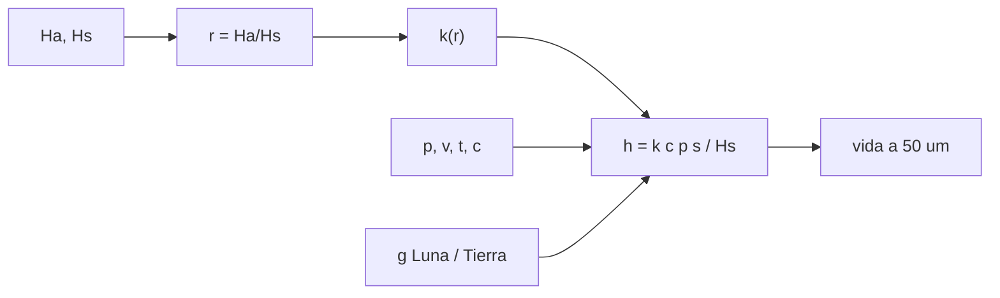

# B84-C36 — Desgaste abrasivo por regolito en mecanismos

<!-- nav:top -->
[🏠 Programa](../../../../README.md) · [📚 Bloque B84](../../../tronco-comun/B84-estructuras-materiales-y-fabricacion-espacial.md) · [← Anterior: B84-C35 — Control de procesos de fabricación y calidad](../B84-C35-control-de-procesos-de-fabricacion-y-calidad/CLASE.md) · [Siguiente: B84-C37 — Compuestos y aglomerantes a base de regolito →](../B84-C37-compuestos-y-aglomerantes-a-base-de-regolito/CLASE.md)
<!-- /nav -->

## 1. Ubicación, nivel y alcance

Clase 36 del bloque B84. Nivel N3. El polvo lunar es abrasivo, cortante y se adhiere a todo. Aquí aplicas la ley de Archard con una regla de dureza relativa a un sello deslizante bajo regolito, comparas cinco superficies, evalúas el efecto de la gravedad lunar y la sensibilidad a la dureza del abrasivo. Todas las durezas y los coeficientes de desgaste son **ilustrativos** (órdenes de magnitud inventados); ningún dato de regolito se consultó.

## 2. Por qué esta clase existe

Un sello de acero inoxidable bajo regolito pierde 1,8 mm en 1000 h con un 10 % del área expuesta a polvo, y uno de carburo de volframio pierde 0,18 µm: la elección de dureza decide si el mecanismo vive. La decisión central: **¿qué superficie y qué estrategia de protección permiten que un mecanismo sobreviva al regolito?**

## 3. Lo que podrás hacer al terminar

1. Aplicar `h = k c p s/H` (Archard).
2. Usar la regla de dureza relativa `H_a/H_s` para elegir el coeficiente `k`.
3. Calcular la vida hasta un desgaste admisible.
4. Estimar el efecto de la gravedad lunar.
5. Medir la sensibilidad a la dureza del abrasivo.
6. Rotular lo ilustrativo.

La evidencia es la **ficha de desgaste abrasivo por regolito** del ejercicio 12 (sección 20).

## 4. Con qué llegas y cómo comprobarlo

1. ¿Qué es el desgaste de Archard?
2. ¿Qué es la dureza?
3. ¿Qué es un abrasivo?
4. ¿Qué es la presión de contacto?
5. ¿Qué es el regolito?

<details>
<summary>Ver respuestas</summary>

1. `V = k F s/H`: volumen desgastado proporcional a carga y distancia, inverso a la dureza. 2. La resistencia a la indentación, en GPa. 3. Una partícula dura que arranca material. 4. Fuerza dividida por área. 5. El polvo y fragmentos que cubren la superficie lunar.
</details>

Con cuatro o cinco aciertos, sigue; si no, repasa los prerrequisitos.

## 5. Un caso de contexto y casos de referencia

Con un abrasivo de `H_a = 6 GPa` (ilustrativo), presión `0,2 MPa` y `v = 0,05 m/s` durante `1000 h` y `c = 0,1`: aluminio 6061 `3273 µm`, acero 304 `1800 µm`, anodizado duro `900 µm`, acero endurecido `1,38 µm` y carburo de volframio `0,18 µm`. En la Luna, con carga por peso, el desgaste es `16,5 %` del terrestre. **Ejemplo conductor.** Todo ilustrativo.

## 6. Vocabulario

La **ley de Archard** da la profundidad de desgaste `h = k c p s/H_s`. La **regla de dureza relativa** supone abrasión severa (`k ≈ 10⁻³`) si `H_a/H_s ≥ 1,2` y suave (`k ≈ 10⁻⁶`) si `≤ 0,8`. La **fracción expuesta** `c` es el área con abrasivo. La **vida** es el tiempo hasta un desgaste admisible.

## 7. Modelo mental: lijar una pieza con papel más o menos duro que ella



*Descripción textual:* la razón de durezas fija el coeficiente, que con presión, distancia y área expuesta da el desgaste y la vida; la gravedad escala la presión.

Analogía: el papel de lija solo corta a materiales más blandos que el grano. Límite: la regla de dureza relativa es una simplificación; el desgaste real depende de forma, tamaño y fragmentación de los granos.

## 8. La explicación, paso a paso

### 8.1 Superficies

| Superficie | `H_s` (GPa) | `r` | `k` | `h(1000 h, c=1)` (µm) | `h(c=0,1)` (µm) | Vida a 50 µm (h) |
|---|---|---|---|---|---|---|
| Al 6061 | 1,1 | 5,45 | 10⁻³ | 32 730 | 3273 | 15,3 |
| Acero 304 | 2,0 | 3,00 | 10⁻³ | 18 000 | 1800 | 27,8 |
| Al anodizado duro | 4,0 | 1,50 | 10⁻³ | 9000 | 900 | 55,6 |
| Acero endurecido | 7,0 | 0,86 | 2,68 × 10⁻⁶ | 13,8 | 1,38 | 36 240 |
| Carburo de volframio | 20 | 0,30 | 10⁻⁶ | 1,8 | 0,18 | 277 800 |

Pasar de `r > 1,2` a `r < 0,8` baja la tasa de desgaste 1000 veces: la dureza de la superficie por encima de la del abrasivo es lo que protege.

### 8.2 Verificación

La integración por pasos del acero 304 da `18 000,000 µm`, igual a la fórmula cerrada (`1,7 × 10⁻¹⁴`); `h(2t) = 2h(t)` exacto.

### 8.3 Gravedad

Con presión proporcional al peso, el desgaste en la Luna es `297,3 µm` frente a `1800 µm` en la Tierra: cociente `0,1652 = g_L/g_T`. Los contactos de resorte no dependen de `g`.

### 8.4 Dureza del abrasivo

En el acero 304 con `c = 0,1`: `H_a = 2 GPa` (`r = 1,0`) da `56,9 µm`; con `H_a ≥ 3 GPa` (`r ≥ 1,5`), `1800 µm`: un abrasivo más duro que `1,2 H_s` entra en el régimen severo.

## 9. Magnitudes, símbolos y unidades

| Símbolo | Qué es | Unidad | Valor / nota |
|---|---|---|---|
| `H_a`, `H_s` | dureza del abrasivo y de la superficie | GPa | 6,0; 1,1–20 |
| `k` | coeficiente de desgaste | — | 10⁻⁶ a 10⁻³ |
| `p` | presión de contacto | MPa | 0,2 |
| `c` | fracción expuesta | — | 0,1; 1 |
| `h` | profundidad de desgaste | µm | 0,18–32 730 |
| `g` | gravedad | m/s² | 9,80665; 1,62 |

## 10. Convenciones y referencias

SI y µm. Regla de dureza ilustrativa; `p`, `v`, `c` y durezas ilustrativos. `g_Tierra` del NIST (consultado en la clase B84-C01 el 2026-11-10); `g_Luna = 1,62` ilustrativo. Tolerancias: integración por pasos frente a la cerrada < 10⁻⁹.

## 11. De dónde sale lo que afirmamos

| ID | Fuente | Localizador | Respalda | Estado |
|---|---|---|---|---|
| S1 | NIST, CODATA, aceleración estándar de la gravedad — https://physics.nist.gov/cgi-bin/cuu/Value?gn (consultada 2026-11-10) | valor de `gₙ` | `gₙ` = 9,806 65 m/s² (exacto por definición) | Consultada |
| — | Durezas, coeficientes de Archard y propiedades del regolito lunar | — | todos los valores del abrasivo y las superficies y la regla de dureza | No consultada en una fuente concreta |

Límites: no se consultó ningún dato de regolito ni de tribología espacial; todos los valores son órdenes de magnitud ilustrativos; no es una predicción de vida de un mecanismo.

## 12. Cómo ver el desgaste por regolito

| Magnitud | Valor |
|---|---|
| Acero 304 (1000 h, `c = 0,1`) | 1800 µm |
| Acero endurecido | 1,38 µm |
| Carburo de volframio | 0,18 µm |
| Cociente Luna/Tierra | 0,1652 |
| Vida del acero 304 a 50 µm | 27,8 h |

Descripción larga: una superficie más dura que el abrasivo reduce el desgaste en más de 1000 veces.

## 13. Ejemplo trabajado: el desgaste del acero 304

**Paso 1 · Distancia.** `s = 0,05 × 3,6e6 = 1,8 × 10⁵ m`.

**Paso 2 · Archard.** `h = 10⁻³ × 0,1 × 0,2e6 × 1,8e5/2e9 = 1,8 × 10⁻³ m`.

**Paso 3 · Resultado.** `1800 µm`.

## 14. Distintas formas de describir el desgaste de una superficie

**Por modelo:** Archard. **Por regla:** `H_a/H_s`. **Por exposición:** `c`. **Por vida:** horas hasta 50 µm. **Por gravedad:** `g_L/g_T`.

## 15. Práctica guiada

**Ejercicio 1 · con los pasos indicados** Calcula `r` de un acero de `H_s = 7 GPa` con `H_a = 6`. *Pasos:* `6/7`.

<details><summary>Solución comentada</summary>

`0,857` (suave).
</details>

**Ejercicio 2 · con los pasos indicados** ¿Qué `k` usa la regla si `r = 3`? *Pista:* `r ≥ 1,2`.

<details><summary>Solución comentada</summary>

`10⁻³`.
</details>

**Ejercicio 3 · con los pasos indicados** ¿Por qué el desgaste lunar es 16,5 % del terrestre? *Casi autónomo.*

<details><summary>Solución comentada</summary>

Porque `p ∝ g` en contactos cargados por el peso.
</details>

## 16. Práctica autónoma, transferencia e integrador

**Ejercicio 4 · autónomo** `h` del acero 304 con `c = 0,01`.

<details><summary>Solución comentada</summary>

`180 µm`.
</details>

**Ejercicio 5 · autónomo** Vida del Al anodizado con `c = 0,01`.

<details><summary>Solución comentada</summary>

`555,6 h`.
</details>

**Ejercicio 6 · autónomo** `h` del carburo con `c = 1` en 100 h.

<details><summary>Solución comentada</summary>

`0,18 µm`.
</details>

**Ejercicio 7 · autónomo** `k` con `r = 1,0` (interpolación).

<details><summary>Solución comentada</summary>

`3,16 × 10⁻⁵`.
</details>

**Ejercicio 8 · autónomo** ¿Qué pasa si `p` se duplica?

<details><summary>Solución comentada</summary>

`h` se duplica.
</details>

**Ejercicio 9 · transferencia. **Transferencia.**** Un diseñador cambia a acero 304 y a un recubrimiento duro. ¿Qué aporta la dureza?

<details><summary>Solución comentada</summary>

Pasa a `r < 0,8` si el recubrimiento es mucho más duro que el regolito.
</details>

**Ejercicio 10 · transferencia. **Transferencia.**** Un sello puede sellarse contra el polvo con un fuelle. ¿Qué cambia?

<details><summary>Solución comentada</summary>

`c` baja a casi 0 mientras el sello esté íntegro.
</details>

**Ejercicio 11 · transferencia. **Transferencia.**** ¿Es suficiente un ensayo de 100 h con simulante?

<details><summary>Solución comentada</summary>

No: el simulante y el entorno (vacío, temperatura, carga electrostática) deben representar el real.
</details>

**Ejercicio 12 · integrador. **Integrador.**** Elabora tu *ficha de desgaste abrasivo por regolito*: tabla de cinco superficies, vida, efecto de la gravedad y sensibilidad a `H_a`, rotulando lo ilustrativo.

<details><summary>Solución comentada</summary>

Secciones 8.1–8.4 y la salida del laboratorio.
</details>

## 17. Laboratorio: desgaste de Archard bajo regolito

El script [regolito_desgaste.py](regolito_desgaste.py) calcula el desgaste de cinco superficies con la regla de dureza, la vida, el efecto de la gravedad y la sensibilidad a la dureza del abrasivo (**comprueba** integración por pasos frente a la cerrada (< 1e-9) y `h` lineal en el tiempo).

**Datos:** todo **ilustrativo**. **Predice antes de ejecutar:** ¿cuántas veces menos desgasta el carburo que el acero 304? (10⁴ veces.) **Ejecución del 2026-11-10 (Python 3.12.9):**

```text
Python 3.12.9 (biblioteca estandar)
Abrasivo ILUSTRATIVO H_a = 6,0 GPa; presion de contacto 0,2 MPa; v = 0,05 m/s; k(r) de la regla de dureza (ilustrativa)
superficie                 H_s [GPa]  r=Ha/Hs         k  h(1000 h, c=1) [um]  h(1000 h, c=0,1) [um]   vida a 50 um, c=0,1 [h]
Aluminio 6061                    1.1     5.45  1.00e-03            3.273e+04                   3273                     15.28
Acero 304                        2.0     3.00  1.00e-03              1.8e+04                   1800                     27.78
Aluminio anodizado duro          4.0     1.50  1.00e-03                 9000                    900                     55.56
Acero endurecido                 7.0     0.86  2.68e-06                 13.8                   1.38                 3.624e+04
Carburo de volframio            20.0     0.30  1.00e-06                  1.8                   0.18                 2.778e+05
Integracion por pasos del acero 304: 18000.000000 um ; formula cerrada: 18000.000000 um ; dif relativa = 1.7e-14
Linealidad h(2t) = 2 h(t): dif relativa = 0.0e+00
Efecto de la gravedad para un contacto cargado por el peso (p proporcional a g), acero 304, 1000 h, c = 0,1:
  Tierra: 1800.000 um ; Luna (g = 1,62): 297.349 um ; cociente = 0.1652 = g_L/g_T = 0.1652
Sensibilidad a la dureza del abrasivo (acero 304, c = 0,1, 1000 h):
  H_a = 2.0 GPa: r = 1.00, k = 3.16e-05, h =     56.92 um
  H_a = 3.0 GPa: r = 1.50, k = 1.00e-03, h =      1800 um
  H_a = 4.0 GPa: r = 2.00, k = 1.00e-03, h =      1800 um
  H_a = 6.0 GPa: r = 3.00, k = 1.00e-03, h =      1800 um
  H_a = 8.0 GPa: r = 4.00, k = 1.00e-03, h =      1800 um
Pruebas superadas.
```

```bash
python programa/clases/B84/B84-C36-desgaste-abrasivo-por-regolito-en-mecanismos/regolito_desgaste.py
```

**Límites:** regla de dureza simplificada; sin fragmentación ni adhesión; presión constante.

## 18. Errores frecuentes y cómo corregirlos

**Elegir el material solo por resistencia.** Se corrige con 8.1.

**Olvidar la fracción expuesta.** Se corrige con el ejercicio 4.

**Suponer que la gravedad lunar siempre reduce el desgaste.** Se corrige con 8.3.

**Tomar las durezas como datos del regolito.** Se corrige con la sección 10.

## 19. Cómo sabrás que vas bien

Tras la sección 8: ¿qué superficie esperabas más resistente? Si dudas, repasa el ejemplo 13. Tras el laboratorio: ¿qué comprueba? (ver la sección 17).

## 20. Qué entregas y cómo se evalúa

El producto es tu **ficha de desgaste abrasivo por regolito** (ejercicio 12).

| Criterio | Inicial | En desarrollo | Logrado | Destacado |
|---|---|---|---|---|
| Conceptos | Los confunde | Parciales | Calcula desgaste y vida bajo regolito | Explica los límites |
| Cálculo | Sin unidades | Con errores | Tablas completas con unidades | Calcula casos nuevos |
| Numérico | Sin comprobar | Un caso | Contraste con una segunda vía | Interpreta las diferencias |
| Fuentes | Sin fuente | Sin fecha | Fuentes con fecha y estado | Declara lo ilustrativo y lo no consultado |
| Límites | No los nombra | Uno | Tres | Discute qué falta del modelo |

**Condiciones críticas (no se compensan con promedio):** rotular los datos ilustrativos y sintéticos como tales; no presentar un cálculo como ensayo ni como dato de vuelo; citar solo lo consultado.

## 21. Ética, seguridad y límites

Clase educativa: los modelos son simplificados y sus datos son sintéticos, ilustrativos o valores de estándar rotulados; **no es una base de diseño de hardware de vuelo** y ningún resultado sustituye a datos de material cualificados, a los documentos vigentes de la agencia o del lanzador ni a la revisión por personal competente. Accesibilidad: tablas equivalentes a las gráficas, fórmulas en texto, ejercicios sin conexión.

## 22. Para cerrar y seguir

El acero 304 pierde `1800 µm` en 1000 h con `c = 0,1` y el carburo `0,18 µm`. Queda una pregunta: ¿se puede construir con el propio regolito?

**Glosario español–inglés.** desgaste abrasivo · *abrasive wear*; regolito · *regolith*; ley de Archard · *Archard's law*; dureza · *hardness*; sello · *seal*.

**Continuidad.** [B84-C37](../B84-C37-compuestos-y-aglomerantes-a-base-de-regolito/CLASE.md) estudia compuestos y aglomerantes a base de regolito.

**Referencias:** ver sección 11.

<!-- nav:bottom -->
---

[← Anterior: B84-C35 — Control de procesos de fabricación y calidad](../B84-C35-control-de-procesos-de-fabricacion-y-calidad/CLASE.md) · [📚 Bloque B84](../../../tronco-comun/B84-estructuras-materiales-y-fabricacion-espacial.md) · [Siguiente: B84-C37 — Compuestos y aglomerantes a base de regolito →](../B84-C37-compuestos-y-aglomerantes-a-base-de-regolito/CLASE.md)
<!-- /nav -->
