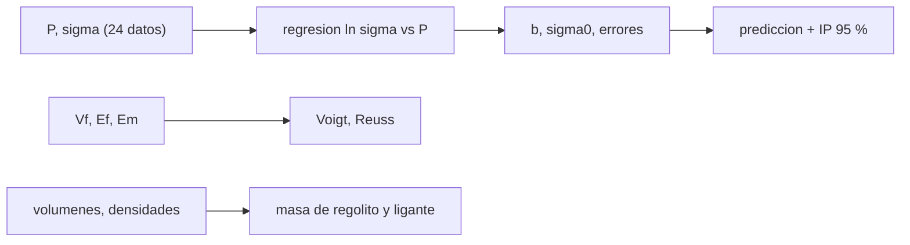

# B84-C37 — Compuestos y aglomerantes a base de regolito

<!-- nav:top -->
[🏠 Programa](../../../../README.md) · [📚 Bloque B84](../../../tronco-comun/B84-estructuras-materiales-y-fabricacion-espacial.md) · [← Anterior: B84-C36 — Desgaste abrasivo por regolito en mecanismos](../B84-C36-desgaste-abrasivo-por-regolito-en-mecanismos/CLASE.md) · [Siguiente: B84-C38 — Producción de piezas y repuestos con materia prima in situ →](../B84-C38-produccion-de-piezas-y-repuestos-con-materia-prima-in-situ/CLASE.md)
<!-- /nav -->

## 1. Ubicación, nivel y alcance

Clase 37 del bloque B84. Nivel N3. El regolito mezclado con un ligante forma ladrillos y piezas estructurales. Aquí ajustas la relación resistencia–porosidad de Ryshkewitch a 24 resistencias **sintéticas**, calculas el intervalo de predicción, las cotas de rigidez de Voigt y Reuss para un compuesto de regolito y ligante y la masa de ligante de un ladrillo. Todos los datos son sintéticos o ilustrativos; ningún dato de simulante de regolito se consultó.

## 2. Por qué esta clase existe

La resistencia de un compuesto cae exponencialmente con la porosidad: pasar de 10 a 25 % de huecos divide la resistencia por 2,4. La decisión central: **¿qué porosidad máxima permite cumplir una resistencia mínima y cuánto ligante hay que transportar?**

## 3. Lo que podrás hacer al terminar

1. Ajustar `σ = σ₀ e^(−bP)` por regresión de `ln σ` frente a `P`.
2. Calcular errores típicos y el intervalo de predicción.
3. Calcular las cotas de rigidez de Voigt y Reuss.
4. Estimar la masa de regolito y de ligante de un ladrillo.
5. Comprobar que el ajuste recupera los parámetros verdaderos.
6. Rotular lo sintético y lo ilustrativo.

La evidencia es la **ficha de un compuesto de regolito y su porosidad** del ejercicio 12 (sección 20).

## 4. Con qué llegas y cómo comprobarlo

1. ¿Qué es la porosidad?
2. ¿Qué es una regresión lineal?
3. ¿Qué es un intervalo de predicción?
4. ¿Qué es una cota de Voigt?
5. ¿Qué es un aglomerante?

<details>
<summary>Ver respuestas</summary>

1. La fracción de huecos del volumen. 2. Ajuste por mínimos cuadrados de una recta. 3. El rango en que cae una nueva observación con cierta probabilidad. 4. La rigidez si ambas fases se deforman por igual. 5. Un material que une partículas, como el azufre fundido o un polímero.
</details>

Con cuatro o cinco aciertos, sigue; si no, repasa los prerrequisitos.

## 5. Un caso de contexto y casos de referencia

Con `σ₀ = 110 MPa` y `b = 5,8` (verdaderos) y 8 % de ruido, el ajuste da `b = 5,786 ± 0,154` y `σ₀ = 112,59 MPa` (`R² = 0,9846`). Con `P = 0,25`, `σ = 26,50 MPa` con intervalo de predicción `[21,86; 32,13]`. Con `V_f = 0,6`, `E_f = 60 GPa` y `E_m = 5 GPa`, la rigidez cae entre `Reuss 11,11` y `Voigt 38,00 GPa`. Un ladrillo de 1 L usa `1,860 kg` de regolito y `0,600 kg` de ligante. **Ejemplo conductor.** Datos sintéticos e ilustrativos.

## 6. Vocabulario

La **relación de Ryshkewitch** es `σ = σ₀ exp(−bP)`. Las **cotas de Voigt y Reuss** son `E_V = V_f E_f + (1 − V_f)E_m` y `E_R = 1/(V_f/E_f + (1 − V_f)/E_m)`. El **intervalo de predicción** cubre una nueva medida, no solo la media. La **porosidad residual** son los huecos que quedan tras compactar.

## 7. Modelo mental: un muro de piedras con más o menos mortero



*Descripción textual:* los datos dan `b` y `σ₀` con sus errores y las predicciones; las fases dan las cotas de rigidez; los volúmenes dan las masas.

Analogía: un muro con más huecos entre piedras resiste menos; con menos mortero también. Límite: la relación exponencial es empírica y válida en un rango de porosidad; la rigidez real depende de la microestructura.

## 8. La explicación, paso a paso

### 8.1 Ajuste

24 datos con `P` de 0,05 a 0,45. Regresión de `ln σ`: `b = 5,786 ± 0,154` (verdadero `5,8`), `ln σ₀ = 4,7238 ± 0,0428` (`σ₀ = 112,59 MPa`, verdadero 110), `R² = 0,9846`, desviación residual en `ln` `0,0909`. El ajuste recupera los parámetros verdaderos dentro de 3 errores típicos.

### 8.2 Predicciones

| `P` | `σ` (MPa) | Intervalo 95 % | Verdadera |
|---|---|---|---|
| 0,10 | 63,13 | [51,77; 76,98] | 61,59 |
| 0,20 | 35,39 | [29,18; 42,94] | 34,48 |
| 0,25 | 26,50 | [21,86; 32,13] | 25,80 |
| 0,35 | 14,86 | [12,22; 18,06] | 14,45 |
| 0,45 | 8,33 | [6,80; 10,20] | 8,09 |

### 8.3 Rigidez

`V_f` 0,3; 0,5; 0,6; 0,7; 0,8: Voigt `21,50; 32,50; 38,00; 43,50; 49,00 GPa`; Reuss `6,90; 9,23; 11,11; 13,95; 18,75`. La rigidez real queda entre ambas; la cota de Reuss es la prudente.

### 8.4 Masa

Ladrillo `0,20 × 0,10 × 0,05 m = 1,0 L` con 30 % de ligante y 10 % de porosidad: con `V_regolito = 1 − 0,30 − 0,10 = 0,60`, regolito `0,60 × 3100 × 10⁻³ = 1,860 kg`; ligante `0,30 × 2000 × 10⁻³ = 0,600 kg` (24,4 % de la masa). Para 1000 ladrillos: `600 kg` de ligante y `1860 kg` de regolito local.

## 9. Magnitudes, símbolos y unidades

| Símbolo | Qué es | Unidad | Valor / nota |
|---|---|---|---|
| `σ₀`, `b` | parámetros de Ryshkewitch | MPa, — | 112,59; 5,786 |
| `P` | porosidad | — | 0,05–0,45 |
| `R²` | coef. de determinación | — | 0,9846 |
| `E_V`, `E_R` | cotas de rigidez | GPa | 38,00; 11,11 |
| `V_f` | fracción de regolito | — | 0,60 |
| masas | regolito y ligante del ladrillo | kg | 1,860; 0,600 |

## 10. Convenciones y referencias

MPa, GPa, kg. Datos sintéticos con semilla 84037, ruido lognormal 8 %. `t = 2,074` (22 g.l., recordado, no consultado). Ladrillo `0,20 × 0,10 × 0,05 m`, ligante 30 %, porosidad 10 %. Tolerancias: ajuste dentro de 3 errores típicos; `E_R ≤ E_V`.

## 11. De dónde sale lo que afirmamos

| ID | Fuente | Localizador | Respalda | Estado |
|---|---|---|---|---|
| — | Propiedades de simulantes de regolito y de aglomerantes; relación de Ryshkewitch | — | todos los valores y la forma exponencial, que se verifica con datos sintéticos | No consultada en una fuente concreta |

Límites: datos sintéticos e ilustrativos; no se consultó ningún simulante ni aglomerante real; la relación es empírica.

## 12. Cómo ver el compuesto

| Magnitud | Valor |
|---|---|
| `b` ajustado | 5,786 ± 0,154 |
| `σ` a `P = 0,25` | 26,50 MPa |
| Voigt, `V_f = 0,6` | 38,00 GPa |
| Reuss, `V_f = 0,6` | 11,11 GPa |
| Ligante por ladrillo | 0,600 kg |

Descripción larga: la resistencia cae un 60 % entre `P = 0,10` y `0,25`; la rigidez tiene un rango de 3,4 veces entre las cotas.

## 13. Ejemplo trabajado: la resistencia a `P = 0,25`

**Paso 1 · Exponente.** `−5,786 × 0,25 = −1,4465`.

**Paso 2 · Exponencial.** `e^(−1,4465) = 0,2354`.

**Paso 3 · Resistencia.** `112,59 × 0,2354 = 26,50 MPa`.

## 14. Distintas formas de describir un compuesto de regolito

**Por resistencia:** `σ(P)`. **Por rigidez:** cotas. **Por composición:** `V_f`, ligante. **Por incertidumbre:** intervalo de predicción. **Por masa:** kg por ladrillo.

## 15. Práctica guiada

**Ejercicio 1 · con los pasos indicados** Calcula `σ` con `P = 0,10`, `σ₀ = 112,59` y `b = 5,786`. *Pasos:* `σ₀ e^(−bP)`.

<details><summary>Solución comentada</summary>

`63,1 MPa`.
</details>

**Ejercicio 2 · con los pasos indicados** Calcula Voigt con `V_f = 0,5`. *Pista:* promedio ponderado.

<details><summary>Solución comentada</summary>

`32,5 GPa`.
</details>

**Ejercicio 3 · con los pasos indicados** ¿Por qué Reuss es menor que Voigt? *Casi autónomo.*

<details><summary>Solución comentada</summary>

Porque supone tensión uniforme (serie) y la fase blanda domina.
</details>

## 16. Práctica autónoma, transferencia e integrador

**Ejercicio 4 · autónomo** `P` para `σ = 20 MPa`.

<details><summary>Solución comentada</summary>

`P = ln(112,59/20)/5,786 = 0,299`.
</details>

**Ejercicio 5 · autónomo** Efecto de subir `P` de 0,10 a 0,20.

<details><summary>Solución comentada</summary>

`σ` cae de 63,1 a 35,4 MPa (−44 %).
</details>

**Ejercicio 6 · autónomo** `E_R` con `V_f = 0,8`.

<details><summary>Solución comentada</summary>

`18,75 GPa`.
</details>

**Ejercicio 7 · autónomo** Masa de ligante de 10 ladrillos.

<details><summary>Solución comentada</summary>

`6,0 kg`.
</details>

**Ejercicio 8 · autónomo** `R²` indica…

<details><summary>Solución comentada</summary>

Que el 98,5 % de la variación de `ln σ` la explica `P`.
</details>

**Ejercicio 9 · transferencia. **Transferencia.**** Un ladrillo con `P = 0,4` debe soportar 20 MPa. ¿Sirve?

<details><summary>Solución comentada</summary>

No: predice `≈ 11 MPa`; hace falta compactar más.
</details>

**Ejercicio 10 · transferencia. **Transferencia.**** Un ligante hay que traerlo de la Tierra. ¿Qué optimizas?

<details><summary>Solución comentada</summary>

Reduces el porcentaje de ligante sin subir `P` demasiado.
</details>

**Ejercicio 11 · transferencia. **Transferencia.**** El simulante de regolito difiere del real. ¿Qué haces con el ajuste?

<details><summary>Solución comentada</summary>

Lo tratas como válido solo para el simulante.
</details>

**Ejercicio 12 · integrador. **Integrador.**** Elabora tu *ficha de un compuesto de regolito y su porosidad*: ajuste con errores, predicciones con intervalo, cotas de rigidez y masas del ladrillo, rotulando lo sintético.

<details><summary>Solución comentada</summary>

Secciones 8.1–8.4 y la salida del laboratorio.
</details>

## 17. Laboratorio: resistencia–porosidad y cotas de rigidez

El script [regolito_compuesto.py](regolito_compuesto.py) ajusta Ryshkewitch a 24 datos sintéticos, calcula las cotas de rigidez y la masa de ligante (**comprueba** el ajuste recupera `σ₀` y `b` dentro de 3 errores típicos y `E_R ≤ E_V`).

**Datos:** resistencias **sintéticas**; propiedades **ilustrativas**. **Predice antes de ejecutar:** ¿recuperará el ajuste `b = 5,8`? (sí: 5,786 ± 0,154.) **Ejecución del 2026-11-10 (Python 3.12.9):**

```text
Python 3.12.9 (biblioteca estandar)
24 resistencias SINTETICAS: sigma0 = 110 MPa, b = 5,8 (verdaderos), ruido lognormal de 8 %
Ajuste de Ryshkewitch: b = 5.786 +/- 0.154 ; sigma0 = 112.59 MPa (ln sigma0 = 4.7238 +/- 0.0428) ; R2 = 0.9846 ; desviacion residual en ln = 0.0909
Prediccion (media y intervalo de prediccion al 95 %) segun la porosidad:
  P = 0.10: sigma =   63.13 MPa  [  51.77,   76.98]  (verdadera   61.59)
  P = 0.20: sigma =   35.39 MPa  [  29.18,   42.94]  (verdadera   34.48)
  P = 0.25: sigma =   26.50 MPa  [  21.86,   32.13]  (verdadera   25.80)
  P = 0.35: sigma =   14.86 MPa  [  12.22,   18.06]  (verdadera   14.45)
  P = 0.45: sigma =    8.33 MPa  [   6.80,   10.20]  (verdadera    8.09)
Cotas de rigidez con V_f = 0.6: Voigt = 38.00 GPa ; Reuss = 11.11 GPa ; la rigidez real esta entre ambas (E_R <= E <= E_V)
Rigidez frente a la fraccion de regolito (Voigt / Reuss, GPa):
  V_f = 0.3: Voigt =  21.50 ; Reuss =   6.90
  V_f = 0.5: Voigt =  32.50 ; Reuss =   9.23
  V_f = 0.6: Voigt =  38.00 ; Reuss =  11.11
  V_f = 0.7: Voigt =  43.50 ; Reuss =  13.95
  V_f = 0.8: Voigt =  49.00 ; Reuss =  18.75
Ladrillo de 1.0 L: regolito = 1.860 kg ; ligante = 0.600 kg ; masa total = 2.460 kg ; ligante = 24.4 % de la masa
Para 1000 ladrillos: ligante a transportar desde la Tierra (si no hay ligante in situ) = 600 kg ; regolito local = 1860 kg
Pruebas superadas.
```

```bash
python programa/clases/B84/B84-C37-compuestos-y-aglomerantes-a-base-de-regolito/regolito_compuesto.py
```

**Límites:** relación empírica; sin variabilidad entre lotes; cotas, no rigidez real.

## 18. Errores frecuentes y cómo corregirlos

**Usar la media en vez del intervalo de predicción.** Se corrige con 8.2.

**Confundir cota con valor.** Se corrige con 8.3.

**Olvidar la porosidad residual.** Se corrige con 8.4.

**Presentar datos sintéticos como de simulante.** Se corrige con la sección 10.

## 19. Cómo sabrás que vas bien

Tras la sección 8: ¿qué `σ` esperabas a `P = 0,25`? Si dudas, repasa el ejemplo 13. Tras el laboratorio: ¿qué comprueba? (ver la sección 17).

## 20. Qué entregas y cómo se evalúa

El producto es tu **ficha de un compuesto de regolito y su porosidad** (ejercicio 12).

| Criterio | Inicial | En desarrollo | Logrado | Destacado |
|---|---|---|---|---|
| Conceptos | Los confunde | Parciales | Ajusta, predice y calcula cotas | Explica los límites |
| Cálculo | Sin unidades | Con errores | Tablas completas con unidades | Calcula casos nuevos |
| Numérico | Sin comprobar | Un caso | Contraste con una segunda vía | Interpreta las diferencias |
| Fuentes | Sin fuente | Sin fecha | Fuentes con fecha y estado | Declara lo ilustrativo y lo no consultado |
| Límites | No los nombra | Uno | Tres | Discute qué falta del modelo |

**Condiciones críticas (no se compensan con promedio):** rotular los datos ilustrativos y sintéticos como tales; no presentar un cálculo como ensayo ni como dato de vuelo; citar solo lo consultado.

## 21. Ética, seguridad y límites

Clase educativa: los modelos son simplificados y sus datos son sintéticos, ilustrativos o valores de estándar rotulados; **no es una base de diseño de hardware de vuelo** y ningún resultado sustituye a datos de material cualificados, a los documentos vigentes de la agencia o del lanzador ni a la revisión por personal competente. Accesibilidad: tablas equivalentes a las gráficas, fórmulas en texto, ejercicios sin conexión.

## 22. Para cerrar y seguir

Con `P = 0,25` el compuesto resiste `26,5 MPa` y cada ladrillo lleva `0,6 kg` de ligante. Queda una pregunta: ¿cómo se produce un repuesto completo con material local?

**Glosario español–inglés.** regolito · *regolith*; aglomerante · *binder*; porosidad · *porosity*; cota de Voigt · *Voigt bound*; intervalo de predicción · *prediction interval*.

**Continuidad.** [B84-C38](../B84-C38-produccion-de-piezas-y-repuestos-con-materia-prima-in-situ/CLASE.md) estudia la producción de piezas y repuestos con materia prima in situ.

**Referencias:** ver sección 11.

<!-- nav:bottom -->
---

[← Anterior: B84-C36 — Desgaste abrasivo por regolito en mecanismos](../B84-C36-desgaste-abrasivo-por-regolito-en-mecanismos/CLASE.md) · [📚 Bloque B84](../../../tronco-comun/B84-estructuras-materiales-y-fabricacion-espacial.md) · [Siguiente: B84-C38 — Producción de piezas y repuestos con materia prima in situ →](../B84-C38-produccion-de-piezas-y-repuestos-con-materia-prima-in-situ/CLASE.md)
<!-- /nav -->
