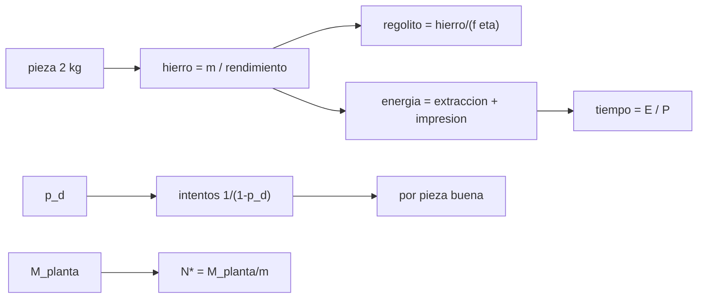

# B84-C38 — Producción de piezas y repuestos con materia prima in situ

<!-- nav:top -->
[🏠 Programa](../../../../README.md) · [📚 Bloque B84](../../../tronco-comun/B84-estructuras-materiales-y-fabricacion-espacial.md) · [← Anterior: B84-C37 — Compuestos y aglomerantes a base de regolito](../B84-C37-compuestos-y-aglomerantes-a-base-de-regolito/CLASE.md) · [Siguiente: B85-C01 — Balance radiativo de satélite →](../../B85/B85-C01-balance-radiativo-de-satelite/CLASE.md)
<!-- /nav -->

## 1. Ubicación, nivel y alcance

Clase 38 del bloque B84. Nivel N3. Cierra el bloque: la cadena regolito → hierro → pieza funcional. Aquí calculas el regolito, la energía y el tiempo para producir un repuesto de 2 kg con materia prima local, el efecto de los defectos con una simulación y el punto de equilibrio frente a transportar el repuesto desde la Tierra. **Todos los datos son ilustrativos** (órdenes de magnitud inventados); no hay datos de procesos ISRU consultados.

## 2. Por qué esta clase existe

Un repuesto que llega en 180 días puede producirse en 1,3 días, pero la planta pesa 400 kg y procesa 74 kg de regolito por pieza: el balance dice cuándo compensa. La decisión central: **¿cuántos repuestos hacen que producir in situ sea mejor que transportarlos?**

## 3. Lo que podrás hacer al terminar

1. Calcular la masa de regolito por pieza con rendimientos.
2. Calcular energía y tiempo por intento y por pieza buena.
3. Modelar los intentos con una distribución geométrica y Monte Carlo.
4. Estudiar la sensibilidad a la fracción de hierro.
5. Calcular el punto de equilibrio en masa transportada.
6. Rotular lo ilustrativo.

La evidencia es la **balance de masa y energía de un repuesto in situ** del ejercicio 12 (sección 20).

## 4. Con qué llegas y cómo comprobarlo

1. ¿Qué es un rendimiento?
2. ¿Qué es una distribución geométrica?
3. ¿Qué es un kWh?
4. ¿Qué es un balance de masa?
5. ¿Qué es un punto de equilibrio?

<details>
<summary>Ver respuestas</summary>

1. La fracción del insumo que llega al producto. 2. El número de intentos hasta el primer éxito; media `1/(1−p)`. 3. 3,6 MJ de energía. 4. Entradas = salidas + acumulación. 5. El número a partir del cual una opción gana.
</details>

Con cuatro o cinco aciertos, sigue; si no, repasa los prerrequisitos.

## 5. Un caso de contexto y casos de referencia

Un repuesto de `2,0 kg` con rendimiento de pieza `0,80` necesita `2,50 kg` de hierro, que con `f = 0,08` y `η = 0,50` requiere `62,5 kg` de regolito y `53,5 kWh` por intento (`26,8 h` a 2 kW). Con 15 % de defectos, `1,1765` intentos por pieza buena: `73,5 kg` de regolito, `62,9 kWh`, `1,31 días`. La planta de `400 kg` se compensa tras `200` repuestos. **Ejemplo conductor.** Todo ilustrativo.

## 6. Vocabulario

El **rendimiento de extracción** `η` es la fracción del hierro del regolito que se recupera. El **rendimiento de pieza** es la fracción del metal que acaba en la pieza. La **energía específica** son kWh por kg. El **punto de equilibrio** es `N* = M_planta/M_pieza`. Los **intentos** hasta una pieza buena siguen una geométrica de media `1/(1 − p_d)`.

## 7. Modelo mental: un molino que convierte una montaña de polvo en un tornillo



*Descripción textual:* la masa de la pieza da el hierro y el regolito; la energía da el tiempo; los defectos dan los intentos; la masa de la planta da el punto de equilibrio.

Analogía: un molino que convierte una montaña de polvo en un puñado de harina útil: lo que importa es cuánto polvo, cuánta energía y cuántas veces. Límite: se ignoran la logística, los consumibles, las fallas de la planta y el calor residual.

## 8. La explicación, paso a paso

### 8.1 Balance por intento

`hierro = 2,0/0,80 = 2,50 kg`; `regolito = 2,50/(0,08 × 0,50) = 62,5 kg` (residuo `60,0 kg`); `energía = 2,50 × 15 + 2,0 × 8 = 53,5 kWh` (`37,5` extracción y `16,0` impresión); tiempo `53,5/2 = 26,8 h`.

### 8.2 Defectos

Intentos esperados `1/(1 − 0,15) = 1,1765`; Monte Carlo (20 000, semilla 84038) `1,1728` (diferencia `0,31 %`). Por pieza buena: `73,5 kg` de regolito, `62,9 kWh`, `31,5 h = 1,31 días`, frente a `180 días` desde la Tierra.

### 8.3 Sensibilidad

`f = 0,04; 0,08; 0,12; 0,15` da `147,1; 73,5; 49,0; 39,2 kg` de regolito por pieza buena: inversamente proporcional a la fracción de hierro.

### 8.4 Equilibrio

`N* = 400/2 = 200` repuestos de 2 kg. Con 10, 50 y 100 repuestos transportar es más ligero; con 200 igual; con 500 la planta ahorra masa (`400` frente a `1000 kg`). El resultado cambia con la masa de consumibles y el reemplazo de piezas de la planta, que aquí se ignoran.

## 9. Magnitudes, símbolos y unidades

| Símbolo | Qué es | Unidad | Valor / nota |
|---|---|---|---|
| `m` | masa del repuesto | kg | 2,0 |
| `f`, `η` | fracción de hierro y rendimiento | — | 0,08; 0,50 |
| `m_reg` | regolito por intento | kg | 62,5 |
| `E` | energía por intento | kWh | 53,5 |
| `p_d` | probabilidad de defecto | — | 0,15 |
| `N*` | punto de equilibrio | repuestos | 200 |

## 10. Convenciones y referencias

kg, kWh, h. Todos los datos ilustrativos (hierro extraíble 8 %, 15 kWh/kg de extracción, 8 kWh/kg de impresión, planta de 400 kg, 2 kW). Semilla 84038. Tolerancia: Monte Carlo dentro de 2 % de la teoría.

## 11. De dónde sale lo que afirmamos

| ID | Fuente | Localizador | Respalda | Estado |
|---|---|---|---|---|
| — | Datos de extracción de metales del regolito, consumos de energía y masa de plantas ISRU | — | todos los valores del ejemplo | No consultada en una fuente concreta |

Límites: no se consultó ningún dato de ISRU; los valores son inventados como orden de magnitud; no es una evaluación de misión.

## 12. Cómo ver el balance in situ

| Magnitud | Valor |
|---|---|
| Regolito por pieza buena | 73,5 kg |
| Energía por pieza buena | 62,9 kWh |
| Tiempo | 1,31 días |
| Intentos esperados | 1,1765 |
| Equilibrio | 200 repuestos |

Descripción larga: producir tarda 1,3 días frente a 180 y se compensa en masa tras 200 repuestos.

## 13. Ejemplo trabajado: el regolito para 2 kg de pieza

**Paso 1 · Hierro.** `2,0/0,80 = 2,50 kg`.

**Paso 2 · Regolito.** `2,50/(0,08 × 0,50) = 62,5 kg`.

## 14. Distintas formas de describir la producción in situ

**Por masa:** hierro y regolito. **Por energía:** kWh. **Por tiempo:** horas. **Por calidad:** intentos. **Por economía:** `N*`.

## 15. Práctica guiada

**Ejercicio 1 · con los pasos indicados** Calcula el hierro para una pieza de 3 kg. *Pasos:* `3/0,8`.

<details><summary>Solución comentada</summary>

`3,75 kg`.
</details>

**Ejercicio 2 · con los pasos indicados** Calcula el tiempo con 53,5 kWh a 4 kW. *Pista:* `E/P`.

<details><summary>Solución comentada</summary>

`13,4 h`.
</details>

**Ejercicio 3 · con los pasos indicados** ¿Por qué `p_d = 0,15` da 1,1765 intentos? *Casi autónomo.*

<details><summary>Solución comentada</summary>

Porque `1/(1 − 0,15) = 1,1765`.
</details>

## 16. Práctica autónoma, transferencia e integrador

**Ejercicio 4 · autónomo** Regolito con `f = 0,12`.

<details><summary>Solución comentada</summary>

`41,7 kg` por intento.
</details>

**Ejercicio 5 · autónomo** Energía si la extracción baja a 10 kWh/kg.

<details><summary>Solución comentada</summary>

`2,50 × 10 + 16 = 41 kWh`.
</details>

**Ejercicio 6 · autónomo** `N*` con una planta de 300 kg.

<details><summary>Solución comentada</summary>

`150`.
</details>

**Ejercicio 7 · autónomo** Intentos esperados con `p_d = 0,3`.

<details><summary>Solución comentada</summary>

`1,43`.
</details>

**Ejercicio 8 · autónomo** Masa transportada de 300 repuestos de 2 kg.

<details><summary>Solución comentada</summary>

`600 kg`.
</details>

**Ejercicio 9 · transferencia. **Transferencia.**** Solo necesitas 20 repuestos. ¿Planta o transporte?

<details><summary>Solución comentada</summary>

Transporte: 40 kg frente a 400 kg.
</details>

**Ejercicio 10 · transferencia. **Transferencia.**** El regolito tiene 4 % de hierro. ¿Qué ocurre?

<details><summary>Solución comentada</summary>

El regolito por pieza se duplica.
</details>

**Ejercicio 11 · transferencia. **Transferencia.**** ¿Qué falta en este balance?

<details><summary>Solución comentada</summary>

Consumibles, fallas de la planta, logística, calor residual y calificación del repuesto.
</details>

**Ejercicio 12 · integrador. **Integrador.**** Elabora tu *balance de masa y energía de un repuesto in situ*: regolito, energía, tiempo, intentos esperados, sensibilidad a `f` y punto de equilibrio, rotulando lo ilustrativo.

<details><summary>Solución comentada</summary>

Secciones 8.1–8.4 y la salida del laboratorio.
</details>

## 17. Laboratorio: un repuesto con materia prima in situ

El script [insitu.py](insitu.py) calcula el balance, los intentos por Monte Carlo y el punto de equilibrio (**comprueba** Monte Carlo dentro del 2 % de la geométrica y `N* = 200`).

**Datos:** todo **ilustrativo**. **Predice antes de ejecutar:** ¿cuántos intentos esperados con 15 % de defectos? (≈ 1,18.) **Ejecución del 2026-11-10 (Python 3.12.9):**

```text
Python 3.12.9 (biblioteca estandar)
Repuesto de 2,0 kg (todos los datos ILUSTRATIVOS)
Hierro necesario = 2.50 kg (rendimiento de pieza 0.8) ; regolito procesado = 62.5 kg (f = 0.08, eta = 0.5) ; escoria/residuo = 60.0 kg
Energia por intento = 53.5 kWh (37.5 extraccion + 16.0 impresion) ; tiempo a 2.0 kW = 26.8 h = 1.11 dias
Intentos hasta una pieza buena: teorica = 1.1765 ; Monte Carlo = 1.1728 (dif 0.31 %)
Por pieza buena: regolito = 73.5 kg ; energia = 62.9 kWh ; tiempo = 31.5 h = 1.31 dias (frente a 180 dias desde la Tierra)
Sensibilidad a la fraccion de hierro extraible (regolito por pieza buena, kg):
  f = 0.04:   147.1 kg de regolito por pieza buena
  f = 0.08:    73.5 kg de regolito por pieza buena
  f = 0.12:    49.0 kg de regolito por pieza buena
  f = 0.15:    39.2 kg de regolito por pieza buena
Punto de equilibrio en masa transportada: la planta de 400 kg se compensa tras 200 repuestos de 2 kg (si se ignoran consumibles y repuestos de la propia planta)
Masa transportada acumulada segun el numero de repuestos necesarios (Tierra frente a planta):
    10 repuestos: Tierra =     20 kg ; planta =   400 kg -> el transporte es menor
    50 repuestos: Tierra =    100 kg ; planta =   400 kg -> el transporte es menor
   100 repuestos: Tierra =    200 kg ; planta =   400 kg -> el transporte es menor
   200 repuestos: Tierra =    400 kg ; planta =   400 kg -> masa igual
   500 repuestos: Tierra =   1000 kg ; planta =   400 kg -> la planta ahorra masa
Pruebas superadas.
```

```bash
python programa/clases/B84/B84-C38-produccion-de-piezas-y-repuestos-con-materia-prima-in-situ/insitu.py
```

**Límites:** sin logística ni consumibles; defectos independientes.

## 18. Errores frecuentes y cómo corregirlos

**Ignorar el rendimiento de la pieza.** Se corrige con 8.1.

**Olvidar los defectos.** Se corrige con 8.2.

**Dar el equilibrio sin consumibles.** Se corrige con 8.4.

**Presentar los valores como de un proceso real.** Se corrige con la sección 10.

## 19. Cómo sabrás que vas bien

Tras la sección 8: ¿cuánto regolito esperabas por pieza? Si dudas, repasa el ejemplo 13. Tras el laboratorio: ¿qué comprueba? (ver la sección 17).

## 20. Qué entregas y cómo se evalúa

El producto es tu **balance de masa y energía de un repuesto in situ** (ejercicio 12).

| Criterio | Inicial | En desarrollo | Logrado | Destacado |
|---|---|---|---|---|
| Conceptos | Los confunde | Parciales | Calcula el balance in situ | Explica los límites |
| Cálculo | Sin unidades | Con errores | Tablas completas con unidades | Calcula casos nuevos |
| Numérico | Sin comprobar | Un caso | Contraste con una segunda vía | Interpreta las diferencias |
| Fuentes | Sin fuente | Sin fecha | Fuentes con fecha y estado | Declara lo ilustrativo y lo no consultado |
| Límites | No los nombra | Uno | Tres | Discute qué falta del modelo |

**Condiciones críticas (no se compensan con promedio):** rotular los datos ilustrativos y sintéticos como tales; no presentar un cálculo como ensayo ni como dato de vuelo; citar solo lo consultado.

## 21. Ética, seguridad y límites

Clase educativa: los modelos son simplificados y sus datos son sintéticos, ilustrativos o valores de estándar rotulados; **no es una base de diseño de hardware de vuelo** y ningún resultado sustituye a datos de material cualificados, a los documentos vigentes de la agencia o del lanzador ni a la revisión por personal competente. Accesibilidad: tablas equivalentes a las gráficas, fórmulas en texto, ejercicios sin conexión.

## 22. Para cerrar y seguir

Un repuesto de `2 kg` requiere `73,5 kg` de regolito y `62,9 kWh` y se compensa tras `200` repuestos. Con esto el bloque cierra el recorrido: del lanzamiento a la fabricación lunar de piezas.

**Glosario español–inglés.** utilización de recursos in situ · *in-situ resource utilization (ISRU)*; repuesto · *spare part*; rendimiento · *yield*; punto de equilibrio · *break-even*; fabricación · *manufacturing*.

**Continuidad.** Fin del bloque B84. El bloque B85 continúa con la gestión térmica y el entorno espacial, en [su guía](../../../tronco-comun/B85-gestion-termica-y-entorno-espacial.md).

**Referencias:** ver sección 11.

<!-- nav:bottom -->
---

[← Anterior: B84-C37 — Compuestos y aglomerantes a base de regolito](../B84-C37-compuestos-y-aglomerantes-a-base-de-regolito/CLASE.md) · [📚 Bloque B84](../../../tronco-comun/B84-estructuras-materiales-y-fabricacion-espacial.md) · [Siguiente: B85-C01 — Balance radiativo de satélite →](../../B85/B85-C01-balance-radiativo-de-satelite/CLASE.md)
<!-- /nav -->
