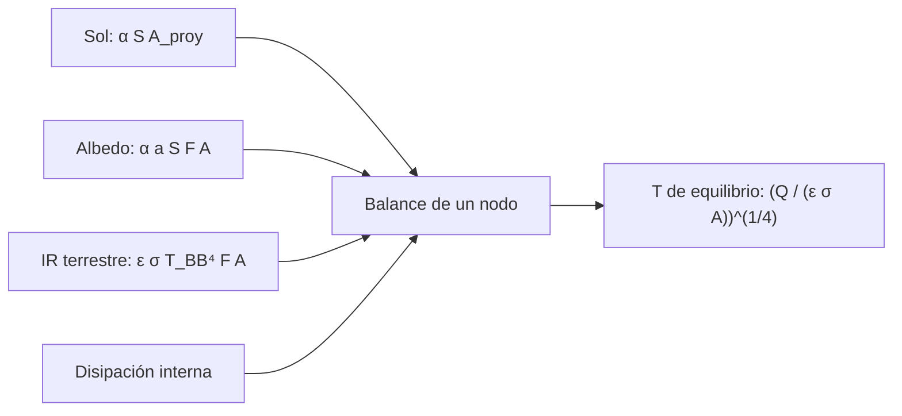

# B85-C01 — Balance radiativo de satélite

<!-- nav:top -->
[🏠 Programa](../../../../README.md) · [📚 Bloque B85](../../../tronco-comun/B85-gestion-termica-y-entorno-espacial.md) · [← Anterior: B84-C38 — Producción de piezas y repuestos con materia prima in situ](../../B84/B84-C38-produccion-de-piezas-y-repuestos-con-materia-prima-in-situ/CLASE.md) · [Siguiente: B85-C02 — Conducción térmica en estructuras →](../B85-C02-conduccion-termica-en-estructuras/CLASE.md)
<!-- /nav -->

## 1. Ubicación, nivel y alcance

Clase 1 del bloque B85. Nivel N3. Un satélite en el vacío solo intercambia calor por radiación: lo que absorbe del Sol, del albedo y del infrarrojo terrestre más lo que disipa por dentro debe salir como radiación propia. Aquí planteas ese balance para una esfera y una placa, obtienes la temperatura de equilibrio en el caso caliente y en el frío y la contrastas con una segunda vía. La esfera y su órbita son sintéticas: no corresponden a ninguna nave real.

## 2. Por qué esta clase existe

Las temperaturas de una nave no se miden primero: se predicen con un balance de energía. Un error de 30 K en el equilibrio decide si una batería sobrevive. La decisión central: **¿qué temperatura de equilibrio alcanza un cuerpo en órbita en el peor caso caliente y en el peor caso frío, y qué términos del balance la dominan?**

## 3. Lo que podrás hacer al terminar

1. Escribir el balance de energía de un nodo isotermo con Sol, albedo, infrarrojo planetario y disipación interna.
2. Calcular el factor de forma de una esfera a la Tierra y el flujo infrarrojo con `σT⁴`.
3. Hallar la temperatura de equilibrio con la fórmula cerrada y con bisección.
4. Distinguir el caso caliente (con Sol) del caso frío (eclipse).
5. Evaluar la sensibilidad a `α`, `ε` y a la disipación interna.
6. Separar lo consultado (`σ`, `S₀`, albedo, `T` de cuerpo negro terrestre) de lo ilustrativo (geometría, `α`, `ε`, órbita).

La evidencia es la **ficha de balance radiativo en caso caliente y frío** del ejercicio 12 (sección 20).

## 4. Con qué llegas y cómo comprobarlo

1. ¿Qué es la constante de Stefan–Boltzmann y en qué unidades se da?
2. ¿Qué es la irradiancia solar a 1 UA?
3. ¿Qué es la emisividad?
4. ¿Qué es un dato sintético?
5. ¿Qué es una verificación por segunda vía?

<details>
<summary>Ver respuestas</summary>

1. La que relaciona la emisión de un cuerpo negro con `T⁴`, en W m⁻² K⁻⁴. 2. La potencia solar por unidad de área perpendicular, en W/m². 3. El cociente entre lo que emite una superficie y lo que emitiría un cuerpo negro a la misma `T`. 4. Un dato generado para el ejemplo, no medido. 5. Calcular lo mismo con otro método y comparar.
</details>

Con cuatro o cinco aciertos, sigue; si no, repasa los prerrequisitos.

## 5. Un caso de contexto y casos de referencia

Una esfera de `0,5 m` de radio a `500 km` de altura, con `α = 0,30`, `ε = 0,80` y `50 W` de disipación interna, alcanza `262,26 K` en el caso caliente y `201,62 K` en eclipse. Es el **ejemplo conductor**. Todo es **ilustrativo** salvo `σ`, `S₀`, el albedo de la Tierra y su temperatura de cuerpo negro, que se consultaron.

## 6. Vocabulario

El **balance radiativo** iguala la potencia absorbida más la disipada con la emitida: `ε σ A T⁴ = Q_abs + Q_int`. La **temperatura de equilibrio** es la `T` que lo cumple. El **albedo** `a` es la fracción de luz solar que la Tierra refleja. El **infrarrojo terrestre** es la emisión propia del planeta, `M_IR = σ T_BB⁴`. El **factor de forma** `F` es la fracción de la radiación de una superficie que llega a otra. El **caso caliente** suma Sol, albedo e infrarrojo; el **caso frío** es el eclipse.

## 7. Modelo mental



*Descripción textual:* cuatro entradas de potencia (Sol, albedo, infrarrojo de la Tierra y disipación interna) alimentan el balance de un nodo, que entrega la temperatura de equilibrio.

Analogía: un cubo que se llena de agua por cuatro grifos y se vacía por un orificio cuyo caudal crece con la cuarta potencia del nivel; el nivel de equilibrio es la temperatura. Límite: el nodo se supone isotermo y la órbita fija; una nave real tiene gradientes y su geometría cambia con la actitud.

## 8. La explicación, paso a paso

### 8.1 Flujos del entorno

`σ = 5,670 374 419 × 10⁻⁸ W m⁻² K⁻⁴`, `S₀ = 1361,0 W/m²`, `a = 0,294` y `T_BB = 254,0 K` (consultados). El infrarrojo terrestre es `M_IR = σ T_BB⁴ = 236,02 W/m²`. El factor de forma de una esfera a la Tierra es `F = (1 − √(1 − ρ²))/2` con `ρ = R/(R + h)`; con `R = 6371 km` y `h = 500 km` da `F = 0,3128`.

### 8.2 Caso caliente y caso frío

Con `A = 4π r² = 3,1416 m²` y área proyectada `π r² = 0,7854 m²`: Sol `320,7 W`, albedo `117,9 W` (cota superior: exitancia subsolar sobre todo el casquete), infrarrojo `185,5 W` y disipación `50 W`. Suman `674,1 W` y `T = (Q/(ε σ A))^(1/4) = 262,26 K`. En eclipse solo quedan `185,5 W + 50 W` y `T = 201,62 K`.

### 8.3 Dos vías

Resolviendo `ε σ A T⁴ − Q = 0` por bisección se obtiene `262,2558 K`, igual que la fórmula cerrada. Una esfera negra que solo ve el Sol, `T = (S₀/(4σ))^(1/4) = 278,32 K`, coincide con el balance numérico.

### 8.4 Qué domina

Subir la absortividad a `α = 0,9` lleva el caso caliente a `323,01 K` (`+60,76 K`); subir la disipación a `200 W` lleva el caso frío a `228,06 K`. Una placa al Sol con una cara activa llega a `308,01 K` y con dos caras a `259,01 K`: la temperatura depende de `α/ε` y del área que emite, no de la masa.

## 9. Magnitudes, símbolos y unidades

| Símbolo | Qué es | Unidad | Valor / nota |
|---|---|---|---|
| `σ` | constante de Stefan–Boltzmann | W m⁻² K⁻⁴ | 5,670 374 419 × 10⁻⁸ (consultada) |
| `S₀` | irradiancia solar | W/m² | 1361,0 (consultada) |
| `a` | albedo de Bond de la Tierra | — | 0,294 (consultado) |
| `F` | factor de forma esfera–Tierra | — | 0,3128 |
| `α`, `ε` | absortividad solar, emisividad infrarroja | — | 0,30; 0,80 (ilustrativos) |
| `T` | temperatura de equilibrio | K | 262,26 caliente; 201,62 frío |

## 10. Convenciones y referencias

`σ`, `S₀`, `a`, `T_BB` y el radio terrestre proceden de las fichas citadas. Nodo isotermo, superficie gris y difusa, órbita circular a `500 km`, sin conducción a otros nodos. Geometría, `α`, `ε` y disipación son ilustrativas. Temperaturas en kelvin.

## 11. De dónde sale lo que afirmamos

| ID | Fuente | Localizador | Respalda | Estado |
|---|---|---|---|---|
| S1 | NIST, CODATA 2022, Stefan–Boltzmann constant — https://physics.nist.gov/cgi-bin/cuu/Value?sigma (consultada 2026-11-10) | valor de `σ` | `σ` exacta, CODATA 2022 | Consultada |
| S2 | NASA/NSSDC, Earth Fact Sheet — https://nssdc.gsfc.nasa.gov/planetary/factsheet/earthfact.html (consultada 2026-11-10) | ficha completa | `S₀ = 1361,0 W/m²`; albedo de Bond `0,294`; `T_BB = 254,0 K`; radio medio `6371 km` | Consultada |
| — | Balance de energía de un nodo, factor de forma esfera–esfera y ley `σT⁴` | — | las verifica el laboratorio con una segunda vía | No consultada en una fuente concreta |

Límites: la geometría, las propiedades ópticas, la órbita y la disipación no se consultaron; no se predice la temperatura de ninguna nave real; ECSS-E-ST-31C no se pudo consultar.

## 12. Cómo ver el resultado

| Magnitud | Valor |
|---|---|
| `T` caliente | 262,26 K |
| `T` frío | 201,62 K |
| `F` | 0,3128 |
| `T` esfera negra, solo Sol | 278,32 K |
| diferencia bisección–fórmula | < 1e-6 K |

Descripción larga: el caso caliente supera al frío en unos 60 K con estos datos; el infrarrojo terrestre aporta más que el albedo y la disipación interna es el término menor.

## 13. Ejemplo trabajado

**Paso 1 · Flujo infrarrojo.** `M_IR = 5,6704 × 10⁻⁸ × 254⁴ = 236,02 W/m²`.

**Paso 2 · Infrarrojo absorbido.** `ε M_IR F A = 0,8 × 236,02 × 0,3128 × 3,1416 = 185,5 W`.

**Paso 3 · Caso frío.** `Q = 185,5 + 50 = 235,5 W`; `T = (235,5/(0,8 × σ × 3,1416))^(1/4) = 201,62 K`.

## 14. Distintas formas de describir el problema

**Por energía:** `Q_abs + Q_int = ε σ A T⁴`. **Por temperatura:** `T = (Q/(ε σ A))^(1/4)`. **Por cociente:** `T ∝ (α/ε)^(1/4)`. **Por caso:** caliente y frío.

## 15. Práctica guiada

**Ejercicio 1 · con los pasos indicados.** Calcula `M_IR = σ T_BB⁴` con `T_BB = 254 K`. *Pasos:* eleva a la cuarta y multiplica por `σ`.

<details><summary>Solución comentada</summary>

`236,02 W/m²`.
</details>

**Ejercicio 2 · con una pista.** Predice el cociente `T_caliente/T_frío`. *Pista:* ambas salen de `Q^(1/4)`.

<details><summary>Solución comentada</summary>

`(Q_c/Q_f)^(1/4) = (674,1/235,5)^(1/4) = 1,301`; coincide con `262,26/201,62`.
</details>

**Ejercicio 3 · casi autónomo.** ¿Por qué una placa con dos caras activas está más fría que con una? Mira el área que emite.

<details><summary>Solución comentada</summary>

Emite por `2A` y absorbe por `A`: `T` baja por `2^(-1/4)`: `308,01 → 259,01 K`.
</details>

## 16. Práctica autónoma, transferencia e integrador

**Ejercicio 4 · autónomo.** Si `ε` pasa de 0,8 a 0,4 con `α = 0,3`, ¿cómo cambia la esfera negra equivalente del caso solo Sol?

<details><summary>Solución comentada</summary>

`T ∝ ε^(-1/4)`: sube un factor `2^(1/4) = 1,189`.
</details>

**Ejercicio 5 · autónomo.** ¿Qué `α/ε` hace que una esfera solo con Sol quede a 300 K?

<details><summary>Solución comentada</summary>

`α/ε = 4σT⁴/S₀ = 4 × 5,6704e-8 × 300⁴/1361 = 1,350`.
</details>

**Ejercicio 6 · autónomo.** Calcula `F` a 1000 km.

<details><summary>Solución comentada</summary>

`ρ = 6371/7371 = 0,8643`; `F = (1 − √(1 − 0,7471))/2 = 0,2485`.
</details>

**Ejercicio 7 · autónomo.** ¿Cuánto debe disipar la esfera para estar a 273,15 K en eclipse?

<details><summary>Solución comentada</summary>

`Q = ε σ A T⁴ − ε M_IR F A = 607,8 W`.
</details>

**Ejercicio 8 · autónomo.** Con `α = 0,9`, ¿qué término crece más en el caso caliente?

<details><summary>Solución comentada</summary>

El de Sol y albedo, porque `α` multiplica ambos; el infrarrojo depende de `ε`, no de `α`.
</details>

**Ejercicio 9 · transferencia.** **Transferencia.** Un colega reporta 262 K como «temperatura medida» de la esfera. ¿Es válido?

<details><summary>Solución comentada</summary>

No: es el resultado de un modelo con datos ilustrativos; no hay medición.
</details>

**Ejercicio 10 · transferencia.** **Transferencia.** Un satélite real cambia de actitud. ¿Qué parte del modelo deja de valer?

<details><summary>Solución comentada</summary>

El área proyectada, los factores de forma y el albedo cambian con el tiempo; hay que promediar o calcular por casos.
</details>

**Ejercicio 11 · transferencia.** **Transferencia.** La disipación interna sube a 200 W en un satélite pequeño. ¿Qué caso se vuelve crítico?

<details><summary>Solución comentada</summary>

El caliente: la `T` sube; el frío mejora (`228,06 K` en eclipse con `200 W`).
</details>

**Ejercicio 12 · integrador.** **Integrador.** Elabora tu *ficha de balance radiativo en caso caliente y frío*: términos de potencia, `T` en ambos casos, contraste con bisección y lista de lo consultado e ilustrativo.

<details><summary>Solución comentada</summary>

Secciones 8.1–8.4 y la salida del laboratorio.
</details>

## 17. Laboratorio: balance de una esfera en órbita baja

El script [balance_radiativo.py](balance_radiativo.py) calcula los flujos del entorno, las temperaturas de equilibrio caliente y frío, las contrasta con bisección y con el caso de la esfera negra (**comprueba** coincidencia con la bisección a 1e-6 K y con `(S₀/(4σ))^(1/4)` a 1e-9 K).

**Datos:** `σ`, `S₀`, albedo, `T_BB` y radio terrestre consultados; geometría, `α`, `ε`, altura y disipación **ilustrativas**. **Predice antes de ejecutar:** ¿cuál es la temperatura de una esfera negra que solo ve el Sol? (278,3 K.) **Ejecución del 2026-11-10 (Python 3.12.9):**

```text
Python 3.12.9 (biblioteca estandar)
Esfera ILUSTRATIVA: r = 0.5 m, h = 500 km, alfa = 0.3, eps = 0.8, Q_int = 50.0 W
Area total = 3.1416 m2 ; area proyectada = 0.7854 m2 ; F(esfera->Tierra) = 0.3128
M_IR = sigma*T_BB^4 = 236.02 W/m2 (T_BB = 254.0 K)
Caso caliente: Sol 320.7 W + albedo 117.9 W + IR 185.5 W + interna 50.0 W -> T = 262.26 K
Caso frio (eclipse): IR 185.5 W + interna 50.0 W -> T = 201.62 K
Biseccion (caso caliente) T = 262.2558 K
Esfera negra solo Sol: T = 278.32 K (formula) ; 278.32 K (balance)
Placa al Sol: una cara 308.01 K ; dos caras 259.01 K
Sensibilidad: alfa = 0.9 -> T caliente 323.01 K ; Q_int = 200 W -> T frio 228.06 K
Pruebas superadas.
```

```bash
python programa/clases/B85/B85-C01-balance-radiativo-de-satelite/balance_radiativo.py
```

**Límites:** nodo isotermo, albedo en cota superior, superficie gris difusa y actitud fija; el laboratorio no es un modelo de misión.

## 18. Errores frecuentes y cómo corregirlos

**Olvidar la emisión por toda la superficie.** `A = 4πr²` emite; solo `πr²` intercepta el Sol (8.2)

**Aplicar el albedo en eclipse.** sin Sol no hay albedo (8.2)

**Mezclar kelvin y grados Celsius.** `T⁴` exige kelvin (sección 10)

**Presentar la temperatura ilustrativa como predicción de una nave.** se corrige con la sección 10

## 19. Cómo sabrás que vas bien

Tras la sección 8: ¿qué temperatura esperabas en eclipse y cuál obtuviste? Si dudas, repasa el ejemplo 13. Tras el laboratorio: ¿qué comprueba? (ver la sección 17).

## 20. Qué entregas y cómo se evalúa

El producto es tu **ficha de balance radiativo en caso caliente y frío** (ejercicio 12).

| Criterio | Inicial | En desarrollo | Logrado | Destacado |
|---|---|---|---|---|
| Conceptos | Los confunde | Parciales | Plantea el balance y calcula `T` | Explica los límites |
| Cálculo | Sin unidades | Con errores | Tablas completas con unidades | Calcula casos nuevos |
| Numérico | Sin comprobar | Un caso | Contraste con una segunda vía | Interpreta las diferencias |
| Fuentes | Sin fuente | Sin fecha | Fuentes con fecha y estado | Declara lo ilustrativo y lo no consultado |
| Límites | No los nombra | Uno | Tres | Discute qué falta del modelo |

**Condiciones críticas (no se compensan con promedio):** rotular la geometría, `α`, `ε` y la órbita como ilustrativos; no presentar una temperatura modelada como medición; citar solo lo consultado.

## 21. Ética, seguridad y límites

Clase educativa: los modelos son simplificados y sus datos son sintéticos o ilustrativos; ningún resultado describe una nave real, ni sustituye a los estándares de proyecto, a la verificación con datos de misión ni a una revisión disciplinar. Los valores de este texto no son requisitos de ningún proyecto. Accesibilidad: tablas equivalentes a las gráficas, fórmulas en texto, ejercicios sin conexión.

## 22. Para cerrar y seguir

Una esfera de 0,5 m a 500 km queda a `262,26 K` al sol y a `201,62 K` en eclipse con estos datos ilustrativos. Queda una pregunta: ¿cómo viaja el calor dentro de la estructura hasta donde puede salir?

**Glosario español–inglés.** balance radiativo · *radiative balance*; temperatura de equilibrio · *equilibrium temperature*; albedo · *albedo*; factor de forma · *view factor*; emisividad · *emissivity*.

**Continuidad.** [B85-C02](../B85-C02-conduccion-termica-en-estructuras/CLASE.md) estudia la conducción térmica en estructuras.

**Referencias:** ver sección 11.

<!-- nav:bottom -->
---

[← Anterior: B84-C38 — Producción de piezas y repuestos con materia prima in situ](../../B84/B84-C38-produccion-de-piezas-y-repuestos-con-materia-prima-in-situ/CLASE.md) · [📚 Bloque B85](../../../tronco-comun/B85-gestion-termica-y-entorno-espacial.md) · [Siguiente: B85-C02 — Conducción térmica en estructuras →](../B85-C02-conduccion-termica-en-estructuras/CLASE.md)
<!-- /nav -->
