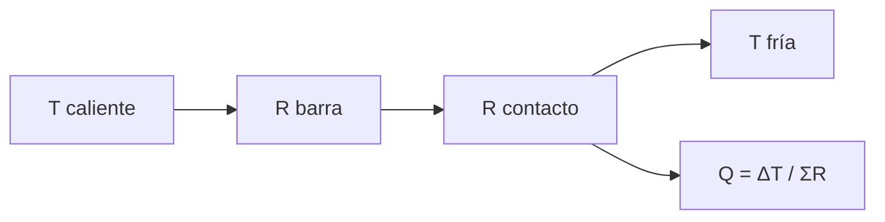

# B85-C02 — Conducción térmica en estructuras

<!-- nav:top -->
x
<!-- /nav -->

## 1. Ubicación, nivel y alcance

Clase 2 del bloque B85. Nivel N3. Dentro de una nave el calor viaja por conducción: por la estructura, por las uniones y por las aletas. Aquí calculas el flujo en una barra con una unión atornillada, lo comparas con una red de diferencias finitas y evalúas una aleta. La barra, el material y la unión son sintéticos: ninguna cifra describe una estructura real.

## 2. Por qué esta clase existe

El calor generado por un equipo debe llegar al radiador por algún camino; una unión mal conductora puede ser la resistencia dominante. La decisión central: **¿qué parte del camino de conducción limita el flujo y qué cambio lo mejora más?**

## 3. Lo que podrás hacer al terminar

1. Calcular resistencias de conducción `R = L/(kA)` y de contacto `R = 1/(h A)`.
2. Sumar resistencias en serie y hallar el flujo y los saltos de temperatura.
3. Resolver una barra con una unión por diferencias finitas y compararla con la solución en serie.
4. Calcular el flujo y la eficiencia de una aleta con extremo aislado.
5. Decidir si conviene mejorar el material o la unión.
6. Separar lo consultado (nada, en esta clase) de lo ilustrativo (todas las propiedades).

La evidencia es la **ficha de caminos de conducción de una estructura** del ejercicio 12 (sección 20).

## 4. Con qué llegas y cómo comprobarlo

1. ¿Qué dice la ley de Fourier?
2. ¿Qué es una resistencia térmica?
3. ¿Cómo se suman resistencias en serie?
4. ¿Qué es la conductancia de contacto?
5. ¿Qué es una verificación por segunda vía?

<details>
<summary>Ver respuestas</summary>

1. El flujo de calor es proporcional al gradiente de temperatura: `q = −k dT/dx`. 2. El cociente entre la diferencia de temperatura y el flujo, en K/W. 3. Se suman directamente. 4. La inversa de la resistencia de una unión por unidad de área, en W/(m² K). 5. Calcular lo mismo con otro método y comparar.
</details>

Con cuatro o cinco aciertos, sigue; si no, repasa los prerrequisitos.

## 5. Un caso de contexto y casos de referencia

Una barra de aluminio genérico (`k = 150 W/(m K)`, sección `4 cm²`, `0,30 m`) con una unión de `800 W/(m² K)` entre `320 K` y `280 K` conduce `4,9231 W`, frente a `8,0000 W` sin la unión. Es el **ejemplo conductor**. Todo es **ilustrativo**.

## 6. Vocabulario

La **conducción** transfiere calor por contacto entre partículas. La **resistencia térmica** de una barra es `R = L/(kA)`; la de una unión, `R_c = 1/(h_c A)`. La **aleta** es una superficie extendida que disipa calor al ambiente; su **eficiencia** `η = tanh(mL)/(mL)` compara el flujo real con el ideal. El **extremo aislado** no intercambia calor.

## 7. Modelo mental



*Descripción textual:* la temperatura caliente atraviesa la resistencia de la barra y la de la unión en serie hasta la temperatura fría; el flujo es la diferencia dividida por la suma.

Analogía: un circuito eléctrico con resistencias en serie y una batería de diferencia de temperatura. Límite: se supone `k` constante y flujo unidimensional; en una estructura real `k` varía con la temperatura y el calor se reparte en varios caminos.

## 8. La explicación, paso a paso

### 8.1 Resistencias en serie

`R_barra = L/(kA) = 0,30/(150 × 4×10⁻⁴) = 5,000 K/W`; `R_c = 1/(800 × 4×10⁻⁴) = 3,125 K/W`. El flujo es `Q = (320 − 280)/(5,000 + 3,125) = 4,9231 W`; la unión provoca un salto de `15,385 K` y reduce el flujo un `38,5 %`.

### 8.2 Segunda vía

Una cadena de 60 tramos con la unión en el centro, resuelta como red lineal, da `4,9231 W`, idéntica a la solución en serie. Es una comprobación del código y del ensamblado de la red.

### 8.3 Aleta

Con `h = 10 W/(m² K)` (coeficiente equivalente linealizado), perímetro `0,08 m` y `L = 0,10 m`: `m = √(hp/(kA)) = 3,651 m⁻¹`, `η = 0,9578`. El flujo analítico `√(hpkA)(T_b − T_∞)tanh(mL)` es `3,06497 W` y el numérico `3,06448 W`.

### 8.4 Qué mejorar

Duplicar `k` baja `R_barra` a `2,500 K/W` y sube el flujo a `7,1111 W`. Con la unión como resistencia `3,125 K/W`, mejorar la unión (más presión, relleno térmico) rinde tanto como cambiar el material.

## 9. Magnitudes, símbolos y unidades

| Símbolo | Qué es | Unidad | Valor / nota |
|---|---|---|---|
| `k` | conductividad | W/(m K) | 150 (ilustrativa) |
| `A` | sección | m² | 4,0 × 10⁻⁴ |
| `L` | longitud | m | 0,30 |
| `h_c` | conductancia de contacto | W/(m² K) | 800 (ilustrativa) |
| `R` | resistencia térmica | K/W | 5,000 (barra); 3,125 (unión) |
| `Q` | flujo de calor | W | 4,9231 |

## 10. Convenciones y referencias

Flujo unidimensional estacionario; `k` y `h_c` constantes; extremos a temperatura fija; aleta con extremo aislado y coeficiente equivalente `h`. En el vacío `h` representa un coeficiente radiativo linealizado. Todas las propiedades son ilustrativas.

## 11. De dónde sale lo que afirmamos

| ID | Fuente | Localizador | Respalda | Estado |
|---|---|---|---|---|
| — | Ley de Fourier, resistencias en serie, contacto y aleta con extremo aislado | — | las verifica el laboratorio con una segunda vía | No consultada en una fuente concreta |

Límites: no se consultó ninguna fuente para propiedades de materiales ni conductancias de contacto; todos los valores son ilustrativos y no representan una estructura real; la conductancia real de una unión depende de la presión, la rugosidad y la temperatura.

## 12. Cómo ver el resultado

| Magnitud | Valor |
|---|---|
| `R_barra` | 5,000 K/W |
| `R_c` | 3,125 K/W |
| `Q` con unión | 4,9231 W |
| `Q` sin unión | 8,0000 W |
| `η` aleta | 0,9578 |

Descripción larga: la unión añade una resistencia comparable a la de la barra y recorta el flujo en un tercio; la aleta corta es casi ideal.

## 13. Ejemplo trabajado

**Paso 1 · Resistencias.** `R_barra = 5,000 K/W`, `R_c = 3,125 K/W`.

**Paso 2 · Flujo.** `Q = 40/8,125 = 4,9231 W`.

**Paso 3 · Salto en la unión.** `ΔT_c = Q R_c = 4,9231 × 3,125 = 15,385 K`.

## 14. Distintas formas de describir el problema

**Por resistencias:** `Q = ΔT/ΣR`. **Por conductancia:** `G = 1/R`. **Por red:** nodos y aristas. **Por eficiencia:** `η` de una aleta.

## 15. Práctica guiada

**Ejercicio 1 · con los pasos indicados.** Calcula `R_barra` con `L = 0,30 m`, `k = 150` y `A = 4 cm²`. *Pasos:* convierte `A` a m².

<details><summary>Solución comentada</summary>

`0,30/(150 × 4×10⁻⁴) = 5,000 K/W`.
</details>

**Ejercicio 2 · con una pista.** Predice `Q` si la unión fuese perfecta (`R_c = 0`). *Pista:* usa solo `R_barra`.

<details><summary>Solución comentada</summary>

`40/5,000 = 8,0000 W`.
</details>

**Ejercicio 3 · casi autónomo.** ¿Por qué el flujo numérico coincide con la serie a 1e-9? Piensa en qué comprueba.

<details><summary>Solución comentada</summary>

Son el mismo modelo lineal escrito de otra manera: valida el código, no la física.
</details>

## 16. Práctica autónoma, transferencia e integrador

**Ejercicio 4 · autónomo.** ¿Qué `h_c` iguala `R_c` a `R_barra`?

<details><summary>Solución comentada</summary>

`h_c = 1/(R_barra A) = 500,0 W/(m² K)`.
</details>

**Ejercicio 5 · autónomo.** Si `L` se duplica, ¿cómo cambia `Q`?

<details><summary>Solución comentada</summary>

`R_barra = 10,000 K/W`; `Q = 40/13,125 = 3,0476 W`.
</details>

**Ejercicio 6 · autónomo.** Calcula la temperatura en el extremo de la barra pegado a la unión (lado caliente).

<details><summary>Solución comentada</summary>

`T = 320 − Q R_barra/2 = 307,69 K` en la unión, lado caliente.
</details>

**Ejercicio 7 · autónomo.** Calcula `η` si `L = 0,30 m` en la aleta.

<details><summary>Solución comentada</summary>

`mL = 1,095`; `η = tanh(mL)/(mL) = 0,7293`.
</details>

**Ejercicio 8 · autónomo.** ¿Qué pasa con `Q` si se añade una segunda barra en paralelo?

<details><summary>Solución comentada</summary>

Las conductancias se suman: `Q` se duplica a `9,8462 W`.
</details>

**Ejercicio 9 · transferencia.** **Transferencia.** Un ingeniero propone cambiar el aluminio por cobre (`k` ≈ 2,6 veces). ¿Qué esperas con esta unión?

<details><summary>Solución comentada</summary>

`R_barra` baja a `1,923 K/W`; `Q = 7,924 W`: mejora, pero la unión pasa a dominar.
</details>

**Ejercicio 10 · transferencia.** **Transferencia.** Se mide `T` en dos puntos de una barra real y el salto en una unión es de 15 K. ¿Qué concluyes?

<details><summary>Solución comentada</summary>

Que la unión tiene una resistencia significativa; hay que medir también `Q` para cuantificarla. Un solo salto no da `h_c` sin el flujo.
</details>

**Ejercicio 11 · transferencia.** **Transferencia.** ¿Por qué en el vacío una aleta no disipa por convección y qué usa en su lugar?

<details><summary>Solución comentada</summary>

No hay fluido; disipa por radiación, con `h_r ≈ 4εσT³` linealizado (clase C03).
</details>

**Ejercicio 12 · integrador.** **Integrador.** Elabora tu *ficha de caminos de conducción de una estructura*: resistencias, flujo, salto en la unión, contraste con diferencias finitas y lista de lo ilustrativo.

<details><summary>Solución comentada</summary>

Secciones 8.1–8.4 y la salida del laboratorio.
</details>

## 17. Laboratorio: barra con unión y aleta

El script [conduccion.py](conduccion.py) calcula las resistencias, el flujo en serie, lo contrasta con una red de 60 nodos y con la solución analítica de la aleta (**comprueba** diferencia < 1e-9 en la barra y < 0,5 % en la aleta).

**Datos:** todo **ilustrativo** (propiedades, geometría, `h_c`, `h`). **Predice antes de ejecutar:** ¿cuánto cae el flujo por la unión? (de 8 W a unos 4,9 W.) **Ejecución del 2026-11-10 (Python 3.12.9):**

```text
Python 3.12.9 (biblioteca estandar)
Barra ILUSTRATIVA: k = 150.0 W/(m K), A = 4.0 cm2, L = 0.3 m, h_contacto = 800.0 W/(m2 K), 320 K -> 280 K
R_barra = 5.000 K/W ; R_contacto = 3.125 K/W
Q con contacto = 4.9231 W ; sin contacto = 8.0000 W ; salto en el contacto = 15.385 K
Diferencias finitas (60 nodos, contacto en el centro): Q = 4.9231 W
Aleta (h = 10 W/(m2 K), p = 0.08 m, L = 0.10 m): m = 3.651 1/m ; eta = 0.9578
  Q analitico = 3.06497 W ; Q numerico = 3.06448 W
Con k doble en la barra: Q = 7.1111 W
Pruebas superadas.
```

```bash
python programa/clases/B85/B85-C02-conduccion-termica-en-estructuras/conduccion.py
```

**Límites:** propiedades constantes, flujo unidimensional y coeficientes ilustrativos; no representa una estructura real.

## 18. Errores frecuentes y cómo corregirlos

**Olvidar la resistencia de las uniones.** la unión puede dominar (8.1)

**Sumar conductancias en serie.** en serie se suman las resistencias (8.1)

**Validar la física con una red que es el mismo modelo.** valida solo el código (8.2)

**Presentar la barra sintética como una estructura real.** se corrige con la sección 10

## 19. Cómo sabrás que vas bien

Tras la sección 8: ¿qué flujo esperabas con la unión y cuál obtuviste? Si dudas, repasa el ejemplo 13. Tras el laboratorio: ¿qué comprueba? (ver la sección 17).

## 20. Qué entregas y cómo se evalúa

El producto es tu **ficha de caminos de conducción de una estructura** (ejercicio 12).

| Criterio | Inicial | En desarrollo | Logrado | Destacado |
|---|---|---|---|---|
| Conceptos | Los confunde | Parciales | Calcula `R` y `Q` | Explica los límites |
| Cálculo | Sin unidades | Con errores | Tablas completas con unidades | Calcula casos nuevos |
| Numérico | Sin comprobar | Un caso | Contraste con una segunda vía | Interpreta las diferencias |
| Fuentes | Sin fuente | Sin fecha | Fuentes con fecha y estado | Declara lo ilustrativo y lo no consultado |
| Límites | No los nombra | Uno | Tres | Discute qué falta del modelo |

**Condiciones críticas (no se compensan con promedio):** rotular propiedades y uniones como ilustrativas; no presentar el modelo como una estructura real; citar solo lo consultado.

## 21. Ética, seguridad y límites

Clase educativa: los modelos son simplificados y sus datos son sintéticos o ilustrativos; ningún resultado describe una nave real, ni sustituye a los estándares de proyecto, a la verificación con datos de misión ni a una revisión disciplinar. Los valores de este texto no son requisitos de ningún proyecto. Accesibilidad: tablas equivalentes a las gráficas, fórmulas en texto, ejercicios sin conexión.

## 22. Para cerrar y seguir

Una barra con una unión conduce `4,92 W` en lugar de `8,00 W`. Queda una pregunta: ¿qué ocurre con la convección cuando no hay aire fuera?

**Glosario español–inglés.** resistencia térmica · *thermal resistance*; conductancia de contacto · *contact conductance*; aleta · *fin*; conducción · *conduction*; conductividad · *thermal conductivity*.

**Continuidad.** [B85-C03](../B85-C03-conveccion-y-ausencia-de-conveccion-exterior/CLASE.md) estudia la convección y su ausencia en el exterior.

**Referencias:** ver sección 11.

<!-- nav:bottom -->
x
<!-- /nav -->
