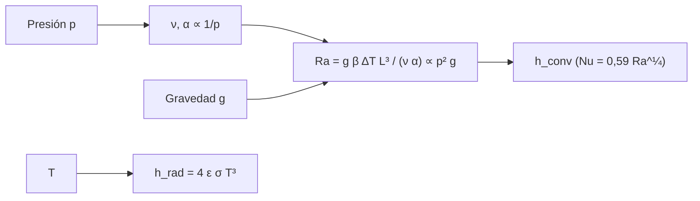

# B85-C03 — Convección y ausencia de convección exterior

<!-- nav:top -->
x
<!-- /nav -->

## 1. Ubicación, nivel y alcance

Clase 3 del bloque B85. Nivel N3. En el suelo, el aire se mueve por flotabilidad y arrastra calor; en órbita no hay aire exterior y la convección desaparece. Aquí calculas el número de Rayleigh según la presión y la gravedad, ves a qué presión se apaga la convección y comparas el coeficiente convectivo con el radiativo equivalente. Las propiedades del aire y la geometría son ilustrativas.

## 2. Por qué esta clase existe

Un equipo que se enfría bien sobre la mesa puede sobrecalentarse en vacío y en microgravedad. La decisión central: **¿cuánto del enfriamiento de un equipo se pierde al quitar la convección y qué queda para sustituirla?**

## 3. Lo que podrás hacer al terminar

1. Calcular el número de Rayleigh de una capa de aire según la presión y la gravedad.
2. Hallar la presión a la que la convección natural se apaga (`Ra = 1708`).
3. Estimar el coeficiente convectivo con `Nu = 0,59 Ra^(1/4)`.
4. Calcular el coeficiente radiativo `h_r = 4εσT³` y compararlo con el convectivo.
5. Calcular el camino libre medio y ver cuándo el gas deja de ser un continuo.
6. Separar lo consultado (`σ`) de lo ilustrativo (aire, geometría, `ε`).

La evidencia es la **tabla de convección frente a radiación** del ejercicio 12 (sección 20).

## 4. Con qué llegas y cómo comprobarlo

1. ¿Qué es la convección natural?
2. ¿Qué es el número de Rayleigh?
3. ¿Cómo escala la densidad de un gas ideal con la presión a `T` fija?
4. ¿Qué es el camino libre medio?
5. ¿Qué es una verificación por segunda vía?

<details>
<summary>Ver respuestas</summary>

1. El movimiento de un fluido por diferencias de densidad debidas a la temperatura. 2. Un número adimensional que compara la flotabilidad con la difusión de calor y de cantidad de movimiento. 3. Proporcionalmente. 4. La distancia media que recorre una molécula entre choques. 5. Calcular lo mismo con otro método y comparar.
</details>

Con cuatro o cinco aciertos, sigue; si no, repasa los prerrequisitos.

## 5. Un caso de contexto y casos de referencia

Una placa vertical de `0,10 m` con `ΔT = 20 K` en aire a `300 K` tiene `Ra = 1,86 × 10⁶` y `h = 5,67 W/(m² K)` a 1 atm. Con `1e-6 g` baja a `Ra = 1,86` y `h = 0,26 W/(m² K)`. Es el **ejemplo conductor**. Todo es **ilustrativo**, salvo `σ`.

## 6. Vocabulario

El **número de Rayleigh** es `Ra = g β ΔT L³/(ν α)`. El **número de Nusselt** `Nu = h L/k` compara convección con conducción. El **coeficiente radiativo** `h_r = 4εσT³` linealiza la radiación para `ΔT` pequeño. El **camino libre medio** es `λ = k_B T/(√2 π d² p)`. La **convección natural** se apaga si `Ra` es menor que el valor crítico, aquí `1708`.

## 7. Modelo mental



*Descripción textual:* la presión y la gravedad determinan el número de Rayleigh, que gobierna el coeficiente convectivo; la radiación aporta un coeficiente independiente del aire.

Analogía: una lámpara de lava que deja de moverse si la gravedad cae o si el fluido se rarifica. Límite: la correlación `Nu = 0,59 Ra^(1/4)` es para placa vertical en régimen laminar; no vale para espacios cerrados estrechos ni en régimen molecular.

## 8. La explicación, paso a paso

### 8.1 Rayleigh y presión

A `T` fija, `ρ ∝ p` y la viscosidad dinámica no cambia, así que `ν ∝ 1/p` y `α = k/(ρ c_p) ∝ 1/p`: `Ra ∝ p²`. Con la presión a la décima parte, `Ra` baja a `0,0100` de su valor. A 1 atm y `g = 9,82 m/s²`: `Ra = 1,861 × 10⁶`, `Nu = 21,79`, `h = 5,67 W/(m² K)`.

### 8.2 Dónde se apaga

`Ra = 1708` (relación estándar para una capa calentada desde abajo) ocurre a `p = 3069,4 Pa = 30,69 mbar`. Por debajo no hay movimiento convectivo y solo conduce el gas. Con `g = 10⁻⁶ g`, a 1 atm, `Ra = 1,86`: sin convección aunque haya aire. En Marte (`g = 3,73`), `Ra = 7,070 × 10⁵`.

### 8.3 Lo que queda: radiación

`h_r = 4 ε σ T³ = 4,899 W/(m² K)` a `300 K` con `ε = 0,8`; el cálculo exacto con `ΔT = 20 K` da `4,905`. A 1 atm la convección natural (`5,67`) aporta lo mismo que la radiación; en vacío solo queda la radiación.

### 8.4 Continuo y molecular

El camino libre medio es `67,2 nm` a 1 atm, `2,22 µm` a `p = 3069 Pa` y `6,81 m` a `10⁻³ Pa`. Cuando `λ` iguala la escala del gap, el gas deja de transportar calor como un fluido.

## 9. Magnitudes, símbolos y unidades

| Símbolo | Qué es | Unidad | Valor / nota |
|---|---|---|---|
| `Ra` | número de Rayleigh | — | 1,86 × 10⁶ |
| `Nu` | número de Nusselt | — | 21,79 |
| `h` | coeficiente convectivo | W/(m² K) | 5,67 |
| `h_r` | coeficiente radiativo | W/(m² K) | 4,899 |
| `λ` | camino libre medio | m | 6,72 × 10⁻⁸ (1 atm) |
| `p_crit` | presión de apagado | Pa | 3069,4 |

## 10. Convenciones y referencias

`σ` consultada (NIST). `Ra_crit = 1708` y `Nu = 0,59 Ra^(1/4)` son relaciones estándar no consultadas en una fuente concreta. Propiedades del aire a `300 K` (`ν = 1,6 × 10⁻⁵ m²/s`, `α = 2,2 × 10⁻⁵ m²/s`, `k = 0,026 W/(m K)`, `d = 3,7 × 10⁻¹⁰ m`) ilustrativas. `g = 9,82 m/s²` de la ficha de la Tierra.

## 11. De dónde sale lo que afirmamos

| ID | Fuente | Localizador | Respalda | Estado |
|---|---|---|---|---|
| S1 | NIST, CODATA 2022, Stefan–Boltzmann constant — https://physics.nist.gov/cgi-bin/cuu/Value?sigma (consultada 2026-11-10) | valor de `σ` | `σ` para `h_r` | Consultada |
| S2 | NASA/NSSDC, Earth Fact Sheet — https://nssdc.gsfc.nasa.gov/planetary/factsheet/earthfact.html (consultada 2026-11-10) | ficha completa | `g = 9,820 m/s²` | Consultada |
| — | Número de Rayleigh, `Ra_crit`, correlación de Nusselt y camino libre medio | — | las verifica el laboratorio con una segunda vía | No consultada en una fuente concreta |

Límites: las propiedades del aire y las correlaciones no se consultaron; no se predice el enfriamiento de un equipo real; no se trata el régimen molecular libre ni el transporte por gas residual.

## 12. Cómo ver el resultado

| Magnitud | Valor |
|---|---|
| `Ra` (1 atm) | 1,86 × 10⁶ |
| `h` (1 atm) | 5,67 W/(m² K) |
| `h_r` | 4,899 W/(m² K) |
| `p_crit` | 3069,4 Pa |
| `Ra(p/10)/Ra(p)` | 0,0100 |

Descripción larga: la convección natural a 1 atm equivale a la radiación; con la presión a la décima parte, `Ra` cae cien veces, y con microgravedad desaparece aunque haya aire.

## 13. Ejemplo trabajado

**Paso 1 · Propiedades a 1 atm.** `ν = 1,6 × 10⁻⁵`, `α = 0,026/(ρ c_p)`.

**Paso 2 · Rayleigh.** `Ra = 1,861 × 10⁶`.

**Paso 3 · Nusselt y `h`.** `Nu = 0,59 Ra^(1/4) = 21,79`; `h = Nu k/L = 5,67 W/(m² K)`.

## 14. Distintas formas de describir el problema

**Por números:** `Ra`, `Nu`. **Por coeficientes:** `h` y `h_r`. **Por presión:** `Ra ∝ p²`. **Por régimen:** continuo o molecular.

## 15. Práctica guiada

**Ejercicio 1 · con los pasos indicados.** Calcula `h_r` para `ε = 0,8` a `300 K`. *Pasos:* `4 ε σ T³`.

<details><summary>Solución comentada</summary>

`4,899 W/(m² K)`.
</details>

**Ejercicio 2 · con una pista.** Predice `Ra` a `0,1 atm`. *Pista:* `Ra ∝ p²`.

<details><summary>Solución comentada</summary>

`1,861 × 10⁴`; coincide con el laboratorio (cociente `0,0100`).
</details>

**Ejercicio 3 · casi autónomo.** ¿Por qué una cámara a `10⁻³ Pa` ya no tiene convección aunque tenga gas? Compara `λ` con el tamaño.

<details><summary>Solución comentada</summary>

`λ = 6,81 m` es mayor que la cámara: el gas no es un continuo y `Ra` pierde sentido.
</details>

## 16. Práctica autónoma, transferencia e integrador

**Ejercicio 4 · autónomo.** ¿A qué presión `Ra = 1708` con `g = 3,73`?

<details><summary>Solución comentada</summary>

`Ra ∝ g p²`: `p = 4980,3 Pa`.
</details>

**Ejercicio 5 · autónomo.** Calcula `h` si `ΔT = 40 K` (otras cosas iguales).

<details><summary>Solución comentada</summary>

`Ra` se duplica; `h ∝ Ra^(1/4)`: `6,74 W/(m² K)`.
</details>

**Ejercicio 6 · autónomo.** ¿Qué fracción del enfriamiento (convección + radiación) se pierde al ir al vacío?

<details><summary>Solución comentada</summary>

`53,6 %`.
</details>

**Ejercicio 7 · autónomo.** Si `ε = 0,05`, ¿cuánto vale `h_r`?

<details><summary>Solución comentada</summary>

`0,306 W/(m² K)`; sin convección el equipo casi no se enfría.
</details>

**Ejercicio 8 · autónomo.** ¿Qué cambia en Marte a 1 atm (`g = 3,73`)?

<details><summary>Solución comentada</summary>

`Ra = 7,070 × 10⁵`, menor en `0,380`; sigue habiendo convección.
</details>

**Ejercicio 9 · transferencia.** **Transferencia.** Un equipo se calienta 15 K más al subir a vacío. ¿Qué mediste y qué modelaste?

<details><summary>Solución comentada</summary>

La medición es del ensayo; el modelo de convección es una estimación; no hay que presentar el modelo como medición.
</details>

**Ejercicio 10 · transferencia.** **Transferencia.** Un ensayo en cámara a 1 atm de un equipo que irá al vacío, ¿es conservador?

<details><summary>Solución comentada</summary>

No: la convección ayuda a enfriar y subestima la temperatura en vuelo.
</details>

**Ejercicio 11 · transferencia.** **Transferencia.** ¿Por qué la ISS necesita ventiladores internos?

<details><summary>Solución comentada</summary>

En microgravedad `Ra ≈ 0`: sin flotabilidad el aire no circula y el calor se queda; hay que forzar la convección.
</details>

**Ejercicio 12 · integrador.** **Integrador.** Elabora tu *tabla de convección frente a radiación*: `Ra`, `h` y `h_r` en tres casos (Tierra, Marte, microgravedad), `p_crit` y lista de lo ilustrativo.

<details><summary>Solución comentada</summary>

Secciones 8.1–8.4 y la salida del laboratorio.
</details>

## 17. Laboratorio: Rayleigh, presión y gravedad

El script [conveccion.py](conveccion.py) calcula `Ra`, `h` y `h_r` según presión y gravedad, la presión crítica por bisección y el camino libre medio (**comprueba** `Ra ∝ p²` a 1e-12, `Ra(p_crit) = 1708` y la linealización de `h_r` a 1 %).

**Datos:** `σ` y `g` consultados; aire, geometría, `ΔT` y `ε` **ilustrativos**. **Predice antes de ejecutar:** ¿cuánto vale el cociente `Ra(p/10)/Ra(p)`? (0,01.) **Ejecución del 2026-11-10 (Python 3.12.9):**

```text
Python 3.12.9 (biblioteca estandar)
Aire ILUSTRATIVO a 300 K: nu = 1.6e-05 m2/s, alpha = 2.2e-05 m2/s (a 1 atm); placa L = 0.1 m, DT = 20 K, eps = 0.8
Ra (1 atm, g = 9.82) = 1.861e+06 ; Nu = 21.79 ; h_conv = 5.67 W/(m2 K)
Ra (1 atm, g = 1e-6 g) = 1.861e+00 ; h_conv = 0.26 W/(m2 K) (solo conduccion)
h_rad = 4 eps sigma T^3 = 4.899 W/(m2 K) ; exacto = 4.905 W/(m2 K)
Ra(p/10)/Ra(p) = 0.0100 (esperado 0.01 = (1/10)^2)
Presion con Ra = 1708: 3069.4 Pa = 30.69 mbar
Camino libre medio: 1 atm 67.2 nm ; a p_crit 2.22 um ; a 1e-3 Pa 6.81 m
Ra en Marte (g = 3.73, 1 atm) = 7.070e+05
Pruebas superadas.
```

```bash
python programa/clases/B85/B85-C03-conveccion-y-ausencia-de-conveccion-exterior/conveccion.py
```

**Límites:** correlación de placa vertical laminar, sin régimen molecular; no es un modelo de equipo.

## 18. Errores frecuentes y cómo corregirlos

**Esperar convección en vacío.** sin fluido no hay flotabilidad (8.2)

**Olvidar la gravedad.** `Ra ∝ g` (8.2)

**Confundir `h` con `h_r`.** `h_r` no depende del aire (8.3)

**Usar el aire a otra presión con las mismas propiedades.** `ν` y `α` cambian con `1/p` (8.1)

## 19. Cómo sabrás que vas bien

Tras la sección 8: ¿qué `Ra` esperabas con la presión a la décima parte y cuál obtuviste? Si dudas, repasa el ejemplo 13. Tras el laboratorio: ¿qué comprueba? (ver la sección 17).

## 20. Qué entregas y cómo se evalúa

El producto es tu **tabla de convección frente a radiación** (ejercicio 12).

| Criterio | Inicial | En desarrollo | Logrado | Destacado |
|---|---|---|---|---|
| Conceptos | Los confunde | Parciales | Calcula `Ra` y `h` | Explica los límites |
| Cálculo | Sin unidades | Con errores | Tablas completas con unidades | Calcula casos nuevos |
| Numérico | Sin comprobar | Un caso | Contraste con una segunda vía | Interpreta las diferencias |
| Fuentes | Sin fuente | Sin fecha | Fuentes con fecha y estado | Declara lo ilustrativo y lo no consultado |
| Límites | No los nombra | Uno | Tres | Discute qué falta del modelo |

**Condiciones críticas (no se compensan con promedio):** rotular las propiedades del aire como ilustrativas; no presentar el modelo como medición; citar solo lo consultado.

## 21. Ética, seguridad y límites

Clase educativa: los modelos son simplificados y sus datos son sintéticos o ilustrativos; ningún resultado describe una nave real, ni sustituye a los estándares de proyecto, a la verificación con datos de misión ni a una revisión disciplinar. Los valores de este texto no son requisitos de ningún proyecto. Accesibilidad: tablas equivalentes a las gráficas, fórmulas en texto, ejercicios sin conexión.

## 22. Para cerrar y seguir

A 1 atm la convección aporta `5,67 W/(m² K)` y la radiación `4,90`; en vacío solo queda la radiación. Queda una pregunta: ¿qué determina cuánto emite una superficie?

**Glosario español–inglés.** número de Rayleigh · *Rayleigh number*; convección natural · *natural convection*; coeficiente radiativo · *radiative coefficient*; camino libre medio · *mean free path*; microgravedad · *microgravity*.

**Continuidad.** [B85-C04](../B85-C04-radiacion-termica-de-superficies/CLASE.md) estudia la radiación térmica de superficies.

**Referencias:** ver sección 11.

<!-- nav:bottom -->
x
<!-- /nav -->
