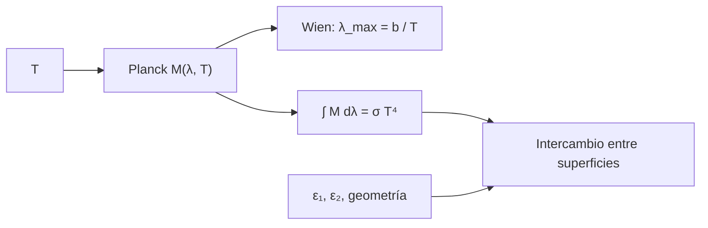

# B85-C04 — Radiación térmica de superficies

<!-- nav:top -->
[🏠 Programa](../../../../README.md) · [📚 Bloque B85](../../../tronco-comun/B85-gestion-termica-y-entorno-espacial.md) · [← Anterior: B85-C03 — Convección y ausencia de convección exterior](../B85-C03-conveccion-y-ausencia-de-conveccion-exterior/CLASE.md) · [Siguiente: B85-C05 — Recubrimientos ópticos térmicos →](../B85-C05-recubrimientos-opticos-termicos/CLASE.md)
<!-- /nav -->

## 1. Ubicación, nivel y alcance

Clase 4 del bloque B85. Nivel N3. Toda superficie a temperatura `T` emite radiación; cuánto y en qué longitudes de onda lo dicen la ley de Planck, la de Wien y la de Stefan–Boltzmann, y cuánto llega a otra superficie lo decide la geometría y las emisividades. Aquí calculas el espectro de un cuerpo negro, comprobas que su integral es `σT⁴` y calculas el intercambio entre placas y esferas. Las temperaturas y las emisividades son sintéticas.

## 2. Por qué esta clase existe

La mitad del control térmico es elegir cuánto emite o absorbe cada superficie. La decisión central: **¿cuánto calor intercambian dos superficies y cómo lo cambia poner una emisividad baja entre ellas?** La decisión central: **¿cuánto calor intercambian dos superficies y cómo lo cambia una emisividad baja?**

## 3. Lo que podrás hacer al terminar

1. Calcular la exitancia espectral de Planck y localizar su máximo con la ley de Wien.
2. Comprobar numéricamente que la integral del espectro es `σT⁴` y que `σ` sale de `h`, `k_B` y `c`.
3. Calcular qué fracción de la energía de un cuerpo negro cae en una banda.
4. Calcular el intercambio neto entre placas paralelas y esferas concentricas.
5. Explicar por qué la emisividad baja reduce el intercambio.
6. Separar lo consultado (`σ`) de lo ilustrativo (temperaturas, emisividades).

La evidencia es la **ficha de intercambio radiativo entre superficies** del ejercicio 12 (sección 20).

## 4. Con qué llegas y cómo comprobarlo

1. ¿Qué es un cuerpo negro?
2. ¿Qué dice la ley de Stefan–Boltzmann?
3. ¿Qué es la ley de Kirchhoff?
4. ¿Qué es un factor de forma?
5. ¿Qué es una verificación por segunda vía?

<details>
<summary>Ver respuestas</summary>

1. Un absorbente y emisor ideal: absorbe toda la radiación incidente y emite el máximo posible a su `T`. 2. La exitancia total de un cuerpo negro es `σT⁴`. 3. Para una superficie gris en equilibrio, absortividad igual a emisividad a cada longitud de onda. 4. La fracción de la radiación que sale de una superficie y llega a otra. 5. Calcular lo mismo con otro método y comparar.
</details>

Con cuatro o cinco aciertos, sigue; si no, repasa los prerrequisitos.

## 5. Un caso de contexto y casos de referencia

Un cuerpo negro a `300 K` emite `459,30 W/m²` con máximo en `9,66 µm`. Dos placas paralelas a `300 K` y `200 K` con `ε = 0,8` intercambian `245,7 W/m²`; con `ε = 0,05`, solo `9,45 W/m²`. Es el **ejemplo conductor**. Todo es **ilustrativo**, salvo `σ`.

## 6. Vocabulario

La **exitancia espectral** de Planck es `M_λ = 2πhc²/(λ⁵(e^(hc/λkT) − 1))`. La **ley de Wien** da `λ_max T = b`. La **emisividad** `ε` es el cociente con el cuerpo negro. El **intercambio entre placas paralelas** es `q = σ(T₁⁴ − T₂⁴)/(1/ε₁ + 1/ε₂ − 1)`. Una **cavidad** es un recinto cuya radiación interna se aproxima a la de un cuerpo negro.

## 7. Modelo mental



*Descripción textual:* la temperatura define el espectro de Planck, de él salen el máximo de Wien y la integral `σT⁴`, y con las emisividades y la geometría se obtiene el intercambio entre superficies.

Analogía: la luz de una brasa cambia de color al calentarse: más energía y más corta la onda. Límite: se supone superficie gris y difusa; los recubrimientos reales dependen de la longitud de onda y de la dirección.

## 8. La explicación, paso a paso

### 8.1 Planck, Stefan–Boltzmann y Wien

Con `h`, `k_B` y `c` exactos del SI, `σ = 2π⁵k_B⁴/(15h³c²) = 5,670374419 × 10⁻⁸ W m⁻² K⁻⁴`, que coincide con el valor consultado (NIST, CODATA 2022) con diferencia relativa `3,25 × 10⁻¹¹`. La constante de Wien sale de la raíz de `x = 5(1 − e⁻ˣ)`: `b = 2,897772 mm K`. A `300 K`, `λ_max = 9,659 µm` (máximo hallado numéricamente) y a `5772 K`, `0,5020 µm`.

### 8.2 Integral y bandas

La integral numérica de `M_λ` a `300 K` es `459,3000 W/m²`, igual a `σT⁴ = 459,3003 W/m²`. Un cuerpo negro de `5772 K` (usado aquí solo como ilustración del Sol) tiene `36,6 %` de su energía en `0,4–0,7 µm` y `96,6 %` por debajo de `2,5 µm`; uno de `300 K` emite `99,79 %` por encima de `4 µm`. La emisión solar y la térmica de la nave casi no se solapan, por eso `α` y `ε` pueden ser distintas.

### 8.3 Intercambio entre superficies

Placas paralelas a `300 K` y `200 K`: negras `368,57 W/m²`; con `ε = 0,8`, `245,72 W/m²`; con `ε = 0,05`, `9,451 W/m²`. Esferas concentricas (`r₁ = 0,3`, `r₂ = 0,5`, `ε = 0,8`): `275,06 W/m²` por área interior; cuando `r₂ → ∞` el resultado tiende a `ε₁σ(T₁⁴ − T₂⁴) = 294,86 W/m²`.

### 8.4 Qué cambia y qué no

Una emisividad baja en cualquiera de las dos superficies reduce el intercambio; la solución es la base de las pantallas de radiación y de la manta multicapa (clase C06).

## 9. Magnitudes, símbolos y unidades

| Símbolo | Qué es | Unidad | Valor / nota |
|---|---|---|---|
| `σ` | constante de Stefan–Boltzmann | W m⁻² K⁻⁴ | 5,670374419 × 10⁻⁸ (consultada) |
| `b` | constante de Wien | mm K | 2,897772 |
| `λ_max` | longitud de onda del máximo | µm | 9,659 (300 K) |
| `M` | exitancia | W/m² | 459,30 (300 K) |
| `ε` | emisividad | — | 0,8; 0,05 (ilustrativas) |
| `q` | flujo neto entre placas | W/m² | 245,7 |

## 10. Convenciones y referencias

`σ` consultada (NIST, CODATA 2022). `h`, `k_B` y `c` son valores exactos del SI y no se consultaron en esta clase; el laboratorio los contrasta con `σ`. Superficies grises, difusas e isotermas. Temperaturas y emisividades ilustrativas. Las integrales usan la regla de Simpson en escala logarítmica.

## 11. De dónde sale lo que afirmamos

| ID | Fuente | Localizador | Respalda | Estado |
|---|---|---|---|---|
| S1 | NIST, CODATA 2022, Stefan–Boltzmann constant — https://physics.nist.gov/cgi-bin/cuu/Value?sigma (consultada 2026-11-10) | valor de `σ` | `σ` exacta, CODATA 2022; se contrasta con `2π⁵k_B⁴/(15h³c²)` | Consultada |
| — | Ley de Planck, ley de Wien, intercambio entre placas y esferas | — | las verifica el laboratorio con una segunda vía | No consultada en una fuente concreta |

Límites: las emisividades y las temperaturas no se consultaron; no se calculan factores de forma de geometrías complejas ni emisividad espectral.

## 12. Cómo ver el resultado

| Magnitud | Valor |
|---|---|
| `σ` calculada vs NIST | dif. 3,3 × 10⁻¹¹ |
| `λ_max` (300 K) | 9,659 µm |
| integral a 300 K | 459,30 W/m² |
| `q` placas `ε = 0,8` | 245,7 W/m² |
| `q` placas `ε = 0,05` | 9,45 W/m² |

Descripción larga: el espectro integra `σT⁴`; la emisividad baja corta el intercambio entre placas por un factor de unos 26.

## 13. Ejemplo trabajado

**Paso 1 · Negro.** `σ(300⁴ − 200⁴) = 368,57 W/m²`.

**Paso 2 · Factor de emisividades.** `1/0,8 + 1/0,8 − 1 = 1,5`.

**Paso 3 · Placas.** `q = 368,57/1,5 = 245,72 W/m²`.

## 14. Distintas formas de describir el problema

**Por espectro:** `M_λ`. **Por máximo:** `λ_max = b/T`. **Por total:** `σT⁴`. **Por intercambio:** `q` con emisividades y geometría.

## 15. Práctica guiada

**Ejercicio 1 · con los pasos indicados.** Calcula `λ_max` a `300 K` con `b = 2,8978 mm K`. *Pasos:* divide.

<details><summary>Solución comentada</summary>

`9,659 µm`.
</details>

**Ejercicio 2 · con una pista.** Predice `q` entre placas negras a `300 K` y `200 K`. *Pista:* `σ(T₁⁴ − T₂⁴)`.

<details><summary>Solución comentada</summary>

`368,57 W/m²`.
</details>

**Ejercicio 3 · casi autónomo.** ¿Por qué la integral numérica difiere de `σT⁴` en `1e-4`? Piensa en los límites de integración.

<details><summary>Solución comentada</summary>

Se integra de `0,05 µm` a `2000 µm`; la cola fuera del rango no está incluida.
</details>

## 16. Práctica autónoma, transferencia e integrador

**Ejercicio 4 · autónomo.** Calcula `λ_max` de un cuerpo a `77 K`.

<details><summary>Solución comentada</summary>

`37,63 µm`.
</details>

**Ejercicio 5 · autónomo.** ¿Cuánto cambia `q` entre placas si una tiene `ε = 0,05` y la otra `0,8`?

<details><summary>Solución comentada</summary>

`1/0,05 + 1/0,8 − 1 = 20,25`; `q = 18,20 W/m²`.
</details>

**Ejercicio 6 · autónomo.** Calcula `σT⁴` a `4 K` (fondo cósmico aproximado).

<details><summary>Solución comentada</summary>

`1,45 × 10⁻⁵ W/m²`.
</details>

**Ejercicio 7 · autónomo.** ¿Qué `T` emite el mismo total que `300 K` con `ε = 0,5`?

<details><summary>Solución comentada</summary>

`T = 300 × 0,5^(1/4) = 252,27 K`.
</details>

**Ejercicio 8 · autónomo.** ¿Qué porcentaje de lo que emite un cuerpo a 300 K está por debajo de `4 µm`?

<details><summary>Solución comentada</summary>

`0,21 %` (fracción menor de `4 µm` = 1 − `0,99787`).
</details>

**Ejercicio 9 · transferencia.** **Transferencia.** Un panel con `ε = 0,03` en el exterior parece frío al tacto en un ensayo. ¿Qué mide y qué infiere?

<details><summary>Solución comentada</summary>

Mide la temperatura de superficie; que emita poco no significa que esté frío internamente. No es una medición de la temperatura interna.
</details>

**Ejercicio 10 · transferencia.** **Transferencia.** Se pone una pantalla con `ε = 0,05` entre dos placas negras. ¿Qué esperas?

<details><summary>Solución comentada</summary>

El intercambio cae mucho; es la idea de la multicapa (C06).
</details>

**Ejercicio 11 · transferencia.** **Transferencia.** ¿Por qué la pintura blanca para el visible puede ser negra en el infrarrojo?

<details><summary>Solución comentada</summary>

Porque el visible y el infrarrojo térmico están en bandas distintas (8.2) y `α` y `ε` se miden en bandas distintas.
</details>

**Ejercicio 12 · integrador.** **Integrador.** Elabora tu *ficha de intercambio radiativo entre superficies*: espectro, máximo, fracción de banda, intercambio entre placas y esferas, y lista de lo consultado e ilustrativo.

<details><summary>Solución comentada</summary>

Secciones 8.1–8.4 y la salida del laboratorio.
</details>

## 17. Laboratorio: Planck, Wien y placas paralelas

El script [radiacion_superficies.py](radiacion_superficies.py) evalúa Planck, halla `λ_max` numéricamente, integra el espectro, calcula fracciones de banda y el intercambio entre placas y esferas (**comprueba** `σ` desde constantes frente a NIST (1e-8), Wien (1e-6), integral frente a `σT⁴` (1e-4) y el límite de esferas (1e-3)).

**Datos:** `σ` consultada; `h`, `k_B`, `c` exactos del SI; temperaturas y emisividades **ilustrativas**. **Predice antes de ejecutar:** ¿cuánto vale `λ_max` a 300 K? (9,66 µm.) **Ejecución del 2026-11-10 (Python 3.12.9):**

```text
Python 3.12.9 (biblioteca estandar)
sigma desde h, k, c = 5.670374419e-08 ; sigma (NIST) = 5.670374419e-08 ; dif. relativa = 3.25e-11
b de Wien = 2.897772 mm K ; lambda_max(300 K) = 9.659 um (b/T = 9.659) ; lambda_max(5772 K) = 0.5020 um
Integral de Planck a 300 K = 459.3000 W/m2 ; sigma T^4 = 459.3003 W/m2
Fraccion de un cuerpo negro de 5772 K (ILUSTRATIVO como Sol): visible 0.4-0.7 um = 0.3664 ; < 2.5 um = 0.9656
Fraccion de un cuerpo negro de 300 K con lambda > 4 um = 0.99787
Placas paralelas 300 K / 200 K: eps = 0.8 -> 245.72 W/m2 ; eps = 0.05 -> 9.451 W/m2 ; negras -> 368.57 W/m2
Esferas concentricas (r1 = 0.3, r2 = 0.5, eps = 0.8): 275.06 W/m2 (por area interior) ; limite r2 -> infinito: 294.86 W/m2 = eps sigma (T1^4 - T2^4)
Pruebas superadas.
```

```bash
python programa/clases/B85/B85-C04-radiacion-termica-de-superficies/radiacion_superficies.py
```

**Límites:** superficies grises y difusas; el cuerpo de `5772 K` es una ilustración, no la medición del espectro solar.

## 18. Errores frecuentes y cómo corregirlos

**Usar grados Celsius.** `T⁴` exige kelvin (sección 10)

**Sumar emisividades.** el factor es `1/ε₁ + 1/ε₂ − 1` (8.3)

**Olvidar que `α` depende de la banda.** el Sol y la nave emiten en bandas distintas (8.2)

**Presentar un espectro de cuerpo negro como medición del Sol.** es una ilustración (sección 10)

## 19. Cómo sabrás que vas bien

Tras la sección 8: ¿qué `λ_max` esperabas a 300 K y cuál obtuviste? Si dudas, repasa el ejemplo 13. Tras el laboratorio: ¿qué comprueba? (ver la sección 17).

## 20. Qué entregas y cómo se evalúa

El producto es tu **ficha de intercambio radiativo entre superficies** (ejercicio 12).

| Criterio | Inicial | En desarrollo | Logrado | Destacado |
|---|---|---|---|---|
| Conceptos | Los confunde | Parciales | Calcula `λ_max`, `σT⁴` y `q` | Explica los límites |
| Cálculo | Sin unidades | Con errores | Tablas completas con unidades | Calcula casos nuevos |
| Numérico | Sin comprobar | Un caso | Contraste con una segunda vía | Interpreta las diferencias |
| Fuentes | Sin fuente | Sin fecha | Fuentes con fecha y estado | Declara lo ilustrativo y lo no consultado |
| Límites | No los nombra | Uno | Tres | Discute qué falta del modelo |

**Condiciones críticas (no se compensan con promedio):** rotular temperaturas y emisividades como ilustrativas; no presentar el cuerpo de 5772 K como medición del Sol; citar solo lo consultado.

## 21. Ética, seguridad y límites

Clase educativa: los modelos son simplificados y sus datos son sintéticos o ilustrativos; ningún resultado describe una nave real, ni sustituye a los estándares de proyecto, a la verificación con datos de misión ni a una revisión disciplinar. Los valores de este texto no son requisitos de ningún proyecto. Accesibilidad: tablas equivalentes a las gráficas, fórmulas en texto, ejercicios sin conexión.

## 22. Para cerrar y seguir

Un cuerpo negro de 300 K emite `459,3 W/m²` con máximo en `9,66 µm`, y una emisividad de 0,05 reduce el intercambio a `9,5 W/m²`. Queda una pregunta: ¿cómo se eligen los recubrimientos que fijan `α` y `ε`?

**Glosario español–inglés.** exitancia · *exitance*; cuerpo negro · *blackbody*; ley de Wien · *Wien's law*; emisividad · *emissivity*; intercambio radiativo · *radiative exchange*.

**Continuidad.** [B85-C05](../B85-C05-recubrimientos-opticos-termicos/CLASE.md) estudia los recubrimientos ópticos térmicos.

**Referencias:** ver sección 11.

<!-- nav:bottom -->
---

[← Anterior: B85-C03 — Convección y ausencia de convección exterior](../B85-C03-conveccion-y-ausencia-de-conveccion-exterior/CLASE.md) · [📚 Bloque B85](../../../tronco-comun/B85-gestion-termica-y-entorno-espacial.md) · [Siguiente: B85-C05 — Recubrimientos ópticos térmicos →](../B85-C05-recubrimientos-opticos-termicos/CLASE.md)
<!-- /nav -->
