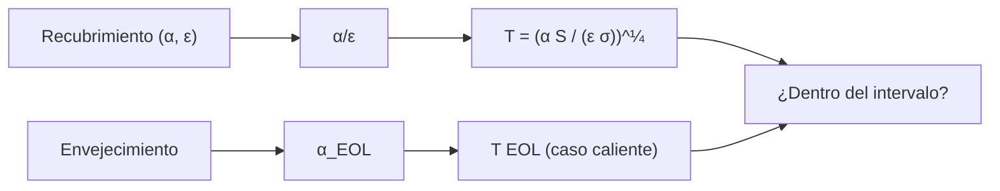

# B85-C05 — Recubrimientos ópticos térmicos

<!-- nav:top -->
[🏠 Programa](../../../../README.md) · [📚 Bloque B85](../../../tronco-comun/B85-gestion-termica-y-entorno-espacial.md) · [← Anterior: B85-C04 — Radiación térmica de superficies](../B85-C04-radiacion-termica-de-superficies/CLASE.md) · [Siguiente: B85-C06 — Aislamiento multicapa →](../B85-C06-aislamiento-multicapa/CLASE.md)
<!-- /nav -->

## 1. Ubicación, nivel y alcance

Clase 5 del bloque B85. Nivel N3. El recubrimiento de una superficie fija su absortividad solar `α` y su emisividad infrarroja `ε`, y con ellas su temperatura de equilibrio. Aquí comparas seis recubrimientos con una placa al Sol, eliges los que cumplen un intervalo de temperatura y ves cómo el envejecimiento los desplaza. La tabla de propiedades es sintética, salvo lo que se cita de NASA sobre coatings a medida y cintas de plata/FEP.

## 2. Por qué esta clase existe

Cambiar un recubrimiento es la forma más barata de mover la temperatura de una superficie decenas de kelvin. La decisión central: **¿qué recubrimiento mantiene la superficie dentro del intervalo al principio y al final de la vida?** La decisión central: **¿qué recubrimiento mantiene la superficie dentro del intervalo al principio y al final de la vida?**

## 3. Lo que podrás hacer al terminar

1. Calcular `α/ε` y la temperatura de equilibrio de una placa al Sol.
2. Elegir recubrimientos que cumplan un intervalo de temperatura.
3. Comparar el principio de vida (BOL) con el fin de vida (EOL).
4. Calcular el `α/ε` necesario para una temperatura objetivo.
5. Explicar por qué el caso caliente usa los valores de fin de vida.
6. Separar lo consultado (nota de NASA) de lo ilustrativo (la tabla).

La evidencia es la **tabla de selección de recubrimientos** del ejercicio 12 (sección 20).

## 4. Con qué llegas y cómo comprobarlo

1. ¿Qué es la absortividad solar?
2. ¿Qué es la emisividad infrarroja?
3. ¿Cómo depende `T` de `α/ε`?
4. ¿Qué es BOL y EOL?
5. ¿Qué es un dato sintético?

<details>
<summary>Ver respuestas</summary>

1. La fracción de la radiación solar incidente que absorbe una superficie. 2. El cociente entre lo que emite una superficie y un cuerpo negro a su `T`. 3. `T ∝ (α/ε)^(1/4)`. 4. Principio y fin de vida (*beginning/end of life*). 5. Un dato generado para el ejemplo, no medido.
</details>

Con cuatro o cinco aciertos, sigue; si no, repasa los prerrequisitos.

## 5. Un caso de contexto y casos de referencia

Una placa de pintura blanca ilustrativa (`α = 0,20`, `ε = 0,90`) llega a `270,25 K` al principio de la vida y a `310,83 K` al final, con `α_EOL = 0,35`. Es el **ejemplo conductor**. La tabla de valores es **ilustrativa**; solo se consultó que los coatings se oscurecen en órbita.

## 6. Vocabulario

El **cociente `α/ε`** fija `T = (α S/(ε σ))^(1/4)` para una placa al Sol con el reverso aislado. Un **espejo solar óptico (OSR)** es un radiador de `α` bajo y `ε` alta. El **envejecimiento** eleva `α` por radiación y contaminación. **BOL** y **EOL** son los extremos de la vida.

## 7. Modelo mental



*Descripción textual:* el recubrimiento da `α/ε`, de ahí sale la temperatura; el envejecimiento da `α_EOL` y una segunda temperatura; ambas deben estar dentro del intervalo.

Analogía: ropa clara u oscura bajo el sol: el color cambia cuánto se calienta, y se ensucia con el tiempo. Límite: aquí `α` y `ε` son valores únicos; en realidad dependen de la longitud de onda, el ángulo y la dosis.

## 8. La explicación, paso a paso

### 8.1 La tabla

Placa unitaria, una cara a `S₀ = 1361 W/m²`, reverso aislado:

| Recubrimiento | `α` BOL | `ε` | `α` EOL | `α/ε` BOL | `T` BOL (K) | `T` EOL (K) |
|---|---|---|---|---|---|---|
| pintura blanca | 0,20 | 0,90 | 0,35 | 0,222 | 270,25 | 310,83 |
| pintura negra | 0,95 | 0,90 | 0,95 | 1,056 | 398,96 | 398,96 |
| espejo solar OSR | 0,08 | 0,80 | 0,15 | 0,100 | 221,34 | 259,01 |
| aluminio pulido | 0,15 | 0,05 | 0,20 | 3,000 | 518,01 | 556,64 |
| oro | 0,25 | 0,03 | 0,25 | 8,333 | 668,75 | 668,75 |
| coating a medida | 0,10 | 0,25 | 0,14 | 0,400 | 313,02 | 340,49 |

### 8.2 Elegir

Los que mantienen `250–320 K` en BOL y EOL: **pintura blanca**. El OSR queda frío y la pintura negra, el aluminio y el oro, muy calientes. El coating a medida (`ε ≈ 0,25`, `α ≈ 0,1` según NASA) en estos números se pasa del intervalo en EOL: `340,49 K`.

### 8.3 Objetivo

Para `293,15 K` al Sol se necesita `α/ε = σT⁴/S₀ = 0,3077`: entre la pintura blanca BOL (`0,222`) y la del coating a medida.

### 8.4 Envejecimiento

La pintura blanca sube `40,58 K` entre BOL y EOL con `Δα = 0,15`. El OSR sube `37,67 K`. El caso caliente se evalúa con EOL (NASA, SST-SoA): una selección que cumple en BOL puede fallar en EOL.

## 9. Magnitudes, símbolos y unidades

| Símbolo | Qué es | Unidad | Valor / nota |
|---|---|---|---|
| `α` | absortividad solar | — | 0,08–0,95 (ilustrativa) |
| `ε` | emisividad infrarroja | — | 0,03–0,90 (ilustrativa) |
| `α/ε` | cociente | — | 0,222 (blanca BOL) |
| `T` | temperatura de equilibrio | K | 270,25 BOL; 310,83 EOL |
| `S₀` | irradiancia solar | W/m² | 1361,0 (consultada) |

## 10. Convenciones y referencias

`σ` y `S₀` consultadas. Placa plana de `1 m²`, una cara al Sol (`cos = 1`), reverso aislado, sin planeta. La tabla de `α`, `ε` y `α_EOL` es ilustrativa y no corresponde a ningún producto. Temperaturas en kelvin.

## 11. De dónde sale lo que afirmamos

| ID | Fuente | Localizador | Respalda | Estado |
|---|---|---|---|---|
| S1 | NIST, CODATA 2022, Stefan–Boltzmann constant — https://physics.nist.gov/cgi-bin/cuu/Value?sigma (consultada 2026-11-10) | valor de `σ` | `σ` del balance | Consultada |
| S2 | NASA/NSSDC, Earth Fact Sheet — https://nssdc.gsfc.nasa.gov/planetary/factsheet/earthfact.html (consultada 2026-11-10) | ficha completa | `S₀ = 1361,0 W/m²` | Consultada |
| S3 | NASA, State-of-the-Art of Small Spacecraft Technology, capítulo Thermal Control — https://www.nasa.gov/smallsat-institute/sst-soa/thermal-control/ (consultada 2026-11-10) | sección de coatings y radiadores | coatings a medida con `ε ≈ 0,25` y `α ≈ 0,1`; cinta de plata/FEP con `α` inicial desde `0,08`; los coatings se oscurecen y se usan valores de fin de vida para el caso caliente | Consultada |
| — | Balance de una placa al Sol, relación `T ∝ (α/ε)^(1/4)` | — | las verifica el laboratorio con una segunda vía | No consultada en una fuente concreta |

Límites: los valores `α`, `ε` y `α_EOL` de la tabla no se consultaron; ninguna cifra es de un producto comercial; no se modela la dependencia con el ángulo ni la longitud de onda.

## 12. Cómo ver el resultado

| Magnitud | Valor |
|---|---|
| blanca BOL / EOL | 270,25 / 310,83 K |
| OSR BOL / EOL | 221,34 / 259,01 K |
| válidos 250–320 K | pintura blanca |
| `σT⁴/S₀` objetivo | 0,3077 |
| residuo del balance | 5,7 × 10⁻¹⁴ W/m² |

Descripción larga: el envejecimiento desplaza la pintura blanca unos 40 K; solo uno de los seis recubrimientos cumple el intervalo en BOL y EOL.

## 13. Ejemplo trabajado

**Paso 1 · Cociente.** `α/ε = 0,20/0,90 = 0,222`.

**Paso 2 · Temperatura BOL.** `T = (0,20 × 1361/(0,90 × σ))^(1/4) = 270,25 K`.

**Paso 3 · EOL.** Con `α = 0,35`: `T = 310,83 K`; el intervalo `250–320 K` se cumple en ambos.

## 14. Distintas formas de describir el problema

**Por propiedades:** `α` y `ε`. **Por cociente:** `α/ε`. **Por temperatura:** `T`. **Por vida:** BOL y EOL.

## 15. Práctica guiada

**Ejercicio 1 · con los pasos indicados.** Calcula `α/ε` de la pintura negra. *Pasos:* divide.

<details><summary>Solución comentada</summary>

`0,95/0,90 = 1,056`.
</details>

**Ejercicio 2 · con una pista.** Predice la `T` BOL de un recubrimiento con `α/ε = 0,4`. *Pista:* `(0,4 S₀/σ)^(1/4)`.

<details><summary>Solución comentada</summary>

`313,02 K`; coincide con el coating a medida.
</details>

**Ejercicio 3 · casi autónomo.** ¿Por qué el aluminio pulido llega a más de `500 K`? Mira `ε`.

<details><summary>Solución comentada</summary>

Porque `ε = 0,05` casi no emite: `α/ε = 3`.
</details>

## 16. Práctica autónoma, transferencia e integrador

**Ejercicio 4 · autónomo.** ¿Qué `α` da `T = 300 K` con `ε = 0,9`?

<details><summary>Solución comentada</summary>

`α = ε σ T⁴/S₀ = 0,3037`.
</details>

**Ejercicio 5 · autónomo.** ¿Cuánto sube `T` si `α` aumenta 0,15 en la pintura blanca?

<details><summary>Solución comentada</summary>

`40,58 K`.
</details>

**Ejercicio 6 · autónomo.** Una placa con `cos = 0,5` (incidencia oblicua) de pintura blanca BOL, ¿qué `T`?

<details><summary>Solución comentada</summary>

`227,25 K`.
</details>

**Ejercicio 7 · autónomo.** ¿Qué pasa con `T` si `ε` y `α` se duplican a la vez?

<details><summary>Solución comentada</summary>

No cambia: depende solo de `α/ε`.
</details>

**Ejercicio 8 · autónomo.** A la sombra, con 100 W/m² internos y pintura blanca, ¿qué `T`?

<details><summary>Solución comentada</summary>

`210,40 K`.
</details>

**Ejercicio 9 · transferencia.** **Transferencia.** Un diseñador elige el recubrimiento con `α` BOL y pasa el análisis. ¿Qué falta?

<details><summary>Solución comentada</summary>

El EOL del caso caliente y la dispersión del lote; el envejecimiento puede sacar `T` del intervalo.
</details>

**Ejercicio 10 · transferencia.** **Transferencia.** Un fabricante da `α = 0,08` como valor «medido». ¿Cómo se rotula en tu ficha?

<details><summary>Solución comentada</summary>

Como dato del fabricante a verificar, con fecha, condición (BOL) y fuente; no como valor de vuelo.
</details>

**Ejercicio 11 · transferencia.** **Transferencia.** Un radiador blanco queda cubierto de polvo en la Luna. ¿Qué parámetro cambia?

<details><summary>Solución comentada</summary>

`α` sube y por tanto `T` (se retoma en la clase C16).
</details>

**Ejercicio 12 · integrador.** **Integrador.** Elabora tu *tabla de selección de recubrimientos*: `α`, `ε`, `α/ε`, `T` BOL y EOL, intervalo y lista de lo consultado e ilustrativo.

<details><summary>Solución comentada</summary>

Secciones 8.1–8.4 y la salida del laboratorio.
</details>

## 17. Laboratorio: selección de recubrimientos

El script [recubrimientos.py](recubrimientos.py) calcula `α/ε`, `T` BOL y EOL de seis recubrimientos, filtra los que cumplen un intervalo y el `α/ε` objetivo (**comprueba** residuo del balance < 1e-9 W/m² y `T_EOL ≥ T_BOL`).

**Datos:** `σ` y `S₀` consultados; tabla de `α`, `ε`, `α_EOL` **ilustrativa y sintética**. **Predice antes de ejecutar:** ¿cuál recubrimiento mantiene 250–320 K en BOL y EOL? (pintura blanca.) **Ejecución del 2026-11-10 (Python 3.12.9):**

```text
Python 3.12.9 (biblioteca estandar)
Tabla ILUSTRATIVA (alfa_BOL, eps, alfa_EOL) y placa unitaria con una cara a 1 Sol (S0 = 1361.0 W/m2), reverso aislado
recubrimiento       a_BOL   eps  a_EOL  a/e BOL  a/e EOL  T BOL[K]  T EOL[K]
pintura blanca       0.20  0.90   0.35    0.222    0.389    270.25    310.83
pintura negra        0.95  0.90   0.95    1.056    1.056    398.96    398.96
espejo solar OSR     0.08  0.80   0.15    0.100    0.187    221.34    259.01
aluminio pulido      0.15  0.05   0.20    3.000    4.000    518.01    556.64
oro                  0.25  0.03   0.25    8.333    8.333    668.75    668.75
coating a medida     0.10  0.25   0.14    0.400    0.560    313.02    340.49
Recubrimientos que mantienen 250-320 K en BOL y EOL: pintura blanca
alfa/eps necesario para 293.15 K con 1 Sol = 0.3077
Pintura blanca: envejecimiento +40.58 K ; residuo del balance = -5.68e-14 W/m2
Placa de pintura blanca a la sombra con 100 W/m2 internos: T = 210.40 K
Pruebas superadas.
```

```bash
python programa/clases/B85/B85-C05-recubrimientos-opticos-termicos/recubrimientos.py
```

**Límites:** placa de reverso aislado, un solo ángulo, valores únicos de `α` y `ε`.

## 18. Errores frecuentes y cómo corregirlos

**Elegir por `α` solamente.** importa el cociente `α/ε` (8.1)

**Ignorar el EOL.** el caso caliente usa EOL (8.4)

**Tratar la tabla como datos de producto.** es ilustrativa (sección 10)

**Olvidar el reverso.** la placa supone el reverso aislado (sección 10)

## 19. Cómo sabrás que vas bien

Tras la sección 8: ¿qué recubrimiento esperabas elegir y cuál obtuviste? Si dudas, repasa el ejemplo 13. Tras el laboratorio: ¿qué comprueba? (ver la sección 17).

## 20. Qué entregas y cómo se evalúa

El producto es tu **tabla de selección de recubrimientos** (ejercicio 12).

| Criterio | Inicial | En desarrollo | Logrado | Destacado |
|---|---|---|---|---|
| Conceptos | Los confunde | Parciales | Calcula `α/ε` y `T` BOL y EOL | Explica los límites |
| Cálculo | Sin unidades | Con errores | Tablas completas con unidades | Calcula casos nuevos |
| Numérico | Sin comprobar | Un caso | Contraste con una segunda vía | Interpreta las diferencias |
| Fuentes | Sin fuente | Sin fecha | Fuentes con fecha y estado | Declara lo ilustrativo y lo no consultado |
| Límites | No los nombra | Uno | Tres | Discute qué falta del modelo |

**Condiciones críticas (no se compensan con promedio):** rotular la tabla de propiedades como ilustrativa; no presentar un valor de fabricante como medición de vuelo; citar solo lo consultado.

## 21. Ética, seguridad y límites

Clase educativa: los modelos son simplificados y sus datos son sintéticos o ilustrativos; ningún resultado describe una nave real, ni sustituye a los estándares de proyecto, a la verificación con datos de misión ni a una revisión disciplinar. Los valores de este texto no son requisitos de ningún proyecto. Accesibilidad: tablas equivalentes a las gráficas, fórmulas en texto, ejercicios sin conexión.

## 22. Para cerrar y seguir

Entre seis recubrimientos ilustrativos, solo la pintura blanca mantiene `250–320 K` en BOL y EOL (`270,25` y `310,83 K`). Queda una pregunta: ¿cómo se aísla el resto de la nave de esos extremos?

**Glosario español–inglés.** absortividad · *absorptivity*; emisividad · *emissivity*; principio de vida · *beginning of life*; fin de vida · *end of life*; espejo solar óptico · *optical solar reflector*.

**Continuidad.** [B85-C06](../B85-C06-aislamiento-multicapa/CLASE.md) estudia el aislamiento multicapa.

**Referencias:** ver sección 11.

<!-- nav:bottom -->
---

[← Anterior: B85-C04 — Radiación térmica de superficies](../B85-C04-radiacion-termica-de-superficies/CLASE.md) · [📚 Bloque B85](../../../tronco-comun/B85-gestion-termica-y-entorno-espacial.md) · [Siguiente: B85-C06 — Aislamiento multicapa →](../B85-C06-aislamiento-multicapa/CLASE.md)
<!-- /nav -->
