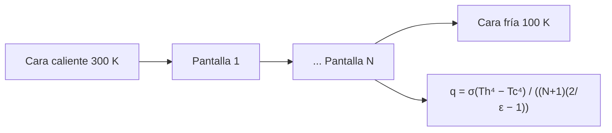

# B85-C06 — Aislamiento multicapa

<!-- nav:top -->
x
<!-- /nav -->

## 1. Ubicación, nivel y alcance

Clase 6 del bloque B85. Nivel N3. Una manta multicapa (MLI) apila pantallas de baja emisividad en el vacío para que cada una reduzca el intercambio radiativo entre la cara caliente y la fría. Aquí calculas el flujo a través de N pantallas con la fórmula `1/(N+1)`, lo contrastas con una red de nodos, ves cuántas capas hacen falta y qué pasa si las capas se comprimen y se acoplan por conducción. Las propiedades son sintéticas.

## 2. Por qué esta clase existe

Aislar una caja que opera a `300 K` de un entorno a `100 K` con una sola superficie cuesta cientos de W/m²; con unas pocas capas cuesta unidades. La decisión central: **¿cuántas capas y de qué emisividad hacen falta para limitar el flujo, y cuánto se pierde si se comprimen?** La decisión central: **¿cuántas capas y de qué emisividad hacen falta para limitar el flujo, y cuánto se pierde si se comprimen?**

## 3. Lo que podrás hacer al terminar

1. Calcular el flujo radiativo a través de N pantallas y la emisividad efectiva.
2. Resolver la red de N nodos por Newton y comparar con la fórmula `1/(N+1)`.
3. Hallar las temperaturas de cada pantalla.
4. Calcular cuántas capas hacen falta para un flujo objetivo.
5. Estimar el efecto de la conducción entre capas comprimidas.
6. Separar lo consultado (`σ`, cifras de capas de NASA) de lo ilustrativo (`ε`, temperaturas).

La evidencia es la **ficha de dimensionado de una manta multicapa** del ejercicio 12 (sección 20).

## 4. Con qué llegas y cómo comprobarlo

1. ¿Cómo se intercambia calor entre dos placas paralelas?
2. ¿Qué es una pantalla de radiación?
3. ¿Qué ocurre en régimen estacionario con el flujo entre capas en serie?
4. ¿Qué es una conductancia entre capas?
5. ¿Qué es una verificación por segunda vía?

<details>
<summary>Ver respuestas</summary>

1. Por radiación, con `σ(T₁⁴ − T₂⁴)/(1/ε₁ + 1/ε₂ − 1)`. 2. Una lámina delgada de baja emisividad interpuesta entre dos superficies. 3. Es el mismo en todas. 4. El flujo por conducción por unidad de área y de diferencia de temperatura, en W/(m² K). 5. Calcular lo mismo con otro método y comparar.
</details>

Con cuatro o cinco aciertos, sigue; si no, repasa los prerrequisitos.

## 5. Un caso de contexto y casos de referencia

Con `ε = 0,05` en todas las caras, `300 K` y `100 K`, sin capas el flujo es `11,63 W/m²`; con 10 pantallas, `1,057 W/m²`; con 20, `0,554 W/m²`. Es el **ejemplo conductor**. Todo es **ilustrativo**, salvo `σ`.

## 6. Vocabulario

La **manta multicapa (MLI)** es un apilado de láminas reflectantes separadas por espaciadores. Con `N` pantallas idénticas, `q = σ(T_h⁴ − T_c⁴)/((N+1)(2/ε − 1))`. La **emisividad efectiva** `ε_eff = q/(σ(T_h⁴ − T_c⁴))` es la de una sola superficie que daría el mismo flujo. La **compresión** de las capas añade conducción entre ellas y degrada el aislamiento.

## 7. Modelo mental



*Descripción textual:* la cara caliente irradia a una cadena de N pantallas en serie hasta la cara fría; el flujo disminuye como `1/(N+1)`.

Analogía: una pila de láminas de papel de aluminio entre dos paredes: cada hoja reduce el paso del calor radiante. Límite: la fórmula solo cubre la radiación; las capas reales conducen por contacto y por las costuras, y el flujo es mayor que el ideal.

## 8. La explicación, paso a paso

### 8.1 Flujo y emisividad efectiva

Entre superficies negras a `300 K` y `100 K` el flujo es `453,63 W/m²`. Con `ε = 0,05`, cada hueco tiene una resistencia `2/ε − 1 = 39`. Resultados para distintas capas:

| N | `q` fórmula (W/m²) | `q` red (W/m²) | `ε_eff` |
|---|---|---|---|
| 0 | 11,63154 | 11,63154 | 0,02564 |
| 1 | 5,81577 | 5,81577 | 0,01282 |
| 5 | 1,93859 | 1,93859 | 0,00427 |
| 10 | 1,05741 | 1,05741 | 0,00233 |
| 20 | 0,55388 | 0,55388 | 0,00122 |
| 40 | 0,28370 | 0,28370 | 0,00063 |

La fórmula y la red de Newton coinciden a `1e-9`: es una comprobación del código. `ε_eff` cae como `1/(N+1)`.

### 8.2 Temperaturas de las capas

Con 10 pantallas, desde la caliente: `293,0, 285,5, 277,4, 268,4, 258,5, 247,2, 234,2, 218,6, 198,6, 169,6` K. Las capas del lado frío son las que más bajan, porque `T⁴` cae más ahí.

### 8.3 Cuántas capas

Con `ε = 0,05`, `N = 2` ya da menos de `5 W/m²`. Con `ε = 0,10` y `N = 10` el flujo sube a `2,170 W/m²`. NASA (SST-SoA) cita 10 a 20 capas como típicas y avisa de que el rendimiento cae mucho si se comprime.

### 8.4 Compresión

Con una conductancia entre capas de `0,05 W/(m² K)` (ilustrativa) y `N = 10`, el flujo pasa de `1,057` a `1,967 W/m²`, un factor `1,86`: añadir conducción entre capas puede restar más que lo que añaden varias capas.

## 9. Magnitudes, símbolos y unidades

| Símbolo | Qué es | Unidad | Valor / nota |
|---|---|---|---|
| `N` | número de pantallas | — | 0–40 |
| `ε` | emisividad de las caras | — | 0,05 (ilustrativa) |
| `q` | flujo a través de la manta | W/m² | 1,057 (N = 10) |
| `ε_eff` | emisividad efectiva | — | 0,00233 (N = 10) |
| `g_c` | conductancia entre capas | W/(m² K) | 0,05 (ilustrativa) |
| `σ` | constante de Stefan–Boltzmann | W m⁻² K⁻⁴ | 5,670 374 419 × 10⁻⁸ (consultada) |

## 10. Convenciones y referencias

`σ` consultada. Capas idénticas, extremos isotermos, radiación entre planos paralelos infinitos, sin conducción lateral salvo en el caso comprimido. `ε`, temperaturas y `g_c` ilustrativas.

## 11. De dónde sale lo que afirmamos

| ID | Fuente | Localizador | Respalda | Estado |
|---|---|---|---|---|
| S1 | NIST, CODATA 2022, Stefan–Boltzmann constant — https://physics.nist.gov/cgi-bin/cuu/Value?sigma (consultada 2026-11-10) | valor de `σ` | `σ` del flujo | Consultada |
| S2 | NASA, State-of-the-Art of Small Spacecraft Technology, capítulo Thermal Control — https://www.nasa.gov/smallsat-institute/sst-soa/thermal-control/ (consultada 2026-11-10) | sección de MLI | 10 a 20 capas de baja emisividad; el rendimiento «cae drásticamente» si se comprime; para cubesats se prefieren recubrimientos | Consultada |
| — | Fórmula `1/(N+1)` de pantallas de radiación y modelo de red con conductancia entre capas | — | las verifica el laboratorio con una segunda vía | No consultada en una fuente concreta |

Límites: la emisividad de las capas, las temperaturas y la conductancia entre capas no se consultaron; la fórmula ideal no incluye conducción por espaciadores, costuras ni gas residual; ningún valor es de un producto.

## 12. Cómo ver el resultado

| Magnitud | Valor |
|---|---|
| `q` sin capas | 11,63 W/m² |
| `q` N = 10 | 1,057 W/m² |
| `ε_eff` N = 10 | 0,00233 |
| N para `q` ≤ 5 W/m² | 2 |
| `q` N = 10 comprimida | 1,967 W/m² |

Descripción larga: cada capa añadida reduce el flujo como `1/(N+1)`, pero la conducción por compresión puede devolverlo casi al doble.

## 13. Ejemplo trabajado

**Paso 1 · Resistencia de un hueco.** `2/ε − 1 = 2/0,05 − 1 = 39`.

**Paso 2 · Negro.** `σ(300⁴ − 100⁴) = 453,63 W/m²`.

**Paso 3 · N = 10.** `q = 453,63/(11 × 39) = 1,057 W/m²`.

## 14. Distintas formas de describir el problema

**Por fórmula:** `1/(N+1)`. **Por red:** nodos y huecos. **Por emisividad efectiva:** `ε_eff`. **Por capas necesarias:** `N` para un `q` objetivo.

## 15. Práctica guiada

**Ejercicio 1 · con los pasos indicados.** Calcula `q` con `N = 1`. *Pasos:* `σ(Th⁴ − Tc⁴)/(2 × 39)`.

<details><summary>Solución comentada</summary>

`5,8158 W/m²`.
</details>

**Ejercicio 2 · con una pista.** Predice `q` con `N = 40`. *Pista:* `1/(N+1)` respecto de `N = 0`.

<details><summary>Solución comentada</summary>

`0,2837 W/m²`; coincide con la tabla.
</details>

**Ejercicio 3 · casi autónomo.** ¿Por qué la red de Newton coincide a `1e-9` con la fórmula? Piensa en qué valida.

<details><summary>Solución comentada</summary>

Es el mismo modelo escrito de otra manera: valida el código, no la física.
</details>

## 16. Práctica autónoma, transferencia e integrador

**Ejercicio 4 · autónomo.** ¿Qué `ε` da `q = 1 W/m²` con `N = 10`?

<details><summary>Solución comentada</summary>

`2/ε − 1 = 41,24`; `ε = 0,0473`.
</details>

**Ejercicio 5 · autónomo.** Calcula `ε_eff` con `N = 20`.

<details><summary>Solución comentada</summary>

`0,00122`.
</details>

**Ejercicio 6 · autónomo.** Si se duplican las capas de 10 a 20, ¿cuánto cae el flujo?

<details><summary>Solución comentada</summary>

`47,6 %`.
</details>

**Ejercicio 7 · autónomo.** ¿Cuál es la temperatura de la primera pantalla con `N = 10`?

<details><summary>Solución comentada</summary>

`293,0 K`.
</details>

**Ejercicio 8 · autónomo.** Con `T_c = 4 K` en vez de `100 K`, ¿cambia mucho `q` con `N = 10`?

<details><summary>Solución comentada</summary>

`σ(300⁴ − 4⁴)/(11 × 39) = 1,071 W/m²`; casi no cambia porque domina `T_h⁴`.
</details>

**Ejercicio 9 · transferencia.** **Transferencia.** Una MLI de laboratorio mide 8 W/m² con 10 capas. ¿Qué infieres?

<details><summary>Solución comentada</summary>

Que su aislamiento real es peor que el ideal (`1,06 W/m²`): hay conducción, huecos o compresión; el ideal es solo una cota inferior.
</details>

**Ejercicio 10 · transferencia.** **Transferencia.** Un cubesat tiene poco espacio. ¿Por qué se prefieren recubrimientos a la MLI?

<details><summary>Solución comentada</summary>

NASA indica que la MLI rinde peor en cubesats (comprimida); un recubrimiento no tiene capas que comprimir.
</details>

**Ejercicio 11 · transferencia.** **Transferencia.** Un instrumento se ensaya en cámara con MLI sin envejecer. ¿Qué falta?

<details><summary>Solución comentada</summary>

La degradación por radiación, el ciclado y las costuras; el ensayo no sustituye al modelo de fin de vida.
</details>

**Ejercicio 12 · integrador.** **Integrador.** Elabora tu *ficha de dimensionado de una manta multicapa*: `q`, `ε_eff` y temperaturas para `N` capas, número de capas para un objetivo, efecto de la compresión y lista de lo consultado e ilustrativo.

<details><summary>Solución comentada</summary>

Secciones 8.1–8.4 y la salida del laboratorio.
</details>

## 17. Laboratorio: MLI de N pantallas

El script [mli.py](mli.py) calcula el flujo por fórmula y por red de Newton para varios `N`, las temperaturas de las capas, el efecto de `ε` y de la compresión (**comprueba** fórmula frente a red a 1e-9 y el caso `N = 0`).

**Datos:** `σ` consultada; `ε`, temperaturas y `g_c` **ilustrativas**. **Predice antes de ejecutar:** ¿cuánto vale `q` con `N = 10`? (1,06 W/m².) **Ejecución del 2026-11-10 (Python 3.12.9):**

```text
Python 3.12.9 (biblioteca estandar)
MLI ILUSTRATIVA: eps = 0.05 en todas las caras, T_caliente = 300 K, T_fria = 100 K, solo radiacion
Flujo entre superficies negras = 453.63 W/m2
   N   q formula       q red    eps_eff
   0    11.63154    11.63154    0.02564
   1     5.81577     5.81577    0.01282
   5     1.93859     1.93859    0.00427
  10     1.05741     1.05741    0.00233
  20     0.55388     0.55388    0.00122
  40     0.28370     0.28370    0.00063
Temperaturas de las 10 pantallas (K): 293.0, 285.5, 277.4, 268.4, 258.5, 247.2, 234.2, 218.6, 198.6, 169.6
N = 10 con conductancia entre capas gc = 0.05 W/(m2 K) (capas comprimidas): q = 1.9665 W/m2 (x1.86)
N = 10 con eps = 0.10: q = 2.1705 W/m2
Capas para q <= 5 W/m2 con eps = 0.05: N = 2
Pruebas superadas.
```

```bash
python programa/clases/B85/B85-C06-aislamiento-multicapa/mli.py
```

**Límites:** radiación entre planos infinitos; sin conducción por espaciadores ni costuras salvo el caso `g_c`; no es una MLI real.

## 18. Errores frecuentes y cómo corregirlos

**Sumar flujos de las capas.** en serie el flujo es común y se suman las resistencias (8.1)

**Esperar `1/(N+1)` en una MLI real.** hay conducción (8.4)

**Usar `ε` alta.** `2/ε − 1` crece al bajar `ε` (8.3)

**Presentar el flujo ideal como el de una manta real.** se corrige con la sección 10

## 19. Cómo sabrás que vas bien

Tras la sección 8: ¿qué flujo esperabas con 10 capas y cuál obtuviste? Si dudas, repasa el ejemplo 13. Tras el laboratorio: ¿qué comprueba? (ver la sección 17).

## 20. Qué entregas y cómo se evalúa

El producto es tu **ficha de dimensionado de una manta multicapa** (ejercicio 12).

| Criterio | Inicial | En desarrollo | Logrado | Destacado |
|---|---|---|---|---|
| Conceptos | Los confunde | Parciales | Calcula `q` y `ε_eff` | Explica los límites |
| Cálculo | Sin unidades | Con errores | Tablas completas con unidades | Calcula casos nuevos |
| Numérico | Sin comprobar | Un caso | Contraste con una segunda vía | Interpreta las diferencias |
| Fuentes | Sin fuente | Sin fecha | Fuentes con fecha y estado | Declara lo ilustrativo y lo no consultado |
| Límites | No los nombra | Uno | Tres | Discute qué falta del modelo |

**Condiciones críticas (no se compensan con promedio):** rotular `ε`, temperaturas y `g_c` como ilustrativos; no presentar el flujo ideal como el de una manta real; citar solo lo consultado.

## 21. Ética, seguridad y límites

Clase educativa: los modelos son simplificados y sus datos son sintéticos o ilustrativos; ningún resultado describe una nave real, ni sustituye a los estándares de proyecto, a la verificación con datos de misión ni a una revisión disciplinar. Los valores de este texto no son requisitos de ningún proyecto. Accesibilidad: tablas equivalentes a las gráficas, fórmulas en texto, ejercicios sin conexión.

## 22. Para cerrar y seguir

Diez pantallas de `ε = 0,05` reducen el flujo de `11,6` a `1,06 W/m²`, y la compresión lo casi duplica. Queda una pregunta: ¿cómo se saca el calor de la nave?

**Glosario español–inglés.** manta multicapa · *multilayer insulation (MLI)*; pantalla de radiación · *radiation shield*; emisividad efectiva · *effective emissivity*; compresión · *compression*; conductancia · *conductance*.

**Continuidad.** [B85-C07](../B85-C07-radiadores-espaciales/CLASE.md) estudia los radiadores espaciales.

**Referencias:** ver sección 11.

<!-- nav:bottom -->
x
<!-- /nav -->
