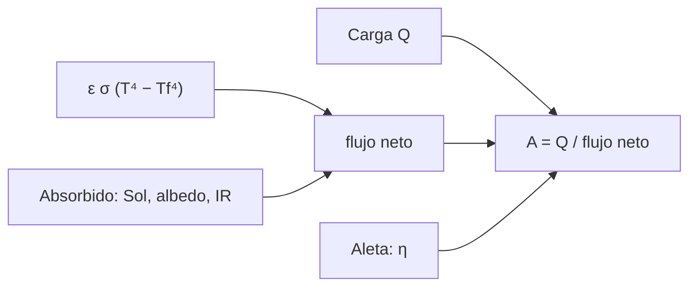

# B85-C07 — Radiadores espaciales

<!-- nav:top -->
x
<!-- /nav -->

## 1. Ubicación, nivel y alcance

Clase 7 del bloque B85. Nivel N3. Un radiador es la única salida del calor de una nave: emite al espacio lo que ya no puede conducirse a otra parte. Aquí dimensionas un radiador para una carga y una temperatura, ves cómo crece el área con el Sol, el albedo y el envejecimiento, y calculas la eficiencia de una aleta radiante. Todos los parámetros son sintéticos, salvo `σ`, `S₀` y el entorno terrestre.

## 2. Por qué esta clase existe

El área del radiador manda en masa, volumen y costo. La decisión central: **¿cuánta área necesita un radiador en el caso caliente de fin de vida y qué la reduce?** La decisión central: **¿cuánta área necesita un radiador en el caso caliente de fin de vida y qué la reduce?**

## 3. Lo que podrás hacer al terminar

1. Calcular el flujo neto de un radiador con el entorno y el área para una carga.
2. Comparar espacio profundo, caso caliente BOL y caso caliente EOL.
3. Ver el efecto de subir la temperatura del radiador.
4. Calcular la eficiencia de una aleta radiante y contrastarla con la lineal.
5. Reconocer cuando el Sol directo anula el radiador.
6. Separar lo consultado (`σ`, `S₀`, albedo, `T_BB`, nota de NASA) de lo ilustrativo.

La evidencia es la **ficha de dimensionado de un radiador** del ejercicio 12 (sección 20).

## 4. Con qué llegas y cómo comprobarlo

1. ¿Qué relaciona la potencia radiada con `T`?
2. ¿Qué es la eficiencia de una aleta?
3. ¿Qué es un caso caliente EOL?
4. ¿Qué es el flujo neto de un radiador?
5. ¿Qué es una verificación por segunda vía?

<details>
<summary>Ver respuestas</summary>

1. La ley de Stefan–Boltzmann: `ε σ A T⁴`. 2. El cociente entre el calor real y el que disiparía si toda la aleta estuviese a la temperatura de la raíz. 3. El peor caso de entorno con propiedades de fin de vida. 4. Lo que emite menos lo que absorbe del entorno, por unidad de área. 5. Calcular lo mismo con otro método y comparar.
</details>

Con cuatro o cinco aciertos, sigue; si no, repasa los prerrequisitos.

## 5. Un caso de contexto y casos de referencia

Un radiador de `500 W` a `290 K` con `ε = 0,85` necesita `1,47 m²` en espacio profundo, `1,89 m²` en órbita baja con valores iniciales y `2,38 m²` con valores de fin de vida. Es el **ejemplo conductor**. Todo es **ilustrativo** salvo `σ`, `S₀` y el entorno terrestre.

## 6. Vocabulario

El **flujo neto** de un radiador es `ε σ (T⁴ − T_f⁴) − q_abs`. El **área requerida** es `A = Q/flujo_neto`. Una **aleta radiante** extiende el radiador con una lámina conductora; su **eficiencia** `η = tanh(mL)/(mL)` (lineal, con `m² = 2h_r/(k e)`) mide cuánto de la lámina trabaja. El **espacio profundo** se aproxima aquí como un sumidero a `3 K`.

## 7. Modelo mental



*Descripción textual:* la carga se divide por el flujo neto, que es la emisión menos lo absorbido del entorno; la aleta modifica el área efectiva.

Analogía: una ventana que se abre para dejar salir calor pero por la que también entra algo de luz. Límite: el modelo usa un factor de forma fijo y un `α` único; en una nave real el entorno cambia con la actitud y la órbita.

## 8. La explicación, paso a paso

### 8.1 Espacio profundo

Con `ε = 0,85` a `290 K`, `ε σ (T⁴ − 3⁴) = 340,90 W/m²` y `A = 500/340,90 = 1,4667 m²`.

### 8.2 Órbita baja

Se añade lo absorbido (`α` solar con `¼` de incidencia media, albedo e infrarrojo con factor de forma `0,2`, todo ilustrativo): BOL (`α = 0,10`) `76,55 W/m²` y neto `264,35 W/m²`, `A = 1,8914 m²`; EOL (`α = 0,25`) `131,19 W/m²`, neto `209,71 W/m²`, `A = 2,3843 m²`. El envejecimiento cuesta `26,1 %` más de área. Con Sol directo y `α = 0,25` el neto es `-45,48 W/m²`: el radiador no rechaza nada.

### 8.3 Subir la temperatura

A `310 K` el área EOL baja a `1,5927 m²`: el término `T⁴` favorece mucho el aumento de `T`, a costa de que el equipo se opere más caliente.

### 8.4 Aleta

Con `k = 160 W/(m K)`, espesor `2 mm`, `L = 0,30 m` y `290 K` en la raíz: `m = 5,421 m⁻¹` y `η_lineal = 0,5691`. La solución numérica no lineal da `η = 0,6099` (la punta baja a `239,0 K`); la lineal subestima porque supone `h_r` de la raíz en toda la aleta. Con una aleta casi isoterma (`k = 10⁶`, `L = 0,05 m`) `η = 1,00000`.

## 9. Magnitudes, símbolos y unidades

| Símbolo | Qué es | Unidad | Valor / nota |
|---|---|---|---|
| `Q` | carga térmica | W | 500 |
| `T` | temperatura del radiador | K | 290 |
| `ε` | emisividad infrarroja | — | 0,85 (ilustrativa) |
| `A` | área | m² | 1,47 / 1,89 / 2,38 |
| `q_abs` | flujo absorbido | W/m² | 76,5 BOL; 131,2 EOL |
| `η` | eficiencia de aleta | — | 0,6099 |

## 10. Convenciones y referencias

`σ`, `S₀`, albedo y `T_BB` consultados. Radiador de una cara; incidencia solar media `¼`; factor de forma al planeta `0,2` y albedo medio `0,3`; sumidero a `3 K`; `α` `0,10`/`0,25`; todo ilustrativo. Aleta de dos caras con extremo aislado.

## 11. De dónde sale lo que afirmamos

| ID | Fuente | Localizador | Respalda | Estado |
|---|---|---|---|---|
| S1 | NIST, CODATA 2022, Stefan–Boltzmann constant — https://physics.nist.gov/cgi-bin/cuu/Value?sigma (consultada 2026-11-10) | valor de `σ` | `σ` del flujo | Consultada |
| S2 | NASA/NSSDC, Earth Fact Sheet — https://nssdc.gsfc.nasa.gov/planetary/factsheet/earthfact.html (consultada 2026-11-10) | ficha completa | `S₀`, albedo `0,294` (el cálculo usa `0,3` ilustrativo) y `T_BB = 254 K` | Consultada |
| S3 | NASA, State-of-the-Art of Small Spacecraft Technology, capítulo Thermal Control — https://www.nasa.gov/smallsat-institute/sst-soa/thermal-control/ (consultada 2026-11-10) | sección de radiadores | un radiador necesita `ε` infrarroja alta y `α` solar baja; los coatings se oscurecen y el caso caliente usa EOL | Consultada |
| — | Balance de un radiador y eficiencia de aleta lineal | — | las verifica el laboratorio con una segunda vía | No consultada en una fuente concreta |

Límites: los factores de forma, `α`, `ε`, el albedo `0,3` y las propiedades de la aleta no se consultaron; no se dimensiona un radiador real.

## 12. Cómo ver el resultado

| Magnitud | Valor |
|---|---|
| `A` espacio profundo | 1,4667 m² |
| `A` BOL | 1,8914 m² |
| `A` EOL | 2,3843 m² |
| `A` EOL a 310 K | 1,5927 m² |
| `η` aleta | 0,6099 (lineal 0,5691) |

Descripción larga: el entorno y el envejecimiento añaden más de la mitad del área respecto del espacio profundo; subir 20 K la reduce un tercio.

## 13. Ejemplo trabajado

**Paso 1 · Emisión.** `0,85 × σ × 290⁴ = 340,90 W/m²`.

**Paso 2 · Neto EOL.** `340,90 − 131,19 = 209,71 W/m²`.

**Paso 3 · Área.** `A = 500/209,71 = 2,3843 m²`.

## 14. Distintas formas de describir el problema

**Por flujo:** `ε σ (T⁴ − T_f⁴) − q_abs`. **Por área:** `Q/flujo`. **Por caso:** profundo, BOL, EOL. **Por aleta:** `η`.

## 15. Práctica guiada

**Ejercicio 1 · con los pasos indicados.** Calcula la emisión a `290 K` con `ε = 0,85`. *Pasos:* `ε σ T⁴`.

<details><summary>Solución comentada</summary>

`340,90 W/m²`.
</details>

**Ejercicio 2 · con una pista.** Predice el área si la carga sube a `1000 W` (EOL). *Pista:* `A ∝ Q`.

<details><summary>Solución comentada</summary>

`4,769 m²`.
</details>

**Ejercicio 3 · casi autónomo.** ¿Por qué el área EOL es mayor que la BOL? Mira `α`.

<details><summary>Solución comentada</summary>

Porque `α` sube con el envejecimiento y el absorbido crece.
</details>

## 16. Práctica autónoma, transferencia e integrador

**Ejercicio 4 · autónomo.** ¿Qué `T` se necesita para `A = 1,6 m²` en EOL?

<details><summary>Solución comentada</summary>

Neto necesario `500/1,6 = 312,5 W/m²`; `T = ((312,5 + 131,19)/(0,85 σ))^(1/4) = 309,8 K`.
</details>

**Ejercicio 5 · autónomo.** Calcula `A` con `ε = 0,5`, `T = 290 K`, EOL (`q_abs` igual).

<details><summary>Solución comentada</summary>

`neto = 0,5 σ 290⁴ − 131,19 = 69,34`; `A = 7,211 m²`.
</details>

**Ejercicio 6 · autónomo.** ¿Cuál es el efecto en `η` de duplicar el espesor de la aleta?

<details><summary>Solución comentada</summary>

`m` baja por `√2`; `η_lineal = 0,7111`.
</details>

**Ejercicio 7 · autónomo.** Un radiador mira a un planeta con un factor de forma mayor. ¿Qué pasa?

<details><summary>Solución comentada</summary>

El absorbido aumenta y el área requerida crece; hay que reducir el factor de forma con la actitud o la orientación.
</details>

**Ejercicio 8 · autónomo.** Un instrumento tolera `310 K` en vez de `290 K`. ¿Cuánto ahorra?

<details><summary>Solución comentada</summary>

`33,2 %` de área.
</details>

**Ejercicio 9 · transferencia.** **Transferencia.** Un radiador desplegable para un cubesat, ¿qué dice la fuente consultada?

<details><summary>Solución comentada</summary>

NASA indica que los radiadores desplegables son difíciles en SmallSats por el volumen y cita un diseño que se pliega en 3U (sin cifras térmicas).
</details>

**Ejercicio 10 · transferencia.** **Transferencia.** Un colega presenta `2,38 m²` como «el área que necesita la nave». ¿Qué corriges?

<details><summary>Solución comentada</summary>

Es un resultado de un modelo con valores ilustrativos, no el dimensionado de una nave.
</details>

**Ejercicio 11 · transferencia.** **Transferencia.** Con Sol directo el neto es negativo. ¿Qué decisión de diseño sugiere?

<details><summary>Solución comentada</summary>

Mantener el radiador fuera del Sol (actitud, ubicación, deflector) o bajar `α`.
</details>

**Ejercicio 12 · integrador.** **Integrador.** Elabora tu *ficha de dimensionado de un radiador*: flujo neto y área en tres casos, efecto de `T`, eficiencia de aleta y lista de lo consultado e ilustrativo.

<details><summary>Solución comentada</summary>

Secciones 8.1–8.4 y la salida del laboratorio.
</details>

## 17. Laboratorio: dimensionado de un radiador

El script [radiadores.py](radiadores.py) calcula el área para espacio profundo, BOL y EOL, el efecto de `T`, y la eficiencia de aleta lineal frente a la numérica no lineal (**comprueba** residuo de potencia < 1e-9 W, orden de áreas, `η` lineal < `η` numérica < `η` lineal + 0,06 y aleta casi isoterma → `η = 1` a 1e-3).

**Datos:** `σ`, `S₀`, albedo `0,294` y `T_BB` consultados; carga, temperatura, `ε`, `α`, factores y aleta **ilustrativos**. **Predice antes de ejecutar:** ¿cuánto vale `A` en espacio profundo? (1,47 m².) **Ejecución del 2026-11-10 (Python 3.12.9):**

```text
Python 3.12.9 (biblioteca estandar)
Radiador ILUSTRATIVO: Q = 500 W a 290 K, eps = 0.85, alfa BOL/EOL = 0.1/0.25; fondo 3 K
Espacio profundo (sin absorbido): flujo neto = 340.90 W/m2 -> A = 1.4667 m2
Orbita baja, caso caliente BOL: absorbido = 76.55 W/m2, neto = 264.35 W/m2 -> A = 1.8914 m2
Orbita baja, caso caliente EOL: absorbido = 131.19 W/m2, neto = 209.71 W/m2 -> A = 2.3843 m2
Con Sol directo EOL: flujo neto = -45.48 W/m2 (negativo: no rechaza nada) ; radiador a 310 K (EOL): A = 1.5927 m2
Residuo de potencia rechazada = -5.68e-14 W
Aleta (k = 160 W/(m K), e = 2 mm, L = 0.30 m, 290 K en la raiz): m = 5.421 1/m ; eta lineal = 0.5691
  Numerica: Q = 124.745 W/m ; ideal = 204.538 W/m ; eta = 0.6099 ; T punta = 238.99 K
  Prueba con k = 1e6 y L = 0.05 m (casi isoterma): eta = 1.00000
Pruebas superadas.
```

```bash
python programa/clases/B85/B85-C07-radiadores-espaciales/radiadores.py
```

**Límites:** radiador de una cara, un solo caso de entorno, un `α` por época; la aleta es 1D con extremo aislado.

## 18. Errores frecuentes y cómo corregirlos

**Ignorar lo absorbido.** el neto es emisión menos absorbido (8.2)

**Usar BOL en el caso caliente.** se usa EOL (8.2)

**Suponer eficiencia 1 en una aleta larga.** `η < 1` (8.4)

**Presentar el área como el dimensionado de una nave.** se corrige con la sección 10

## 19. Cómo sabrás que vas bien

Tras la sección 8: ¿qué área esperabas en EOL y cuál obtuviste? Si dudas, repasa el ejemplo 13. Tras el laboratorio: ¿qué comprueba? (ver la sección 17).

## 20. Qué entregas y cómo se evalúa

El producto es tu **ficha de dimensionado de un radiador** (ejercicio 12).

| Criterio | Inicial | En desarrollo | Logrado | Destacado |
|---|---|---|---|---|
| Conceptos | Los confunde | Parciales | Calcula el flujo neto y `A` | Explica los límites |
| Cálculo | Sin unidades | Con errores | Tablas completas con unidades | Calcula casos nuevos |
| Numérico | Sin comprobar | Un caso | Contraste con una segunda vía | Interpreta las diferencias |
| Fuentes | Sin fuente | Sin fecha | Fuentes con fecha y estado | Declara lo ilustrativo y lo no consultado |
| Límites | No los nombra | Uno | Tres | Discute qué falta del modelo |

**Condiciones críticas (no se compensan con promedio):** rotular `α`, `ε` y factores de forma como ilustrativos; no presentar el área como un dimensionado real; citar solo lo consultado.

## 21. Ética, seguridad y límites

Clase educativa: los modelos son simplificados y sus datos son sintéticos o ilustrativos; ningún resultado describe una nave real, ni sustituye a los estándares de proyecto, a la verificación con datos de misión ni a una revisión disciplinar. Los valores de este texto no son requisitos de ningún proyecto. Accesibilidad: tablas equivalentes a las gráficas, fórmulas en texto, ejercicios sin conexión.

## 22. Para cerrar y seguir

Un radiador de `500 W` a `290 K` pasa de `1,47 m²` en espacio profundo a `2,38 m²` en el caso caliente EOL. Queda una pregunta: ¿cómo se evita que la carga se enfríe demasiado?

**Glosario español–inglés.** radiador · *radiator*; flujo neto · *net flux*; aleta · *fin*; fin de vida · *end of life*; espacio profundo · *deep space*.

**Continuidad.** [B85-C08](../B85-C08-calentadores-y-termostatos/CLASE.md) estudia los calentadores y termostatos.

**Referencias:** ver sección 11.

<!-- nav:bottom -->
x
<!-- /nav -->
