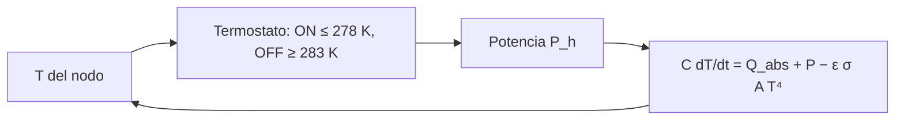

# B85-C08 — Calentadores y termostatos

<!-- nav:top -->
[🏠 Programa](../../../../README.md) · [📚 Bloque B85](../../../tronco-comun/B85-gestion-termica-y-entorno-espacial.md) · [← Anterior: B85-C07 — Radiadores espaciales](../B85-C07-radiadores-espaciales/CLASE.md) · [Siguiente: B85-C09 — Tubos de calor →](../B85-C09-tubos-de-calor/CLASE.md)
<!-- /nav -->

## 1. Ubicación, nivel y alcance

Clase 8 del bloque B85. Nivel N3. Un calentador evita que un equipo baje de su temperatura mínima en eclipse, y un termostato lo enciende y apaga con una histéresis. Aquí calculas la potencia necesaria, simulas cuatro órbitas con termostato y compruebas el cierre de energía y el ciclo de trabajo. La caja, las potencias y la órbita son sintéticas.

## 2. Por qué esta clase existe

Un calentador pequeño no sostiene la temperatura y uno grande gasta energía que una batería no tiene. La decisión central: **¿cuánta potencia de calentador mantiene la temperatura mínima en el peor eclipse y cuánta energía cuesta por órbita?** La decisión central: **¿cuánta potencia de calentador mantiene la temperatura mínima en el peor eclipse y cuánta energía cuesta por órbita?**

## 3. Lo que podrás hacer al terminar

1. Calcular la potencia que compensa las pérdidas en eclipse.
2. Simular un termostato con histéresis sobre un nodo con capacidad térmica.
3. Medir temperatura mínima y máxima, ciclo de trabajo y energía por órbita.
4. Comprobar el cierre de energía de la simulación.
5. Reconocer un calentador subdimensionado.
6. Separar lo consultado (`σ`, nota de NASA sobre calentadores) de lo ilustrativo.

La evidencia es la **ficha de calentador de supervivencia** del ejercicio 12 (sección 20).

## 4. Con qué llegas y cómo comprobarlo

1. ¿Qué es la histéresis de un termostato?
2. ¿Qué es una capacidad térmica?
3. ¿Qué es un ciclo de trabajo?
4. ¿Qué es el cierre de energía?
5. ¿Qué es una verificación por segunda vía?

<details>
<summary>Ver respuestas</summary>

1. La diferencia entre la temperatura de encendido y la de apagado, que evita el chattering. 2. La energía por kelvin que almacena un cuerpo, en J/K. 3. La fracción del tiempo con el calentador encendido. 4. La suma de entradas menos salidas igual a la variación almacenada. 5. Calcular lo mismo con otro método y comparar.
</details>

Con cuatro o cinco aciertos, sigue; si no, repasa los prerrequisitos.

## 5. Un caso de contexto y casos de referencia

Una caja de `1500 J/K` y `0,06 m²` con calentador de `20 W` y termostato `278–283 K` mantiene una mínima de `277,99 K` en eclipse con ciclo de trabajo `15,0 %` y gasta `16160 J` por órbita. Con `10 W` baja a `276,40 K`. Es el **ejemplo conductor**. Todo es **ilustrativo**.

## 6. Vocabulario

El **calentador resistivo** convierte potencia eléctrica en calor. El **termostato** conmuta con **histéresis**: enciende a `T_on` y apaga a `T_off`. El **ciclo de trabajo** es el tiempo encendido dividido por el periodo. El **calentador de supervivencia** mantiene el mínimo de no operación. El **cierre de energía** verifica que lo que entra, sale o se almacena suma cero.

## 7. Modelo mental



*Descripción textual:* la temperatura del nodo realimenta al termostato, que decide la potencia; el nodo integra el balance.

Analogía: la calefacción de una casa con un termostato de dos umbrales. Límite: aquí el nodo es isotermo y el sensor ideal; un sensor real tiene retardo, error y una posición que importa.

## 8. La explicación, paso a paso

### 8.1 Potencia necesaria

Para sostener `T_on = 278 K` con `Q_ecl = 3 W` absorbidos: `P = ε σ A T⁴ − Q_ecl = 13,26 W`; para `280 K`, `13,73 W`. Sin calentador la caja tiende a `303,19 K` al sol y a `182,21 K` en eclipse.

### 8.2 Simulación con termostato

Cuatro órbitas de `5400 s` con eclipse de `2100 s` y paso de `1 s`. En la cuarta: `T_min = 277,99 K`, `T_max = 292,07 K`, ciclo de trabajo `14,96 %` y energía de calentador `16160 J` (`2,993 W` medios). El calentador solo actúa cuando la caja baja a `278 K` en el eclipse.

### 8.3 Cierre de energía

`E_in + E_h − E_out − C ΔT = 1,30 × 10⁻⁹ J`, nulo salvo el redondeo. Verifica el código; no valida el modelo físico.

### 8.4 Dimensionado

Con `15 W`: `T_min = 277,99 K` y ciclo `18,9 %`; con `10 W`: `276,40 K`, por debajo de `T_on` aunque el calentador esté encendido casi todo el eclipse: `10 W < 13,3 W` necesarios. Sin calentador la mínima es `265,84 K`.

## 9. Magnitudes, símbolos y unidades

| Símbolo | Qué es | Unidad | Valor / nota |
|---|---|---|---|
| `C` | capacidad térmica | J/K | 1500 (ilustrativa) |
| `A` | área radiante | m² | 0,06 |
| `P_h` | potencia del calentador | W | 20; 15; 10 |
| `T_on`, `T_off` | umbrales | K | 278; 283 |
| `D` | ciclo de trabajo | % | 14,96 |
| `E_h` | energía por órbita | J | 16160 |

## 10. Convenciones y referencias

`σ` consultada. Nodo isotermo, `ε = 0,8`, absorbido `23 W` al sol y `3 W` en eclipse (ilustrativos), paso de Euler explícito de `1 s`, sensor ideal. Todo lo demás es ilustrativo.

## 11. De dónde sale lo que afirmamos

| ID | Fuente | Localizador | Respalda | Estado |
|---|---|---|---|---|
| S1 | NIST, CODATA 2022, Stefan–Boltzmann constant — https://physics.nist.gov/cgi-bin/cuu/Value?sigma (consultada 2026-11-10) | valor de `σ` | `σ` de la pérdida | Consultada |
| S2 | NASA, State-of-the-Art of Small Spacecraft Technology, capítulo Thermal Control — https://www.nasa.gov/smallsat-institute/sst-soa/thermal-control/ (consultada 2026-11-10) | sección de calentadores | calentadores sobre todo resistivos tipo Kapton, usados para baterías y controlados por termostato o sensor | Consultada |
| — | Balance de un nodo con termostato de histéresis e integración explícita | — | las verifica el laboratorio con una segunda vía | No consultada en una fuente concreta |

Límites: las potencias, la capacidad térmica, el absorbido y los umbrales no se consultaron; no se dimensiona un calentador de una nave real; no se tratan fallas de sensor ni de termostato.

## 12. Cómo ver el resultado

| Magnitud | Valor |
|---|---|
| `T_min` 20 W | 277,99 K |
| ciclo de trabajo | 14,96 % |
| `E_h` por órbita | 16160 J |
| potencia necesaria | 13,26 W |
| cierre de energía | 1,3 × 10⁻⁹ J |

Descripción larga: con 20 W el calentador trabaja alrededor del 15 % del tiempo y sostiene el mínimo; con 10 W no alcanza.

## 13. Ejemplo trabajado

**Paso 1 · Pérdida a `278 K`.** `ε σ A T⁴ = 16,26 W`.

**Paso 2 · Neto.** `16,26 − 3 = 13,26 W`.

**Paso 3 · Dimensionado.** `20 W > 13,3 W`: sostiene el mínimo; `10 W` no.

## 14. Distintas formas de describir el problema

**Por potencia:** `P = pérdida − absorbido`. **Por ciclo:** `D = P_med/P_h`. **Por energía:** `E_h` por órbita. **Por simulación:** `T(t)`.

## 15. Práctica guiada

**Ejercicio 1 · con los pasos indicados.** Calcula la pérdida a `280 K` con `ε = 0,8` y `A = 0,06 m²`. *Pasos:* `ε σ A T⁴`.

<details><summary>Solución comentada</summary>

`16,73 W`.
</details>

**Ejercicio 2 · con una pista.** Predice el ciclo de trabajo con `15 W`. *Pista:* más potencia, menos tiempo encendido.

<details><summary>Solución comentada</summary>

`18,9 %`, mayor que con 20 W (`15,0 %`).
</details>

**Ejercicio 3 · casi autónomo.** ¿Por qué el cierre de energía es ~0? Piensa en qué comprueba.

<details><summary>Solución comentada</summary>

Es un identidad del código de integración: valida el código, no la física.
</details>

## 16. Práctica autónoma, transferencia e integrador

**Ejercicio 4 · autónomo.** ¿Cuánta energía por órbita gasta el calentador de `10 W` si trabaja `25,74 %` del tiempo?

<details><summary>Solución comentada</summary>

`10 × 5400 × 0,2574 = 13900 J`.
</details>

**Ejercicio 5 · autónomo.** Calcula la constante de tiempo `τ = C/(4 ε σ A T³)` a `280 K`.

<details><summary>Solución comentada</summary>

`6276 s`.
</details>

**Ejercicio 6 · autónomo.** Con histéresis de `2 K` en vez de `5 K`, ¿qué esperas del número de conmutaciones?

<details><summary>Solución comentada</summary>

Aumenta: la banda es más estrecha y la temperatura cruza los umbrales más a menudo.
</details>

**Ejercicio 7 · autónomo.** ¿Qué pasa si `Q_ecl` sube a `10 W`?

<details><summary>Solución comentada</summary>

La potencia necesaria baja a `6,26 W`.
</details>

**Ejercicio 8 · autónomo.** Estima la energía diaria de calentador (orbitas de `5400 s`).

<details><summary>Solución comentada</summary>

`258560 J ≈ 71,8 Wh` al día.
</details>

**Ejercicio 9 · transferencia.** **Transferencia.** Un termostato mecánico tiene `±2 K` de tolerancia. ¿Qué hace con la `T_min`?

<details><summary>Solución comentada</summary>

Puede bajar hasta 2 K sobre `T_on` o sobre `T_off`; el margen se resta al límite del componente.
</details>

**Ejercicio 10 · transferencia.** **Transferencia.** Un banco de baterías opera mejor entre `278` y `283 K`. ¿Qué dice la fuente consultada?

<details><summary>Solución comentada</summary>

NASA cita calentadores resistivos Kapton para mantener la temperatura de baterías; los umbrales de la clase son ilustrativos.
</details>

**Ejercicio 11 · transferencia.** **Transferencia.** Un ingeniero afirma que `20 W` bastan para cualquier eclipse. ¿Qué responde?

<details><summary>Solución comentada</summary>

Solo para los datos de esta clase (`absorbido`, eclipse `2100 s`); cambiar la órbita o las pérdidas cambia la necesidad.
</details>

**Ejercicio 12 · integrador.** **Integrador.** Elabora tu *ficha de calentador de supervivencia*: potencia necesaria, `T_min`, ciclo de trabajo y energía por órbita para 20, 15 y 10 W, cierre de energía y lista de lo consultado e ilustrativo.

<details><summary>Solución comentada</summary>

Secciones 8.1–8.4 y la salida del laboratorio.
</details>

## 17. Laboratorio: calentador con termostato

El script [calentadores.py](calentadores.py) simula cuatro órbitas con termostato de histéresis, calcula `T_min`, `T_max`, ciclo de trabajo y energía, y compara 20, 15, 10 W y sin calentador (**comprueba** cierre de energía < 1e-6 de la energía radiada y `T_min` coherente con el dimensionado).

**Datos:** `σ` consultada; capacidad, área, `ε`, absorbidos, potencias, umbrales y órbita **ilustrativos**. **Predice antes de ejecutar:** ¿baja de `278 K` un calentador de `10 W`? (sí, a unos `276,4 K`.) **Ejecución del 2026-11-10 (Python 3.12.9):**

```text
Python 3.12.9 (biblioteca estandar)
Caja ILUSTRATIVA: C = 1500 J/K, A = 0.06 m2, eps = 0.8; absorbido sol/eclipse = 23.0/3.0 W; calentador 20 W
Termostato: ON a 278 K, OFF a 283 K; orbita 5400 s con eclipse de 2100 s; paso 1 s
Potencia para mantener 278 K en eclipse = 13.26 W ; para 280 K = 13.73 W
Equilibrio sin calentador: sol 303.19 K ; eclipse 182.21 K
Cuarta orbita con calentador de 20 W: Tmin = 277.99 K ; Tmax = 292.07 K ; ciclo de trabajo = 14.96 % ; energia calentador = 16160 J (2.993 W medios)
Cierre de energia = 1.304e-09 J
  sin calentador : Tmin = 265.84 K ; ciclo de trabajo = 0.00 %
  15 W           : Tmin = 277.99 K ; ciclo de trabajo = 18.89 %
  10 W           : Tmin = 276.40 K ; ciclo de trabajo = 25.74 %
Pruebas superadas.
```

```bash
python programa/clases/B85/B85-C08-calentadores-y-termostatos/calentadores.py
```

**Límites:** nodo isotermo, sensor ideal, Euler explícito de `1 s`; no incluye fallas ni retardos.

## 18. Errores frecuentes y cómo corregirlos

**Dimensionar con la temperatura de equilibrio.** hay que sostener el mínimo en el peor eclipse (8.1)

**Olvidar la histéresis.** sin ella el termostato conmuta sin parar (8.2)

**Tomar el cierre de energía como validación física.** valida el código (8.3)

**Presentar el calentador de la clase como de una nave.** se corrige con la sección 10

## 19. Cómo sabrás que vas bien

Tras la sección 8: ¿qué mínima esperabas con `10 W` y cuál obtuviste? Si dudas, repasa el ejemplo 13. Tras el laboratorio: ¿qué comprueba? (ver la sección 17).

## 20. Qué entregas y cómo se evalúa

El producto es tu **ficha de calentador de supervivencia** (ejercicio 12).

| Criterio | Inicial | En desarrollo | Logrado | Destacado |
|---|---|---|---|---|
| Conceptos | Los confunde | Parciales | Dimensiona y simula | Explica los límites |
| Cálculo | Sin unidades | Con errores | Tablas completas con unidades | Calcula casos nuevos |
| Numérico | Sin comprobar | Un caso | Contraste con una segunda vía | Interpreta las diferencias |
| Fuentes | Sin fuente | Sin fecha | Fuentes con fecha y estado | Declara lo ilustrativo y lo no consultado |
| Límites | No los nombra | Uno | Tres | Discute qué falta del modelo |

**Condiciones críticas (no se compensan con promedio):** rotular la caja, las potencias y los umbrales como ilustrativos; no presentar el dimensionado como el de una nave; citar solo lo consultado.

## 21. Ética, seguridad y límites

Clase educativa: los modelos son simplificados y sus datos son sintéticos o ilustrativos; ningún resultado describe una nave real, ni sustituye a los estándares de proyecto, a la verificación con datos de misión ni a una revisión disciplinar. Los valores de este texto no son requisitos de ningún proyecto. Accesibilidad: tablas equivalentes a las gráficas, fórmulas en texto, ejercicios sin conexión.

## 22. Para cerrar y seguir

Un calentador de `20 W` con termostato `278–283 K` sostiene `277,99 K` con `15,0 %` de ciclo de trabajo; uno de `10 W` no. Queda una pregunta: ¿cómo se mueve calor de un punto caliente a otro sin partes móviles?

**Glosario español–inglés.** calentador · *heater*; termostato · *thermostat*; histéresis · *hysteresis*; ciclo de trabajo · *duty cycle*; calentador de supervivencia · *survival heater*.

**Continuidad.** [B85-C09](../B85-C09-tubos-de-calor/CLASE.md) estudia los tubos de calor.

**Referencias:** ver sección 11.

<!-- nav:bottom -->
---

[← Anterior: B85-C07 — Radiadores espaciales](../B85-C07-radiadores-espaciales/CLASE.md) · [📚 Bloque B85](../../../tronco-comun/B85-gestion-termica-y-entorno-espacial.md) · [Siguiente: B85-C09 — Tubos de calor →](../B85-C09-tubos-de-calor/CLASE.md)
<!-- /nav -->
