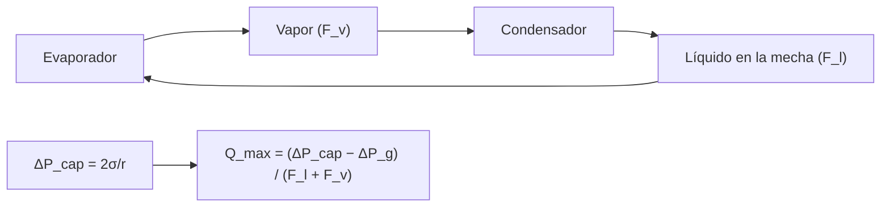

# B85-C09 — Tubos de calor

<!-- nav:top -->
x
<!-- /nav -->

## 1. Ubicación, nivel y alcance

Clase 9 del bloque B85. Nivel N3. Un tubo de calor transporta calor con un fluido que se evapora en un extremo, viaja como vapor y se condensa en el otro; una mecha capilar devuelve el líquido. Aquí calculas el límite capilar con la presión capilar y las caídas de presión del líquido y del vapor, ves cuánto lo reduce la inclinación en un ensayo en tierra y contrastas con una bisección. El fluido, la mecha y la longitud son sintéticos y no se consultaron.

## 2. Por qué esta clase existe

Un tubo de calor es un conductor térmico muy bueno pero tiene un límite de potencia que se descubre tarde: en un ensayo en tierra, o en vuelo con una carga mayor. La decisión central: **¿cuánto calor transporta como máximo un tubo y cuánto pierde en un ensayo con inclinación?** La decisión central: **¿cuánto calor transporta como máximo un tubo y cuánto pierde en un ensayo con inclinación?**

## 3. Lo que podrás hacer al terminar

1. Calcular la presión capilar máxima de una mecha.
2. Calcular las caídas de presión del líquido y del vapor por vatio.
3. Hallar el calor máximo transportable y verificarlo por bisección.
4. Estimar el efecto de la elevación en un ensayo en tierra.
5. Calcular el número de mérito de un fluido.
6. Separar lo consultado (`g`; mención de NASA a los tubos de calor) de lo ilustrativo (todo el fluido y la mecha).

La evidencia es la **ficha de capacidad de un tubo de calor** del ejercicio 12 (sección 20).

## 4. Con qué llegas y cómo comprobarlo

1. ¿Qué es la presión capilar?
2. ¿Qué es el calor latente?
3. ¿Qué mueve el líquido en la mecha?
4. ¿Qué es una caída de presión por Darcy?
5. ¿Qué es una verificación por segunda vía?

<details>
<summary>Ver respuestas</summary>

1. La diferencia de presión a través de un menisco, `2σ cosθ/r`. 2. La energía que absorbe un fluido al cambiar de fase, en J/kg. 3. La presión capilar. 4. `Δp = μ L Q/(ρ K A h_fg)` para un caudal másico `Q/h_fg` en un medio de permeabilidad `K`. 5. Calcular lo mismo con otro método y comparar.
</details>

Con cuatro o cinco aciertos, sigue; si no, repasa los prerrequisitos.

## 5. Un caso de contexto y casos de referencia

Un tubo ilustrativo de amoníaco con mecha de `r_eff = 50 µm` y `L_ef = 0,40 m` transporta como máximo `22,0 W` en horizontal y `18,9 W` si el evaporador está `20 mm` por encima del condensador. Es el **ejemplo conductor**. Todo es **ilustrativo y no consultado**, salvo `g`.

## 6. Vocabulario

El **límite capilar** ocurre cuando la presión capilar máxima `2σ cosθ/r_eff` iguala las caídas de presión: `Q_max = (ΔP_cap − ΔP_g)/(F_l + F_v)`. `F_l` y `F_v` son las caídas por vatio del líquido y del vapor. La **elevación** `ΔP_g = ρ_l g h` se opone al retorno. El **número de mérito** `M = ρ_l σ h_fg/μ_l` compara fluidos. La **longitud efectiva** reúne la mitad de evaporador y condensador más la sección adiabática.

## 7. Modelo mental



*Descripción textual:* el fluido circula en lazo: evapora, viaja como vapor, condensa y vuelve por la mecha; el límite capilar iguala la presión capilar a las pérdidas.

Analogía: una mecha de vela que sube cera líquida contra la gravedad; hay una altura y un caudal máximos. Límite: se omiten los límites sónico, de ebullición y de arrastre y se usa vapor laminar incompresible.

## 8. La explicación, paso a paso

### 8.1 Presión capilar y pérdidas

Con `σ = 0,0213 N/m` y `r_eff = 50 µm`: `ΔP_cap = 2σ/r_eff = 852,0 Pa`. La caída en el líquido, `F_l = μ_l L_ef/(ρ_l K A_w h_fg) = 38,7029 Pa/W`, domina sobre la del vapor, `F_v = 3,12 × 10⁻² Pa/W` (`0,080 %` del total).

### 8.2 Calor máximo

`Q_max = ΔP_cap/(F_l + F_v) = 22,00 W`; la bisección del balance de presiones da `22,00 W`. El número de mérito del fluido es `1,101 × 10¹¹ W/m²`.

### 8.3 Efecto de la elevación

| Elevación (mm) | `ΔP_g` (Pa) | `Q_max` (W) |
|---|---|---|
| 0,0 | 0,00 | 22,00 |
| 2,0 | 11,98 | 21,69 |
| 5,0 | 29,95 | 21,22 |
| 10,0 | 59,90 | 20,45 |
| 20,0 | 119,80 | 18,90 |

La elevación que anula el transporte es `h = ΔP_cap/(ρ_l g) = 142,2 mm`; a `20 mm` el tubo todavía rinde `86 %` de su capacidad horizontal. Un ensayo en tierra exige controlar la elevación a milímetros para no subestimar la capacidad de vuelo.

### 8.4 Escalas

Duplicar `r_eff` o `L_ef` reduce `Q_max` a la mitad (`11,00 W` en ambos casos): una mecha de poros finos y un tubo corto transportan más, pero una mecha más fina reduce la permeabilidad real; aquí `K` se mantuvo fija.

## 9. Magnitudes, símbolos y unidades

| Símbolo | Qué es | Unidad | Valor / nota |
|---|---|---|---|
| `σ` | tensión superficial | N/m | 0,0213 (ilustrativa) |
| `r_eff` | radio efectivo de la mecha | µm | 50 (ilustrativo) |
| `K` | permeabilidad | m² | 10⁻¹⁰ (ilustrativa) |
| `L_ef` | longitud efectiva | m | 0,40 |
| `ΔP_cap` | presión capilar máxima | Pa | 852,0 |
| `Q_max` | calor máximo | W | 22,00 |

## 10. Convenciones y referencias

Amoníaco a `20 °C`, mecha y geometría ilustrativos y no consultados; vapor laminar incompresible (Poiseuille); líquido en medio poroso (Darcy); ángulo de contacto `0°`. `g = 9,820 m/s²` de la ficha de la Tierra. Se omiten los demás límites de transporte.

## 11. De dónde sale lo que afirmamos

| ID | Fuente | Localizador | Respalda | Estado |
|---|---|---|---|---|
| S1 | NASA/NSSDC, Earth Fact Sheet — https://nssdc.gsfc.nasa.gov/planetary/factsheet/earthfact.html (consultada 2026-11-10) | ficha completa | `g = 9,820 m/s²` | Consultada |
| S2 | NASA, State-of-the-Art of Small Spacecraft Technology, capítulo Thermal Control — https://www.nasa.gov/smallsat-institute/sst-soa/thermal-control/ (consultada 2026-11-10) | sección de otros elementos pasivos | los tubos de calor se clasifican como medio pasivo de transporte; la página no da cifras | Consultada |
| — | Límite capilar de un tubo de calor, ley de Darcy y flujo de Poiseuille | — | las verifica el laboratorio con una segunda vía | No consultada en una fuente concreta |

Límites: las propiedades del fluido, de la mecha y de la geometría no se consultaron; no se tratan los límites sónico, de ebullición, de arrastre ni de ebullición; no se dimensiona un tubo real.

## 12. Cómo ver el resultado

| Magnitud | Valor |
|---|---|
| `ΔP_cap` | 852,0 Pa |
| `Q_max` horizontal | 22,00 W |
| `Q_max` a 20 mm | 18,90 W |
| `F_l` | 38,7029 Pa/W |
| `M` | 1,10 × 10¹¹ W/m² |

Descripción larga: el líquido en la mecha limita el transporte; un desnivel de 20 mm en tierra recorta el calor máximo en un 14 %.

## 13. Ejemplo trabajado

**Paso 1 · Capilar.** `ΔP_cap = 2 × 0,0213/(50×10⁻⁶) = 852,0 Pa`.

**Paso 2 · Pérdidas.** `F_l + F_v = 38,7341 Pa/W`.

**Paso 3 · Calor máximo.** `Q_max = 852,0/38,7341 = 22,00 W`.

## 14. Distintas formas de describir el problema

**Por presiones:** capilar frente a pérdidas. **Por calor:** `Q_max`. **Por elevación:** `ΔP_g`. **Por fluido:** número de mérito.

## 15. Práctica guiada

**Ejercicio 1 · con los pasos indicados.** Calcula `ΔP_cap` con `r_eff = 50 µm` y `σ = 0,0213 N/m`. *Pasos:* `2σ/r`.

<details><summary>Solución comentada</summary>

`852,0 Pa`.
</details>

**Ejercicio 2 · con una pista.** Predice `Q_max` si la mecha tiene el doble de permeabilidad. *Pista:* `F_l ∝ 1/K`.

<details><summary>Solución comentada</summary>

`F_l` se divide por 2: `Q_max ≈ 44,0 W`.
</details>

**Ejercicio 3 · casi autónomo.** ¿Por qué se desprecia casi siempre la caída del vapor? Mira `F_v/F_l`.

<details><summary>Solución comentada</summary>

Es `0,080 %` del total: el vapor fluye por un canal grande.
</details>

## 16. Práctica autónoma, transferencia e integrador

**Ejercicio 4 · autónomo.** Calcula `ΔP_g` para `h = 10 mm`.

<details><summary>Solución comentada</summary>

`59,90 Pa`; `Q_max = 20,45 W`.
</details>

**Ejercicio 5 · autónomo.** ¿Qué elevación reduce `Q_max` al 50 %?

<details><summary>Solución comentada</summary>

`ΔP_g = ΔP_cap/2`; `h = 71,1 mm`.
</details>

**Ejercicio 6 · autónomo.** Calcula el calor transportado con `L_ef = 0,2 m`.

<details><summary>Solución comentada</summary>

`Q_max` se duplica: `44,0 W`.
</details>

**Ejercicio 7 · autónomo.** ¿Qué pasa si la mecha tiene `A_w` doble?

<details><summary>Solución comentada</summary>

`F_l` se divide por 2: `Q_max ≈ 44,0 W`.
</details>

**Ejercicio 8 · autónomo.** Un fluido con mérito doble, ¿cuánto transporta?

<details><summary>Solución comentada</summary>

El doble: `44,0 W`.
</details>

**Ejercicio 9 · transferencia.** **Transferencia.** Un ensayo en tierra con el evaporador 5 mm arriba da `21,2 W`. ¿Qué infieres para el vuelo?

<details><summary>Solución comentada</summary>

Que en microgravedad el tubo transporta algo más (`22,0 W` en el modelo); con valores reales, mide con la elevación mínima.
</details>

**Ejercicio 10 · transferencia.** **Transferencia.** Una carga sube de `15` a `25 W`. ¿Qué pasa con este tubo?

<details><summary>Solución comentada</summary>

Supera `Q_max`: se seca el evaporador y la temperatura sube de golpe.
</details>

**Ejercicio 11 · transferencia.** **Transferencia.** Un colega presenta `22 W` como «la capacidad medida de nuestro tubo». ¿Qué corriges?

<details><summary>Solución comentada</summary>

Es un cálculo con propiedades ilustrativas no consultadas; no hay medición.
</details>

**Ejercicio 12 · integrador.** **Integrador.** Elabora tu *ficha de capacidad de un tubo de calor*: `ΔP_cap`, `F_l`, `Q_max` horizontal y con elevación, número de mérito y lista de lo ilustrativo y no consultado.

<details><summary>Solución comentada</summary>

Secciones 8.1–8.4 y la salida del laboratorio.
</details>

## 17. Laboratorio: límite capilar de un tubo

El script [tubos_de_calor.py](tubos_de_calor.py) calcula la presión capilar, las pérdidas, `Q_max` por fórmula y por bisección y el efecto de la elevación (**comprueba** fórmula frente a bisección a 1e-6 W y `Q_max` decreciente con la elevación).

**Datos:** `g` consultada; fluido, mecha y longitud **ilustrativos y no consultados**. **Predice antes de ejecutar:** ¿cuánto calor transporta en horizontal? (22,0 W.) **Ejecución del 2026-11-10 (Python 3.12.9):**

```text
Python 3.12.9 (biblioteca estandar)
Tubo ILUSTRATIVO (amoniaco 20 C, valores no consultados): r_eff = 50 um, K = 1e-10 m2, A_mecha = 20 mm2, L_ef = 0.4 m
Presion capilar maxima = 852.0 Pa ; coef. liquido = 38.70290 Pa/W ; coef. vapor = 3.12e-02 Pa/W
Q_max (horizontal, g -> 0) = 22.00 W ; por biseccion = 22.00 W ; numero de merito = 1.101e+11 W/m2
 elevacion[mm]   dP_g[Pa]   Q_max[W]
           0.0       0.00      22.00
           2.0      11.98      21.69
           5.0      29.95      21.22
          10.0      59.90      20.45
          20.0     119.80      18.90
Elevacion que anula el transporte = 142.2 mm
Radio efectivo doble: Q_max = 11.00 W ; longitud efectiva doble: Q_max = 11.00 W ; fraccion de caida en el vapor = 0.080 %
Pruebas superadas.
```

```bash
python programa/clases/B85/B85-C09-tubos-de-calor/tubos_de_calor.py
```

**Límites:** solo el límite capilar; sin límites sónico ni de ebullición; propiedades a una sola temperatura.

## 18. Errores frecuentes y cómo corregirlos

**Ignorar la gravedad en el ensayo.** `ΔP_g` resta capacidad (8.3)

**Usar el calor latente de otro fluido.** depende del fluido y de `T` (sección 10)

**Esperar que el vapor limite.** domina el líquido (8.1)

**Presentar el cálculo como medición del tubo.** se corrige con la sección 10

## 19. Cómo sabrás que vas bien

Tras la sección 8: ¿qué `Q_max` esperabas en horizontal y cuál obtuviste? Si dudas, repasa el ejemplo 13. Tras el laboratorio: ¿qué comprueba? (ver la sección 17).

## 20. Qué entregas y cómo se evalúa

El producto es tu **ficha de capacidad de un tubo de calor** (ejercicio 12).

| Criterio | Inicial | En desarrollo | Logrado | Destacado |
|---|---|---|---|---|
| Conceptos | Los confunde | Parciales | Calcula `ΔP_cap` y `Q_max` | Explica los límites |
| Cálculo | Sin unidades | Con errores | Tablas completas con unidades | Calcula casos nuevos |
| Numérico | Sin comprobar | Un caso | Contraste con una segunda vía | Interpreta las diferencias |
| Fuentes | Sin fuente | Sin fecha | Fuentes con fecha y estado | Declara lo ilustrativo y lo no consultado |
| Límites | No los nombra | Uno | Tres | Discute qué falta del modelo |

**Condiciones críticas (no se compensan con promedio):** rotular el fluido, la mecha y la geometría como ilustrativos y no consultados; no presentar el cálculo como medición; citar solo lo consultado.

## 21. Ética, seguridad y límites

Clase educativa: los modelos son simplificados y sus datos son sintéticos o ilustrativos; ningún resultado describe una nave real, ni sustituye a los estándares de proyecto, a la verificación con datos de misión ni a una revisión disciplinar. Los valores de este texto no son requisitos de ningún proyecto. Accesibilidad: tablas equivalentes a las gráficas, fórmulas en texto, ejercicios sin conexión.

## 22. Para cerrar y seguir

Un tubo de calor ilustrativo transporta `22,0 W` en horizontal y pierde un 14 % con `20 mm` de elevación. Queda una pregunta: ¿cómo se regula la temperatura con un lazo de control?

**Glosario español–inglés.** tubo de calor · *heat pipe*; límite capilar · *capillary limit*; mecha · *wick*; presión capilar · *capillary pressure*; número de mérito · *merit number*.

**Continuidad.** [B85-C10](../B85-C10-control-termico-activo/CLASE.md) estudia el control térmico activo.

**Referencias:** ver sección 11.

<!-- nav:bottom -->
x
<!-- /nav -->
