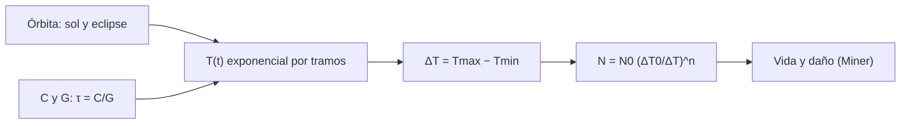

# B85-C11 — Ciclos térmicos

<!-- nav:top -->
x
<!-- /nav -->

## 1. Ubicación, nivel y alcance

Clase 11 del bloque B85. Nivel N3. En órbita baja la nave entra y sale del eclipse unas `5800` veces al año y cada ciclo estira y encoge sus materiales. Aquí obtienes la oscilación de temperatura de un nodo con una solución periódica analítica, la contrastas con la integración numérica y estimas la vida por fatiga con una ley de Coffin–Manson. El nodo, los flujos y la ley de fatiga son sintéticos.

## 2. Por qué esta clase existe

La amplitud térmica de cada ciclo decide la vida por fatiga de soldaduras y uniones, y se reduce con inercia térmica o con calentadores. La decisión central: **¿qué amplitud de ciclo y cuántos ciclos acumula una unión en la misión, y cuánto la reduce la inercia térmica?** La decisión central: **¿qué amplitud de ciclo y cuántos ciclos acumula una unión en la misión, y cuánto la reduce la inercia térmica?**

## 3. Lo que podrás hacer al terminar

1. Calcular las temperaturas mínima y máxima periódicas de un nodo con eclipse.
2. Contrastar la solución analítica con la integración numérica.
3. Calcular ciclos por año y la amplitud `ΔT`.
4. Estimar la vida con una ley de Coffin–Manson ilustrativa.
5. Ver cómo la capacidad térmica reduce `ΔT`.
6. Separar lo calculado (aritmética orbital) de lo ilustrativo (nodo, ley de fatiga).

La evidencia es la **ficha de ciclos y fatiga de una unión** del ejercicio 12 (sección 20).

## 4. Con qué llegas y cómo comprobarlo

1. ¿Qué es la constante de tiempo de un nodo?
2. ¿Qué es una solución periódica?
3. ¿Qué es la fatiga térmica?
4. ¿Qué es la ley de Coffin–Manson?
5. ¿Qué es una verificación por segunda vía?

<details>
<summary>Ver respuestas</summary>

1. `τ = C/G`: el tiempo en que cubre el 63 % de un cambio. 2. La que se repite igual en cada ciclo una vez superado el transitorio. 3. El daño acumulado por ciclos de dilatación y contracción. 4. Una relación potencial entre amplitud de deformación y ciclos hasta la falla. 5. Calcular lo mismo con otro método y comparar.
</details>

Con cuatro o cinco aciertos, sigue; si no, repasa los prerrequisitos.

## 5. Un caso de contexto y casos de referencia

Un nodo de `2000 J/K` con `G = 1,5 W/K` oscila entre `253,10 K` y `277,74 K` (`ΔT = 24,64 K`) en una órbita de `5400 s` con eclipse de `2100 s`; hace `5844` ciclos al año. Es el **ejemplo conductor**. Todo es **ilustrativo**.

## 6. Vocabulario

La **solución periódica** de un nodo lineal por tramos iguala `T` al final de un ciclo con `T` al inicio. La **constante de tiempo** `τ = C/G`. La **amplitud** `ΔT = T_max − T_min`. La **ley de Coffin–Manson** `N = N₀ (ΔT₀/ΔT)ⁿ` da los ciclos hasta la falla. La **regla de Miner** suma el daño `n/N` de cada tramo de carga.

## 7. Modelo mental



*Descripción textual:* la órbita define dos tramos con distinto flujo; el nodo responde con una exponencial en cada uno; la amplitud entra en la ley de fatiga que da la vida.

Analogía: doblar un clip una y otra vez: cuanto más se dobla cada vez, menos veces aguanta. Límite: la ley de Coffin–Manson de la clase es un modelo con constantes ilustrativas; la vida real depende del material, la unión y los ensayos.

## 8. La explicación, paso a paso

### 8.1 Solución periódica

El nodo cumple `C dT/dt = Q − G(T − T_ref)`, con `T_ref = 240 K`. En el sol `T_eq,s = 280,0 K` y en eclipse `T_eq,e = 246,7 K`. Con `τ = C/G`, `T_max = (T_eq,s(1 − e^(−t_s/τ)) + e^(−t_s/τ) T_eq,e(1 − e^(−t_e/τ)))/(1 − e^(−(t_s+t_e)/τ))` y `T_min = T_eq,e + (T_max − T_eq,e)e^(−t_e/τ)`.

### 8.2 La inercia reduce la amplitud

| `C` (J/K) | `τ` (s) | `T_min` (K) | `T_max` (K) | `ΔT` (K) | ciclos hasta falla |
|---|---|---|---|---|---|
| 500 | 333 | 246,73 | 280,00 | 33,27 | 90340 |
| 2000 | 1333 | 253,10 | 277,74 | 24,64 | 164741 |
| 8000 | 5333 | 262,96 | 270,82 | 7,86 | 1617838 |
| 30000 | 20000 | 265,96 | 268,09 | 2,14 | 21921801 |

Con `C = 2000 J/K`, `τ = 1333 s`: la integración numérica tras 30 órbitas da `253,095`–`277,738 K` y la analítica `253,098`–`277,736 K`.

### 8.3 Fatiga

`N = 10⁴ (100/ΔT)²` (ilustrativa). Con `ΔT = 24,64 K`, `N = 164741` ciclos, es decir `28,19` años a `5844` ciclos/año; en 5 años el daño de Miner es `0,18`. Para 15 años hace falta `ΔT ≤ 33,78 K`.

### 8.4 Qué mover

Aumentar la capacidad térmica o el acoplamiento (más `G` lleva a `T_eq` más extremos pero `τ` menor) cambia `ΔT`; un calentador que eleva `T_eq,e` recorta la amplitud. La decisión se evalúa con el modelo y se confirma con ciclado en ensayo (clase C19).

## 9. Magnitudes, símbolos y unidades

| Símbolo | Qué es | Unidad | Valor / nota |
|---|---|---|---|
| `C` | capacidad térmica | J/K | 500–30 000 (ilustrativa) |
| `τ` | constante de tiempo | s | 1333 (C = 2000) |
| `ΔT` | amplitud del ciclo | K | 24,64 |
| `N` | ciclos hasta falla | — | 164741 |
| ciclos/año | ciclos orbitales | 1/año | 5844 |
| `n` | exponente de Coffin–Manson | — | 2,0 (ilustrativo) |

## 10. Convenciones y referencias

Órbita de `5400 s` con eclipse de `2100 s`, nodo isotermo lineal con `G = 1,5 W/K` y `T_ref = 240 K`, absorbidos `60/10 W`; ley de fatiga `N₀ = 10⁴` a `ΔT₀ = 100 K`, `n = 2`. Todo ilustrativo; no hay datos consultados. El año es `365,25 d`.

## 11. De dónde sale lo que afirmamos

| ID | Fuente | Localizador | Respalda | Estado |
|---|---|---|---|---|
| — | Respuesta exponencial por tramos, solución periódica y ley de Coffin–Manson con regla de Miner | — | las verifica el laboratorio con una segunda vía | No consultada en una fuente concreta |

Límites: no se consultó ninguna fuente para esta clase; el nodo, los flujos y las constantes de fatiga son ilustrativos y no corresponden a una unión real; la vida calculada no es una predicción.

## 12. Cómo ver el resultado

| Magnitud | Valor |
|---|---|
| `T_min` / `T_max` (2000 J/K) | 253,10 / 277,74 K |
| `ΔT` | 24,64 K |
| ciclos por año | 5844 |
| vida ilustrativa | 28,19 años |
| numérica − analítica | < 0,05 K |

Descripción larga: cuadruplicar la capacidad térmica reduce la amplitud a un tercio y multiplica la vida por diez.

## 13. Ejemplo trabajado

**Paso 1 · Constante de tiempo.** `τ = 2000/1,5 = 1333 s`.

**Paso 2 · Amplitud.** `ΔT = 277,74 − 253,10 = 24,64 K`.

**Paso 3 · Vida.** `N = 10⁴ (100/24,64)² = 164741`; `/5844 = 28,19` años.

## 14. Distintas formas de describir el problema

**Por tramos:** exponenciales. **Por amplitud:** `ΔT`. **Por vida:** `N`. **Por daño:** `n/N`.

## 15. Práctica guiada

**Ejercicio 1 · con los pasos indicados.** Calcula `τ` para `C = 8000 J/K` y `G = 1,5`. *Pasos:* `C/G`.

<details><summary>Solución comentada</summary>

`5333 s`.
</details>

**Ejercicio 2 · con una pista.** Predice si `ΔT` sube o baja al pasar de `C = 2000` a `8000`. *Pista:* más inercia.

<details><summary>Solución comentada</summary>

Baja: de `24,64` a `7,86 K`.
</details>

**Ejercicio 3 · casi autónomo.** ¿Por qué la numérica y la analítica difieren en milésimas de K? Piensa en el paso y en el transitorio.

<details><summary>Solución comentada</summary>

El paso de `1 s` y las 30 órbitas dejan un error residual de milésimas; valida el código.
</details>

## 16. Práctica autónoma, transferencia e integrador

**Ejercicio 4 · autónomo.** Calcula los ciclos por año con una órbita de `6000 s`.

<details><summary>Solución comentada</summary>

`5259,6`.
</details>

**Ejercicio 5 · autónomo.** Calcula `N` para `ΔT = 50 K`.

<details><summary>Solución comentada</summary>

`10⁴ (100/50)² = 40 000`.
</details>

**Ejercicio 6 · autónomo.** ¿Qué `ΔT` da una vida de 10 años?

<details><summary>Solución comentada</summary>

`ΔT = 100 √(10⁴/(10 × 5844)) = 41,37 K`.
</details>

**Ejercicio 7 · autónomo.** Calcula el daño de Miner de 3 años con `ΔT = 24,64 K`.

<details><summary>Solución comentada</summary>

`3 × 5844/164741 = 0,106`.
</details>

**Ejercicio 8 · autónomo.** ¿Qué pasa con `ΔT` si se enciende un calentador de `5 W` en eclipse?

<details><summary>Solución comentada</summary>

`T_eq,e` sube `5/1,5 = 3,33 K`; `ΔT` baja.
</details>

**Ejercicio 9 · transferencia.** **Transferencia.** Un ensayo de 100 ciclos con `ΔT = 100 K` no produce falla. ¿Qué concluye?

<details><summary>Solución comentada</summary>

Que los 100 ciclos no bastan para decidir la vida: la ley dice `10⁴` ciclos; el ensayo es un punto de control, no una validación.
</details>

**Ejercicio 10 · transferencia.** **Transferencia.** ¿Por qué la misma unión puede vivir distinto en LEO y en GEO?

<details><summary>Solución comentada</summary>

Cambian los ciclos por año (5800 frente a unos 90 eclipses) y `ΔT`; en GEO hay pocos ciclos.
</details>

**Ejercicio 11 · transferencia.** **Transferencia.** Un colega presenta `28 años` como la vida de la unión. ¿Qué corriges?

<details><summary>Solución comentada</summary>

Es un cálculo con constantes ilustrativas, no una vida; falta el material, la unión y el ensayo.
</details>

**Ejercicio 12 · integrador.** **Integrador.** Elabora tu *ficha de ciclos y fatiga de una unión*: tabla de `C`, `τ`, `ΔT`, `N`, vida y daño, contraste numérico–analítico y lista de lo ilustrativo.

<details><summary>Solución comentada</summary>

Secciones 8.1–8.4 y la salida del laboratorio.
</details>

## 17. Laboratorio: ciclos orbitales y fatiga

El script [ciclos_termicos.py](ciclos_termicos.py) calcula la solución periódica, la contrasta con la integración numérica y estima `N`, la vida y el daño (**comprueba** numérica frente a analítica a 0,05 K y `ΔT` decreciente con la inercia).

**Datos:** todo **ilustrativo**; sin datos consultados. **Predice antes de ejecutar:** ¿cuánto baja `ΔT` si la capacidad térmica sube de 2000 a 8000 J/K? (de 24,6 a 7,9 K.) **Ejecución del 2026-11-10 (Python 3.12.9):**

```text
Python 3.12.9 (biblioteca estandar)
Nodo ILUSTRATIVO: G = 1.5 W/K a 240 K ; absorbido sol/eclipse = 60/10 W ; orbita 5400 s, eclipse 2100 s
  C [J/K]   tau [s]  Tmin [K]  Tmax [K]   DT [K]  N hasta falla
      500       333    246.73    280.00    33.27          90340
     2000      1333    253.10    277.74    24.64         164741
     8000      5333    262.96    270.82     7.86        1617838
    30000     20000    265.96    268.09     2.14       21921801
Numerica (C = 2000 J/K, 30 orbitas): Tmin = 253.095 K, Tmax = 277.738 K ; analitica: 253.098 / 277.736 K
Ciclos por anio = 5844.0 ; vida (Coffin-Manson ILUSTRATIVO) con C = 2000 J/K = 28.19 anios ; dano en 5 anios = 0.18
DT maximo para 15 anios de vida = 33.78 K
Pruebas superadas.
```

```bash
python programa/clases/B85/B85-C11-ciclos-termicos/ciclos_termicos.py
```

**Límites:** nodo lineal, flujos constantes por tramo y ley de fatiga ilustrativa.

## 18. Errores frecuentes y cómo corregirlos

**Usar la amplitud de un solo ciclo sin multiplicarla por los ciclos.** la vida es `N/ciclos por año` (8.3)

**Esperar que más `G` reduzca siempre `ΔT`.** cambia `T_eq` y `τ` (8.4)

**Tomar el ciclado en ensayo como validación completa.** es un punto de control (8.3)

**Presentar la vida ilustrada como predicción.** se corrige con la sección 10

## 19. Cómo sabrás que vas bien

Tras la sección 8: ¿qué `ΔT` esperabas con `C = 8000` y cuál obtuviste? Si dudas, repasa el ejemplo 13. Tras el laboratorio: ¿qué comprueba? (ver la sección 17).

## 20. Qué entregas y cómo se evalúa

El producto es tu **ficha de ciclos y fatiga de una unión** (ejercicio 12).

| Criterio | Inicial | En desarrollo | Logrado | Destacado |
|---|---|---|---|---|
| Conceptos | Los confunde | Parciales | Calcula `ΔT`, `N` y la vida | Explica los límites |
| Cálculo | Sin unidades | Con errores | Tablas completas con unidades | Calcula casos nuevos |
| Numérico | Sin comprobar | Un caso | Contraste con una segunda vía | Interpreta las diferencias |
| Fuentes | Sin fuente | Sin fecha | Fuentes con fecha y estado | Declara lo ilustrativo y lo no consultado |
| Límites | No los nombra | Uno | Tres | Discute qué falta del modelo |

**Condiciones críticas (no se compensan con promedio):** rotular el nodo y la ley de fatiga como ilustrativos; no presentar la vida como predicción; citar solo lo consultado (aquí nada).

## 21. Ética, seguridad y límites

Clase educativa: los modelos son simplificados y sus datos son sintéticos o ilustrativos; ningún resultado describe una nave real, ni sustituye a los estándares de proyecto, a la verificación con datos de misión ni a una revisión disciplinar. Los valores de este texto no son requisitos de ningún proyecto. Accesibilidad: tablas equivalentes a las gráficas, fórmulas en texto, ejercicios sin conexión.

## 22. Para cerrar y seguir

Un nodo de `2000 J/K` oscila `24,64 K` por órbita y suma `5844` ciclos al año; con cuatro veces más inercia la amplitud baja a `7,86 K`. Queda una pregunta: ¿qué entorno rodea a esos ciclos, empezando por el vacío?

**Glosario español–inglés.** ciclo térmico · *thermal cycle*; constante de tiempo · *time constant*; fatiga · *fatigue*; Coffin–Manson · *Coffin–Manson*; regla de Miner · *Miner's rule*.

**Continuidad.** [B85-C12](../B85-C12-entorno-de-vacio/CLASE.md) estudia el entorno de vacío.

**Referencias:** ver sección 11.

<!-- nav:bottom -->
x
<!-- /nav -->
