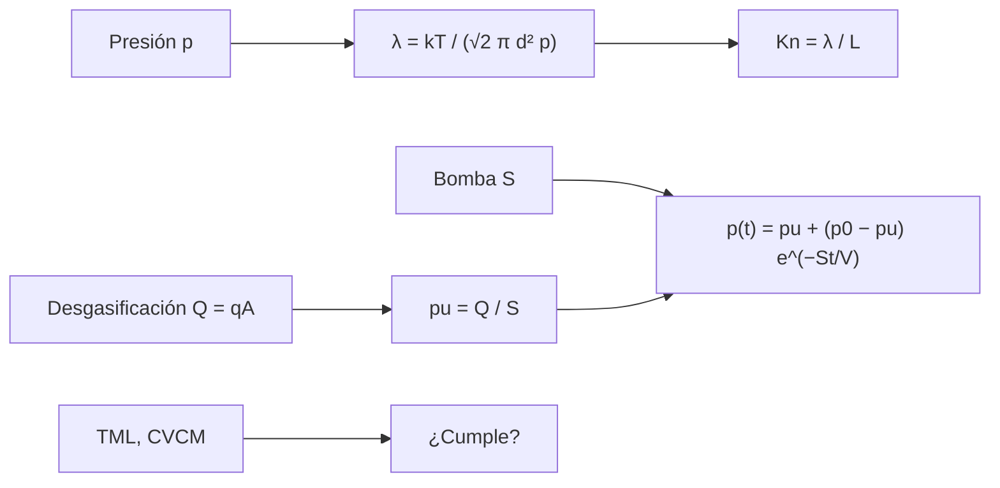

# B85-C12 — Entorno de vacío

<!-- nav:top -->
[🏠 Programa](../../../../README.md) · [📚 Bloque B85](../../../tronco-comun/B85-gestion-termica-y-entorno-espacial.md) · [← Anterior: B85-C11 — Ciclos térmicos](../B85-C11-ciclos-termicos/CLASE.md) · [Siguiente: B85-C13 — Efectos de oxígeno atómico →](../B85-C13-efectos-de-oxigeno-atomico/CLASE.md)
<!-- /nav -->

## 1. Ubicación, nivel y alcance

Clase 12 del bloque B85. Nivel N3. El vacío espacial no es «nada»: es un gas tan raro que las moléculas casi no chocan entre sí, y los materiales sueltan gases. Aquí calculas el camino libre medio y el número de Knudsen, el tiempo de bombeo de una cámara con desgasificación y el cumplimiento de un criterio de masa perdida. Las presiones por altitud, la cámara y los materiales son sintéticos o de orden de magnitud no consultado.

## 2. Por qué esta clase existe

El vacío cambia cómo el gas conduce el calor, cómo se desgasifican los materiales y cuánto tarda un ensayo. La decisión central: **¿cuánto tarda una cámara en llegar a la presión de ensayo y qué la limita?** La decisión central: **¿cuánto tarda una cámara en llegar a la presión de ensayo y qué la limita?**

## 3. Lo que podrás hacer al terminar

1. Calcular el camino libre medio y el número de Knudsen.
2. Distinguir régimen continuo, de transición y molecular.
3. Calcular el tiempo de bombeo con una velocidad de bombeo y una desgasificación.
4. Obtener la presión límite `Q/S` y contrastar con RK4.
5. Aplicar un criterio de masa perdida a materiales sintéticos.
6. Separar lo consultado (`k_B`) de lo ilustrativo y no consultado (presiones por altitud, cámara, criterio).

La evidencia es la **ficha de la cámara y del entorno de vacío** del ejercicio 12 (sección 20).

## 4. Con qué llegas y cómo comprobarlo

1. ¿Qué es el camino libre medio?
2. ¿Qué es el número de Knudsen?
3. ¿Qué es una velocidad de bombeo?
4. ¿Qué es la desgasificación?
5. ¿Qué es una verificación por segunda vía?

<details>
<summary>Ver respuestas</summary>

1. La distancia media entre choques de una molécula. 2. `Kn = λ/L`, el cociente entre el camino libre medio y la escala del sistema. 3. El volumen por segundo que extrae una bomba, en m³/s. 4. La liberación de gas de las superficies y de los materiales en el vacío. 5. Calcular lo mismo con otro método y comparar.
</details>

Con cuatro o cinco aciertos, sigue; si no, repasa los prerrequisitos.

## 5. Un caso de contexto y casos de referencia

Una cámara de `2 m³` con una bomba de `0,5 m³/s` y `20 m²` de superficie que desgasifica `2 × 10⁻⁶ Pa m³/(s m²)` llega a `10⁻³ Pa` en `74 s` y su presión límite es `8,0 × 10⁻⁵ Pa`. Es el **ejemplo conductor**. Todo es **ilustrativo**; `k_B` es exacta del SI.

## 6. Vocabulario

El **camino libre medio** es `λ = k_B T/(√2 π d² p)`. El **número de Knudsen** `Kn = λ/L` separa continuo (`Kn ≪ 1`) de molecular (`Kn ≫ 1`). La **velocidad de bombeo** `S` y la **carga de gas** `Q = q A` fijan `p(t) = p_u + (p₀ − p_u)e^(−St/V)` con `p_u = Q/S`. La **masa perdida total (TML)** y los **volátiles condensables (CVCM)** miden la desgasificación de un material.

## 7. Modelo mental



*Descripción textual:* la presión fija el camino libre medio y el régimen; la bomba y la desgasificación fijan la curva de bombeo y la presión límite; los materiales se filtran por masa perdida.

Analogía: vaciar una bañera con una fuga: baja rápido al principio y se estabiliza cuando el caudal que entra iguala al que sale. Límite: la bomba se supone de velocidad constante y el gas ideal; en realidad `S` baja a baja presión y la desgasificación decae con el tiempo.

## 8. La explicación, paso a paso

### 8.1 Régimen

Con `d = 0,37 nm` y `T = 300 K`:

| `h` (km) | `p` (Pa) | `λ` (m) | `Kn` (`L = 1 m`) |
|---|---|---|---|
| 0 | 1,0 × 10⁵ | 6,72 × 10⁻⁸ | 6,72 × 10⁻⁸ |
| 100 | 3,2 × 10⁻² | 2,13 × 10⁻¹ | 2,13 × 10⁻¹ |
| 200 | 1,0 × 10⁻⁴ | 6,81 × 10¹ | 6,81 × 10¹ |
| 400 | 1,0 × 10⁻⁵ | 6,81 × 10² | 6,81 × 10² |
| 800 | 1,0 × 10⁻⁷ | 6,81 × 10⁴ | 6,81 × 10⁴ |

Las presiones por altitud son órdenes de magnitud ilustrativos y no consultados. A `1 atm`, `λ ≈ 6,7 × 10⁻⁸ m`: continuo. A `100 km` ya es transicional (`Kn ≈ 0,21`) y por encima de `200 km` es molecular libre: la convección y la conducción por gas desaparecen (clase C03).

### 8.2 Bombeo

`p_u = Q/S = 8,0 × 10⁻⁵ Pa` y `V/S = 4,0 s`. Llegar a `10² Pa` toma `27,7 s`, a `10⁻² Pa`, `64,6 s` y a `10⁻³ Pa`, `74,1 s`. La integración RK4 da `p(t) = 1,000000 × 10⁻³ Pa`, igual al objetivo `10⁻³`.

### 8.3 Qué limita

Cerca de `p_u` la presión baja muy poco: duplicar la desgasificación duplica la presión límite (`1,6 × 10⁻⁴ Pa`). Por eso un ensayo de vacío térmico exige limpieza y materiales de baja desgasificación.

### 8.4 Materiales

Con el criterio ilustrativo `TML ≤ 1,0 %` y `CVCM ≤ 0,10 %` (no consultado): A (sintetico): TML 0,45 %, CVCM 0,02 % → cumple; B (sintetico): TML 1,40 %, CVCM 0,05 % → no cumple; C (sintetico): TML 0,80 %, CVCM 0,15 % → no cumple. Un material puede fallar por masa perdida o por condensables.

## 9. Magnitudes, símbolos y unidades

| Símbolo | Qué es | Unidad | Valor / nota |
|---|---|---|---|
| `λ` | camino libre medio | m | 6,72 × 10⁻⁸ (1 atm) |
| `Kn` | número de Knudsen | — | según `L` |
| `V`, `S` | volumen y bombeo | m³; m³/s | 2; 0,5 |
| `q` | desgasificación específica | Pa m³/(s m²) | 2 × 10⁻⁶ (ilustrativa) |
| `p_u` | presión límite | Pa | 8,0 × 10⁻⁵ |
| `TML`, `CVCM` | masa perdida y condensables | % | criterio ilustrativo |

## 10. Convenciones y referencias

`k_B` exacta del SI. Gas ideal, un solo diámetro molecular, temperatura `300 K`; presiones por altitud de orden de magnitud no consultado; cámara y bomba ilustrativas; criterio `TML`/`CVCM` ilustrativo y no consultado (no es el de ningún proyecto). Pascal como unidad de presión (`1 mbar = 100 Pa`).

## 11. De dónde sale lo que afirmamos

| ID | Fuente | Localizador | Respalda | Estado |
|---|---|---|---|---|
| — | Camino libre medio, ecuación de bombeo con carga de gas y criterio de masa perdida | — | las verifica el laboratorio con una segunda vía | No consultada en una fuente concreta |

Límites: no se consultó ninguna fuente para esta clase; las presiones por altitud son órdenes de magnitud sin fecha ni modelo; el criterio de masa perdida es ilustrativo; ECSS y ASTM no se consultaron.

## 12. Cómo ver el resultado

| Magnitud | Valor |
|---|---|
| `λ` a 1 atm | 6,72 × 10⁻⁸ m |
| `p_u` | 8,0 × 10⁻⁵ Pa |
| tiempo a `10⁻³ Pa` | 74,1 s |
| RK4 a `t_1e−3` | 1,000000 × 10⁻³ Pa |
| materiales que cumplen | A |

Descripción larga: el bombeo cae exponencialmente hasta la presión límite, que fija la desgasificación; el régimen pasa de continuo a molecular entre el suelo y 200 km.

## 13. Ejemplo trabajado

**Paso 1 · Presión límite.** `p_u = 2×10⁻⁶ × 20/0,5 = 8,0 × 10⁻⁵ Pa`.

**Paso 2 · Tiempo a `10⁻³ Pa`.** `t = −(V/S) ln((p − p_u)/(p₀ − p_u)) = 74,1 s`.

**Paso 3 · Verificación.** RK4 integra la ecuación y da `1,000000 × 10⁻³ Pa`.

## 14. Distintas formas de describir el problema

**Por camino libre:** `λ`, `Kn`. **Por tiempo:** `t(p)`. **Por límite:** `p_u = Q/S`. **Por material:** TML y CVCM.

## 15. Práctica guiada

**Ejercicio 1 · con los pasos indicados.** Calcula `V/S` para `V = 5 m³` y `S = 1 m³/s`. *Pasos:* divide.

<details><summary>Solución comentada</summary>

`5 s`.
</details>

**Ejercicio 2 · con una pista.** Predice `p_u` si la superficie desgasificante se duplica. *Pista:* `p_u ∝ Q`.

<details><summary>Solución comentada</summary>

`1,6 × 10⁻⁴ Pa`.
</details>

**Ejercicio 3 · casi autónomo.** ¿Por qué RK4 y la fórmula coinciden a `1e-5`? Piensa en qué valida.

<details><summary>Solución comentada</summary>

Integra la misma ecuación diferencial: valida el código, no el modelo de bomba.
</details>

## 16. Práctica autónoma, transferencia e integrador

**Ejercicio 4 · autónomo.** ¿A qué presión `λ = 1 m`?

<details><summary>Solución comentada</summary>

`p = k_B T/(√2 π d² λ) = 6,81 × 10⁻³ Pa`.
</details>

**Ejercicio 5 · autónomo.** Calcula el tiempo para llegar a `1 Pa`.

<details><summary>Solución comentada</summary>

`46,1 s`.
</details>

**Ejercicio 6 · autónomo.** Calcula `Kn` a `200 km` con `L = 0,1 m`.

<details><summary>Solución comentada</summary>

`6,81 × 10²`: molecular.
</details>

**Ejercicio 7 · autónomo.** Con `S = 1 m³/s`, ¿cuánto vale `p_u`?

<details><summary>Solución comentada</summary>

`4,0 × 10⁻⁵ Pa`.
</details>

**Ejercicio 8 · autónomo.** ¿Qué pasa con el tiempo a `10⁻³ Pa` si `S` se duplica?

<details><summary>Solución comentada</summary>

`t = 36,9 s`, menor, y `p_u` también baja.
</details>

**Ejercicio 9 · transferencia.** **Transferencia.** Un equipo tiene `TML = 1,2 %`. ¿Qué hace en un satélite con un sensor óptico sensible?

<details><summary>Solución comentada</summary>

Con este criterio ilustrativo no cumple; los volátiles pueden condensarse en las ópticas, hay que cambiarlo o hornearlo.
</details>

**Ejercicio 10 · transferencia.** **Transferencia.** ¿Por qué no puedes usar `λ = 6,7 × 10⁻⁸ m` a `400 km`?

<details><summary>Solución comentada</summary>

Es el valor a `1 atm`; a `400 km` `λ` es de cientos de metros.
</details>

**Ejercicio 11 · transferencia.** **Transferencia.** Un colega afirma que «en el espacio la presión es cero». ¿Qué respondes?

<details><summary>Solución comentada</summary>

Es muy baja, no nula; sus valores dependen de la altitud y del modelo, que aquí no se consultó.
</details>

**Ejercicio 12 · integrador.** **Integrador.** Elabora tu *ficha de la cámara y del entorno de vacío*: `λ` y `Kn` por altitud, curva de bombeo, `p_u`, tiempos a tres presiones y lista de lo ilustrativo y no consultado.

<details><summary>Solución comentada</summary>

Secciones 8.1–8.4 y la salida del laboratorio.
</details>

## 17. Laboratorio: camino libre medio y bombeo

El script [vacio.py](vacio.py) calcula `λ` y `Kn` por altitud, la curva de bombeo con desgasificación, la contrasta con RK4 y aplica el criterio de masa perdida a tres materiales sintéticos (**comprueba** RK4 frente a la solución analítica a 1e-5 y orden de tiempos).

**Datos:** `k_B` exacta; presiones por altitud (orden de magnitud no consultado), cámara, desgasificación y materiales **ilustrativos y sintéticos**. **Predice antes de ejecutar:** ¿cuál es la presión límite? (8 × 10⁻⁵ Pa.) **Ejecución del 2026-11-10 (Python 3.12.9):**

```text
Python 3.12.9 (biblioteca estandar)
Camino libre medio (aire ILUSTRATIVO, T = 300 K, d = 0.37 nm) y Knudsen para L = 1 m; presiones por altitud: ORDEN DE MAGNITUD no consultado
  h [km]      p [Pa]    lambda [m]   Kn=lambda/L
       0    1.01e+05     6.721e-08     6.721e-08
     100    3.20e-02     2.128e-01     2.128e-01
     200    1.00e-04     6.810e+01     6.810e+01
     400    1.00e-05     6.810e+02     6.810e+02
     800    1.00e-07     6.810e+04     6.810e+04
Camara ILUSTRATIVA: V = 2.0 m3, S = 0.5 m3/s, desgasificacion = 2e-06 Pa m3/(s m2) sobre 20 m2
Presion limite = Q/S = 8.00e-05 Pa ; constante de tiempo V/S = 4.0 s
Tiempo hasta 1e2 Pa = 27.7 s ; hasta 1e-2 Pa = 64.6 s ; hasta 1e-3 Pa = 74.1 s
p(t_1e-3) por RK4 = 1.000000e-03 Pa (objetivo 1e-3)
Con desgasificacion doble la presion limite sube a 1.60e-04 Pa
  Material A (sintetico): TML = 0.45 %, CVCM = 0.02 % -> cumple el criterio ilustrativo
  Material B (sintetico): TML = 1.40 %, CVCM = 0.05 % -> no cumple el criterio ilustrativo
  Material C (sintetico): TML = 0.80 %, CVCM = 0.15 % -> no cumple el criterio ilustrativo
Pruebas superadas.
```

```bash
python programa/clases/B85/B85-C12-entorno-de-vacio/vacio.py
```

**Límites:** `S` constante, gas ideal, desgasificación constante; no es un modelo de cámara real.

## 18. Errores frecuentes y cómo corregirlos

**Creer que hay convección en el espacio.** `Kn` alto: no hay medio (8.1)

**Confundir mbar con Pa.** `1 mbar = 100 Pa` (sección 10)

**Ignorar la desgasificación.** fija `p_u` (8.3)

**Presentar presiones por altitud como datos.** son órdenes de magnitud no consultados (sección 10)

## 19. Cómo sabrás que vas bien

Tras la sección 8: ¿qué presión límite esperabas y cuál obtuviste? Si dudas, repasa el ejemplo 13. Tras el laboratorio: ¿qué comprueba? (ver la sección 17).

## 20. Qué entregas y cómo se evalúa

El producto es tu **ficha de la cámara y del entorno de vacío** (ejercicio 12).

| Criterio | Inicial | En desarrollo | Logrado | Destacado |
|---|---|---|---|---|
| Conceptos | Los confunde | Parciales | Calcula `λ`, `Kn` y `p_u` | Explica los límites |
| Cálculo | Sin unidades | Con errores | Tablas completas con unidades | Calcula casos nuevos |
| Numérico | Sin comprobar | Un caso | Contraste con una segunda vía | Interpreta las diferencias |
| Fuentes | Sin fuente | Sin fecha | Fuentes con fecha y estado | Declara lo ilustrativo y lo no consultado |
| Límites | No los nombra | Uno | Tres | Discute qué falta del modelo |

**Condiciones críticas (no se compensan con promedio):** rotular las presiones, la cámara y el criterio como ilustrativos y no consultados; no presentar valores de orden de magnitud como datos; citar solo lo consultado.

## 21. Ética, seguridad y límites

Clase educativa: los modelos son simplificados y sus datos son sintéticos o ilustrativos; ningún resultado describe una nave real, ni sustituye a los estándares de proyecto, a la verificación con datos de misión ni a una revisión disciplinar. Los valores de este texto no son requisitos de ningún proyecto. Accesibilidad: tablas equivalentes a las gráficas, fórmulas en texto, ejercicios sin conexión.

## 22. Para cerrar y seguir

Una cámara de `2 m³` llega a `10⁻³ Pa` en `74 s` y no baja de `8,0 × 10⁻⁵ Pa` por la desgasificación. Queda una pregunta: ¿qué le hace al material el oxígeno atómico residual de la órbita baja?

**Glosario español–inglés.** camino libre medio · *mean free path*; número de Knudsen · *Knudsen number*; velocidad de bombeo · *pumping speed*; desgasificación · *outgassing*; masa perdida total · *total mass loss*.

**Continuidad.** [B85-C13](../B85-C13-efectos-de-oxigeno-atomico/CLASE.md) estudia los efectos del oxígeno atómico.

**Referencias:** ver sección 11.

<!-- nav:bottom -->
---

[← Anterior: B85-C11 — Ciclos térmicos](../B85-C11-ciclos-termicos/CLASE.md) · [📚 Bloque B85](../../../tronco-comun/B85-gestion-termica-y-entorno-espacial.md) · [Siguiente: B85-C13 — Efectos de oxígeno atómico →](../B85-C13-efectos-de-oxigeno-atomico/CLASE.md)
<!-- /nav -->
